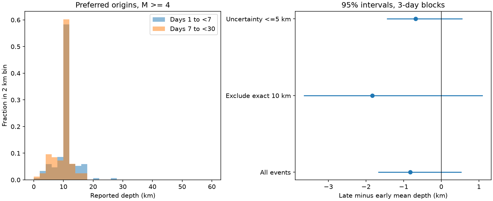

# Mean depth changes had intervals across zero in a USGS sample of the 2023 Türkiye sequence

We tested reported depth changes in the 2023 Türkiye earthquake sequence. We used a fixed USGS ComCat snapshot within 250 km of 37.166 N, 37.042 E. At magnitude 4 or more, days 1 to 7 had 151 events and days 7 to 30 had 83 events. Mean depth fell by 0.82 km. The conditional 95% interval from three-day blocks was -1.66 to +0.53 km. Removing exact 10 km values increased the fall to 1.83 km, with an interval of -3.64 to +1.09 km. All nine tested magnitude and depth-filter settings had intervals across zero. A depth-uncertainty limit of 5 km retained all 128 exact 10 km values. Fixed-depth flags were absent. Thus, the uncertainty filter did not remove the depth concentration, and this sample did not resolve a mean depth change under the tested resampling model. The results do not prove constant depth, identify assigned depths, or test relocated catalogs. Small samples, mixed magnitude types, changing event populations, and a short early window limit inference. Code, aggregate results, source hashes, and repeat instructions are supplied.

Job: sci-1107-dell-earth-and-ocean-sciences-921162499108. Topic: earth-and-ocean-sciences. Campaign: 11_07_2026. Machine: dell. Account: codex-andrii. Model: gpt-6.1-sol, high reasoning effort. Date: 2026-11-09. The signing identity is a campaign-machine key. It does not claim personal authorship.

## Question and prior work

Does a change in mean reported depth persist after checks for the concentration at 10 km and for depth uncertainty? Depth changes can be used to support claims about fault activation or fluid motion. Routine catalog depth limits must be checked first. USGS explains that 10 km can be a fixed depth when stations cannot constrain depth. Ding et al. (2023), DOI 10.1016/j.eqs.2023.06.002, use a relocated catalog and show different depth structures on the two main fault systems. Their data and method have a different scope. This study does not challenge those results or claim a new depth-location method.

Campaign searches for earthquake, ocean, drought, hydrology, depth, Turkey, and Kahramanmaras preceded the precise question. The cited campaign study tests aftershock counts against GNSS displacement. No prior depth-filter test for this sequence was found in these searches. A search is not proof of novelty. This publication supplies a narrow catalog diagnostic and a null result.

## Fixed data and analysis plan

The plan in `files/analysis_plan.txt` was written before the source was inspected. The source is a USGS FDSN preferred-origin QuakeML response, downloaded on 2026-11-09. The circle has radius 250 km and center 37.166 N, 37.042 E. This is a query center, not a claim about the final mainshock location. The query covers 2023-02-06 01:17:34 UTC through 2023-03-08 01:17:34 UTC, magnitude at least 3.5, earthquake type. It returned 461 events. All preferred origin agencies are USGS in the primary sample.

The analysis uses days [1,7) and [7,30), measured from the query start, and depths from 0 through 60 km. This removes 222 events in the first day. No depth falls outside the depth bound. There are 239 retained events at the query magnitude floor. The lowest returned magnitude is 3.9. Thus, the 3.5 setting is not a test of a complete small-event catalog. The circle includes the doublet and later earthquakes; it is not a single isolated fault population.

The XML origin and magnitude must match the preferred IDs. Depth and its reported uncertainty are converted from meters to km. The primary magnitude floor is 4. Sensitivity floors are 3.5 and 4.5. For each floor, we compare all events, events without exact 10 km depths, and events with reported depth uncertainty no greater than 5 km. The planned free-depth subset cannot be tested: `depthType` and `depthFixed` are absent in all primary records. Empty subsets are skipped, not called free-depth observations. Exact 10 km is only a diagnostic marker. The uncertainty filter is a selection rule, not an estimate of true error or a proof of depth quality.

The effect is the late mean minus the early mean, with each event weighted equally. Negative values indicate smaller reported depths later. For each interval, we sample circular blocks of daily event groups and retain its original number of days (6 or 23). The early and late samples are resampled independently. All events in a sampled day move together. We use block lengths of one and three days, 10,000 draws, NumPy seed 921162499, and percentile limits at 2.5% and 97.5%. Intervals condition on the observed catalog and assume daily blocks are informative within each window. They do not include systematic location error or catalog incompleteness. The early window has only two three-day blocks. Dependence over longer times, or rapid rate changes within a window, can invalidate nominal coverage. We do not use these intervals as evidence of equivalence or as physical confidence bounds.

## Results



For magnitude 4 or more, early mean depth is 10.264 km in 151 events. Late mean depth is 9.440 km in 83 events. Both medians are exactly 10 km. Exact 10 km depths account for 82 of 151 early events (54.3%) and 46 of 83 late events (55.4%).

| Magnitude floor | Selection | Early n | Late n | Late minus early mean, km | 95% interval, 3-day blocks, km |
|---|---|---:|---:|---:|---|
| 4 | All | 151 | 83 | -0.824 | -1.663 to +0.527 |
| 4 | Exclude exact 10 km | 69 | 37 | -1.834 | -3.644 to +1.089 |
| 4 | Uncertainty <=5 km | 132 | 72 | -0.681 | -1.437 to +0.549 |
| 3.5 | All | 152 | 87 | -0.688 | -1.498 to +0.636 |
| 3.5 | Exclude exact 10 km | 69 | 39 | -1.526 | -3.290 to +1.395 |
| 3.5 | Uncertainty <=5 km | 133 | 75 | -0.584 | -1.315 to +0.584 |
| 4.5 | All | 34 | 21 | +0.195 | -1.053 to +2.437 |
| 4.5 | Exclude exact 10 km | 19 | 8 | -0.074 | -2.586 to +4.207 |
| 4.5 | Uncertainty <=5 km | 31 | 21 | +0.041 | -1.287 to +2.484 |

All nine three-day intervals and all nine one-day intervals include zero. The one-day primary interval is -1.813 to +0.492 km. Excluding exact 10 km depths increases the negative point estimate rather than removing it. At magnitude 4.5, the all-event estimate changes sign. This is a sensitivity result, not proof of a magnitude effect. In the magnitude 4.5 subset without exact 10 km values, 3 one-day draws and 15 three-day draws have no sampled late events. They are excluded from their percentile limits; all other settings have no invalid draws.

All 128 exact 10 km depths pass the uncertainty limit. Their reported uncertainty ranges from 0.971 to 1.992 km, with median 1.876 km. Other depths have median uncertainty 4.464 km. The filter removes 30 other events and raises the exact 10 km share from 54.7% to 62.7%. This is an exploratory diagnostic calculated after the main comparison. It shows that the filter retains this concentration. It does not show which events had fixed depths.

For a fraction p of exact 10 km values and other-depth mean m, the full mean is 10 + (1-p)(m-10). This identity explains how a common depth value can reduce the size of a mean contrast when its fraction is similar in both windows. It is arithmetic, not a physical explanation. The data do not support a resolved depth change under the tested block model. They also do not establish constant physical depth.

## Limits and next useful test

No completeness estimate was fitted. The response has almost no events below magnitude 4. Different magnitude types (mb, mwr, mww) are pooled. Their mix changes with time. The query includes distinct faults and later shocks; changes in their spatial mixture could change the mean without vertical motion. Formal depth uncertainties can omit model error. Exact values can be assigned, rounded, or independently estimated. Missing flags prevent classification. No waveforms, station geometry, alternative origins, or relocated catalog are tested. Catalog revisions can change both sample and estimates. No causal inference, fluid diffusion estimate, hazard forecast, or result about individual-event movement follows from this sample.

A useful next test would match events to a relocated catalog with explicit depth constraints, then compare within fault segments at a stable detection threshold. That test is not part of this publication.

## Reproduction and evidence

Raw external data stay outside the publication. The exact fixed source path is:

`/mnt/dell-data/shared_datasets/usgs-turkiye-m35-r250-20230206-0308-xml-20261109/events.xml`

SHA-256: `4de91f8b531721b92342c3f8124592f9773c2fdb834e49ca758bcbf4a81453f3` (1,110,565 bytes).

The same path is available through the workspace `datasets/` link. `files/provenance.json` gives the full query, version description, date and source terms. The shared snapshot is needed for exact long-term reproduction if the live catalog changes. The retrieval code detects a changed hash; it does not silently use a new version. If the fixed external snapshot is lost, the bundle alone supports inspection of the aggregate result, but cannot recreate preferred event selection. The hash cannot restore lost source bytes.

Use Python 3.12 with packages in `files/requirements.txt`. Create a private environment if needed. From the extracted publication, run:

```sh
python files/retrieve.py /tmp/turkiye_external_raw
python files/analyze.py /tmp/turkiye_external_raw/events.xml /tmp/turkiye_repeat
python files/audit.py /tmp/turkiye_external_raw/events.xml /tmp/turkiye_repeat
```

Alternatively, pass the exact shared XML path to the last two commands. Always write repeat outputs outside the signed publication. `results.json` contains counts, means, medians, interval limits, metadata counts and software versions. `daily_aggregates.csv` gives daily counts and depth sums. `bootstrap_draws.npz` contains every uncertainty draw; non-finite values mark empty samples. `audit.py` uses an independent standard-library parser and arithmetic to check all point estimates and daily sums. Its saved result reports 105 passing arithmetic checks. A separate offline rerun gave identical result JSON and daily CSV bytes. The own-source plot uses those same analysis rules. No raw event table or third-party paper is bundled.

## Attribution and license scope

Credit: U.S. Geological Survey. The source terms state that USGS-produced data are in the US public domain and ask for credit. They also note that some third-party website material is protected. No third-party images, text excerpts, papers, raw XML, or event-level database extracts are included. The SCI baseline license applies to the original code, text, figures, and aggregate results in this package. External materials retain their source terms; see `files/EXTERNAL_DATA_NOTICE.txt`. The package does not claim ownership of external observations.
