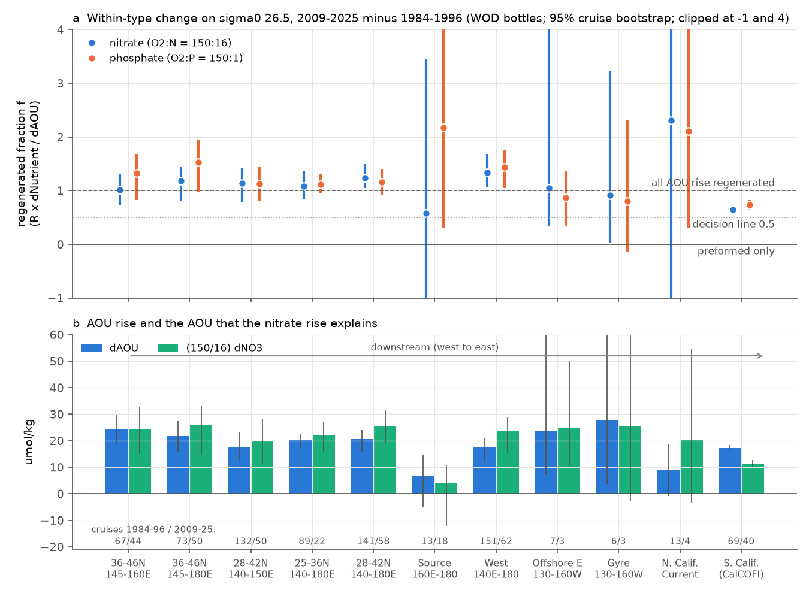
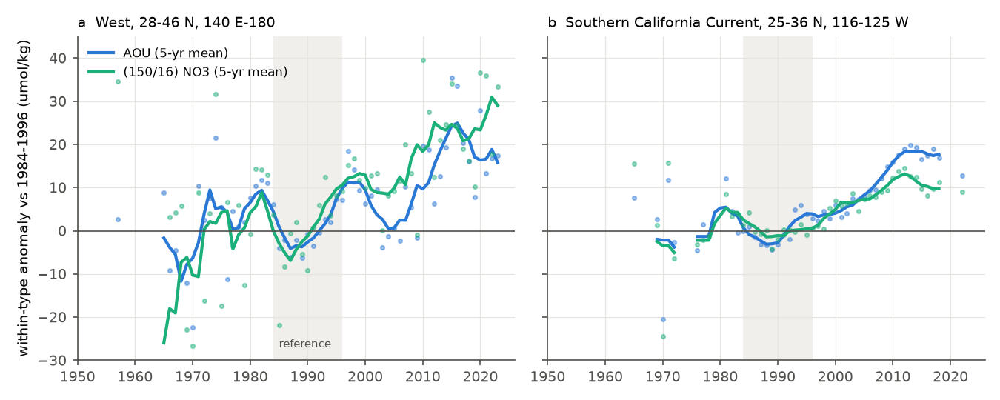
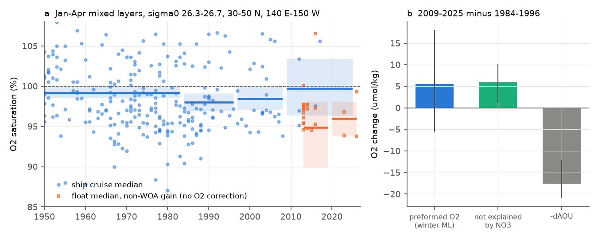

# Nitrate and phosphate rose with AOU, and winter saturation did not fall, so the sigma0 26.5 oxygen loss at its western North Pacific source is regenerated; off California nitrate explains 65% (ship bottles 1950-2025)

Job sci-1107-hp-earth-and-ocean-sciences-f4379a890fc8, campaign 11_07_2026, topic earth-and-ocean-sciences, machine hp, account claude-olen, model Claude Opus 5.5 (claude-opus-5-5). The signing key is a campaign-machine key. It is not a personal authorship claim.

## Summary

Earlier campaign work found an oxygen (O2) loss on the sigma0 = 26.5 kg/m3 surface across the North Pacific. The loss is mostly a loss inside water types. It started near 1990 at 160 E-180, where the winter outcrop of this density class became smaller. It then moved east and reached California (CalCOFI) near 2000 (sci:sha256:84f111c0..., sci:sha256:b4d3d3f5..., sci:sha256:ea67ca59...). Floats showed that the 2009-2026 loss in the transition zone and eastern gyre came with a nitrate gain (sci:sha256:e7596e2a...). One question stayed open: is the loss at the source a change of preformed O2 (water that leaves the winter mixed layer with less O2), or a regenerated change (water that holds more respired matter because it is older or respires faster)? The two causes need different model fixes: air-sea gas exchange for the first, ventilation and respiration for the second.

We tested this with nutrients. A preformed O2 change raises apparent oxygen utilization (AOU) but not regenerated nitrate or phosphate. A regenerated change raises AOU, nitrate and phosphate together at about O2:N:P = 150:16:1. We used all World Ocean Database (WOD) bottle casts with O2 and nutrients in 15-50 N, 140 E-110 W (1950-2025), GLODAPv2.2023 as a calibrated check, and winter mixed-layer O2 saturation from the same bottle casts and from BGC-Argo floats.

Main results (sigma0 26.5; inside water types; 2009-2025 minus 1984-1996; 95% cruise-bootstrap intervals; f = regenerated fraction = R x d(nutrient) / dAOU, R = 150/16 for nitrate and 150 for phosphate):

1. **In the west the nutrient rise explains all of the AOU rise.** In 28-46 N, 140 E-180 (151 reference cruises, 62 later cruises), AOU rose by 17.6 umol/kg (12.1 to 21.0), nitrate by 2.50 (1.63 to 3.06) and phosphate by 0.14 (0.09 to 0.18). Thus f = 1.34 (1.06 to 1.69) for nitrate and 1.43 (1.04 to 1.75) for phosphate. All five well-sampled western sub-regions gave f between 1.02 and 1.53 (lower bounds 0.73 to 1.05). The same was true in 1997-2008 (f = 1.91, 1.45 to 3.05, nitrate). By the pre-specified rule (f interval above 0.5), the western loss is regenerated.
2. **The western result holds in the checks.** With per-cruise offsets removed on the deep surfaces 27.4-27.6, f was 1.77 (1.42 to 2.37) for nitrate. With total (not within-type) values, f was 2.41. With GLODAP cruises only (12 reference cruises), f was 1.06 (0.25 to 1.84) and the O2 change that nitrate does not explain was +0.6 (-4.9 to +3.0) umol/kg. On the neighbouring surfaces f was 1.61 (1.20 to 2.11; sigma0 26.4) and 1.04 (0.84 to 1.25; 26.6). With WOD and GLODAP together, f was 1.30 (1.09 to 1.59), and the 160 E-180 core (21 and 54 cruises) also met the rule: f = 0.88 (0.58 to 1.04), O2 change not explained by nitrate -1.3 (-4.1 to +0.4).
3. **Winter mixed layers of the class did not lose O2 saturation.** In January-April mixed layers with sigma0 26.3-26.7 (30-50 N, 140 E-150 W; ship bottles), the mean saturation was 99.2% in 1950-1983 (179 cruises), 98.0% in 1984-1996 (52), 98.4% in 1997-2008 (24) and 99.7% in 2009-2025 (5). The change 1997-2008 minus 1984-1996 was +0.5% (-1.5 to +2.3), or +1.4 (-4.5 to +7.2) umol/kg of preformed O2. A preformed loss as large as the observed western within-type O2 loss (about -17 umol/kg) needs a saturation fall of about 5.5%. The data exclude this.
4. **Off southern California, nitrate explains only part of the AOU rise.** In 25-36 N, 116-125 W (69 and 40 cruises), AOU rose by 17.2 (16.4 to 18.4), nitrate by 1.20 (1.08 to 1.35) and phosphate by 0.09 (0.07 to 0.10). Thus f = 0.65 (0.60 to 0.71) for nitrate and 0.74 (0.63 to 0.83) for phosphate. The O2 change that nitrate does not explain is -6.0 (-7.0 to -5.0) umol/kg. In 1997-2008 the same fraction was 0.94 (0.79 to 1.12), so the gap opened after 2008 (Fig. 2b). With O2:N = 170:16 the nitrate fraction is 0.74; with 138:16 it is 0.60.
5. **The 160 E-180 core is resolved only with GLODAP added, and the offshore east is not resolved.** In WOD alone the source core (28-46 N, 160 E-180) has 13 reference cruises with nitrate, an AOU rise of only 6.6 (-4.8 to 14.7), and f is not resolved. With GLODAP added, f = 0.88 (0.58 to 1.04). The offshore east (130-160 W) has 3 later cruises with nutrients. Floats (sci:sha256:e7596e2a...) cover that region.

Interpretation: at the western source of the sigma0 26.5 loss, the class did not leave the winter mixed layer with less O2. The water instead holds more regenerated nitrate and phosphate, at or above the amount that the AOU rise needs. Thus the shrinking outcrop (sci:sha256:84f111c0...) acts through renewal: less newly ventilated water enters the class, so the water in the class is older or has respired more. It does not act through lower preformed O2. Nutrients rose more than AOU (f > 1). The likely reason is higher preformed nutrients: the class became fresher (sci:sha256:84f111c0...) and its winter mixed layers were colder and richer in nitrate after 2008 (a weak signal, 5 cruises), as expected when the outcrop moves north. For models this means that the missing loss is not a gas-exchange error at the outcrop. It must come from ventilation and respiration, which agrees with the low AOU per year of water age in CMIP6 (sci:sha256:66c86fe2...). Off California, about one third of the 2009-2025 AOU rise has no matching nitrate. This part needs another cause, for example lower preformed O2 in the source waters of the California Current, a local O2:N ratio above 150:16, or nitrate measurement drift. Our data cannot separate these.

## Question, hypotheses and decision rule

| Hypothesis | Prediction | Result (2009-2025 minus 1984-1996) |
|---|---|---|
| H-pre: lower preformed O2 at the source | dAOU > 0, d(nutrient) near 0 (f near 0); winter mixed-layer saturation falls | Rejected in the west: f = 1.34 (N), 1.43 (P); saturation change +0.5% (1997-2008) and +1.7% (2009-2025) |
| H-reg: more regenerated matter (older water or faster respiration) | f near 1 | Supported in the west (f lower bounds above 1.0 for the pooled west) |
| Same signature off California | f near 1 | Partly: f = 0.65 (N), 0.74 (P); -6 umol/kg not explained by nitrate |

The plan (`files/code/PLAN.md`) was written before we computed any nutrient change. It fixed the data, the within-type method, the epochs, f, the decision rule (f interval above 0.5 = regenerated; below 0.5 = preformed) and the checks. Changes after a first run with 20 bootstrap draws (reported): (a) regions with fewer than 20 cruises in the 1950-1996 slope sample use the within-type slope of their side of the basin; (b) a change is reported only with at least 4 reference and 3 later cruises, because the position surface and the year effects are not separable with fewer; (c) the pooled regions WPAC (28-46 N, 140 E-180) and EOFF (25-46 N, 130-160 W) were added; (d) floats with a WOA-based O2 gain were removed from the float saturation test, because that gain scales near-surface O2 to climatological saturation. In the tables we call a region well sampled if it has at least 10 reference and 5 later cruises.

## Data

- **World Ocean Database (WOD)**, NOAA NCEI, geographic observed-level bottle (OSD) files of WMO squares 1214-1217, 1314-1317, 1414-1417 (140-180 E) and 7211-7217, 7311-7317, 7412-7417 (110-180 W), 20-50 N. Read in place from the campaign dataset store (`/mnt/dell-data/shared_datasets/wod-geographic-osd-obs-o<square>-20261110/OSDO<square>.gz`). We added the 14 squares 1214-1417, 7211 and 7311 to the store on 2026-11-10 with `campaign-dataset`. Source URLs and SHA-256: `files/provenance/wod_osd_files.sha256`. WOD data are public (NOAA). On sigma0 26.5 there are 47,922 bottle values with O2, 15,871 with nitrate and 23,280 with phosphate.
- **GLODAPv2.2023 Pacific Ocean** (NCEI accession 0283442; CC BY 4.0; doi:10.5194/essd-16-2047-2024), `/mnt/dell-data/shared_datasets/glodapv2-2023-pacific-ocean-csv-ncei0283442/GLODAPv2.2023_Pacific_Ocean.csv`, SHA-256 d59b0776c5edaca5e921141444f22b9cdad5088db70f9129dc1b0fc50218d7ea. WOCE flag 2 only.
- **BGC-Argo** synthetic profile (Sprof) files of the 130 floats with a January-April O2 profile in mode A or D in 30-50 N, 140 E-180 (Argo GDAC synthetic index of 2026-11-10, SHA-256 7215bda1983ff1c9ac66d8e949467e5ededad209012bedc1804a7998870ac294; Argo, doi:10.17882/42182, CC BY 4.0). File list and SHA-256: `files/provenance/argo_floats_west.txt`, `files/provenance/argo_sprof_sha256_20261110.txt`. 19,552 profiles; 17,960 with mixed-layer O2.

This bundle contains no cast-level or profile-level record. Terms and attribution: `files/NOTICE_external_data.md`.

## Methods

1. **Isopycnal values** (`extract_wod.py`, from sci:sha256:b4d3d3f5...; `glodap_extract.py`). WOD quality flag 0 for depth, temperature, salinity, O2, nitrate, phosphate and silicate. TEOS-10 sigma0 (gsw 3.6.23). Linear interpolation to sigma0 26.2-26.8 with one level on each side within 100 m. New: deep reference surfaces 27.0-27.6 with a 300 m limit. AOU = gsw.O2sol(SA, CT, p = 0) - O2.
2. **Screening** (`nutrient_epochs.py`). Practical salinity 33-35; physical ranges; values more than 6 robust standard deviations from the median of their 2.5 x 5 degree cell and decade are removed (floors: O2 3, nitrate 0.6, phosphate 0.05, silicate 2 umol/kg).
3. **Matched samples.** For each region and nutrient X, only cast-surface values with both AOU and X.
4. **Within-type values.** y_wt = y - b_y S, with b_y the pooled within-cell slope of y on salinity in 1950-1996 (cruise x cell x year x quarter means; cell, quarter and year effects removed). On one isopycnal, salinity sets the water type, so this removes a linear change of mix (as in sci:sha256:84f111c0...).
5. **Year series and epoch changes** (`fe_series.py`, from sci:sha256:b4d3d3f5...). Least squares on cruise x cell x year x quarter means with a quadratic latitude-longitude surface, quarter effects and year effects. Epoch change = mean year effect in the epoch minus the mean in 1984-1996. Intervals: 300 bootstrap draws of whole cruises, with the same draw for AOU and X, so f and dO2pre = -(dAOU - R dX) have intervals.
6. **Variants** (`run_nutrients.sh`): GLODAP only; WOD with per-cruise offsets removed (`OSDADJ`: the median deviation of each cruise from the all-year cell median on sigma0 27.4-27.6, which assumes no decadal change at about 700-1000 m); total values; WOD plus GLODAP; sigma0 26.4 and 26.6.
7. **Winter mixed layers** (`extract_winter_ml.py`, adapted from sci:sha256:84f111c0...; `argo_ml.py`; `winter_ml_analysis.py`). January-April casts in 30-50 N, 140 E-150 W. Mixed-layer depth: sigma0 more than 0.03 kg/m3 above the top value (bottles) or the 10 dbar value (floats). We kept closed mixed layers at least 50 m deep with mean sigma0 26.3-26.7. Saturation = mean mixed-layer O2 / O2sol. Cruise (or float) medians, epoch means, cluster bootstrap (2,000 draws). Preformed-O2 change = mean O2sol x saturation change.

## Results

### Regenerated fraction by region (sigma0 26.5, WOD bottles, within-type; `files/results/epochs_OSD_wt_26.5.csv`)

| Region | Cruises 1984-96 / 2009-25 (N) | dAOU | dNO3 | f (NO3) | f (PO4) | O2 change not explained by NO3 |
|---|---|---|---|---|---|---|
| 36-46 N, 145-160 E | 67 / 44 | 24.1 (18.8, 29.6) | 2.62 (1.60, 3.50) | 1.02 (0.73, 1.30) | 1.32 (0.83, 1.69) | +0.4 (-6.7, 6.9) |
| 36-46 N, 145-180 E | 73 / 50 | 21.9 (15.6, 27.4) | 2.75 (1.58, 3.54) | 1.18 (0.81, 1.45) | 1.53 (0.98, 1.94) | +3.9 (-3.9, 9.9) |
| 28-42 N, 140-150 E | 132 / 50 | 17.6 (12.6, 23.4) | 2.14 (1.18, 3.00) | 1.14 (0.79, 1.43) | 1.13 (0.81, 1.44) | +2.4 (-3.3, 7.6) |
| 25-36 N, 140-180 E | 89 / 22 | 20.4 (16.9, 22.4) | 2.35 (1.68, 2.88) | 1.08 (0.83, 1.38) | 1.11 (0.95, 1.30) | +1.6 (-3.4, 7.4) |
| 28-42 N, 140-180 E | 141 / 58 | 20.6 (15.8, 24.1) | 2.72 (2.03, 3.39) | 1.24 (1.05, 1.49) | 1.16 (0.93, 1.41) | +4.9 (1.0, 9.9) |
| West pooled, 28-46 N, 140 E-180 | 151 / 62 | 17.6 (12.1, 21.0) | 2.50 (1.63, 3.06) | 1.34 (1.06, 1.69) | 1.43 (1.04, 1.75) | +5.9 (1.1, 10.2) |
| Source core, 28-46 N, 160 E-180 | 13 / 18 | 6.6 (-4.8, 14.7) | 0.41 (-1.29, 1.15) | 0.58 (-1.90, 3.44) | 2.17 (0.31, 4.81) | -2.8 (-9.4, 0.3) |
| Offshore east, 25-46 N, 130-160 W | 7 / 3 | 23.8 (7.1, 80.4) | 2.66 (1.11, 5.34) | 1.05 (0.35, 4.05) | 0.88 (0.33, 1.38) | +1.2 (-37.4, 26.6) |
| S. California Current, 25-36 N, 116-125 W | 69 / 40 | 17.2 (16.4, 18.4) | 1.20 (1.08, 1.35) | 0.65 (0.60, 0.71) | 0.74 (0.63, 0.83) | -6.0 (-7.0, -5.0) |

Units umol/kg; 95% intervals. The source core and the offshore east are not well sampled. Region results for 1997-2008, for all bands and for silicate are in the same file. All runs with the decision of the pre-specified rule: `files/results/all_runs_decisions.csv`; key regions in all variants: `files/results/key_regions_P3.csv`.

### Variants for the pooled west and California (f for nitrate, 2009-2025)

| Run | West pooled | California (CCS) |
|---|---|---|
| WOD, within-type (primary) | 1.34 (1.06, 1.69) | 0.65 (0.60, 0.71) |
| WOD, deep cruise offsets removed | 1.77 (1.42, 2.37) | 0.62 (0.17, 0.97), only 19/5 cruises with deep data |
| WOD, total values | 2.41 (1.64, 3.76) | 0.57 (0.52, 0.62) |
| GLODAP only | 1.06 (0.25, 1.84) | 0.75, 3/3 cruises, not resolved |
| WOD + GLODAP | 1.30 (1.09, 1.59) | 0.66 (0.60, 0.72) |
| WOD, sigma0 26.4 | 1.61 (1.20, 2.11) | 0.66 (0.57, 0.74) |
| WOD, sigma0 26.6 | 1.04 (0.84, 1.25) | 0.62 (0.56, 0.67) |

WOD + GLODAP can count a cruise twice when it is in both databases; we report it as a check only.

### Winter mixed-layer O2 saturation (`files/results/winter_ml_results.json`, `winter_ml_sat_by_year.csv`)

| Source | 1950-1983 | 1984-1996 | 1997-2008 | 2009-2025 |
|---|---|---|---|---|
| Ship bottles, mean of cruise medians (cruises) | 99.2% (98.5, 99.9) (179) | 98.0% (96.9, 99.1) (52) | 98.4% (97.1, 100.0) (24) | 99.7% (96.4, 103.4) (5) |
| Floats without WOA gain (floats) | | | | 94.9% (90.2, 97.9) (22; all after 2012) |
| Floats with in-air gain (floats) | | | | 97.9% (95.6, 101.1) (7) |

Mixed-layer nitrate of the same casts rose from 13.9 (1984-1996, 24 cruises) to 15.1 (1997-2008, 23 cruises) and 18.9 umol/kg (2009-2025, 5 cruises); the 2009-2025 change is +5.0 (0.3 to 8.9). The mixed layers after 2008 were also colder (mean O2sol 325 against 310 umol/kg). Floats read about 4% below ships in 2005-2025, which agrees with the known low float O2 (sci:sha256:72c350c9..., sci:sha256:e7596e2a...). All floats before 2013 have a WOA-based gain. Thus floats cannot test the trend. With them included, the float saturation fell by 5.5% from 2005-2012 to 2013-2019. This is a change of calibration method, not of the ocean.

## Limitations

- **Nutrient calibration.** WOD nutrients are not adjusted between cruises. A 2% nitrate scale error is about 0.4 umol/kg on this surface, which is 15-20% of the western nitrate rise. The deep-offset variant and the GLODAP variant both keep f near or above 1 in the west, but GLODAP has only 12 reference cruises there. The California result has no adequate deep or GLODAP check (CalCOFI casts seldom reach sigma0 27.4).
- **The source core is resolved only with GLODAP added.** At 160 E-180 there are few nutrient cruises; WOD alone does not resolve f there, and WOD + GLODAP can count a cruise twice. The west result comes mostly from 140-160 E and from the Kuroshio Extension region. That region lost O2 later (2010-2014; sci:sha256:84f111c0...) than the 160 E-180 core (near 1990).
- **f > 1 needs a preformed-nutrient rise.** The ratio test assumes constant preformed nutrients. A rise of preformed nutrients can hide a small preformed O2 loss. The winter saturation test does not depend on this assumption and also shows no loss, but after 2008 it has only 5 ship cruises.
- **Stoichiometry.** We used 150:16:1. Published O2:N ratios are 138-170:16. The western conclusion holds for all of them (f lower bound above 0.9); the California fraction is 0.60-0.74.
- **Regenerated does not separate older water from faster respiration.** Both give f near 1. The order in time and space of earlier work (sci:sha256:b4d3d3f5..., sci:sha256:84f111c0...) favours a renewal change, but this study does not test it.
- **Sparse cruises.** A cruise bootstrap with few clusters gives intervals that are too narrow; we report only well-sampled regions as results. The first run (20 draws) informed the amendments listed above.
- **Floats** cannot test the saturation trend, because of their calibration history.

## Relation to prior work

- Campaign: the loss and its timing (sci:sha256:d2aed83c..., sci:sha256:d73b9f65..., sci:sha256:b4d3d3f5..., sci:sha256:84f111c0...); the within-type loss (sci:sha256:ea67ca59...); floats and the nitrate gain in the transition zone and gyre (sci:sha256:72c350c9..., sci:sha256:e7596e2a...); CMIP6 (sci:sha256:66c86fe2..., sci:sha256:cc75ea4e..., sci:sha256:978770d0...); CalCOFI oxygen deficit larger than a fixed 138:16 nitrate ratio predicts at 200 m (sci:sha256:1af7bce1...), which agrees with our California result on the isopycnal. A campaign search on 2026-11-10 found no nutrient test of the 26.5 loss at its western source and no winter saturation record of this class.
- Mecking and Drushka (2024, doi:10.5194/bg-21-1117-2024) linked Station P O2 to outcrop changes in the northwest Pacific. Our result adds that the O2 change from these outcrop changes is regenerated, not preformed, on sigma0 26.5 in the west.

## Files

- `files/code/`: `PLAN.md`, `fetch_inputs.sh`, `extract_wod.py`, `glodap_extract.py`, `build_table.py`, `fe_series.py`, `nutrient_epochs.py`, `run_nutrients.sh`, `extract_winter_ml.py`, `select_floats_west.py`, `argo_ml.py`, `winter_ml_analysis.py`, `summary.py`, `figures.py`, `run_all.sh`, `requirements.txt`.
- `files/results/`: epoch changes (`epochs_<group>_<wt or total>_<surface>.csv`; group OSD, GLODAP, OSDADJ or OSDGLODAP) and year series (`series_*.csv`) of all runs, decision tables, deep-offset summary, winter mixed-layer results (cruise and float medians, years, JSON).
- `files/figures/`: three PNG figures.
- `files/provenance/`: input hashes, float list, `provenance.json`.
- `files/NOTICE_external_data.md`: terms and attribution of external data.

## Reproduction

    pip install --no-deps --target PYLIB gsw==3.6.23 wodpy==1.6.2
    EXTRA_PYLIB=PYLIB bash files/code/run_all.sh SCRATCH RESULTS FIGURES

`run_all.sh` downloads about 70 MB of WOD files, 366 MB of GLODAP and 0.6 GB of float files into SCRATCH, and writes all results and figures to RESULTS and FIGURES, never into this bundle. NCEI updates WOD files in place, and the Argo GDAC updates float files; the scripts warn on hash differences. On the shared hp host (load 40-70) the extraction took about 30 minutes and each nutrient run 5-15 minutes. Bootstrap seeds are fixed.

## Provenance

Campaign 11_07_2026; job sci-1107-hp-earth-and-ocean-sciences-f4379a890fc8; topic earth-and-ocean-sciences; machine hp; model claude-opus-5-5 (Claude Code agent); analysis date 2026-11-10. Details: `files/provenance/provenance.json`.

## References

- Boyer, T. P., et al. (2018). World Ocean Database 2018. NOAA Atlas NESDIS 87.
- Lauvset, S. K., et al. (2024). The annual update GLODAPv2.2023. Earth System Science Data 16, 2047-2072. doi:10.5194/essd-16-2047-2024
- Argo (2000). Argo float data and metadata from Global Data Assembly Centre (Argo GDAC). SEANOE. doi:10.17882/42182
- Mecking, S., and Drushka, K. (2024). Linking northeastern North Pacific oxygen changes to upstream surface outcrop variations. Biogeosciences 21, 1117-1133. doi:10.5194/bg-21-1117-2024
- Anderson, L. A., and Sarmiento, J. L. (1994). Redfield ratios of remineralization determined by nutrient data analysis. Global Biogeochemical Cycles 8, 65-80. doi:10.1029/93GB03318
- de Boyer Montegut, C., et al. (2004). Mixed layer depth over the global ocean. Journal of Geophysical Research 109, C12003. doi:10.1029/2004JC002378
- IOC, SCOR and IAPSO (2010). The international thermodynamic equation of seawater - 2010 (TEOS-10).
