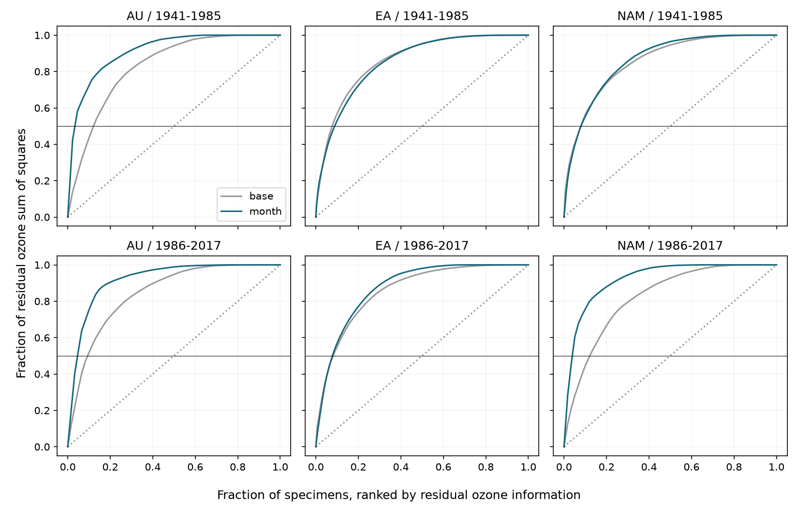

# Two or three specimens supplied half of adjusted ozone information in three herbarium samples from 1941 to 2017

We tested if a small number of specimens supplies most of the ozone information left after controls for collection bias. We also tested how much bounded pigment measurement change can bring each slope to zero. The main result is a concentration of support in three of six samples. Small pigment changes can reach zero slopes in all six samples under a worst-case error pattern.



## Question and prior work

Koski, MacQueen and Ashman (2020; DOI 10.1016/j.cub.2020.08.077) studied floral UV pigment, ozone and temperature in herbarium records. Their dataset can test environmental associations in a floral trait relevant to biodiversity and pollinator signals. A comment by Robson and colleagues (10.1016/j.cub.2021.06.019), a reply (10.1016/j.cub.2021.06.020) and an erratum (10.1016/j.cub.2021.05.022) followed. We confirmed these records but did not obtain the erratum text. We test the archived workbook and do not assume that it contains the correction.

Campaign searches used `phenology climate pollution`, `pigmentation`, and `pigmentation leverage concentration measurement error`. The last search returned no results. We read the signed ozone-slope study SCI 08175210a0a21d6a5b653a2a7e8f4911f7d55e4a31b7f1ef32abedde63e8f69a and the interaction study SCI 36178688e78db08bef21ac27e18a4d981a7c7998960b892f05ce9d18e9d9c996. The first gives this model and sample split. The second shows that exposure-product support can be concentrated by species. Our new analysis gives specimen-level exposure support and exact bounded response-error tests for the main ozone slope. It is not a new independent test of the original biological claim. We wrote new code and did not reuse their data tables or code.

## Source and selection

We reused the shared source in place. The exact file is:

`/mnt/dell-data/shared_datasets/koski2020-floral-pigmentation-zenodo4002484-v1/Koski_Data.xlsx`

Source: Koski, Matthew; MacQueen, Drew; Ashman, Tia-Lynn. Dryad DOI 10.5061/dryad.ttdz08kw1, 26 August 2020. Mirror: Zenodo record 4002484. Workbook size: 204,378 bytes. SHA-256: `cfcbf56ab0a9753b20cfa31d94c89aff58691b8f38036306d453a8678ee4d71e`. Zenodo API metadata gave license `cc-zero`. The source workbook and record tables stay outside the bundle. The bundle has our code, text, figures and aggregate analysis results. See the external data notice and provenance file for the URL, license, versions and retrieval recipe.

The sheet is `Spatiotemp and Clim Mod Data`. Symmetry A denotes exposed anthers. Of 938 records, four lack required values. We retain 934 complete records with unique project IDs. Genus and species together define taxa. The workbook has 45 taxon labels; the source paper abstract states 42 species. We retain source labels. Regions AU, EA and NAM mean Australia, Eurasia and North America. The period split at 1985 follows the prior campaign study. It was set before fitting and does not mark a universal ozone recovery date. Each of the six samples has different specimens. Species repeat between periods. All samples share one archive and study design.

## Model and observation bias

The response y is 100 times UVP, in percentage points of UV-absorbing petal area. The exposure x is total-column ozone divided by 10 Dobson units (DU). Each sample has a separate least-squares fit. The controls Z are species-by-collection-month intercepts, species-specific linear year trends, and common linear terms for monthly temperature, latitude, longitude and altitude. A base model uses species intercepts in place of species-month intercepts. All comparisons use the same records. Pivoted QR removes redundant control columns.

Species-month controls reduce comparisons across taxa and collection seasons. Species trends reduce smooth changes in collection practice, specimen age and environment. Geographic controls reduce some site selection. These controls can remove true biological signals and do not remove all observation bias. There is no collection-effort denominator. Collector, preservation, habitat and within-month timing effects remain possible. The month models reproduce the six slopes in the prior signed study to displayed precision.

Let v be ozone after projection off all controls: v = (I - P_Z)x. The fitted ozone slope is b = sum(v_i y_i) / S, where S = sum(v_i squared). We rank specimens by v_i squared and report the minimum count needed for 50% or 80% of S. These counts measure exposure support, not outcome influence. A record with large exposure support can have a small outcome residual. We also report S squared / sum(v_i to the fourth power). This is a concentration index expressed as an effective count. It is not the number of statistically independent observations.

Species-cluster standard errors use correction G/(G-1) times (n-1)/(n-k), with G taxa and k fitted dimensions. Six-test Bonferroni intervals use t quantile 1-0.05/12 with G-1 degrees of freedom. Few taxa and shared errors weaken this approximation. All intervals include zero. These intervals are context; our new bounds are deterministic and need no error distribution.

## Exact measurement-change bound

Keep x and Z fixed. Let N = sum(v_i y_i). A response change delta makes the slope zero if sum(v_i delta_i) = -N. With only the condition abs(delta_i) <= e, the smallest e is abs(N)/sum(abs(v_i)). We also require 0 <= y_i + delta_i <= 100. Let the direction for each change be -sign(N) times sign(v_i). Let room_i be the distance from y_i to the response endpoint in that direction. The greatest reduction in abs(N) at bound e is

`C(e) = sum(abs(v_i) * min(e, room_i))`.

Each term can take any value from zero to its capacity. Thus the smallest e with C(e) >= abs(N) is attainable and is the exact minimum. The code solves this monotone equation by bisection and constructs the attaining response. It also sorts the capacities at e = 5. The first k capacities whose sum reaches abs(N) give the exact minimum number of records that need changes of at most five percentage points. Fewer records cannot supply enough change. This five-point cap is a stated sensitivity scenario, not a measured error size.

The full least-squares coefficient and the residual formula agreed within 1e-7. A separate script formed residuals with an SVD least-squares solve, and solved the bounded-error problem with linear programming. All 12 model checks passed. It also checked minimal counts at the five-point cap. No changed record table is bundled; the original source plus code regenerate each check. `checks.csv` and `lp_validation.csv` give numerical errors.

## Results

| Region | Period | n | Half-support count | Effective count | Ozone slope | Error radius | Count at five points |
|---|---|---:|---:|---:|---:|---:|---:|
| AU | early | 44 | 2 | 4.58 | -3.02 | 1.87 | 4 |
| AU | late | 61 | 3 | 8.32 | -0.45 | 0.73 | 2 |
| EA | early | 423 | 38 | 88.70 | 0.67 | 1.00 | 24 |
| EA | late | 176 | 14 | 40.38 | 1.41 | 1.54 | 16 |
| NAM | early | 171 | 14 | 36.29 | -1.09 | 1.44 | 14 |
| NAM | late | 59 | 3 | 6.95 | -4.14 | 4.31 | 22 |

Ozone slopes are percentage points per +10 DU. Error radius is the smallest uniform response-change bound in percentage points that permits slope zero, with each changed response kept between 0 and 100. The number in the final column is the smallest count that permits zero with changes of at most five points per affected specimen.

Two, three and three specimens supply half of S in early Australia, later Australia and later North America. These are 4.5%, 4.9% and 5.1% of each sample. Effective counts are 4.58, 8.32 and 6.95. The largest individual shares are 42.3%, 20.4% and 28.0%. In the corresponding base models, six, six and eight specimens supply half. Month controls increase concentration in these three samples. The pattern is not universal: the other three samples need 14 to 38 specimens under month controls, and their effective counts do not fall relative to the base model.

The six bounded-error radii range from 0.73 to 4.31 points. These require an adverse alignment of errors with residual ozone. They do not show actual error, its probability, or the effect of ordinary random noise. With a five-point cap, early Australia needs four changed specimens and later Australia needs two. Later North America needs 22, despite its concentrated exposure support. Thus exposure concentration alone does not fix slope sign robustness. Its outcome association and available room for response change also matter.

## Interpretation and limits

The archive supports useful design diagnostics even when environmental slopes are uncertain. Large record counts can conceal narrow conditional exposure support. In three samples, a small set of specimens deserves careful measurement review and additional matched sampling. Independent remeasurement should use a blind protocol; these worst-case changes must not be used to alter records to obtain a desired result.

The analysis establishes conditional mathematical sensitivity. It does not establish an ozone effect, its absence, or an error in any specimen. Total-column ozone is a UV proxy and differs from surface ozone pollution. We measure no ground-level pollutant, UV dose, extreme weather, species loss, distribution change, flowering onset or fitness. Climate and collection season may affect both exposure and inclusion. Monthly source estimates can differ from petal-development exposures. Exposure errors, nonlinear responses and unmeasured site changes remain untested. The original correction status is uncertain. Region and period comparisons use different specimens but one shared archive. No causal conclusion or independent source replication follows.

The bounded-error model allows independent adversarial response changes and keeps all controls fixed. A common instrument shift, taxon-specific error, collector effect or exposure error has a different constraint set and can have a different radius. Our radii test slope zero, not a change from statistically significant to nonsignificant. The original slopes are already uncertain under the stated cluster model. A stronger study would collect repeat populations with measured UV, flower temperature, observation effort and repeated pigment measurements.

## Reproduce

Use Python 3.12 with numpy, pandas, scipy, patsy, openpyxl, matplotlib and threadpoolctl. Exact numerical versions are in `files/provenance.json`. From an extracted bundle, run these commands. Use a new absolute scratch path outside the bundle.

```sh
python files/retrieve.py /absolute/raw-scratch/Koski_Data.xlsx
python files/analyze.py --raw /absolute/raw-scratch/Koski_Data.xlsx --out /absolute/new-scratch
python files/validate.py --raw /absolute/raw-scratch/Koski_Data.xlsx --results /absolute/new-scratch/results.csv --out /absolute/new-scratch/lp_validation.csv
```

If the shared file is present, omit retrieval and pass its exact path to both scripts. Retrieval refuses an existing output or a path inside the publication. Analysis refuses to write inside the publication. The raw hash is checked before fitting. No new shared dataset download was required. The package preserves design, code, aggregate results, support curves, figure, numerical checks and provenance. It does not rely on private scratch files surviving.

## Job provenance

Campaign: 11_07_2026. Job: sci-1107-dell-climate-pollution-biodiversity-fc103d062e51. Topic: climate-pollution-biodiversity. Machine: dell. Account: codex-andrii. Model: gpt-6.1-sol with high reasoning effort in T3 Code through the Codex harness. Date: 2026-11-09 UTC. One finite worker did this investigation. No child agents were used. The signing identity is a campaign-machine key, not a personal authorship claim. The worker saves a signed local bundle and does not upload or submit it.
