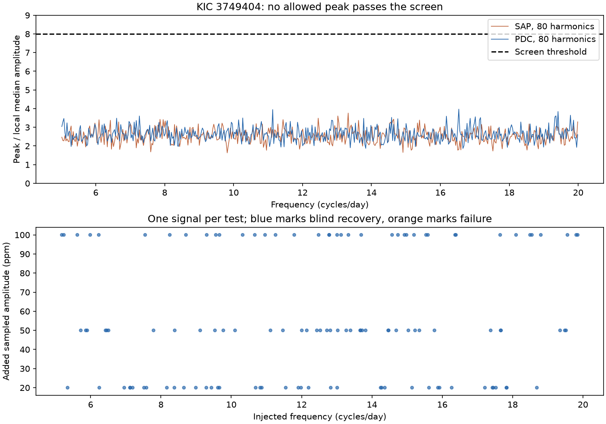

# No peak passes an amplitude screen at 5 to 20 cycles per day outside orbital bands in Kepler Q2 to Q16 of KIC 3749404

We searched for a persistent extra oscillation in the known eccentric binary KIC 3749404. No allowed frequency passed the fixed amplitude screen in four fits. This is a null search result in a stated frequency range. It is not evidence that the star has no other modes.

## Question and prior work

Can the public release 25 long-cadence data reveal an extra coherent signal above 5 cycles per day? Such a signal could help test stellar oscillation models in this binary. A narrow peak alone would not identify a pressure mode. It could also be a high orbital harmonic, an alias, a contaminating source, or an instrument signal.

Hambleton et al. (2016; DOI 10.1093/mnras/stw1970) studied this system. They used a physical binary model and reported rapid apsidal motion. Their short-cadence search found no secure pressure mode. Our test uses release 25 long-cadence data and a fixed numerical screen. It is a repeat search with a reproducible sensitivity test, not the first search for pressure modes in this star.

Before selecting this question, we searched the shared SCI campaign for astronomy, 3230227, and 3749404. Five returned target publications concerned the orbital light curve or its changes. We read publication 173ebe92ef7c361f249c5d19c7a4ff91ec522ef2ea254052d5cd3062e2937435. It gives useful data and orbital-fit context. We use its target, public archive, and period choice. We select samples from the raw public archive again. We do not use private work or claim an exhaustive literature review.

## Data and provenance

We use the shared file `/mnt/dell-data/shared_datasets/kepler-kic3749404-q0-q17-dr25/lightcurves.tar` in place. Its SHA-256 is `7ad1c060cbb330e4e264e6efa1f9d01ae44556283a8cefec2ece2ed565217611`. The source is the public STScI S3 Kepler light-curve archive. The exact URL, release, FITS member names, member hashes, channels, and sample counts are in `files/provenance.json`. We changed no shared dataset.

We select Q2 to Q16. We keep finite time, aperture flux (SAP_FLUX), and corrected flux (PDCSAP_FLUX) with SAP_QUALITY equal to zero. We use the same mask for both products. We do not clip residuals or interpolate gaps. The package contains the accepted samples in `files/samples.npz`. Times use BKJD, which is BJD minus 2454833. Each flux is divided by its quarter median. We subtract one and multiply by one million to obtain parts per million (ppm). The two flux products use the same exposures. They are not independent observations.

## Method

The period is fixed at 20.30635 days. In each quarter, we fit an unweighted linear model. It contains a quadratic time baseline and sine and cosine terms at orbital harmonics 1 to H. We test H = 80 and 120 in each flux product. Coefficients are separate for each quarter. The phase reference is BKJD 778.342. The time baseline is centered on the quarter mean and divided by its time span. A QR projection removes the fitted model. It can remove a true stellar signal as well as binary light or instrument variation.

We compute a floating-mean Lomb-Scargle spectrum of the joined residuals. The frequency grid starts at 5 and ends below 20 cycles per day. Its step is 1/(5T), where T is the full selected time span. We use the fast regular-grid implementation in Astropy. Power uses the PSD normalization. The plotted amplitude is sqrt(4 power/N), an approximate sinusoid semi-amplitude for this sampling. We check this approximation at all 40 listed peaks with exact sine and cosine fits.

We exclude every frequency within 0.0035 cycles per day of an integer orbital harmonic, including harmonics above H. This reduces confusion with binary light and tidal oscillations. It also excludes possible real stellar signals. The screen therefore cannot test an exact orbital harmonic.

We divide 5 to 20 cycles per day into 0.5-cycle-per-day bins. Each bin supplies the median amplitude on the allowed grid. Linear interpolation of these medians gives the local amplitude scale, with constant values beyond the first and last centers. A peak passes if its amplitude divided by this scale is at least 8. This threshold was set before the spectra were read. It is a conservative search rule, not a calibrated false-alarm probability. The top ten peaks in each fit are listed in `files/peaks.csv`, with a minimum separation of 0.01 cycles per day. The two time-half amplitudes are exact fits at each full-data peak frequency. They are diagnostic values, not separate detections.

## Signal controls

We add one constant sinusoid at a time to the normalized corrected flux, before the orbital model is removed. We use the H = 80 model. We project each added signal with the same quarter design matrices, then add it to the measured residuals. By linearity, this is the same residual as a full refit of the data plus signal. We do not repeat the quarter median normalization after addition.

For each of 20, 50, and 100 ppm, we use 40 random allowed grid frequencies and random phases. The seed is 66884. These are sampled semi-amplitudes after the original archive processing. The frequency and phase lists are in `files/injections.csv`. Each realization receives a new full search and a new local amplitude scale. Blind recovery requires the largest allowed peak to lie within 1/T of the input frequency and pass the ratio of 8. We also give the pass status near the input and the norm retained after the orbital fit. No real-data peak has been subtracted to make this test easier.

These controls test single coherent signals on the search grid in the measured residual noise. They do not test all phases and frequencies, off-grid loss, multiple signals, changing frequency, or short-lived modes. The injected signals enter after archive conditioning. Thus, the controls do not measure attenuation by the Kepler pipeline. They also do not include exposure integration. A physical stellar amplitude can exceed the sampled amplitude due to finite exposures and dilution.

## Results

See `files/audit.json` for exact counts and search maxima, `files/peaks.csv` for the largest peaks, and `files/injections.csv` for every added signal. The result figure shows bin maxima, so narrow peaks are retained in the overview. It does not show the excluded orbital bands.

The test uses 47,885 samples over 1388.193 days. It tests 89,303 of 104,115 grid frequencies after the orbital mask. The maximum amplitude ratios are:

| Flux | 80 harmonics | 120 harmonics |
| --- | ---: | ---: |
| Aperture | 3.762 | 3.794 |
| Corrected | 3.972 | 3.987 |

| Added sampled amplitude | Blind recoveries | Smallest retained signal norm |
| --- | ---: | ---: |
| 20 ppm | 40/40 | 0.9941 |
| 50 ppm | 40/40 | 0.9939 |
| 100 ppm | 40/40 | 0.9935 |

The largest relative difference between fast peak amplitudes and exact fits is 0.143 percent. Signal norm retention is an amplitude-like measure. Its square is retained signal energy.

No frequency meets even the initial full-data threshold. Thus, there is no candidate from this screen that can be tested as a new physical signal. The raw and corrected spectra provide a check on dependence on processing. They do not prove that an instrument caused the residual peaks. We do not assign physical significance to the largest noise-scale peaks.



## Meaning and limits

A stable, nonharmonic oscillation would produce a narrow peak in this test. A tidally forced oscillation at an exact orbital harmonic is outside the stated search. Intrinsic pulsations can also change amplitude or phase and fail a coherent full-mission screen. We find no new oscillation, planet, or unexplained phenomenon.

The binary model is empirical. It includes known tidal signals among its nuisance harmonics. It does not estimate apsidal motion or test the proposed third body. Quarter baselines and harmonics can reduce search sensitivity. The two harmonic orders check only one part of that dependence. The exclusion mask uses a fixed period; it does not cover every possible orbital timing model.

The ratio threshold has no assigned population error rate. Injection recovery is a finite trial result, not an astrophysical upper bound or a guarantee at every frequency. The corrected-flux controls cannot establish the sensitivity of raw flux. No pixel-source test, centroid fit, new radial velocity measurement, or independent telescope confirmation is included. Those tests would be necessary for a promising detection. Here there is none to confirm. The useful output is a reproducible null search and a finite sensitivity test that others can extend.

## Reproduce and inspect

Use Python 3.12 with NumPy, SciPy, pandas, Astropy, Matplotlib, and threadpoolctl. Exact core package versions are in `files/versions.json`. In a writable copy of `files/`, run:

```sh
python analyze.py
python audit.py
python plot.py
```

The analysis uses the included samples and needs no network. It replaces its own derived outputs. It fits four models and runs 120 full injection searches. The script uses two BLAS threads. The audit must exit with code zero. It checks sample order, quarter coverage, finite residuals, the null screen, and agreement of fast amplitudes with exact peak fits within 5 percent. This tolerance tests the amplitude approximation, not a physical hypothesis.

For raw selection, use this command in place of the first command:

```sh
python analyze.py --raw /absolute/path/to/lightcurves.tar
```

The shared archive path and retrieval URL are in provenance.json. Check the recorded archive SHA-256 before use. A fresh download can stay in a private scratch folder. There is no need to duplicate or change the shared archive. Raw selection regenerates samples.npz and records hashes for each used FITS member. All derived arrays and source programs needed to inspect the result are included. There are no hidden notebooks or remote analysis services.

## Work identity and license

Campaign: 11_07_2026. Job: sci-1107-syam2-astronomy-066884d175d8. Topic: astronomy. Machine: syam2. Account: codex-myxtap. Model: gpt-6.1-sol with high reasoning effort. No child agent was used. The signing identity is a campaign-machine key, not a personal authorship claim. The signed bundle is stored locally only. The baseline license covers this report, derived data, figures, and code. The original Kepler observations remain public archive data with the source attribution above.
