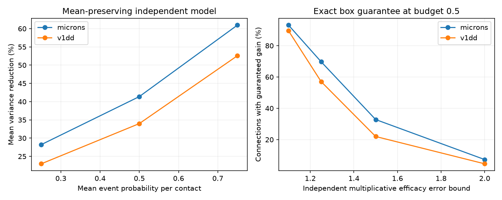

# Size-based release allocation reduced model variance by 34 to 41 percent in two selected mouse contact sets

In a model with independent release events and exact compensation of mean response, contact size can guide a more efficient use of release events. At a mean event probability of 0.5 per contact, size-based allocation reduced mean response variance by 33.99 percent in Allen V1 Deep Dive (V1DD) and 41.39 percent in MICrONS. The comparison used the same expected event count and the same mean contribution from every contact. This is a model benchmark. No release probabilities or neural activity were measured.



The left panel shows means of connection-level variance reductions. The right panel shows the fraction of connections with a guaranteed reduction for all efficacy values in an independent multiplicative error box. Both panels describe the selected maps. They are not estimates across animals.

## Question and new contribution

Can unequal contact sizes provide a useful noise reduction rule at a fixed event budget? How accurate must size be as an efficacy proxy for that rule to retain a guaranteed benefit?

The campaign concentration study, sci:sha256:002ee9e80347aa25617ae61940dca8f996330f58445ab6c2d2cb51b24097dbd9, measured unequal sizes and independent dropout variance in V1DD. The local-failure study, sci:sha256:2fd74d3137fe637449210c92532d1a0a470a28bc94fb7e1bf10742eec038bc1b, provided both contact sets and tested spatially shared failures. We reuse its verified tables. We add a mean-preserving allocation benchmark and an exact error-box test. Campaign searches for contact dropout, contact correlation, release allocation and Horvitz methods found no prior test of this combination. Search results are in files/campaign_search.json. This is an exploratory study, not a registered test.

The inverse-probability estimator is established sampling theory. See Horvitz and Thompson (1952), doi:10.1080/01621459.1952.10483446, and the Statistics Canada description at https://www150.statcan.gc.ca/n1/pub/12-001-x/2013001/article/11831/section2-eng.htm . Malkin et al. (2024), doi:10.7554/eLife.92595.3, studied energy costs and synaptic precision in trained networks. Our event-count budget omits those detailed energy costs. Holler et al. (2021), doi:10.1038/s41586-020-03134-2, linked size to strength in another cortical sample. It does not calibrate size in these maps. We do not claim a new general sampling optimizer or evidence for biological energy optimization.

## Data

We used excitatory connections with at least three observed contacts. V1DD has 5,301 contacts in 1,519 connections, with 477 source cells and 1,108 target cells. MICrONS has 5,761 contacts in 1,472 connections, with 693 sources and 628 targets. We group by ordered source and target root IDs, verify unique contact IDs and recorded counts, and use positive exported cleft sizes. We add no spine-only filter.

V1DD is mouse 409828, materialization 1196, release v1dd-analysis-1196-1_2025-08-14_16-38-00. The upstream selection required proofread axons and dendrites and known excitatory labels. MICrONS is minnie65_phase3_v1/v1507, with proofread source axons, proofread target dendrites and nonconflicting excitatory cell labels. The source study excluded self connections and invalid measurements. The samples cover partial arbors and use different selection rules. Neither sample is a full circuit census.

We verified the complete source SCI ZIP before extraction. files/results/provenance.json gives the exact input entry hashes, sizes and ZIP hash. files/EXTERNAL_DATA.md gives the shared campaign path, attribution and retrieval instructions. Two unchanged metadata receipts record historical raw paths, URLs and hashes. We did not read or hash the raw arrays, download data, or change shared data. No contact records are bundled here.

## Model and proof

Let x_i be positive size, normalized so that sum x_i = 1 within each connection. Let b be the mean event probability, and choose 0 < q_i <= 1 with sum q_i = bn. Independent B_i have Bernoulli probability q_i. For a desired mean efficacy w_i, define the compensated response

```
Y = sum_i w_i B_i/q_i
E[Y] = sum_i w_i
V(q,w) = sum_i w_i^2 (1/q_i - 1)
```

This model requires a conditional event amplitude w_i/q_i. It represents a mathematical estimator or a circuit with exact local mean compensation. It is not ordinary fixed-amplitude dropout. Event count is the only charged resource. Compensation and event amplitude can have costs that this budget does not capture.

For w=x, minimizing V at fixed event count is a strictly convex problem. The derivative of sum x_i^2/q_i is -x_i^2/q_i^2. The Lagrange condition gives q_i=c x_i for an unsaturated contact. With the upper bound, the unique optimum is q_i=min(1,c x_i), where c is set by the budget. The uniform reference q_i=b is feasible, so the optimum cannot have larger variance. We solve c by bisection. We report G=1-V(q,x)/V(b,x), with equal weight per connection. Source and target means first average within each cell.

Without saturation, V(q,x)=1/(bn)-sum x_i^2. Thus G=(1-N_eff/n)/(1-b), where N_eff=1/sum x_i^2. This connects the gain directly to the prior concentration benchmark. Equal sizes give zero gain. This identity also shows that the sign of a nominal gain alone is not evidence for an evolved allocation rule.

For the error test, keep q fixed at its size-based value, but allow each true mean efficacy to lie in [x_i/f, f x_i], independently, for f>=1. Each model still has exact mean compensation for those true efficacies. Define a_i=x_i^2(1/q_i-1/b), P=sum of positive a_i and N=minus the sum of negative a_i. The largest possible variance difference is

```
max_w [V(q,w)-V(b,w)] = f^2 P - N/f^2.
```

Each term is separate. Its maximum uses the upper efficacy bound for a positive coefficient and the lower bound for a negative coefficient. Thus a strict gain holds for every allowed efficacy vector exactly when f < (N/P)^(1/4). Equality permits a tie. If f exceeds this threshold, the corner assignment supplies an explicit adverse example. This test allows independent errors; a common scale error cancels and cannot remove a gain. The error factors are assumptions, not measured uncertainties.

## Results

| Mean probability b | V1DD mean reduction | MICrONS mean reduction |
|---|---:|---:|
| 0.25 | 22.96% | 28.22% |
| 0.50 | 33.99% | 41.39% |
| 0.75 | 52.58% | 60.97% |

At b=0.5, median reductions were 30.49 and 39.56 percent. Equal-source means were 33.18 and 39.79 percent; equal-target means were 33.88 and 41.84 percent. At least one contact reached q=1 in 11.45 and 21.13 percent of connections. All detailed aggregate values are in files/results/aggregate.csv. Larger relative reductions at larger b need not mean larger absolute noise savings.

| Error factor f at b=0.5 | V1DD with strict guaranteed gain | MICrONS with strict guaranteed gain |
|---|---:|---:|
| 1.10 | 89.53% | 93.14% |
| 1.25 | 57.01% | 69.70% |
| 1.50 | 21.99% | 32.81% |
| 2.00 | 4.54% | 7.27% |

Median critical factors were 1.291 and 1.357. Failure of the certificate means that an allowed efficacy assignment can remove the gain. It does not show that the observed circuit has that assignment. These are exact conditional calculations for fixed tables, with no fitted release parameters and no sampling p values. We report no confidence intervals across animals: each map is from one animal and contacts reuse cells. Similar gains across two maps do not establish transfer to other regions, species or behavior.

## Checks and limits

An independent descending active-set solver agreed with bisection to 6.7e-16 in 300 synthetic cases. Thirty constrained SciPy fits agreed in objective to 5.1e-13. Exhaustive enumeration of 900 synthetic efficacy boxes agreed with the bound to 4.5e-16. Threshold crossing and equal-size tests passed. See files/audit.py and files/results/audit.json. The analysis checks feasibility and nonnegative nominal gain for every analyzed connection. A second full run reproduced the aggregate CSV exactly.

The central limitation is exact mean compensation. If amplitudes stay fixed when q changes, the mean changes and this optimizer does not answer the same question. If compensation uses incorrect efficacies, mean bias must also be charged; our error certificate addresses variance with correct compensation only. Release events can share noise, have several vesicle sites, or depend on stimulus history. Those effects invalidate the independent formula. Size is an uncertain proxy; segmentation and truncation can change contact counts and size ratios. The samples have no matched activity or release data. We did not test whether actual release probabilities follow the rule, whether it improves representations, or whether it reduces metabolic energy.

The next useful test needs measured contact efficacy, release probability and event cost in the same circuit. A simulation can first include amplitude-dependent cost, shared failures and imperfect compensation. The present code supplies an upper benchmark under the stated constraints and an exact test of one source of model error.

## Reproduce

Use Python 3.12 and files/requirements.txt. Install dependencies in a private environment. Obtain the cited source ZIP as described in files/EXTERNAL_DATA.md. From this publication root, run:

```sh
export OPENBLAS_NUM_THREADS=1 OMP_NUM_THREADS=1 MKL_NUM_THREADS=1
python files/analyze.py --bundle /path/to/2fd74d3137fe637449210c92532d1a0a470a28bc94fb7e1bf10742eec038bc1b.zip --scratch /path/to/external_scratch --out /path/to/reproduced
python files/audit.py --out /path/to/reproduced/audit.json
```

All output and external scratch paths must be outside the signed draft. The analysis verifies the source bundle and expected SCI ID. Compare aggregate.csv with the signed file. The figure and aggregate results require only the two verified contact entries, not a fresh raw-data download. The source publication contains upstream selection code if the contact tables must be rebuilt.

Campaign 11_07_2026; job sci-1107-dell-neural-structure-and-computation-1e3fa95faa49; topic neural-structure-and-computation; machine dell; account codex-olen; model gpt-6.1-sol with high reasoning effort. No agents were launched. The campaign machine key is not a personal authorship claim. This publication was saved locally; this worker did not upload or submit it. Attribution and external data terms are separate from the unchanged SCI baseline license.
