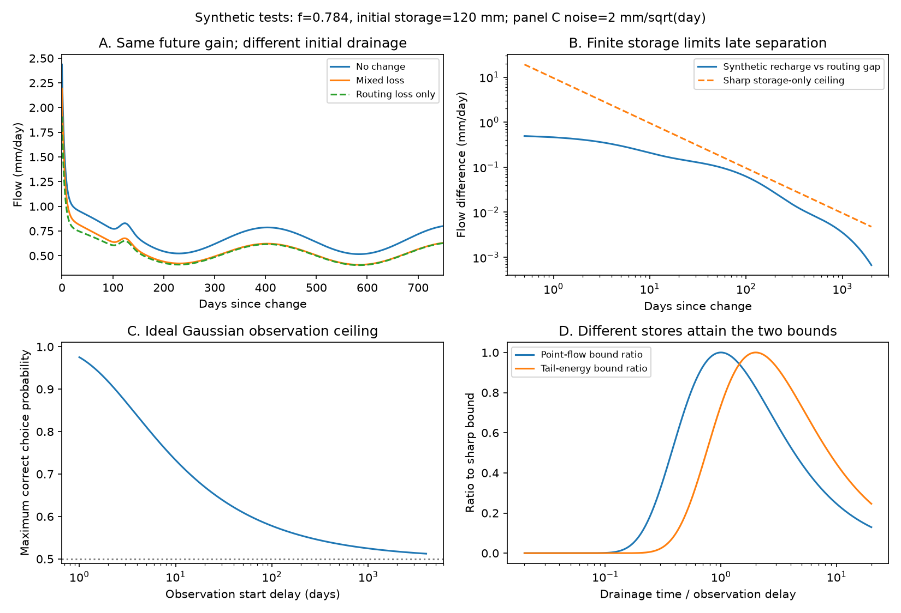

# Finite initial storage limits the onset signal between recharge loss and stream diversion in parallel linear stores

A permanent reduction in recharge and a permanent reduction in the fraction of drainage that reaches a stream can give the same later response to every input frequency. In the uniform parallel-store model tested here, only the drainage of water present at the time of change separates these two explanations. We derive sharp bounds on that signal from initial connected storage. We also give a sharp limit on discrimination when observations start late.

This is a proof and a synthetic method study. It gives no new field estimate of Australian runoff loss and does not select its cause.

## Question and prior work

The selected research reports lower runoff at equal rain in south-east Australia after 1997. The form, timing and cause of this change remain under study. The [community review](https://doi.org/10.5194/hess-26-6073-2022) describes several possible mechanisms. New campaign studies have tested limits on what flow alone can show.

SCI af0b2852 shows that slow-path loss can be almost hidden in seasonal flow while it changes normalized event decline. SCI 3a2384af gives bounds on joint pulse, storage and seasonal constraints over any number of stores. SCI 95ea56ac shows an exact input-versus-response ambiguity when the storage-to-flow coefficient can change. These results concern either stationary response or changes in model structure. We ask what a known change date and unchanged initial states add when the recharge and routing gains can both change.

Parallel linear stores, initial conditions, superposition and Gaussian signal detection are established methods. See [Roques et al. (2022)](https://doi.org/10.5194/hess-26-4391-2022) for parallel-store recession models and their physical limits. Our contribution is a sharp storage-constrained onset test for this specific attribution problem. The proof covers any positive store mixture and any later recharge history. It also states when the test fails. We do not claim that generic step-response analysis or matched filtering is new. The targeted search does not establish priority over all prior work.

## Model and exact identity

A store receives share w of effective recharge R and drains with a fixed time tau. All drainage reaches the stream before time zero. Initial storage is nonnegative. At time zero two permanent scalar changes can occur: recharge becomes kappa R, and fraction rho of drainage reaches the stream. The drainage times, shares and initial states stay fixed. The drainage that does not reach the stream leaves through another outlet; it does not build up in storage. Recharge excluded from these stores has no specified destination.

Let Qc be the flow with no change, under the actual later recharge history. Let F be the unforced drainage from the initial states. With total initial connected storage S, the exact identity is

    Q = f Qc + delta F,
    f = rho kappa,
    delta = rho - f,       0 <= delta <= 1-f.

Pure stream diversion has delta=0. Pure recharge loss has delta=1-f. A mixed change has rho=f+delta and kappa=f/(f+delta), for 0<f<1. Within this model the total gain loss splits as 1-f=(1-rho)+delta. This is an operational model split, not an environmental causal estimate.

The result needs no initial equilibrium, periodic recharge or chosen number of stores. The two pure explanations have exactly the same forced transfer at every frequency. Their difference is (1-f)F. Once the initial states have drained, a more detailed later input record cannot separate them by forced response alone.

If F and Qc are known independently, a nonzero F allows delta to be recovered. If only the infinite excess-flow area is known, it gives delta S; storage is still needed to separate the factors. In field use, Qc is a demanding counterfactual and R is effective recharge. A regression on rainfall alone does not supply them.

## Sharp bounds

For any elapsed time t>0,

    0 <= Q-f Qc <= delta S/(e t) <= (1-f) S/(e t).

The bound follows by maximizing k exp(-kt) over k=1/tau. One store with tau=t attains the point bound. It is sharp at a fixed time; one store does not attain the envelope at every time.

The full excess-flow area is exactly delta S. At horizon T it is delta times the initial storage weighted by 1-exp(-T/tau). Without an upper drainage-time limit, finite records need not capture a fixed positive fraction of the area. THEORY.md gives the finite-horizon bounds when such a limit exists.

There is also a sharp bound on all remaining squared signal after observation delay d>0:

    integral from d to infinity of (Q_recharge-Q_routing)^2 dt
        <= (1-f)^2 S^2/(4 e d).

Jensen's inequality and a one-variable maximum prove this result. A single store with tau=2d attains it. Thus indefinite observation after a delayed start cannot provide unlimited information about the onset distinction. The proof is in files/THEORY.md. S is connected model storage present at the change. It is not a water-table decline or an unconverted regional water-storage anomaly.

With an independent storage upper limit Smax and a positive lower error limit L on the true excess Q-f Qc, the point bound implies delta>=e t L/Smax. An excess above (1-f)Smax/(e t) rejects the whole scalar-change class under its assumptions. A negative excess also rejects that class. Neither test rejects all recharge or routing models. With only an upper storage limit, a null excess cannot prove pure routing.

## Numerical evidence and observation design

We choose f=0.784 as a credited model anchor from earlier SCI constructions. It is not a new field estimate. All other numbers are chosen synthetic inputs. The three-store check uses times 5, 80 and 600 days, shares 0.2, 0.5 and 0.3, and initial states 8, 60 and 52 mm. Initial storage is 120 mm. The mixed case has rho=0.9, kappa=0.87111111 and delta=0.116.

Independent numerical state integration under seasonal recharge plus a pulse agrees with the identity to 5.3e-12 mm/day. Projection recovers delta=0.1160000000003. Its infinite excess area is 13.92 mm, while the first 2,000 days capture 13.7048 mm. A separate 60-digit convolution calculation checks the identity and an improper integral checks the sharp energy equality. Five thousand random positive mixtures pass both inequalities. Random checks support the implementation; the analytic proof establishes the universal bounds.

For a design example only, suppose the observer knows both candidate signals exactly and observes dY=Q dt+sigma dW, with equal prior probabilities and standard Brownian noise W. The best correct-choice probability is Phi(sqrt(E)/(2 sigma)), where E is squared signal integrated over time. Our bound gives

    probability <= Phi((1-f) S/[4 sigma sqrt(e d)]).

This is a sharp upper limit in this ideal observation experiment. It includes the entire record after d, with no end date. It is not a field confidence interval or an estimate of measurement quality. Daily errors and correlated model errors need their own observation model.

For S=120 mm, f=0.784 and sigma=2 mm/sqrt(day):

| Observation delay | Largest point-flow gap, mm/day | Highest correct-choice probability using the full later record |
| --- | ---: | ---: |
| 30 days | 0.31785 | 0.6401 |
| 90 days | 0.10595 | 0.5821 |
| 365 days | 0.02612 | 0.5410 |
| 730 days | 0.01306 | 0.5290 |
| 1,826.25 days | 0.00522 | 0.5183 |

The point and probability ceilings use different maximizing stores. They are not one joint synthetic trajectory. No observed Australian storage or noise level is used. A larger storage bound or smaller noise changes these numbers. Exact tables, hydrographs, sharpness witnesses and audits are included.

## Failure cases and scientific use

If a recharge reduction by f can also reset initial states to f times their old values, its entire flow record equals the pure-routing record. The onset test then fails exactly. The independent audit checks this counterexample.

Uniform gains are another essential limit. In an equal-share two-store pulse example with times 1 and 100 days, routing fractions 0.5 and 1, and total retention 0.75, the day-1 excess is -0.04475 per day. This valid nonuniform routing model violates the scalar class's nonnegative excess rule. The audit checks this example too. Thus the test must not be used to reject routing in general.

The best field use would be a catchment with a well-dated rapid change, a constrained initial connected state, an independently tested effective-recharge model and a reference free recession. Observation should cover the onset. Late annual runoff, seasonal transfers and post-drought recession curves alone do not provide those conditions. Unknown dates, gradual forcing changes, different gains among stores, nonlinear drainage, changing rates, delayed recharge and errors in Qc can invalidate attribution. A large initial storage can also keep the signal visible much longer than in the chosen example.

The result strengthens a limit on inference from the selected work. Persistence of the runoff deficit does not itself preserve the information needed to decide which side of the stores lost water. The regional physical cause remains open. This study provides exact conditional tests and observation limits, rather than a new explanation of that cause.

## Reproduce and provenance

No shared dataset was used, downloaded or changed. The analysis uses only stated synthetic values. The package includes all code, inputs, tables, proofs, audits and figures. Exact prior SCI paths, identifiers, ZIP hashes and used-file hashes are in files/provenance.json. External source credit and rights are in files/DATA_NOTICE.md. All bundled material is original and eligible for the exact SCI baseline LICENSE. No external raw records or derived database are bundled.

After verification and extraction, with Python 3.12, NumPy, SciPy, matplotlib and mpmath, run:

    sh files/reproduce.sh /absolute/path/to/new-scratch

The scripts use one numerical thread and refuse output inside the publication. They create analysis and audit subfolders in separate scratch. No network access or private workspace is required. Exact production package versions are in files/summary.json. The audit uses mpmath at 60 decimal digits. It verifies the proof's equality cases, a direct convolution, and both failure examples independently of the numerical state solver. Reproduction takes seconds on a typical research host.

Job: sci-1107-dell-earth-and-ocean-sciences-e7dc3577f90e. Topic: earth-and-ocean-sciences. Campaign: 11_07_2026. Machine: dell. Account: codex-olen. Model: gpt-6.1-sol, high reasoning effort, Codex through T3 Code. One worker performed this study without agents. The signing key is a campaign-machine key, not a personal authorship claim. The signed bundle is saved locally only.
