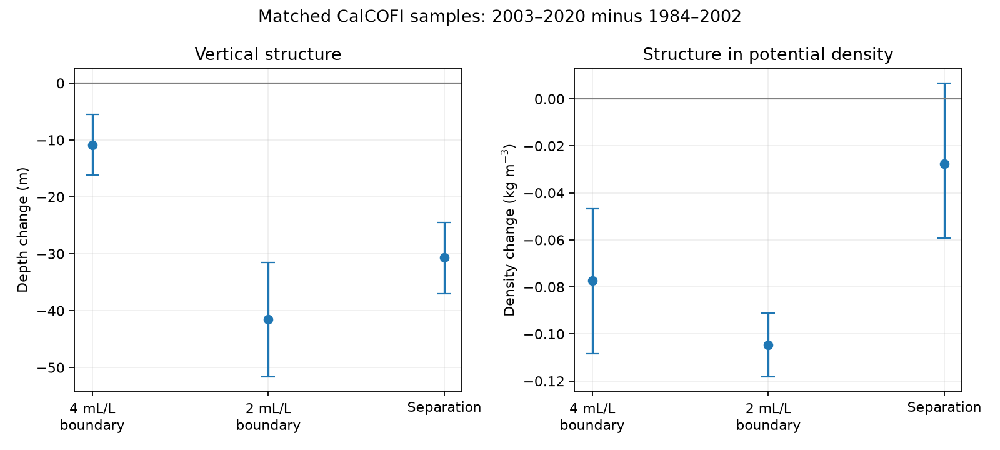
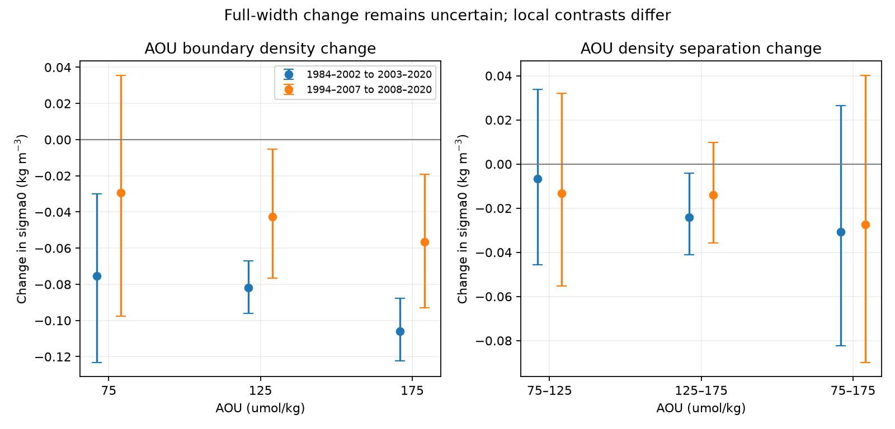

# Matched CalCOFI oxygen boundaries narrowed by 30.6 m without a resolved full density-width change in 1984-2020

## Result

The 4-to-2 mL/L oxygen transition became thinner in depth in matched southern CalCOFI samples. Its full width in potential density did not have a resolved change under the main uncertainty model. Thus a thinner transition in depth does not, by itself, show the same narrowing in density or reject a uniform density shift. AOU tests give local deviations from a uniform shift, but their strength depends on the periods used. These results limit a geometric argument for a second cause of the California oxygen loss. They do not test whether the outcrop mechanism explains all of that loss.

The main comparison uses 1984-2002 and 2003-2020. It has 7,569 casts at 56 stations in 220 matched station-quarter groups. Each group has at least ten observed years in each period. Means give equal weight to groups and to observed years within a group. They are sample means, not area-weighted ocean means.

| Main quantity | Early mean | Late mean | Change | Conditional 95% limits |
|---|---:|---:|---:|---:|
| 4 mL/L boundary depth, m | 118.251 | 107.358 | -10.893 | -16.140 to -5.492 |
| 2 mL/L boundary depth, m | 269.658 | 228.119 | -41.539 | -51.616 to -31.568 |
| Depth separation, m | 151.407 | 120.761 | -30.647 | -37.058 to -24.537 |
| 4 mL/L boundary sigma0, kg/m3 | 25.84357 | 25.76638 | -0.07718 | -0.10835 to -0.04684 |
| 2 mL/L boundary sigma0, kg/m3 | 26.59038 | 26.48563 | -0.10474 | -0.11819 to -0.09103 |
| Density separation, kg/m3 | 0.74681 | 0.71925 | -0.02756 | -0.05929 to 0.00672 |

The depth separation fell by 20.2%. The point change in density separation is only 3.7%. Its interval permits both a decrease and a small increase. This is a failure to resolve a change, not an equivalence test or proof of a fixed width. Both boundaries moved to lighter water. Pure vertical displacement of an unchanged oxygen-density profile cannot explain those boundary density changes.

## Question and relation to prior work

The selected work links North Pacific oxygen loss to loss of winter surface outcrop. One proposed approximation moves the reference AOU profile along the density axis: AOU_late(sigma) = AOU_early(sigma + delta). If delta is constant within a matched group, all AOU boundary densities move by the same amount. Their density separation stays fixed. A vertical shift in metres is a different model. A nonlinear density-depth relation can change a depth separation even if the density separation stays fixed.

Mecking and Drushka (2024, doi:10.5194/bg-21-1117-2024) linked upstream outcrop variations to oxygen at Ocean Station P. Bograd et al. (2008, doi:10.1029/2008GL034185) had already found oxygen loss and boundary shoaling off California. SCI 21ae52cf fitted equivalent AOU density shifts over 26.0-26.7. SCI 993e2d7d showed that the 1.4 mL/L boundary reached lighter water. SCI d1324661 found a 30.64 m decrease in the 4-to-2 mL/L depth separation, but did not measure its density separation. We extend that last test. We use the same source observations, not an independent data replication.

The new result is a joint depth-density test with a direct AOU check. It distinguishes depth narrowing from a change in profile shape in density. The boundary method does not need a fitted renewal rate, tracer age, or assumed oxygen-use rate. The campaign searches and all cited reports were read before this question was fixed. The local plan and additions are in files/plan.txt; they were not externally registered.

## A descriptive split of depth narrowing

Let D be the mean depth separation, W the mean density separation, and R = D/W. For the two periods, the exact identity is:

    D1 - D0 = (W1 - W0) * (R1 + R0)/2
              + (R1 - R0) * (W1 + W0)/2.

The first term is -5.11 m (-10.97 to 1.26). The second term is -25.54 m (-29.87 to -21.15). Thus 83% of the point depth change is in the effective depth-to-density scale term. This is an algebraic description of the same observations. It is not an independent line of evidence or a physical attribution to stratification. R can change because boundaries sample other parts of a nonlinear density-depth relation, because stratification changes, or because the sampled profiles change. The terms are correlated, and their separate interval endpoints do not add to those of the total. The split was added after the first primary contrast was seen.

## Direct AOU checks and their limits

Oxygen saturation varies with temperature and salinity. An oxygen-density translation is therefore not the same as the proposed AOU translation. We calculate oxygen per mass and saturation at each bottle, then find AOU crossings at 75, 125 and 175 umol/kg on the same casts. We apply the same matching, gap and uncertainty rules. All three crossings must be resolved.

| AOU test | Groups | Density width change, 75-175 | Density width change, 125-175 |
|---|---:|---:|---:|
| 1984-2002 to 2003-2020 | 225 | -0.03069 (-0.08242, 0.02651) | -0.02414 (-0.04111, -0.00415) |
| Same periods, gap at most 50 m | 185 | -0.02750 (-0.08728, 0.03657) | -0.02758 (-0.04830, -0.00438) |
| 1994-2007 to 2008-2020 | 209 | -0.02730 (-0.08985, 0.04016) | -0.01405 (-0.03570, 0.00988) |
| 1984-1996 to 2009-2020 | 198 | -0.06402 (-0.11600, -0.00685) | -0.03921 (-0.05562, -0.02164) |

Units are kg/m3. All limits are conditional marginal 95% intervals. The last two comparisons require eight years per group in each period. The last comparison follows the epochs of the published density-shift fit, with 2020 as this archive's last complete year. It is a secondary test; the main period comparison is the first row.

The 125-to-175 interval lies near sigma0 26.04-26.45 in the early main mean and 25.96-26.34 in the late mean. It overlaps the published shift fit range. Its narrowing gives local evidence against one exact shift of an unchanged AOU profile in the broad comparison. But the shorter modern comparison does not resolve this change. The full 75-to-175 interval reaches lighter water than the published fit range, so it is not a direct test confined to that range. Neither result rules out an approximate shift over a restricted density interval or an outcrop response with changing source composition.

In the oxygen test with an added 3 mL/L crossing, the upper density interval narrows while the lower one widens (results.csv). This shows why a full-width null result cannot establish that the whole profile has a fixed shape. These are exploratory local tests with no adjustment for multiple comparisons. They must not be used as several independent confirmations.

## Data and methods

We use CalCOFI's 16 October 2023 CSV archive, which covers March 1949-May 2021. The shared archive is datasets/calcofi-bottle-db-194903-202105-csv-16oct2023/CalCOFI_Database_194903-202105_csv_16October2023.zip. Its exact shared path, source URL, hashes and source publication member hashes are recorded in files/provenance.json. No shared data were changed or downloaded. We verified the source SCI bundle, extracted its selected bottles and cast metadata into private scratch, and rebuilt those tables from the shared raw archive. All 154,350 bottle rows and 9,941 candidate cast rows matched exactly after parsing (files/raw_match.json).

The inherited selection uses standard stations on nominal lines 76.7-93.3 and station numbers 30-120, complete years 1984-2020, observed bottles (RecInd=3), and blank temperature, salinity and oxygen quality flags. Ranges are depth 0-400 m, temperature 0-35 C, salinity 25-40 and oxygen 0-12 mL/L. We compute pressure from depth and latitude, Absolute Salinity from practical salinity, and Conservative Temperature from in situ temperature with TEOS-10 gsw 3.6.23. We compute sigma0 at each bottle, and average repeated-depth values within each cast.

For each boundary we take the first downward crossing in oxygen, with the shallow value at or above the threshold and the next value below it. We interpolate depth and sigma0 with the same oxygen fraction. We reject an unresolved first crossing rather than use a deeper crossing. Each crossing gap must be at most 75 m. The bracketing density must increase with depth and both depth and density separations must be positive. This density check removes one cast from the earlier depth study. No extrapolation is used. The first-crossing rule does not require a monotone complete profile.

For AOU, oxygen in mL/L is multiplied by 44659.6 and divided by in situ density in kg/m3 to give umol/kg. AOU is gsw.O2sol minus this oxygen per mass. Increasing AOU crossings are found by the same linear rule. For the separate mass-oxygen check, fixed oxygen thresholds are 4 and 2 times 44.6596/1.025 umol/kg. This tests the small effect of using oxygen per volume.

We average eligible casts within station-quarter-year cells, then observed years within periods, then matched groups. Missing years stay missing. Circular blocks of three years are sampled within each period, with all groups and variables from one year kept together. We use 4,999 draws, seed 263042, and the 2.5th and 97.5th percentiles. A draw pair with an empty group is rejected and redrawn. Counts are in checks.json. Groups stay fixed in resampling. These intervals are conditional on this sample, group selection and block model; they are not a full error budget.

## Sensitivity and interpretation

The main full oxygen density-width interval includes zero in every planned sensitivity: 50 and 100 m gaps, unique crossings, at least 14 years per period, one- and five-year blocks, mass-oxygen thresholds, and the modern periods. The point density-width changes range from about -0.025 to -0.028 kg/m3. Each test can select a different set of groups. The depth-narrowing result remains clear. Full results, not only selected contrasts, are in files/results.csv. Computing sigma0 from temperature and salinity interpolated to each oxygen crossing, rather than interpolating bottle sigma0, gives a main density-width change of -0.02784 kg/m3. The difference from the primary estimate is 0.00028 kg/m3 (files/interpolation_check.json). This check tests the calculation order, not unresolved structure between bottles. A separate arithmetic audit checks the matched means, saved primary interval limits, and the paired width identity on every bootstrap draw.

The evidence is consistent with substantial narrowing in metres and a smaller, less certain change in density width. It does not show that a uniform AOU shift is exact. Local residuals and the early-versus-late AOU comparison show limits of that approximation. A strong next test would predict several AOU boundary density changes before reading an independent repeat section, rather than fit one density shift to the oxygen loss itself.

Sampling is restricted to casts with both boundaries above 400 m. Their selection can depend on oxygen state. Matching station and quarter weights cannot remove changes in within-quarter dates, missing years or source methods. Finite bottle gaps can miss thin layers and inversions. Temperature, salinity and oxygen errors are correlated in the AOU calculation. There is no crossover correction here. The modern comparison reduces exposure to early method changes but does not certify the old measurements. Three- and five-year blocks can miss longer ocean variation and dependence across the epoch boundary. Results apply to these selected southern CalCOFI observations, not the whole North Pacific. No causal fraction of oxygen loss, habitat volume, hypoxia date, anthropogenic attribution, or future projection is estimated.

## Reproduction, rights and job

See files/REPRODUCE.md for exact commands. The package includes the code, method plan, source hashes, software versions, numerical audit, figures and overall aggregate results. External observations and station-level intermediates remain outside the signed package and can be retrieved or rebuilt into separate scratch. See files/NOTICE.md for attribution and external terms. Our text, figures and aggregate results are under the SCI baseline; our code is under its MIT terms.

Job: sci-1107-dell-earth-and-ocean-sciences-df2c1379cf0d. Topic: earth-and-ocean-sciences. Campaign: 11_07_2026. Machine: dell. Account: codex-olen. Model: gpt-6.1-sol, high reasoning effort, in Codex through T3 Code. Analysis date: 2026-11-11. Data: CalCOFI. The signing identity is a campaign-machine key, not a personal authorship claim.
