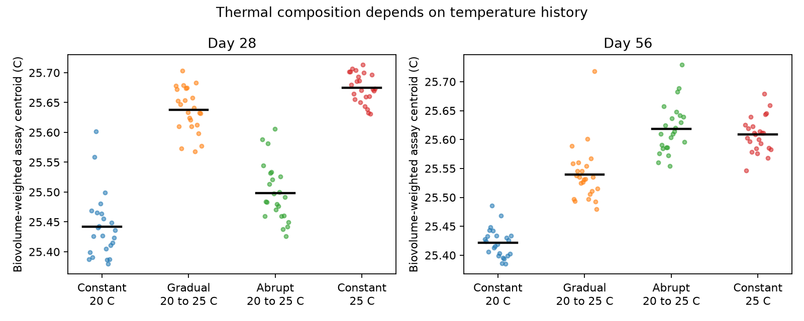

# Gradual warming gave an early thermal-score lead that positive relaxation models cannot predict in a 2014 microalgae experiment

## Result

In an open experiment with ten microalgae species, gradually warmed communities had a higher thermal score than abruptly warmed communities on day 28. The order reversed by day 56. Both groups started at 20 C and ended at 25 C. All species were supplied at the start. This result does not require a geographic species temperature index.

The early lead is outside the prediction of a common positive linear relaxation model. We prove this order restriction for every positive mixture of exponential response rates. We do not fit rates to the observations. The result gives a direct experimental test of a model class that has been used to interpret weak community response to warming.

The evidence does not show that competition causes the reversal. It does show that a temperature-only scalar lag is insufficient under the stated assumptions. Species replacement, changing relative abundance, succession, nonlinear responses and a changing target remain possible explanations. The original authors already reported history effects on evenness and poor transfer from monoculture growth to community composition. Our contribution is the independent thermal-score contrast, its reversal, and the model order test.

## Why this test matters

Earlier campaign studies found that community thermal composition follows a small part of its spatial temperature gradient. A fitted lag can describe such a deficit, but it does not identify the process. We use data beyond BBS and the 54 network summaries. The experiment controls initial species supply, has known temperature schedules, and measures species growth separately. It can test a restricted lag explanation without estimating a long time constant from a short field series.

The laboratory benchmark is not a spatial climate gradient. Our assay score is not a field temperature index. We do not estimate the fraction of the bird tracking gap that this process explains.

## Data and score

We use Limberger, Low-Décarie and Fussmann (2014), Dryad 10.5061/dryad.6t6k6, version 1, from its public Zenodo copy (4941448). There are 144 flasks in 72 paired landscapes, four replicates per treatment combination, and two visits (days 28 and 56). The design varies temperature change, landscape type and dispersal. Two percent of culture volume was exchanged twice weekly in connected pairs.

The growth assay measured nine species at 20, 25 and 30 C, with three cultures per combination. We use one published logistic growth estimate per culture. We apply the source correction that sets Navicula and Pandorina growth at 30 C to zero. Cryptomonas was absent from all community samples and has no growth assay. A source label difference, Kirchneriella versus Pseudokirchneriella, is matched as described in the provenance notice. Excluding this member does not remove the reversal.

For each assayed species, let r(T) be mean nonnegative growth rate. Define its assay centroid as

    s = sum[T * r(T)] / sum[r(T)], T in {20,25,30} C.

This is a score of relative growth across three test temperatures. It is not a thermal optimum, a complete tolerance curve or a realized niche estimate. We then average s with community biovolume shares. Cell shares and equal weights for present species are sensitivity tests. A second score, r(30)-r(20), tests dependence on the centroid formula.

All numerical results can be inspected in files/results. Source files, paths, hashes and rights are in files/PROVENANCE.md.

## Methods and uncertainty

The primary plan specified the day-56 warmed-minus-control contrast and a fraction relative to constant 20 versus constant 25 C communities. It also specified day 28 and alternative weights. We wrote this plan after reading design information and headers but before calculating scores. The direct gradual-minus-abrupt reversal and the order theorem were added after inspecting community means. They are exploratory, not preregistered tests.

We resample landscapes within Change x Landscape x Dispersal strata. Each resampled landscape retains both flasks and both visits. We also resample the three growth cultures within each species-temperature group. We use 2,000 joint draws with seed 845721. Reported limits are percentile 95% bootstrap intervals. They are conditional on this experimental system and the independent-culture interpretation of growth replicates. They do not capture growth chamber effects, unknown assay bias, model misspecification or variation among natural ecosystems. We use no multiple-testing adjustment. Separate sensitivity intervals are not independent replications.

## Numerical results

The main contrast below is gradual minus abrupt for communities warmed from 20 to 25 C. Units are nominal C of the assay centroid.

| Weight | Day 28 | Day 56 | Day 56 minus day 28 |
|---|---|---|---|
| Biovolume | +0.1393 [0.0817, 0.1987] | -0.0787 [-0.1178, -0.0459] | -0.2180 [-0.3092, -0.1308] |
| Cell density | +0.0559 [0.0327, 0.0802] | -0.0466 [-0.0740, -0.0227] | -0.1025 [-0.1487, -0.0620] |
| Presence | +0.1019 [0.0341, 0.1656] | +0.0025 [-0.0096, 0.0138] | -0.0994 [-0.1637, -0.0323] |

At day 56, the biovolume-weighted mean scores are 25.4214 for constant 20 C, 25.5397 for gradual warming, 25.6183 for abrupt warming, and 25.6086 for constant 25 C. Thus the warmed communities do not share a single endpoint score. The point fraction of the constant-treatment difference is about 0.632 for gradual warming and 1.052 for abrupt warming. These are interpolation fractions within this experiment. They are not climate tracking fractions. Full intervals and all planned comparisons are in contrasts.csv.

The biovolume contrast keeps both signs with and without dispersal and in homogeneous landscapes alone. At day 28 the contrast is +0.1468 with dispersal and +0.1318 without it. At day 56 it is -0.0802 and -0.0771. Both early intervals are above zero and both late intervals are below zero. This does not prove no dispersal effect; it shows that dispersal is not required for this pattern.

After exclusion of each assayed species in turn, all nine point contrasts remain positive on day 28 and negative on day 56. Removing Scenedesmus acutus reduces the early contrast to +0.0146. Thus dominant species account for much of its size. These deletion results are sensitivity checks, not independent tests. The alternative warm-growth-advantage score also retains the abundance-based reversal (reversal.csv). Presence alone gives no clear late reversal. The late difference is therefore mainly a difference in relative abundance, rather than a different set of present species.

## A lag order that can be tested without fitting rates

Assume that each component of a scalar community score follows a linear relaxation to a temperature-dependent target, with rate lambda >= 0 and nonnegative target gain. Allow any fixed nonnegative mixture of these components. Assume common initial states in expectation, fixed coefficients, and no treatment-specific forcing other than the prescribed temperature history. An identical background trajectory can be added to both treatments.

The abrupt treatment adds 5 C on day 16. The gradual treatment adds 25 increments of 0.2 C on days 4 through 28. These increment times have mean 16. At time t >= 28, for unit gain and one rate, the gradual-minus-abrupt response is

    D(lambda,t) = 5 exp[-lambda(t-16)]
                  - 0.2 sum(k=4,...,28) exp[-lambda(t-k)].

Convexity of exp(lambda k) gives

    mean[exp(lambda k)] >= exp(lambda * mean[k])
                         = exp(16 lambda).

Therefore D(lambda,t) <= 0 for all lambda >= 0 and all t >= 28. Any nonnegative mixture preserves that inequality. The same proof applies to a continuous linear ramp centered on day 16, or any distribution of positive warming increments with that mean and completed by the observation time.

A positive gradual-minus-abrupt score on day 28 is inconsistent with this model order in the population expectation. The conditional bootstrap interval for the observed contrast is positive. The experiment therefore provides evidence against this model class for this score and these nominal schedules. The late negative contrast agrees with the order, but cannot rescue the early violation.

The theorem does not apply to arbitrary delayed kernels, negative response weights, nonlinear or species-specific temperature targets, changing interactions, treatment-specific initial states, or treatment-specific succession. A delay before an exponential response, for example, is outside the tested class. The result rejects neither all lag mechanisms nor all demographic explanations. The nominal schedule also differs from a measured continuous culture temperature record, which is not supplied here.

## Limits and next test

This is one short laboratory experiment with a limited species pool. Species supply at the start excludes absence of potential colonists as a necessary explanation here, but not dispersal limitation in the field. Temperature-chamber replication is not established by the supplied files. Flask resampling does not solve a shared chamber effect. The result is conditional on these chambers and schedules.

The assay and community cultures use different conditions. Monoculture performance need not equal performance under competition. The source already reported that transfer problem. This study does not separate interaction effects from resource change, physiological adjustment or succession. The natural CTI gap could have other causes.

A decisive follow-up would repeat the two equal-mean schedules in independently replicated chambers, record realized temperatures, and follow species abundance at more than two times. A factorial test with and without competitors could then separate nonlinear physiology from changing interactions. Any fitted model should predict the history contrast before fitting the new community observations.

## Reproduction and checks

Use Python 3.12 with NumPy, pandas and Matplotlib. Actual package versions are in checks.json. No PDF reader is required for the analysis.

From an extracted publication, choose external scratch locations:

    python files/retrieve.py /absolute/scratch/raw
    python files/analyze.py --data-root /absolute/scratch/raw --out /absolute/scratch/results
    python files/reversal.py --data-root /absolute/scratch/raw --out /absolute/scratch/results
    python files/lag_order.py --out /absolute/scratch/results

With the shared store, pass its path as --data-root. Retrieval checks exact SHA-256 hashes and refuses to write raw sources under a publication. Analysis checks the 288 flask-visits, 144 flasks and 72 landscapes, verifies source hashes, checks normalized shares, and checks that species contributions sum to community contrasts. The lag script checks the analytic order at 1,001 rates at both visits. Raw sources need not be copied into the signed publication.

Job, model and source attribution are in files/PROVENANCE.md. This publication was signed locally for campaign 11_07_2026.
