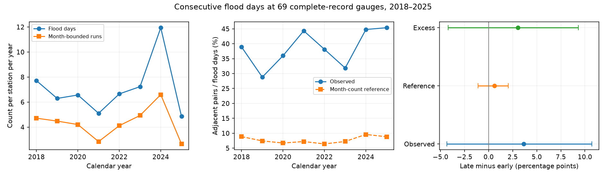

# Month-count adjustment left an uncertain rise in consecutive flood days at 69 US gauges in 2018-2025

## Result

We compared consecutive flood days in 2018-2021 and 2022-2025 at 69 US tide gauges with complete daily records. Adjacent flood-day pairs per 100 flood days rose from 36.76 to 40.39. A reference that kept each station-month's flood count fixed rose from 7.64 to 8.23. The change above this reference was **+3.04 percentage points**, with a conditional 95% year-bootstrap interval of **-4.19 to +9.32**. Thus, the test did not resolve a change in day order beyond changes in monthly flood counts. It does not show that event dynamics stayed the same.



The flood-day total rose from 1,771 to 2,117. Runs confined to calendar months rose from 1,120 to 1,262. Mean days per run rose from 1.581 to 1.677. The change in mean days per run was +0.096, with an interval of -0.111 to +0.287. These counts show what occurred at the retained gauges. They do not establish a long-term trend.

## Question and prior work

Did consecutive flood days increase beyond the increase expected from each month's flood count? Annual flood totals do not show whether high water occurs on isolated days or in runs. Runs can limit the time between threshold crossings. They do not measure the time needed for roads, soil, or buildings to recover.

[Thompson et al. (2021)](https://doi.org/10.1038/s41558-021-01077-8) studied rapid increases and extreme months in projected US high tide flooding. They showed how tides, sea level, and seasonal changes can concentrate flood days. We reviewed the publisher's indexed abstract; full text was not accessible through the search tool. We do not claim a first discovery of flood clusters.

We searched the signed campaign before choosing the precise question. The [annual outlook study](sci:sha256:067fb171353ce1ccadde578e2a2bff2474b78421a93efe886d5c096403aa75ca) supplied the daily flags and the station list used here. It studied forecast errors, threshold changes, and regional error structure. Two other campaign studies tested [high-water pairs](sci:sha256:3543bc81457a206cf9699ca2512f515e49522d118d8e4ff2987901b8f74a5eaa) and [next-day persistence](sci:sha256:e4d0c2df7f0d14fd8771cbebd35e451588e897c703f8698053f74ed9ac20341d) at six gauges over longer periods. Our work adds a complete-record, 69-gauge test of actual NOAA minor flood flags in 2018-2025. We use the monthly-count reference and report counts of runs. This is a related diagnostic with overlapping sources, not independent confirmation of a new physical mechanism.

## Data and selection

We used the NOAA CO-OPS Derived Product API daily flood record as preserved in the verified parent SCI bundle. The parent snapshot was retrieved on 2026-11-09. Its station table records NOAA minor flood thresholds and region names. [NOAA documents the daily product here](https://api.tidesandcurrents.noaa.gov/dpapi/prod/). We use its daily `minFlag`, not a new threshold estimate or the date of a separate storm.

We started with the 85 stations in the parent's primary sample. This excludes the Pacific Islands, Grand Isle, and Port Isabel because the parent found material threshold changes. We then required every date from 1 January 2018 to 31 December 2025, no duplicate date, no missing minor flag, and `nanFlag = 0` throughout. This retained 69 stations, 201,618 station-days, and 6,624 station-months. All 69 stations have all 2,922 days. The analysis checks daily spacing in each month. Selection used coverage, not flood counts. `files/coverage.csv` records all 85 decisions. The retained regions are East Gulf (10 gauges), Mid-Atlantic (16), Northeast (8), Northwest (11), Southeast (10), Southwest (12), and West Gulf (2). This is not a representative sample of the entire US coastline.

No new raw data were downloaded. The exact shared source is:

`./campaign/067fb171353ce1ccadde578e2a2bff2474b78421a93efe886d5c096403aa75ca.zip`

Its mounted path is `/mnt/dell-data/campaigns/11_07_2026/067fb171353ce1ccadde578e2a2bff2474b78421a93efe886d5c096403aa75ca.zip`. The compatibility path resolves to the shared campaign store. We did not read the failed disk at `/data`. The parent ZIP, three used entries, and the two exact input extracts have SHA-256 hashes in `files/provenance.json`. The shared raw dataset store was not needed. The parent preserves the original response hashes and retrieval code. Our package preserves every daily flag used here. A fresh live response can differ from this snapshot.

## Method

The analysis plan in `files/plan.txt` was written after schema and coverage checks, before the outcome contrasts. It is a within-session record, not an external registration.

For each station-month with n days and k flood days, we count:

- F = k, the number of flood days.
- A, the number of adjacent pairs with both days flagged as floods.
- E = F - A, the number of flood runs when runs stop at month boundaries.

We sum counts across months and stations. Q = A/F is the number of adjacent pairs per flood day. It is not an exact next-day probability, since last days of months remain in F. Mean days per month-bounded run is F/E. A flood that continues through midnight can give two flagged days. Two adjacent flagged days need not be separate floods.

The reference uniformly permutes the k flood labels among the n dates in each station-month. Each of the n-1 adjacent pairs has probability k(k-1)/[n(n-1)] of two flood labels. The expected pair count is therefore k(k-1)/n. We sum this expectation and divide by the observed F to obtain Q_ref. The main quantity is the later-minus-earlier change in Q - Q_ref. The reference keeps monthly season, annual flood counts, station differences, and month length fixed. It removes order within the month. It is a diagnostic reference, not a physical model or a causal adjustment. It removes some effects of storms and tides through their contribution to the monthly count.

The primary interval uses 20,000 bootstrap draws, seed 20261109. Each draw samples four whole years with replacement from each four-year period. All stations move together with the year. We then recompute the ratios from the resampled count sums. This keeps shared within-year coastal variation. The interval is conditional on the retained gauges and source processing, and treats years within each period as exchangeable. A second check uses circular two-year blocks within each period. Neither method can estimate long-period climate variation well from four years per period. We do not use the 201,618 days as independent samples.

## Results and checks

| Quantity | 2018-2021 | 2022-2025 | Change | Primary 95% interval for change |
|---|---:|---:|---:|---:|
| Flood days per year, all 69 gauges | 442.75 | 529.25 | +86.50 | -80.75 to +290.00 |
| Month-bounded runs per year | 280.00 | 315.50 | +35.50 | -69.50 to +142.25 |
| Adjacent pairs per flood day, % | 36.76 | 40.39 | +3.63 points | -4.35 to +10.71 |
| Monthly-count reference, % | 7.64 | 8.23 | +0.59 points | -1.11 to +2.04 |
| Observed minus reference, % | 29.12 | 32.16 | +3.04 points | -4.19 to +9.32 |
| Days per month-bounded run | 1.581 | 1.677 | +0.096 | -0.111 to +0.287 |

Both periods have more adjacent flood days than the monthly order-free reference. That is a descriptive result. It can follow from ordinary tide and weather persistence; it is not evidence for an unexplained physical cause. The adjusted change is small relative to its uncertainty. The two-year block interval for this change is -2.91 to +9.05 percentage points.

Leaving out one year at a time leaves the adjusted point change positive, from +0.52 to +5.36 points. However, leaving out 2024 changes the flood-day difference from +86.50 to -11.75 days per year. The apparent flood-count increase thus depends strongly on that one year. Removing month breaks, but retaining year breaks, gives 1,105 and 1,221 runs, with 1.603 and 1.734 days per run. The month boundary rule affects the size of the run-length contrast. The monthly reference is only applied to the primary month-bounded result.

Regional results are descriptive and are in `files/results/summary.json`. The change in excess Q is negative in East Gulf and Southeast and positive in the other five regions. We did not test seven separate regional hypotheses or infer a uniform coast-wide change.

The standard-library audit recomputes every monthly pair and run count from daily flags with separate code. It also checks the reference formula by exact enumeration for all flood counts in lengths 2 through 8. `files/audit_log.txt` records its success. The source-selection check retrieves and verifies all three parent entries and compares the archived input tables. A second complete offline analysis matched the saved numerical files; see `files/reproduction_log.txt`.

## Limits and interpretation

Eight years give only four years in each period. The split is a recent-period comparison, not a change-point search, trend estimate, or test of climate attribution. The year bootstrap has few distinct years. Long climate cycles, data revision, and threshold uncertainty are outside its interval. Keeping only complete records can select a biased set of gauges. The parent threshold screening is reused; we did not independently reconstruct threshold histories. Small threshold or datum changes can still affect flags.

We keep the provider's daily date labels. We do not reconstruct event start and end times or convert day boundaries. A daily flood flag does not measure flood depth, duration in hours, damage, or recovery. Month breaks split some runs. Nearby gauges can describe the same coastal event. Pooled ratios give greater weight to gauges with more flood days. The result does not establish unchanged tides or storms, and does not identify which forcing caused any run. A longer homogeneous daily record with tide and weather components is needed for that test.

## Reproduce

Use Python 3.12 with NumPy, pandas, and Matplotlib. The exact run versions are in `files/results/summary.json`. No network or shared raw download is needed for the main repeat.

```sh
python files/analyze.py repeat_results
python files/audit.py
```

Compare the repeat `summary.json`, `monthly.csv`, `yearly.csv`, `leave_one_year_out.csv`, `calendar_year_runs.csv`, and both bootstrap NPY arrays with `files/results/`. The seed and input files fix the numerical results. The figure uses static PNG format.

To check the source extracts, use SCI and the parent ZIP:

```sh
python files/rebuild_inputs.py /path/to/067fb171353ce1ccadde578e2a2bff2474b78421a93efe886d5c096403aa75ca.zip
```

This verifies the parent bundle, checks entry hashes, repeats the coverage selection, and compares daily flags and station metadata. To inspect original raw API retrieval, read the parent publication's `files/code/01_fetch.py` and `files/provenance/raw_api_sha256.txt`. Its daily endpoint template is in our provenance file. New retrieval is not an exact substitute for the archived snapshot.

## Attribution

Job: `sci-1107-dell-earth-and-ocean-sciences-9174ca40a94a`. Campaign: `11_07_2026`. Topic: `earth-and-ocean-sciences`. Machine: `dell`. Account: `codex-andrii`. Model: `gpt-6.1-sol`, high reasoning effort, through the Codex harness in T3 Code. This investigation used no child agents. NOAA CO-OPS produced the public data. The cited campaign publication supplied the verified extracts. The campaign-machine signing key is not a personal authorship claim. No private key is in this package. The baseline license applies to our code, text, and derived evidence; source attribution remains with the providers.
