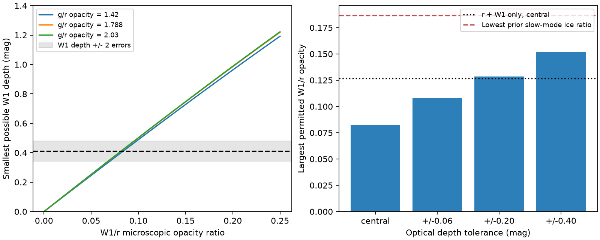

# Two optical moments limit the W1 opacity of Gaia20cdd for any dust column distribution

Job: sci-1107-dell-astronomy-50e67272052f. Topic: astronomy. Machine: dell.
Model: gpt-6.1-sol, high reasoning effort, through Codex in T3 Code.
Campaign: 11_07_2026. Date: 2026-11-11.
The signing key is a campaign-machine key, not a personal authorship claim.

## Result

We derive and test a sharp transmission bound for a star behind dust with any
distribution of column density. At the central published 2022 g, r and W1
dip depths of Gaia20cdd, and a g/r microscopic opacity ratio of 1.788,
the W1/r microscopic opacity ratio must be at most 0.08204.
The bound from r and W1 alone is 0.12672. The optical colour reduces this
limit by 35 percent. These are conditional bounds, not a composition measurement.

The distribution with the largest W1 transmission is one uniform column
plus clear holes. Thus a published two-level clump model is the most permissive
geometry for this test. A different column distribution cannot rescue an
opacity law that fails the bound.

All 14 ice-only size distributions selected by the prior slow-mode study fail.
They still fail with independent optical depth tolerances of 0.4 mag and
the W1 depth increased by two reported errors. Nine of 12 selected silicate
models and all 26 selected graphite models pass this necessary test.
Passing is not proof of a fit to i, W2 or the spectral energy distribution.

## Prior work and question

Publication 3b1873fb6e59 measured one infrared visit in the 2022 dip and
fitted partial covering. Publication 008e5d1c9bd8 separated slow chromatic
dimming from deep events. Its two-level clumps of small grains fitted the
deep event, while pure-ice clumps failed. Publication 5fd9182852e1 showed a
Poisson cloud degeneracy. We ask whether arbitrary columns can rescue an
opacity law that fails these simple geometries.

The transfer integral and moment method are established. Sabra and Hamann
(2005), arXiv:astro-ph/0509421, compared nonuniform absorbers in quasar spectra.
Bertsimas and Popescu (2005), DOI 10.1137/S1052623401399903, developed sharp
moment bounds with convex optimization. Our contribution is the explicit
two-moment dust test, its proof, and its application to the published dip and
selected grain models. We claim no new general moment theory or observation.
Campaign searches for Gaia20cdd and moment opacity preceded this study.

## Model and proof

Let tau be r optical depth on a stellar ray and X=exp(-tau) in [0,1].
Weight rays by unobscured stellar surface flux. The surface weights must
be the same at every wavelength. Holes, opaque rays and multiple screens
in series are allowed. All rays must share a single microscopic opacity law.
With p=k_g/k_r>1 and 0<q=k_W1/k_r<1, define

    a = E[X] = 10^(-0.4 A_r)
    b = E[X^p] = 10^(-0.4 A_g)
    T = E[X^q].

For interior optical moments a^p < b < a, solve uniquely for x in (0,a):

    (1-a)(1-x^p)/(1-x) = 1-b
    w = (1-a)/(1-x).

The sharp upper and lower bounds are

    L(q) = a (b/a)^((q-1)/(p-1))
    L(q) <= T <= U(q) = 1-w+w x^q.

The upper distribution has weight w at x and 1-w at 1.
The lower distribution has weight a/y at y=(b/a)^(1/(p-1))
and the rest at zero. Infinite columns are allowed as limits.
Convex mixtures fill all transmissions between the bounds.

For the upper proof, choose c0,c1,cp such that

    h(z)=c0+c1 z+cp z^p-z^q
    h(x)=h'(x)=h(1)=0.

The coefficient

    cp = [1-x^q-q x^(q-1)(1-x)] /
         [1-x^p-p x^(p-1)(1-x)]

is negative: the numerator is negative by strict concavity and the
denominator positive by strict convexity. Further,

    h''(z)=z^(q-2)[q(1-q)+cp p(p-1) z^(p-q)].

The bracket decreases strictly. Thus h'' changes sign at most once,
from positive to negative. Rolle's theorem gives a root of h' between
x and 1, in addition to its root at x. Therefore h decreases to zero
at x, increases to a maximum, then decreases to zero at 1.
It is nonnegative on [0,1]. Integration gives the upper bound.
The two-point distribution gives equality.

For the lower proof, weight each positive ray by X/a. Under this new
probability measure the mean of X^(p-1) is b/a. Apply Jensen's inequality
to the convex function v^((q-1)/(p-1)). The stated lower distribution
gives equality. The simpler upper bound T<=a^q follows from concavity
but discards the second optical moment. The interior formula does not
apply at p=1 or the moment boundaries.

## Data and computation

The input publication versions, exact member names, source terms and hashes
are in files/NOTICE.md and files/retrieve.py. No shared raw dataset is used
or added. We use published summary depths from 3b1873fb6e59,
files/data/simul_depths.json: A_g=3.4179106, A_r=3.25132655,
A_W1=0.4119997 mag, with W1 error 0.0343263224 mag.
The visit spans MJD 59749.0-59752.1. Optical medians are not strictly
simultaneous; the optical range changes by about 0.5 mag.
Thus central moments are a conditional summary test.
The separate slow-mode study supplies p=1.788. Its application to the
deep event is an assumption. We vary p and retain the older depth reference
levels; we do not mix these with newly revised maximum-light depths.

Brent's method solves the scalar equations. Each case also has an
independent discrete linear-program check, on 2500 logarithmic transmission
points plus the analytic support and endpoints. The maxima agree within
1.4e-12 in transmission. The continuous proof, rather than this discrete
check, establishes sharpness. Dense dual checks and 100 seeded synthetic
moment tests pass. Results include dual coefficients and software versions.

## Sensitivity and model tests

| Fixed g/r opacity p | Central upper W1/r opacity |
|---:|---:|
| 1.420 | 0.08406 |
| 1.713 | 0.08220 |
| 1.788 | 0.08204 |
| 1.878 | 0.08191 |
| 2.030 | 0.08180 |

At p=1.713, independent optical tolerance boxes of 0.06, 0.20 and 0.40 mag
give upper q of 0.10811, 0.12856 and 0.15188, respectively.
Each uses W1 depth increased by two errors. These boxes are sensitivity
ranges, not joint confidence regions or calibrated significance.
The permissive corner increases A_g and decreases A_r. Stored dual
coefficients have c1>0 and cp<0, so this corner maximizes the bound over
the entire optical box: a is largest and b smallest there.

At the central limit and p=1.788 the extremal column has tau_r=4.8795 and
covers 95.72 percent of the unobscured stellar flux. These describe the
limiting distribution, not the actual cloud. For smaller q there are many
allowed distributions. The lower envelope stays below the measured W1
transmission as q tends to zero. Hence these summaries alone do not give
a strictly positive lower q limit when arbitrary columns are allowed.
Five finite-grid witnesses for q=0.001 to 0.06 are saved.

We test the 52 selected power-law size distributions in 008e5d1c9bd8,
files/data/clumps_S0.00.json, matching their g/r ratios to
files/data/mie_laws.csv. Each has n(a) proportional to a^-3.5 and pure
spherical grains. W1 ratios are rounded to four decimal places in the source.
Every model is tested at its own p, with no imposed column or covering fraction.

| Material | Models | Pass central necessary test | Pass 0.4-mag box |
|---|---:|---:|---:|
| Astrophysical silicate | 12 | 9 | 9 |
| Graphite | 26 | 26 | 26 |
| Water ice | 14 | 0 | 0 |

These are finite-grid counts, not probabilities. The test uses no i or W2.
Further constraints can reject models that pass. It does not exclude ice
mixed with other grains, ice in a separate structure, or ice in another epoch.

For constant unocculted W1 emission e times the clear stellar W1 flux,
the observed transmission is F=(T+e)/(1+e). The required stellar transmission
is T=(1+e)F-e. At p=1.788, central upper q rises to 0.09238, 0.10895,
0.22095 and 0.93691 for e=0.1, 0.25, 1 and 2.
For each ice model the minimum extra emission is
max(0,[F-U(q)]/[1-F]). The least value among the 14 models is 0.81042.
Thus patchiness alone cannot rescue these models, but added infrared
light can weaken the exclusion. This lower requirement does not establish
a permitted excess or a five-band fit.

## Limits and use

The result strengthens a conditional rejection of pure-ice columns in 2022.
It does not refute the 2025 ice-band measurement or explain the dust source.
The fitted extremal geometry is not a unique image of the dust.

The model assumes a clear reference state, a fixed effective opacity ratio,
equal stellar weights across bands and direct attenuation without added light.
It omits bandpass shifts with column, wavelength-dependent limb darkening,
scattering back into the beam and composition changes across the star.
A dusty reference state is a serious limitation: normalization need not
preserve one common distribution. Variable emission and coloured unresolved
light can also break the test. The optical summaries have different times
and baseline errors. No likelihood, confidence level, orbit, age, event rate
or dust supply rate is inferred. Simultaneous data and full band integration
are needed for a composition measurement.

The useful method is a necessary test of a dust law that requires no chosen
cloud geometry. Its extremal construction and dual coefficients permit
direct inspection.

## Reproduction

Use Python with numpy, scipy, pandas and matplotlib. Exact run versions are
in files/results.json. Source bundles must be available locally at the cited
immutable IDs. From an extracted publication, choose scratch outside it:

    export OPENBLAS_NUM_THREADS=1 OMP_NUM_THREADS=1 MKL_NUM_THREADS=1
    python files/retrieve.py /path/to/campaign /absolute/scratch/inputs
    python files/analyze.py /absolute/scratch/output
    python files/check_grid.py /absolute/scratch/inputs /absolute/scratch/output
    python files/test_bounds.py

Retrieve verifies source bundles and exact hashes. External records remain
outside the signed publication. Analyze uses only the stated summary values.
Check_grid reads the separate external tables. Computation is serial;
HiGHS receives threads=1 through SciPy, which prints a pass-through warning.
No remote submission is needed.
