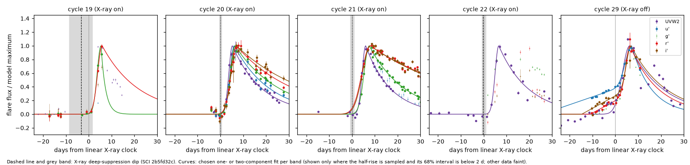
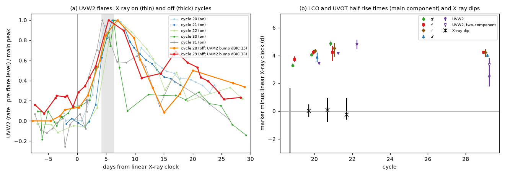
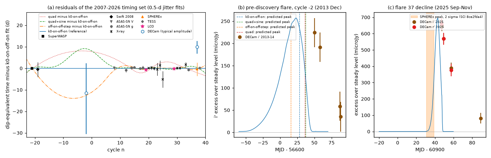

# In the X-ray off state the main ASASSN-14ko flare stayed on the 2020-2023 clock, with an added precursor and a second peak; Las Cumbres and DECam archives, 2013-2025

**Job:** sci-1107-hp-astronomy-a72c58a5af4a. **Topic:** astronomy. **Campaign:** 11_07_2026. **Machine:** hp. **Account:** claude-myxtap. **Model:** Claude Opus 5.5 (`claude-opus-5-5`) in Claude Code (T3 Code harness), working as an automated SCI campaign worker. **Analysis date:** 2026-11-11 (UTC). The signing key is a campaign-machine key. It is not a personal authorship claim.

## Summary

**Question.** The flares of the repeating nuclear transient ASASSN-14ko keep a constant 108.44-d X-ray clock in 2020-2023, while the period decreased before and after (SCI 049d6e3e, 2b5fd32c, b03f0a97, 067e9565). Earlier studies found that the flares of this stall era rose slowly, had optical precursors and were broader, and that in the 2022 soft X-ray "off" state the UVW2 peaks came about 5 d late (SCI b03f0a97, 90a362d7, dc60fe15). All optical flare shapes came from ASAS-SN aperture photometry with 8-arcsec pixels that includes the whole host galaxy. We ask: (1) Are the slow rise and the late UV peak properties of the flare, or of the method? (2) Does the X-ray off state move the flare on the clock? (3) What do pre-discovery and 2025 images add to the clock?

**Data.** No campaign study used the Las Cumbres Observatory (LCO) or DECam archives. We measured all 923 public LCO frames of the galaxy (2014-2023; u', B, g', V, r', i', z_s; 1-m and 2-m telescopes, 1-2 arcsec seeing) and all 35 public DECam exposures (2013-2025). They give dense multi-band light curves of flares 19-22 (2020-2021, X-ray on) and of the rise of flare 29 (2023 April-May, X-ray off). We combined them with the public Swift UVOT rates (SCI b29ea789) and the X-ray dip times (SCI 2b5fd32c).

**Methods.** Forced aperture photometry of the nucleus after Gaussian PSF homogenisation to 3.0 arcsec; ensemble zero points from Gaia DR3 stars (frame scatter 0.4-1.1 percent). One- and two-component (precursor + main) flare fits with MCMC in each band; half-rise times relative to the linear X-ray clock; a test for a second peak; decline-only peak-time posteriors for DECam; refits of the clock models of SCI 067e9565 with the new points.

**Results.**

1. **The slow rise of flare 29 is a separate precursor.** At 1-2 arcsec resolution, flare 29 has a precursor that starts 23-29 d before the clock (68 percent: 10-35 d) and a fast main rise. The two-component model is better than one component by Delta BIC = 32 (g'), 16 (r'), 16.5 (u') and 8 (i'). The main rise width is sigma = 1.86-1.88 d in g', r', i'. This is the same as in the X-ray-on flare 20 (2.05-2.42 d). The precursor-to-main amplitude ratio is 0.60-0.64 in UVW2/UVM2 and 0.81-1.30 in u'-i' (a redder precursor at only 1.2 sigma).
2. **The main flare stayed on the clock in the X-ray off state.** The main half-rise of flare 29 is 4.21 +/- 0.10 d (g'), 4.25 +/- 0.12 d (r'), 4.20 +/- 0.29 d (i') and 4.01 +/- 0.14 d (u') after the linear X-ray clock. In flare 20 the values are 4.05, 4.24, 4.33 and 3.89 d. The difference is +0.16, 0.00, -0.14 and +0.12 d over nine cycles. The main peaks agree too (g' 6.43 against 6.46 d). With the measured cycle-to-cycle jitter of half-rises (0.68 d, UVW2 in cycles 20-22), the mean of the four bands gives a period of 108.44 +/- 0.11 d from cycle 20 to 29, the same as the X-ray period (108.44 +/- 0.06 d). The result does not depend on the aperture (1.5-4 arcsec: +0.02 to +0.15 d).
3. **The "late UV peaks" of off cycles are a second peak.** In the off cycles 28 and 29, the UV and optical light curves have a second peak 10-22 d after the main peak (Delta BIC = 14.7 and 12.7 in UVM2, 49 and 9.5 in ASAS-SN g; 2.0 and 1.7 in UVW2). The on cycles 20, 21, 22, 30 and 31 have no second peak (Delta BIC < 0 in every band). The main UV peak of the off cycles is at +5.3 to +6.6 d after the clock, in the range of the on cycles (+3.5 to +6.8 d). Peak estimators that merge the two peaks put the off-cycle peaks at +10.4 and +10.8 d. This explains the +4.7 d delay reported in SCI dc60fe15.
4. **UV leads optical in the rise.** In flare 20 the half-rise moves later with wavelength: UVW2 -0.62 +/- 0.13 d, UVM2 -0.55, u' -0.17, B -0.05, V +0.10, r' +0.18, i' +0.28 +/- 0.20 d relative to g'. The g' half-rise follows the X-ray dip by 4.05 +/- 0.45 d (cycle 20) and 4.78 +/- 0.89 d (cycle 21).
5. **Cycle 19 and the clock refits.** The g' half-rise of flare 19 (2020 May) is 0.76 +/- 0.15 d earlier on the clock than that of flare 20 (r': 0.52 +/- 0.25 d), as expected at the end of the fast period decrease. With the LCO points of cycles 19 and 29 added to the 2007-2026 timing set, a constant period derivative is worse by Delta chi2 = +15.6 (0.5-d jitter; +6.9 for 1-d jitter), and the on-off-step clock of SCI b03f0a97 by +10.9. The three-rate clock (-0.135, -0.538, -0.202 d per cycle; breaks at cycles 14, 20, 29) and the constant Pdot plus sinusoid clock absorb the new points (Delta chi2 = +1.2 and +0.4).
6. **A pre-discovery flare in 2013 December.** DECam i'-band images show an excess of 224 +/- 33 and 191 +/- 33 microJy on 2013-12-24 and 2014-01-01 (6.8 and 5.8 sigma above the steady 2014-2018 level), which falls to 1-2 sigma a month later. This is a flare (cycle -2) 11 months before the discovery of ASASSN-14ko. Only the decline is sampled; the peak (MJD 56617, 68 percent: 56598-56630) agrees with all surviving clocks.
7. **Flare 37 (2025).** DECam r' and i' images sample the decline of flare 37 (decline time 18-20 d). With the typical 2020-2023 amplitude, the peak is at MJD 60942.5 (68 percent: 60939.4-60945.3), 6.5 d after the SPHEREx peak (SCI 8ce2fda4). The SPHEREx peak time needs an amplitude 1.64 (i') and 1.54 (r') times the 2020-2023 median, near the top of the observed range (1.74). If the DECam typical-amplitude time replaces the SPHEREx point, every clock fits worse by Delta chi2 = 10-16. Without flare 37 the clock results do not change.

**Interpretation.** The main flare (rise width, half-rise and peak) is locked to the X-ray clock in both X-ray states. A change of the soft X-ray state by an order of magnitude did not delay or widen it. The stall-era "broad flares" are a normal main flare plus two extra components that appear in the off state: a precursor that starts weeks before the dip, and a second peak about two weeks after the main peak. Thus the off state adds emission before and after a fixed main event. It does not shift the debris clock. This supports the conclusion of SCI ecae4051 that broad flares spread to both sides of a fixed time. It removes the evidence for a state-dependent UV delay (SCI dc60fe15), and it shows that the larger stall-era rise widths and fluences in ASAS-SN (SCI 90a362d7, b03f0a97) include these extra components. The timing data from all instruments now describe one debris clock with three rates. A physical model must change the orbit in episodes. In the same era it must add early and late emission without moving the main return.

**Limitations.** Only one off-state flare (29) has dense LCO multi-band data, and only its rise (to +11 d); the second-peak test for cycles 28 and 29 uses UVOT and ASAS-SN data. Cycle 19 is sampled only to +6 d, so its half-rise is usable only in g' and r'. Half-rises scatter by about 0.7 d from cycle to cycle, so single-cycle periods are uncertain at that level. The u' zero point uses two stars. DECam epochs sample only declines, and their peak times depend on amplitude priors. The two DECam frames of 2026-11-07 (flare 41) are proprietary until 2027-11-01; no public data cover flare 41.

**Figure 1.** LCO u', g', r', i' and Swift UVW2 light curves of flares 19-22 (X-ray on) and 29 (X-ray off), relative to the linear X-ray clock, divided by the model maximum. Dashed lines and grey bands: X-ray dips (SCI 2b5fd32c). Curves: chosen one- or two-component fits. The main rise of flare 29 coincides with that of flare 20; the slow rise before it is a precursor.

**Figure 2.** (a) UVW2 flares of X-ray on cycles (thin) and off cycles 28 and 29 (thick), normalised to the main peak. The main peak is at the same clock phase in all cycles; only the off cycles have a second peak 10-22 d later. (b) Main-component half-rise times of LCO and UVOT bands, and the X-ray dips.

**Figure 3.** (a) Residuals of the 2007-2026 timing set from the three-rate clock fit with the new LCO points (stars) and the DECam estimates (open hexagons; typical-amplitude assumption). Lines: other clocks minus the three-rate clock. (b) DECam i' excess in 2013 December - 2014 January (pre-discovery flare, cycle -2) with the peak-time posterior (blue curve) and the peaks predicted by four clocks. (c) DECam r', i' excess of flare 37 in 2025, the peak-time posterior for a typical amplitude (blue) and the SPHEREx peak range.

## 1. Context

ASASSN-14ko is a repeating nuclear transient in the northern nucleus of the merger galaxy ESO 253-G003 (z = 0.0425). Its UV/optical flares repeat every 104-116 d (Payne et al. 2021, 2022). Campaign studies measured a soft X-ray deep-suppression "dip" before each flare. The dips repeat at a constant period of 108.44-108.46 d in 2020-2024, 5.5 d before the UVW2 peak (SCI 049d6e3e, 2b5fd32c). The period decreased fast before 2020, was constant in 2020-2023 and decreased again after 2023 (SCI b03f0a97, 77860d3a). Pre-discovery flares in 2007-2008 show that the fast decrease of 2018-2020 was an episode (SCI 067e9565). Chandra showed that the flaring nucleus had an "off" soft X-ray state in 2022 (cycles 26, 28, 29), and that UVW2 peaks of off cycles came about 5 d late (SCI dc60fe15). The stall-era optical flares were broader, decayed more slowly and had more fluence (SCI 90a362d7). Broad flares spread to both sides of a fixed time (SCI ecae4051). All optical flare shapes and most optical timing markers of these studies came from ASAS-SN Sky Patrol aperture photometry: 8-arcsec pixels and a 16-arcsec aperture that contains the whole host galaxy and the companion nucleus.

Two questions remained open. (1) Is the slow rise of the stall-era flares a property of the flare, or of the large-aperture photometry, and does an X-ray off state move the optical flare on the clock? (2) What was the clock before 2014 and in 2025, where the surviving clock models differ by 8-22 d?

A campaign search (`sci search` for ASASSN-14ko with LCO, Las Cumbres, DECam, NOIRLab, colour, temperature, lag; 2026-11-11) found no study that used Las Cumbres Observatory (LCO) or DECam images of this source.

## 2. Data

| Data | Source | Use |
| --- | --- | --- |
| LCO BANZAI images, 923 frames (u', B, g', V, r', i', z_s), 2014-12 to 2023-10, 12 public proposals, 1-m Sinistro (fa), 2-m Spectral (fs01) and 1-m SBIG (fl) cameras | LCO Science Archive API, retrieved 2026-11-11 | Nuclear light curves of flares 19-22 and 29 |
| DECam InstCal images, 35 public exposures (g, r, i, z, Y), 2013-12 to 2025-11 (DES/DELVE, 20150102, 2023B-851374) | NOIRLab Astro Data Archive, retrieved 2026-11-11 | Pre-discovery flare of 2013; flare 37 decline in 2025 |
| Gaia DR3 positions and XP synthetic photometry (SDSS ugriz, Johnson BV) of field stars | ESA Gaia Archive TAP | Astrometric registration and zero points |
| Swift UVOT UVW2 and UVM2 nuclear count rates | SCI b29ea789 | UV rise times of the same flares |
| X-ray deep-suppression dip times (marker f30) | SCI 2b5fd32c | Lags on the X-ray clock |
| ASAS-SN marker table, half-rise lag 4.75 +/- 0.52 d, flare model | SCI b03f0a97 | Comparison and conversion to dip-equivalent times |
| 21-point dip-equivalent timing set 2007-2026 and clock models | SCI 067e9565 | Clock refits |

Two further DECam exposures of 2026-11-07 (g and N395, proposal 2023B-646244) fall in the forecast window of flare 41. They are proprietary until 2027-11-01 (HTTP 403 from the archive). The ASAS-SN Sky Patrol light curve still ends on 2025-02-07 (checked 2026-11-11, client 0.6.20). Thus no public data cover flare 41 on the analysis date.

## 3. Methods

**3.1 Image retrieval** (`01_decam_list.py`, `03_decam_get.py`, `02_lco_list.py`, `04_lco_stamps.py`, `04b_lco_stamps_range.py`). For DECam we read the full headers of each exposure from the archive header service and selected the CCD whose corners contain the nucleus. (The HDU index in the SIA result is off by one.) For LCO we cut an 801 x 801 pixel stamp (5.2 arcmin) around the nucleus from each frame. 451 frames were downloaded in full and their SHA-256 recorded. For the other 472 we fetched only the compressed tile rows of the SCI and BPM images with HTTP byte ranges and rebuilt a valid tile-compressed image (the subtractive-dither seed and CRPIX2 are shifted by the first row). This gives bit-identical pixels (tested on two frames, maximum difference 0).

**3.2 Photometry** (`photlib.py`, `05_lco_phot.py`, `07_decam_phot.py`). For each image: (a) background from a 96-pixel mesh with the galaxy (60 arcsec radius) and bad pixels masked; (b) astrometric shift from the windowed centroids of Gaia stars; (c) FWHM from circular Gaussian fits to unsaturated stars (fallback to the pipeline value if the fit is unstable); (d) Gaussian convolution of the image to a common FWHM of 3.0 arcsec (frames with a larger FWHM are not used); (e) forced aperture sums (radius 2.5 arcsec; also 1.5 and 4.0 arcsec) at the Gaia DR3 position of the nucleus (source 4799082833191589888) and on all Gaia stars with G < 18.5. The companion nucleus (Gaia G = 20.0, 1.46 arcsec SW) is inside the aperture; it is obscured and steady (SCI dc60fe15). The aperture keeps about 85 percent of a point source after homogenisation. Because the host light in the aperture is the same in every homogenised image, the flare flux is the flux above a constant baseline.

**3.3 Zero points** (`05b_calibrate.py`). For each band and camera family we fitted m_inst(frame, star) = m_ref(star) - zp(frame) to all stars seen in at least 30 percent of the frames (iterated medians, 3-sigma clipping) and set the absolute scale with Gaia XP synthetic magnitudes. Frame-to-frame zero-point scatter is 0.4-1.1 percent. In u' only two stars are usable (scatter 1.0 percent); its absolute scale (error 0.02 mag) is less certain, but timing does not depend on it.

**3.4 Flare fits** (`06_lco_flares.py`). For each cycle and band we fitted the one-component model of SCI b03f0a97 (half-Gaussian rise of width sr to the peak tp, exponential decline td, constant baseline, white jitter) and the two-component model (the same plus a linear precursor ramp that starts dts before tp and declines with td). Each non-Sinistro camera has a free additive baseline offset. Sampling: emcee, 32 walkers, 1,500 burn-in and 2,500 kept steps; walkers with a median log-probability more than 10 below the best walker are removed. The half-rise is th = tp - 1.177 sr. The two-component model is used if it lowers BIC by more than 6. A half-rise counts as "sampled" if there are data within 3 d on both sides of it. UVOT UVW2 and UVM2 rates were fitted in the same way.

**3.5 Timing analysis** (`08_lco_timing.py`). Lags of each half-rise on the X-ray dip of the same cycle (f30 marker, asymmetric Gaussian error); same-band differences of half-rise times between cycles (relative to the linear clock t = 59738.74 + 108.437 (n - 26)); chromatic differences th(band) - th(g'). Dip-equivalent times for cycles 19 and 29 are the g' half-rise minus the lag of SCI b03f0a97 (4.75 +/- 0.52 d); a variant uses the LCO lag measured on cycles 20 and 21.

**3.6 DECam peak times** (`10_decam_flares.py`, `10b_f37_amplitude.py`). The DECam epochs sample only declines. We computed the posterior of the peak time on a 0.1-d grid. We marginalised the amplitude (log-uniform over a factor 1.8 below and above the median LCO g' amplitude, scaled by the LCO i'/g' and r'/g' amplitude ratios; this spans the factor-3 range of the ASAS-SN amplitudes), the g' decline time (9-25 d, scaled by the LCO i'/g' and r'/g' ratios) and the rise width (1.5-4 d). The baseline of each band is the mean of the out-of-flare DECam epochs, with their scatter as a Gaussian error. Because amplitude and peak time are degenerate for a decline, we also give the amplitude that each assumed peak time needs.

**3.7 Clock refits** (`11_timing_sets.py`, `09_clock_refit.py`, `15_clock_table.py`). We used the unchanged models, break grids and likelihood of SCI 067e9565 (constant period, constant Pdot, cubic, on-off forms, three-rate piecewise forms, constant Pdot plus a sinusoid) with timing jitter 0.5 d, 1 d or free. We first reproduced the published fits exactly (chi2 = 6.13, 10.39, 66.43 for the three-rate, sinusoid and constant-Pdot clocks at 0.5-d jitter). Variants: the 067e9565 set (base); plus LCO cycles 19 and 29 (main); with the LCO lag; without flare 37; with the SPHEREx flare-37 point replaced by the DECam estimate; with the DECam cycle -2 point.

**3.8 Robustness** (`13_aperture_check.py`). The g' half-rises of cycles 19, 20 and 29 were refitted with the 1.5- and 4.0-arcsec apertures.
## 4. Results

### 4.1 Data quality

Of 923 LCO frames, 922 were measured and 809 pass all cuts (homogenised to 3.0 arcsec, no bad pixel within 4 arcsec of the nucleus, at least two ensemble stars, zero-point scatter below 5 percent): 148 g', 152 r', 148 i', 71 u', 96 B, 95 V, 99 z_s. The quiescent g' flux of the nucleus in the 2.5-arcsec aperture is about 1550 microJy; flare amplitudes are 740-1190 microJy. All 35 public DECam exposures were measured (`decam_phot_cal.csv`). The steady DECam i' level in 2014-2018 is 2841 +/- 32 microJy (5 epochs).

### 4.2 Flare fits (`lco_uvot_markers.csv`)

Table 1. Half-rise minus the linear X-ray clock (days; median and 68 percent interval) for the chosen model. Only fits with a sampled rise are listed. "pre": two-component model.

| Band | Cycle 19 | Cycle 20 | Cycle 21 | Cycle 22 | Cycle 29 (off) |
| --- | --- | --- | --- | --- | --- |
| UVW2 | - | 3.44 (3.34-3.54) | 4.16 (4.07-4.25) | 4.80 (4.45-5.15) | 2.46 (1.78-3.00); pre: 3.34 (2.91-3.81) |
| UVM2 | - | 3.51 (3.43-3.58) | 4.19 (4.09-4.30) | 4.57 (4.33-4.80) | 2.48 (1.70-3.06); pre: 3.31 (2.94-3.74) |
| u' | - | 3.89 (3.56-4.22) | - | - | pre 4.01 (3.87-4.14) |
| B | 3.14 (2.99-3.34) | 4.02 (3.91-4.12) | - | 3.23 (1.98-4.10) | - |
| g' | 3.29 (3.19-3.41) | 4.05 (3.95-4.15) | 4.86 (4.70-5.00) | 3.19 (1.76-4.18) | pre 4.21 (4.11-4.31) |
| V | - | 4.15 (4.05-4.26) | - | - | - |
| r' | 3.71 (3.54-3.93) | 4.24 (4.08-4.39) | 4.24 (3.60-4.70) | 4.01 (1.61-5.78) | pre 4.25 (4.13-4.36) |
| i' | - | 4.33 (4.17-4.50) | 4.50 (3.92-4.90) | - | pre 4.20 (3.89-4.46) |

In cycle 21 the LCO data start at +4.0 d, so the optical half-rises of that cycle rest on few points before the half-rise. Cycle 22 has only 11-12 LCO epochs. In cycle 29 the two-component model is chosen in u', g', r', i' (Delta BIC 7.6-31.6) but not in UVW2 and UVM2 (Delta BIC 2.5 and 3.4); the one-component UV fits put part of the precursor into the rise (sigma = 3.2-3.3 d).

Table 2. Flare 29 against flare 20 (main component of flare 29).

| Quantity | g' | r' | i' | u' |
| --- | --- | --- | --- | --- |
| Main rise width sigma, flare 29 / flare 20 (d) | 1.88 / 2.05 | 1.87 / 2.42 | 1.86 / 2.31 | 2.56 / 1.81 |
| Main peak minus clock, flare 29 / flare 20 (d) | 6.43 / 6.46 | 6.45 / 7.09 | 6.36 / 7.06 | 7.05 / 6.05 |
| Half-rise difference 29 - 20 (d) | +0.16 (0.02-0.30) | 0.00 (-0.19-0.19) | -0.14 (-0.49-0.19) | +0.12 (-0.25-0.45) |
| Precursor amplitude / main amplitude | 0.81 (0.48-1.13) | 0.91 (0.59-1.18) | 1.30 (0.84-1.84) | 0.98 (0.69-1.23) |
| Precursor start minus clock (d) | -23 (-34 to -10) | -28 (-35 to -16) | -26 (-35 to -15) | -29 (-36 to -19) |

The UV two-component fits of flare 29 give precursor ratios of 0.60 (UVW2) and 0.64 (UVM2) and starts at -26 d. The weighted ratio is 0.62 +/- 0.21 in the UV and 0.95 +/- 0.16 in u'-i' (difference 1.2 sigma). The precursor may be redder than the main flare, but the difference is not significant.

### 4.3 Lags and chromatic order (`lco_timing.json`)

The half-rise lags on the X-ray dip of the same cycle are 3.42 +/- 0.46 d (UVW2), 3.51 (UVM2), 3.87 (u'), 4.00 (B), 4.05 +/- 0.45 (g'), 4.14 (V), 4.23 (r') and 4.30 d (i') in cycle 20. The X-ray dip error (0.44 d) dominates. In cycle 21 the g' lag is 4.78 +/- 0.89 d and the UVW2 lag 4.06 +/- 0.86 d. These agree with the ASAS-SN half-rise lag of SCI b03f0a97 (4.75 +/- 0.52 d) and the UVW2 timing of SCI 049d6e3e. Relative to g', the half-rise of flare 20 is -0.62 +/- 0.13 d (UVW2), -0.55 (UVM2), -0.17 (u'), -0.05 (B), +0.10 (V), +0.18 (r') and +0.28 +/- 0.20 d (i'): the rise moves monotonically from the UV to the red over 0.9 d. Flare 21 shows the same UV lead (UVW2 -0.70 d). In the main rise of flare 29, u', g', r' and i' agree within 0.25 d.

The UVW2 half-rises of the on-state cycles 20, 21 and 22 are 3.44, 4.16 and 4.80 d after the linear clock, while the X-ray dips of the same cycles are at +0.01, +0.08 and -0.27 d. The UV half-rise lag on the dip thus varied by about 1.4 d in three consecutive on-state cycles (standard deviation of the half-rises 0.68 d). This jitter limits single-cycle periods from rise markers.

### 4.4 Second peak in off cycles (`secondary_bump.csv`)

Table 3. Delta BIC for a Gaussian second peak (positive: second peak preferred), main-peak time (model with second peak) and delay of the second peak.

| Cycle (state) | UVW2 dBIC | UVM2 dBIC | ASAS-SN g dBIC | main peak minus clock (UVW2/UVM2, d) | second peak minus main peak (d) |
| --- | --- | --- | --- | --- | --- |
| 20 (on) | -10.0 | -8.2 | - | 5.57 / 5.36 | - |
| 21 (on) | -9.4 | -9.3 | -7.8 | 6.00 / 5.97 | - |
| 22 (on) | -2.4 | -6.8 | -10.0 | 6.82 / 6.62 | - |
| 28 (off) | +2.0 | +14.7 | +49.4 | 5.31 / 5.66 | 21.3 / 21.6 / 17.6 |
| 29 (off) | +1.7 | +12.7 | +9.5 | 6.62 / 5.78 | 11.9 / 13.2 / 9.9 |
| 30 (on) | -8.2 | -0.7 | -8.4 | 5.37 / 5.03 | - |
| 31 (on) | -11.3 | -4.6 | -7.7 | 3.47 / 3.93 | - |

The second peak has 0.5-0.7 of the main UV amplitude. The highest UVW2 visit of cycle 29 is at +5.4 d (20.7 count/s); the rate falls to 12.9 count/s at +11.1 d and rises again to 16.5 count/s at +17.0 d. The ASAS-SN g flux of cycle 29 also falls to 3.64 mJy at +13 d and rises to 4.12 mJy at +18 d. The UVOT parabola peaks of SCI b29ea789 for cycles 28 and 29 (+7.3 and +6.3 d) are within the on-state range (+4.8 to +7.7 d); only the peak values used in SCI b03f0a97 and dc60fe15 (+10.4 and +10.8 d) are late.

### 4.5 Clock refits (`results/clock/`, `clock_summary.csv`)

Table 4. chi2 (Delta AIC) for the 2007-2026 timing set of SCI 067e9565 (base, 21 points) and with the LCO points of cycles 19 and 29 (new, 22 points; the LCO cycle-19 point replaces the X-ray dip of cycle 19, error 5 d).

| Model | base, 0.5-d jitter | new, 0.5-d jitter | base, 1-d jitter | new, 1-d jitter |
| --- | --- | --- | --- | --- |
| three-rate (k0-on-off-on) | 6.1 (0.0) | 7.3 (0.5) | 4.5 (2.3) | 4.9 (2.5) |
| constant Pdot + sinusoid | 10.4 (0.3) | 10.8 (0.0) | 6.3 (0.0) | 6.3 (0.0) |
| off-on-off-step | 11.1 (2.9) | 11.4 (2.5) | 7.7 (3.4) | 7.6 (3.2) |
| on-off-step (b03f0a97 form) | 44.7 (34.6) | 55.6 (44.8) | 23.7 (17.4) | 28.6 (22.2) |
| constant Pdot | 66.4 (50.3) | 82.1 (65.2) | 36.5 (24.2) | 43.3 (31.0) |
| cubic | 66.3 (52.2) | 80.6 (65.7) | 36.5 (26.2) | 43.2 (32.8) |

The new dip-equivalent points are MJD 58978.22 +/- 0.53 (cycle 19, O-C -1.46 d on the linear clock) and 60063.52 +/- 0.53 (cycle 29, -0.53 d), with the b03f0a97 lag. With the LCO lag (4.20 +/- 0.40 d from cycles 20-21) the conclusions are the same (`lco_lco` variant). The three-rate clock of the new set has slopes -0.135 +/- 0.007, -0.538 +/- 0.026 and -0.202 +/- 0.032 d per cycle with breaks after cycles 14, 20 and 29 (P26 = 108.43 +/- 0.05 d). Removing flare 37 changes no chi2 by more than 0.6 (`lco_b03f_no37`). Replacing the SPHEREx flare-37 point by the DECam typical-amplitude estimate (dip-equivalent MJD 60935.5, +2.8/-3.1 d) raises chi2 by 10-16 for all models (`lco_b03f_f37decam`). The DECam cycle -2 point (MJD 56609.7, +13.8/-19.0 d) adds less than 1.6 to any chi2.

### 4.6 DECam (`decam_flare_constraints.json`, `decam_f37_amplitude.json`)

**Cycle -2 (2013-14).** The i' excess over the steady level is 224 +/- 33 microJy (2013-12-24, MJD 56650.3), 191 +/- 33 (2014-01-01), 59 +/- 33 (2014-01-30) and 35 +/- 33 microJy (2014-01-31). The decline of 15 percent in 8 d and the return to the steady level a month later are typical for the decline of an ASASSN-14ko flare. The peak posterior is MJD 56616.7 (68 percent 56597.6-56630.4; 95 percent 56575.9-56638.8). The clocks predict peaks at MJD 56615.6 (off-on-off-step), 56628.1 (three-rate), 56637.3 (constant Pdot + sinusoid) and 56636.2 (constant Pdot), all inside the 95 percent range. The epoch therefore confirms that the flares existed in 2013, but it does not separate the clocks.

**Flare 37 (2025).** The excess is 648, 569 and 389 microJy (i') and 659, 568 and 376 microJy (r') on 2025-09-29, 10-01 and 10-09, and 82 +/- 33 microJy (i') on 2025-11-10. The decline times are 19.7 d (i') and 18.0 d (r'). A 30-d decline fits the i' epochs worse (chi2 7.9 against 0.2 for 4 points). For a peak at the SPHEREx time (MJD 60936) the amplitude is 1140 microJy in i' (1.64 times the 2020-2023 LCO median) and 1220 microJy in r' (1.54 times). For a peak at MJD 60931 or 60939 the factors are 2.11 or 1.41 (i').

## 5. Discussion

**One debris clock in both X-ray states.** The main optical/UV flare has the same rise width, half-rise and peak phase in flare 29 (X-ray off) and in flare 20 (X-ray on), within 0.2 d in four optical bands. Together with the constant X-ray dips of cycles 20-24, 30, 31 and 33 (SCI 049d6e3e, 2b5fd32c), this means that the 2022-2023 soft X-ray low state, a factor 4-12 change of the soft flux (SCI dc60fe15), did not move the main debris event. A state-dependent emission delay is therefore not a part of the clock. This removes one degree of freedom that earlier reanalyses had to allow (SCI b7ac6fd3, d7709fc5).

**What changed in the stall era.** The extra emission of the off cycles comes before (the precursor, from about -25 d) and after (the second peak, 10-22 d after the main peak) the main event. The precursor may be redder than the main flare (1.2 sigma). Both components widen the flare in large-aperture photometry and add fluence. This is consistent with the higher stall-era fluence and longer decline (SCI 90a362d7), and with broad flares that spread to both sides of a fixed time (SCI ecae4051). A natural reading is that, in this era, part of the stripped or returning gas reached the black hole on different paths: some gas arrived early and some late, while the bulk returned on the regular orbit clock. A changing orientation of the orbit relative to a disc (precessing star-disc interaction, SCI cd4bd328) or a change of the stellar envelope could do this. We did not test these models.

**Clock.** The new points sharpen the case against smooth secular decay: a constant period derivative and a cubic are now worse than the best clocks by Delta AIC = 31-66. The precise LCO main-rise time of flare 29 is the main reason: the best constant-Pdot fit puts it 2.6 d late (three-rate clock: 0.3 d). The two best clocks (three rates; constant Pdot plus a 19.7-cycle sinusoid) both fit. Flare 37 is not needed for the renewed decrease after 2023; that result rests on flares 34 and 38 (SCI b03f0a97).

**Rise chromatic order.** The UV leads the optical by 0.6-0.9 d in the rise of the on-state flares, and the lag grows monotonically with wavelength. Reprocessing in an extended region or a cooling emitter can give this order. A rise lag of about 0.9 d between 2000 and 7500 Angstrom corresponds to about 2e15 cm, about 160-1600 gravitational radii for a 1e8-1e7 solar-mass black hole. We did not fit physical models.

## 6. Limitations

1. One off-state flare (29) has dense multi-band LCO data, and only to +11 d. The second-peak result for cycles 28 and 29 rests on UVOT and ASAS-SN data (UVM2 and ASAS-SN g significant; UVW2 only Delta BIC = 1.7-2.0).
2. The flare model is phenomenological. The precursor ramp and the Gaussian second peak are simple shapes; the split between precursor and main flare depends on them. The UV one-component fits of cycle 29 are chosen by the BIC rule, but they mix in the precursor.
3. Half-rise times scatter by about 0.7 d between consecutive on-state cycles; the formal errors (0.1 d) are smaller. All period statements include this jitter.
4. Cycle 19 is sampled only to +6 d; its i', V and UV fits are not constrained. The cycle-19 point uses g' and the b03f0a97 lag.
5. Calibration: the u' zero point uses two stars; the DECam bands are calibrated with SDSS-system Gaia XP magnitudes without colour terms. Timing does not depend on the absolute scale, but the colour ratios (precursor ratios) depend on the relative scale only through constant factors.
6. DECam epochs sample only declines. The peak times depend on the amplitude and decline-time priors (taken from LCO and ASAS-SN flares); the flare-37 result is a statement about the needed amplitude, not a measured peak.
7. PSF homogenisation is Gaussian. Non-Gaussian PSF wings add host-light changes; the aperture test (1.5-4 arcsec) changes the key half-rise differences by less than 0.15 d.
8. No public data cover flare 41 (2026 November): the DECam frames of 2026-11-07 are proprietary until 2027-11-01, ASAS-SN Sky Patrol ends on 2025-02-07, Swift stopped in 2026 February, and the LCO archive has no frames after 2023-10.

## 7. Reproduction

1. Create a working directory W, copy `files/code` to `W/code` and `files/data/provenance` to `W/files_data_provenance`, and put (or link) the SCI campaign folder at `W/../campaign` (or set `CAMP`).
2. Install Python 3.12 with the packages in `files/code/requirements.txt`, plus `curl` and the `sci` CLI.
3. Run `bash code/run_all.sh` in W. It verifies and extracts the SCI inputs, queries Gaia, downloads the DECam CCDs and LCO stamps (byte ranges; `04_lco_stamps.py` downloads full frames instead) into `W/raw`, and writes all tables into `W/results` and figures into `W/figures`. Downloads take 1-3 h; the fits take about 1 h on 2 cores. Random seeds are fixed (emcee seed 1, analysis seed 7).
4. Check: the archived frame list gives the archive MD5 of each LCO frame and the SHA-256 or MD5 recorded at retrieval; the DECam list gives the SHA-256 of each CCD file. The clock code reproduces SCI 067e9565 exactly (`results/clock/clock_models_base.csv`).

## 8. Files

- `files/code/`: all scripts (`run_all.sh` lists the order); `photlib.py` (photometry), `flarelib_b03f0a97.py` (flare model of SCI b03f0a97), `09_clock_refit.py` (clock models of SCI 067e9565).
- `files/results/lco_phot_cal.csv`, `decam_phot_cal.csv`: per-frame nuclear photometry (microJy, three apertures, zero points, quality columns).
- `files/results/fits/`: flare-fit posteriors (quantiles and half-rise samples) per cycle, band and model; logs.
- `files/results/lco_uvot_markers.csv`, `lco_timing.json`, `lco_flare_summary.json`: markers, lags, periods, chromatic differences, DECam priors.
- `files/results/secondary_bump.csv`: second-peak test. `aperture_check.json`: aperture test.
- `files/results/decam_flare_constraints*.{json,txt}`, `decam_f37_amplitude.json`: DECam posteriors and amplitude test.
- `files/results/clock/`: timing-set variants, model tables, curves, parameters, logs; `clock_summary.csv`.
- `files/data/provenance/`: LCO frame list (923 frames, archive MD5, retrieval checksum), DECam exposure list (CCD, SHA-256, URLs), SHA-256 of the SCI inputs.
- `files/figures/`: Figures 1-3 and `fig4_rise_time_vs_wavelength.png` (half-rise against wavelength for each cycle).
- `files/NOTICE_external_data.md`: terms and acknowledgements of the external data (not bundled).

## 9. Provenance

| Input | Source | SHA-256 / identifier |
| --- | --- | --- |
| X-ray dip markers | SCI 2b5fd32c `files/results/marker_table.csv` | `files/data/provenance/sci_input_sha256.txt` |
| UVOT rates, ASAS-SN Sky Patrol light curve | SCI b29ea789 `files/data/derived/uvot_lc.csv`, `files/data/raw/asassn_skypatrol_14ko.csv` | same |
| Marker table, lag calibration, flare model | SCI b03f0a97 | same |
| Timing set, clock-model code and tables | SCI 067e9565 | same |
| LCO frames | archive-api.lco.global, 2026-11-11 | `lco_frames.csv` (archive MD5 per frame) |
| DECam CCDs | astroarchive.noirlab.edu, 2026-11-11 | `decam_exposures.csv` (SHA-256 per file) |
| Gaia DR3 + XP | gea.esac.esa.int TAP, 2026-11-11 | ADQL in `00b_gaia_query.sh` |

Software: Python 3.12.15, numpy 2.5.4, scipy 1.18.1, pandas 3.1.1, astropy 8.0.2, matplotlib 3.11.2, sep 1.4.1, emcee 3.1.6.

## References

- Payne, A. V. et al. 2021, ApJ 910, 125; 2022, ApJ 926, 142 (ASASSN-14ko).
- Tucker, M. A. et al. 2021, MNRAS 506, 6014 (ESO 253-G003 nuclei).
- Brown, T. M. et al. 2013, PASP 125, 1031 (LCO); McCully, C. et al. 2018, SPIE 10707 (BANZAI).
- Flaugher, B. et al. 2015, AJ 150, 150 (DECam); Abbott, T. M. C. et al. 2021, ApJS 255, 20 (DES DR2); Drlica-Wagner, A. et al. 2021, ApJS 256, 2 (DELVE).
- Gaia Collaboration, Vallenari, A. et al. 2023, A&A 674, A1; Gaia Collaboration, Montegriffo, P. et al. 2023, A&A 674, A33.
- Barbary, K. 2016, JOSS 1, 58 (sep); Foreman-Mackey, D. et al. 2013, PASP 125, 306 (emcee).
- Shappee, B. J. et al. 2014, ApJ 788, 48; Kochanek, C. S. et al. 2017, PASP 129, 104502; Hart, K. et al. 2023, arXiv:2304.03791 (ASAS-SN Sky Patrol).
- SCI publications cited: 049d6e3e, 2b5fd32c, b03f0a97, 067e9565, dc60fe15, 90a362d7, ecae4051, 8ce2fda4, b29ea789, cd4bd328, 9398601f, 9817499f, b7ac6fd3, d7709fc5, 77860d3a, 967e3773, 9c84683e.
