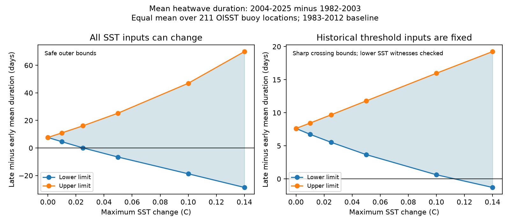

# Exact ratio bounds retain a heatwave duration rise under 0.025 C SST changes at 211 OISST locations in 1982-2025

## Main result

A new event-state method gives exact limits on mean heatwave duration for independent sets of allowed daily threshold crossings. It optimizes the ratio of event days to event count. It does not divide separate bounds on those two quantities.

In published OISST v2.1 records at 211 buoy locations, the equal-location mean event duration is 13.519 days in 1982-2003 and 21.143 days in 2004-2025. The increase is 7.625 days. Every daily SST record within 0.025 C of these inputs keeps a positive increase of at least 0.0576 days, under the tested threshold and event rules. This is a deterministic certificate. It includes a safe allowance for changes in the recalculated historical thresholds.

The increase can reverse in a larger input class. We construct an SST record within 0.14 C on each daily input whose mean duration change is -1.292 days. All historical threshold inputs are left fixed. The rebuilt thresholds are exactly unchanged. This record changes 2.012% of the inputs and has an RMS change of 0.01986 C.

These are sensitivity tests at selected locations. They do not estimate actual SST errors, establish a corrected ocean trend, or show that real errors take the selected form.

Figure 1. Limits on the change in mean event duration. Left: safe outer bounds when all daily SST inputs can change and thresholds are recalculated. Right: sharp bounds on independent threshold crossings when historical threshold inputs are fixed. Every plotted lower endpoint on the right has a checked temperature witness. Lines only connect the tested budgets. The ranges are not confidence intervals.

## Question and contribution

The selected campaign work found input-change artifacts in daily SST variance and mean SST. These artifacts affect marine heatwave duration. Spectral corrections showed that the size of the duration rise depends on the correction. A correction ensemble only tests its selected records.

Two later campaign studies gave deterministic bounds for event-day totals and event counts. Event duration remained outside their scope. Mean duration is not monotone in the threshold crossings: a new short event can lower the mean, while a join can raise it. Further, a record that minimizes days need not maximize count. Dividing separate limits can lose a valid certificate.

We extend that work with a 32-state optimizer of mean duration and a proof for its discrete ratio problem. The states credit days only when a five-day run qualifies, and credit gap days only when a join is confirmed. A positive-count flag excludes an undefined ratio. Dinkelbach's fractional method supplies exact ratio endpoints through additive dynamic programs. This ratio method is established; the contribution here is its event automaton, proof, attainable temperature checks, and finite-record SST application.

Hobday et al. (2016, doi:10.1016/j.pocean.2015.12.014) define the five-day event and two-day join rule. Schlegel et al. (2019, doi:10.3389/fmars.2019.00737) already showed that data quality affects duration estimates. We do not claim to discover that sensitivity. The new result gives extrema over a stated input class instead of a sample of corrections. Searches of the local campaign and targeted web searches found no earlier duration-ratio certificate of this form. This is not an exhaustive priority claim.

## Data and tested statistic

We read files/data/oisst_buoy_cells.npz from verified SCI publication 87b87a67b3fbeabf1a42555bcb64b3859b769e49b54f28c09da0ee2ca781bc71. The extract contains 16,071 daily values at each of 211 unique native OISST cells for 1982-2025. All values are finite. It samples the nearest native 0.25-degree cells to 159 GTMBA and 52 NDBC locations. Locations span 25 S to 60.571 N. They are concentrated in the tropics and near North America. The record contains OISST values at buoy locations, not buoy observations. This study makes no new independent buoy comparison.

NOAA NCEI produces OISST v2.1; NOAA PSL provides the source files. The parent publication records the source snapshots. Their URLs and recorded hashes are preserved in files/provenance/source_snapshots.json. We did not reread or download those raw NOAA files. The exact input extract has SHA-256 e8c32d2ea87893de58539ea6593d9fda37a7d14cf2de82052a52442229eaa15a. No shared raw dataset file was used. The shared source is the cited ZIP under ./campaign. Details and software versions are in files/provenance/run.json.

We use a seasonal 90th-percentile threshold from 1983-2012. For each seasonal day, it pools 11 actual-time days around the matching day in each baseline year. It interpolates February 29, then smooths the 366 slots with a 31-day circular mean. All comparisons use strict exceedance. The threshold code is reused from the prior count-bound study.

An event needs five consecutive exceedances. Qualified runs separated by at most two days are joined. Joined gap days count as event days. We detect events separately within 1982-2003 and 2004-2025. An event at the split is therefore truncated by design. We take total event days divided by event count in each location and period, then average the 211 late-minus-early differences equally. This is not an area-weighted global trend, an annual mean-duration slope, or the ratio of all pooled days and counts.

## Method

The full states, transitions and proof are in files/method.md. For each candidate ratio r, a dynamic program optimizes D-rN over allowed bit paths. D is event days and N is event count. The selected path gives a new r = D/N. The finite ratio iteration ends at the exact endpoint in real arithmetic. The implementation uses double precision, integer D and N, and explicit failure checks. Every recovered path is checked with a separate run-list event routine.

We test two input classes.

1. All inputs can change by at most e C. The seasonal percentile and its smoothing can move by at most e C. Thus the SST-minus-threshold margin can move by at most 2e C. Independent crossing sets at that radius give safe outer bounds for every changed SST record. They need not be attainable jointly with one recalculated threshold.
2. Historical threshold inputs are fixed. We freeze the sufficient interval 1982-12-27 through 2013-01-05, which includes the baseline and all its five-day pooling extensions. Other inputs can change independently by e. This gives exact independent crossing sets. The period and location choices can be attained together. We construct the minimizing record, move changed values by e minus 1e-9 C toward the chosen bit, rebuild every threshold, and check the exact endpoint.

At the largest tested all-input radius, the forced-one path still has at least one event at every location and in both periods. All other allowed paths therefore have a positive count. The ratio is defined throughout both tested classes.

## Results

Limits on the equal-location mean change, in days:

| Maximum input change, C | All inputs: safe lower | All inputs: safe upper | Fixed historical inputs: sharp lower | Fixed historical inputs: sharp upper |
| --- | ---: | ---: | ---: | ---: |
| 0 | 7.625 | 7.625 | 7.625 | 7.625 |
| 0.01 | 4.535 | 10.962 | 6.739 | 8.435 |
| 0.025 | 0.058 | 16.080 | 5.531 | 9.686 |
| 0.05 | -6.591 | 25.298 | 3.671 | 11.786 |
| 0.10 | -18.735 | 46.964 | 0.624 | 15.969 |
| 0.14 | -28.636 | 69.950 | -1.292 | 19.243 |

The negative all-input lower limit at 0.05 C is not an attained reversal. It only marks failure of that outer certificate. The actual 0.14 C witness is an attained reversal and also belongs to the all-input class. The all-input sign radius is therefore at least 0.025 C and less than or equal to 0.14 C for this statistic. No smallest reversing amplitude was found. In the class with fixed historical inputs, the tested grid brackets the sign radius between 0.10 and 0.14 C.

Direct ratio optimization matters. With all inputs allowed to change by 0.025 C, separate day and count bounds give a lower change limit of -3.927 days. They fail to establish the sign. The exact ratio optimization of the same crossing envelope gives +0.0576 days. With fixed historical inputs at 0.10 C, the separate lower limit is -1.369 days, while the ratio method gives +0.624 days. The bounds use the same allowed records; the difference is the optimization target.

The 0.14 C witness has early and late mean durations of 13.879 and 12.587 days. Its maximum input change is 0.139999999 C. Its threshold change is zero. The witness is selected using the full record. It has no required smoothness, error spectrum, zero mean or physical mechanism. It is a counterexample to uniform stability over this class, not a likely error model.

In the source record, 183 of 211 locations have longer mean duration in the late period. With fixed historical inputs and a 0.14 C budget, 127 locations retain a positive difference under every allowed record. The sample-mean difference can still reverse because the changes have different sizes across locations.

## Validation

The audit enumerates all 65,536 binary records of length 16. It then checks 300 partial allowed records, with 213,053 feasible positive-event paths, against exact enumeration of their duration ratios. It checks another 50 partial records of length 40 with 51,200 completions, including chains of joined events. Targeted tests cover failed short joins and gaps of one through four days. All 728 optimized audit paths pass.

For the SST runs, the independent run-list routine checks the integer days and counts for every selected endpoint. The lower temperature witnesses pass full threshold recalculation and path checks for all six budgets. At most six fractional iterations were needed in the main run (see diagnostics.json for the exact recorded maximum). Aggregate bounds and comparison bounds are preserved as CSV files. These are finite-record calculations; no sampling p values or confidence intervals are supplied.

## Limits and next tests

This method adds a uniform duration test to the campaign evidence. It does not strengthen the attribution of a particular SST input artifact. The data overlap the selected work and do not provide an independent observational replication.

The sample is not representative of the ocean. The equal-location statistic puts no area weights on the cells. The proof is general, but the numerical certificate applies only to this sample, baseline, period split and event rule. Different baselines, full-grid sampling, annual duration trends and seasonally constrained errors require new runs. No sea-ice mask was added here.

The all-input envelope can be much wider than the attainable set because seasonal thresholds link many daily choices. A negative endpoint of that envelope is inconclusive without a rebuilt temperature witness. The fixed-input result removes this problem, but it describes a narrower class.

No simultaneous bound on true daily SST errors is estimated. Even the positive certificate must not be read as a probability statement about real errors. Actual correction steps can exceed these budgets or have a structured form that is much less damaging. The earlier correction-ensemble duration results and this sensitivity result can both hold.

## Reproduction and rights

See files/reproduce.md. The package includes the proof, all code, original figures, aggregate results and exact source hashes. Daily SST, thresholds and changed databases stay outside the signed package. The external-data notice separates their terms and attribution from the baseline terms for the bundled work.

Campaign 11_07_2026. Job sci-1107-dell-earth-and-ocean-sciences-5055822d9445. Topic earth-and-ocean-sciences. Machine dell. Account codex-olen. Model gpt-6.1-sol, high reasoning effort. Date 2026-11-11. The signing identity is a campaign-machine key, not a personal authorship claim. This worker signs locally and does not upload or submit the publication.
