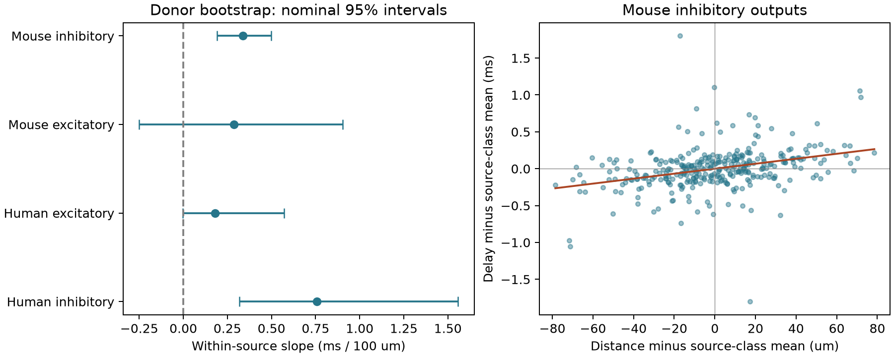

# Mean delay increased with cell-body distance within outputs from the same inhibitory source in selected Allen mouse slices

## Main result

In selected mouse visual-cortex slice recordings, outputs to more distant cell bodies had longer mean delays even when they came from the same inhibitory source cell. The slope was 0.337 ms per 100 micrometres, with a 95% donor bootstrap interval of 0.191 to 0.497. The nominal 98.75% interval was 0.152 to 0.544. This comparison removes a fixed delay offset for each source and target-class group. Thus, differences between source cells alone do not account for this distance relation.

This is a reanalysis of public measurements. The result concerns detected chemical connections in small recorded circuits. It is not a measurement of trial timing precision or of axon conduction speed.

## Question and prior work

A branching circuit can send signals to several targets. Does target distance predict the relative mean arrival times from one source? This is a useful constraint for circuit models that assign delays to edges. A relation across different source cells can also arise from source-cell differences, so a within-source comparison gives a distinct test.

Campagnola, Seeman and colleagues (2022, doi:10.1126/science.abj5861) measured local cortical connectivity and synaptic properties in mouse and human slices. Allen methods describe manual connection detection and response fits used for latency estimates. These methods link the cell identities, local connectivity, and response timing in the same preparation. They do not trace the complete axon route for each connection.

Two campaign reports found distance information for mouse inhibitory delay predictions across donors (SCI 2405b942 and dae3a6b5). The latter also controlled measured source spike width. Another report compared delay similarity for shared sources and shared targets, with no resolved difference (SCI d7a654bb). Our test estimates a distance slope within a shared source, rather than prediction gain across sources or a source-versus-target variance contrast. It extends the same database evidence. It is not an independent replication.

Before the precise question was fixed, we searched the campaign for `connectome`, `distance latency`, `morphology`, `within source distance`, and `branch distance delay`. We read the published dae3a6b5 and d7a654bb reports and shared source metadata. We searched the web for Allen synaptic latency and inspected the official Allen analysis methods. We did not use private sibling workspaces.

## Data and selection

The source file is `/mnt/dell-data/shared_datasets/allen_synphys/r2.1_small_2023-01-26/synphys_r2.1_small.sqlite`. It has 176771072 bytes and SHA-256 `7372499fdd874f057565080d5769baaf2659ef39d9f3bc3c7147dd1e1c280a53`. This is release r2.1 small, schema 22, with source S3 date 2023-01-26. `files/provenance.json` gives its URL, hash, software versions, and run environment. We reused this file in place, opened it read only, and checked its hash. No raw download was needed.

The SQL joins pair, synapse, target cell, experiment, and slice records by database IDs. The source cell ID defines a branching circuit. We require a confirmed chemical synapse, at least one manually passed average response fit, positive finite mean delay, and cell-body distance above zero and at most 500 micrometres. The fit condition is a pair-level filter; it is not a claim that every clamp-mode fit passed. We use mouse VisP and human TCx records. Distance is converted from metres to micrometres, and latency from seconds to milliseconds. We do not use pulse-train arrays, which have a reported order problem in this release.

A matched group contains outputs from one source cell with one synapse sign to one target nonsynaptic class. Missing class has its own category. A group needs at least two outputs with different distances. This selection favors recorded cells with several detected connections. A later check removes missing classes. The main mouse inhibitory subset spans 13.04 to 230.98 micrometres, despite the broader 500 micrometre limit. Its median distance range within a group is 35.77 micrometres. The fitted slope describes local variation and should not be extended to long paths.

No donor names were excluded by the parser. Mouse donors use the unique six-digit number in the specimen name. Human donors use the first three fields in H-prefixed specimen names. We store digests of these inferred labels. These are not verified donor identifiers.

## Estimator and uncertainty

The plan in `files/PLAN.txt` was saved before results were calculated. Let x be distance divided by 100 micrometres and y be delay in milliseconds. In each source and target-class group, subtract the group mean from x and y. The slope is the sum of centered x times centered y, divided by the sum of centered x squared. This is ordinary least squares with one fixed intercept per matched group and one common slope. Connections receive equal residual weight; groups with larger distance variation have more influence on the slope. It is not an equal-source average of individual slopes.

We resample whole inferred donors 10000 times with seed 81108. All group sums from a sampled donor are copied together. The slope is recomputed for each draw. The 2.5th and 97.5th percentiles give the nominal 95% interval. The 0.625th and 99.375th percentiles give a nominal 98.75% interval for each of four groups. This is a Bonferroni-style four-group interval family, under the approximate coverage of the bootstrap. It does not cover all checks or campaign-wide selection. Unlike a bootstrap that holds prediction residuals fixed, this bootstrap recomputes the complete slope estimator. It still conditions on the observed graph and measured edges. It cannot account for missing edges, donor label errors, or systematic response-fit errors. Eight human inhibitory donors give a weak basis for tail intervals.

## Results

All slopes below have units of ms per 100 micrometres. The pooled slope is a descriptive regression on the same retained edges without group intercepts. It is not the prior campaign prediction model.

| Group | Eligible / retained edges | Source cells / matched groups | Donors | Within-source slope | 95% interval | 98.75% interval | Pooled slope |
| --- | ---: | ---: | ---: | ---: | --- | --- | ---: |
| Mouse inhibitory | 1327 / 328 | 151 / 151 | 113 | 0.337 | 0.191 to 0.497 | 0.152 to 0.544 | 0.191 |
| Mouse excitatory | 905 / 159 | 73 / 73 | 63 | 0.288 | -0.250 to 0.902 | -0.372 to 1.098 | 0.171 |
| Human excitatory | 241 / 47 | 22 / 22 | 14 | 0.181 | -0.003 to 0.573 | -0.099 to 0.768 | 0.107 |
| Human inhibitory | 61 / 20 | 9 / 10 | 8 | 0.757 | 0.318 to 1.558 | 0.250 to 1.675 | -0.020 |

The mouse inhibitory sample has 126 recordings. Its estimate stays positive when each donor is removed in turn: 0.293 to 0.360. The largest donor supplies 7.68% of the centered distance sum of squares. Positive distance-delay sums occur in 98 of 151 matched groups and 74 of 113 donors. These counts are descriptive; we did not treat dependent edges as independent tests.

The human inhibitory estimate is also positive. It is based on 20 edges, nine source cells, ten matched groups, and eight donors. Its pooled slope is near zero. This contrast shows why source offsets can matter in this selected sample. It does not prove that the population relation transfers to human cortex. One donor supplies 31.1% of its centered distance information. Human excitatory data have only 14 donors, and one supplies 53.9% of the distance information. The two excitatory intervals include zero. Neither a species difference nor a synapse-sign difference was tested directly.

## Checks

The following planned checks concern mouse inhibitory outputs. Intervals are nominal 95%. Log-delay slope has units of natural log delay per 100 micrometres; other slopes retain the original units.

| Check | Edges / groups / donors | Slope | Interval |
| --- | ---: | ---: | --- |
| Main | 328 / 151 / 113 | 0.337 | 0.191 to 0.497 |
| Log delay | 328 / 151 / 113 | 0.244 | 0.157 to 0.330 |
| Delay between 0.2 and 5 ms | 328 / 151 / 113 | 0.337 | 0.191 to 0.497 |
| Distance range above 20 micrometres | 254 / 114 / 90 | 0.336 | 0.186 to 0.494 |
| Also match target layer | 320 / 148 / 113 | 0.336 | 0.186 to 0.498 |
| Remove missing target classes; added after results | 294 / 134 / 98 | 0.295 | 0.154 to 0.442 |

The delay-range check leaves the main mouse inhibitory sample unchanged. The missing-class check was added after the first result because the audit found 34 missing-class edges. It removes those edges and still gives a positive estimate. All group and sensitivity results are stored in `files/results.json`, including uncertain or unstable outcomes. In mouse excitatory data, restricting delay to 0.2–5 ms changes the slope from 0.288 to 0.001; its interval still includes zero. This warns against a general positive-slope claim across all circuit types.

The separate audit in `files/audit.py` recalculates each main slope from all within-group edge differences and from explicit group-indicator least squares. Both match the centered estimator within 1e-10. It also checks retained counts. The main analysis checks unique pair IDs, distinct cell ends, and one donor per matched group. `files/audit.json` records leverage, missing classes, counts, and data ranges. A fresh full run also gave exact byte matches for results.json, cohort.csv, strata.csv, query.sql, and bootstrap.npz. This is a numerical verification, not independent biological evidence.

## Meaning and limits

The mouse result supports a distance term for the relative mean delays of local inhibitory outputs in this selected recording set. A fixed source-cell timing offset cannot by itself generate the within-source slope. The slope is useful as a constraint for a local circuit model. We did not test whether using it improves a network computation or a representation task.

Soma distance is not axon path length. Response onset also depends on release, postsynaptic location, filtering, waveform, and fit decisions. The source control removes fixed source differences, but does not remove target differences within broad classes, recording differences across trials, or correlated measurement errors. Thus, the reciprocal of this slope is not an identified conduction speed. Target layer labels can be missing and do not identify exact contact location.

Only 328 of 1327 eligible mouse inhibitory edges supply a within-source contrast. Selection requires detection, a passed fit, and multiple measured outputs. Weak connections, cut axons, and targets outside the recording field can be absent. Cluster bootstrap intervals assume donors are independent and the inferred grouping is correct. They do not include the uncertainty from graph selection or systematic fit bias. The short distance range and small groups limit nonlinear tests. The primary hypothesis was motivated by earlier results from the same database. It needs an independent data set with traced paths and repeated onset measurements.

Mouse VisP and human TCx differ in species, region, donors, and preparation. We did not isolate these factors or measure behavior. No general law across regions, animals, or states is established.

## Reproduce

See `files/REPRODUCE.txt`. The package includes the exact SQL, the eligible cohort with pair and cell IDs, group sufficient statistics, all bootstrap draws, complete numerical results, audit code, and the figure. The original SQLite database is stored separately under the Allen Institute terms of use. The bundle does not change those terms. The SCI baseline license applies to original text, figures, code, and derived summaries in this package.

## Campaign record

Campaign: `11_07_2026`. Job: `sci-1107-syam2-neural-structure-and-computation-43c41d667ea5`. Topic: `neural-structure-and-computation`. Machine: `syam2`. Account: `codex-myxtap`. Model: `gpt-6.1-sol`, high reasoning effort, through T3 Code and the Codex harness. No agents were launched. Computation used the host `campaign-compute` limiter with one library thread. The campaign-machine signature is not a personal authorship claim. This publication is saved locally; it is not submitted to a remote archive or index.
