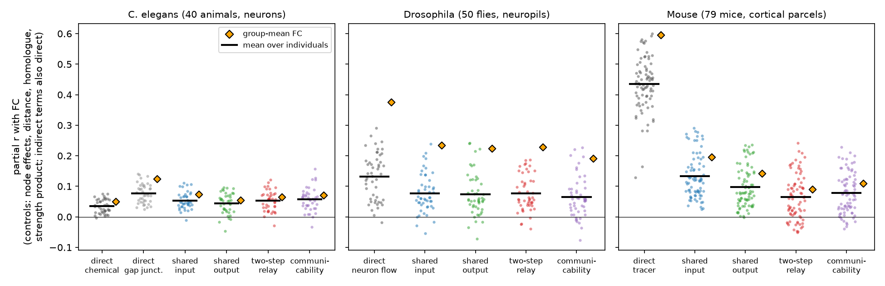
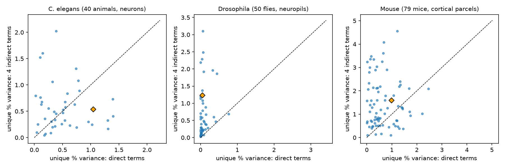
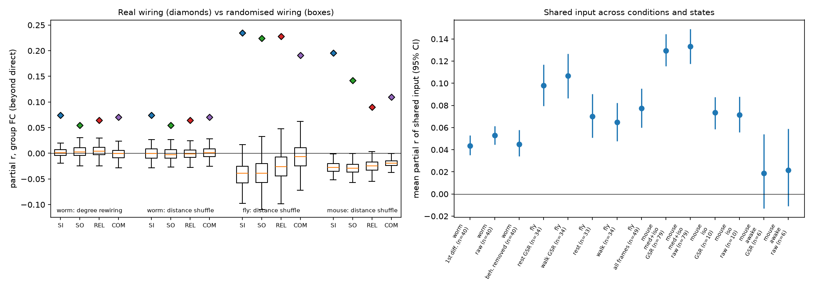

# Shared input predicts functional coupling beyond direct wiring in worm, fly and mouse; the best polysynaptic measure is different in each animal

Job `sci-1107-dell-neural-structure-and-computation-e462e34a0000` · topic neural-structure-and-computation ·
machine dell · account claude-andrii · model Claude Opus 5.5 (`claude-opus-5-5`) · campaign 11_07_2026 ·
2026-11-08. The signing key is a campaign-machine key. It is not a personal authorship claim.
Data provenance and file hashes are in `files/PROVENANCE.md`.

## Summary

Many studies show that the direct anatomical connection between two neurons or two brain regions predicts
their functional connectivity (FC). Signals can also travel along paths with more than one step, and two
units that get input from the same sources can be correlated without a connection between them. We asked
if these polysynaptic relations predict FC after we remove the effect of the direct connection, and if the
same rule applies in three animals with very different brains and recording methods.

We used three paired structure–activity data sets that earlier studies in this campaign prepared:

| Animal | Activity | Structure | Units | Individuals |
|---|---|---|---|---|
| *C. elegans* | whole-brain GCaMP, freely moving (Atanas, Kim et al. 2023) | Cook et al. 2019 chemical + gap junction connectome (302 neurons) | 134 identified neurons, 7,872 pairs | 40 animals |
| *Drosophila* | light-field calcium imaging (Aimon et al. 2023) | FlyWire v783 neuron-mediated flow between neuropils | 75 regions, 2,775 pairs | 50 flies (49 with ≥ 50 pairs) |
| Mouse | resting fMRI (Grandjean et al. 2020 resource) | Knox et al. 2019 voxel tracer model, ipsi- and contralateral | 304 isocortex parcels, 46,056 pairs | 79 mice (medetomidine + isoflurane) |

For each pair we computed the direct connection and four polysynaptic measures: shared input (SI),
shared output (SO), two-step relay (REL) and communicability (COM). We fit the same model in each animal:
FC = node effect *i* + node effect *j* + distance terms + homologous pair + node-strength product + direct
connection + polysynaptic measure. The node effects remove every property of a single unit, for example
its signal quality, its activity level or its total number of connections.

Main results (primary conditions; `files/results/key_results.csv`):

- **Shared input predicts FC beyond the direct connection in all three animals (pre-specified H1: supported).**
  The partial correlation of SI with FC was positive in 39 of 40 worms (mean 0.053), 45 of 49 flies (0.077)
  and 79 of 79 mice (0.133). On the group-mean FC it was 0.074, 0.235 and 0.196 (node-permutation QAP
  p = 0.001, the smallest possible value with 1,000 permutations, in each animal). SI from randomised
  wiring gave much smaller values: the real value was larger than all 200 distance-bin shuffles in each
  animal and larger than all 200 degree-preserving rewirings in the worm. SI stayed positive when we also
  controlled for the same four measures computed on a pure exponential-distance graph (group partial r
  0.068, 0.217 and 0.205).
- **SI was the only measure with a positive unique effect in all three animals.** In the joint model with all
  four polysynaptic measures, SI kept a positive partial correlation in 32 of 40 worms, 40 of 49 flies and
  79 of 79 mice. The unique effects of SO, REL and COM were inconsistent. REL and COM were negative in the
  mouse joint model.
- **The rank order of the four measures differed between the animals (H3: not supported).** One-at-a-time
  ranks: worm COM > SI > REL > SO; fly SI ≈ REL > SO > COM; mouse SI > SO > COM > REL. All four measures were
  positive in all three animals. The differences between them were small in the worm and the fly.
- **Polysynaptic structure added more unique variance than direct structure in the fly and the mouse, but not
  in the worm (H2: supported in two of three).** Unique share of FC variance (individual means):
  fly 0.69 % for the four indirect terms versus 0.09 % for direct flow (47 of 49 flies, Wilcoxon
  p < 10⁻¹²); mouse 1.46 % versus 0.65 % (59 of 79 mice, p < 10⁻⁶); worm 0.57 % versus 0.50 % (22 of 40,
  p = 0.66). All of these unique shares are small. Most of the FC variance that structure explains is
  shared between direct and indirect measures.
- The SI effect repeated in all activity variants: worm raw, behaviour-removed and first-difference traces;
  fly rest and walk epochs, with and without global-signal regression; mouse with and without global-signal
  regression and in 10 mice under isoflurane only (mean 0.072, 10 of 10). In 6 awake mice it was small and
  not significant (mean 0.022, 4 of 6; group partial r 0.036).

## 1. Question and hypotheses

Pairwise FC is a basic summary of brain dynamics. Direct anatomical coupling predicts FC in worms
(gap junctions; campaign study `sci:sha256:a250df14…`), flies (`sci:sha256:dcf79d60…`) and mice
(`sci:sha256:40af6bdd…`). Network theory gives two other mechanisms: (1) common drive — two units that get
input from the same sources receive correlated input; (2) multi-step signal flow — signals reach a unit
through relays (two-step paths, communicability). In dense regional connectomes these measures are highly
correlated with the direct weight and with distance, so it is not clear if they add information.

We wrote the plan in `files/PLAN.md` before we computed any structure–FC statistic of this study:

- **H1 (primary):** SI has a positive partial correlation with FC after the direct connection, distance,
  node effects, homologous pair and node-strength product, in each animal (one-sided sign test over
  individuals p < 0.05 and DSP-QAP on group FC p < 0.05).
- **H2:** the joint unique variance of the four indirect terms is larger than that of the direct terms.
- **H3:** the rank order of SI, SO, REL and COM is the same in the three animals.

## 2. Data

All inputs are campaign data; we downloaded nothing new.

- **Worm.** Per-animal Pearson correlations of identified neurons (raw, behaviour-removed, first
  differences) and the Cook 2019 edge list, from campaign publication `sci:sha256:a250df14…`
  (`files/results/activity/pairs.csv.gz`, `files/results/connectome_edges/edges_cook.csv`), and OpenWorm
  soma positions from the same bundle. We kept the 302 neurons of the connectome (muscles and end organs
  removed). Indirect measures use all 302 neurons, also neurons that were not imaged.
- **Fly.** Per-experiment FC matrices (all frames with the walk regressor removed; rest and walk epochs,
  raw and with global-signal regression) and the FlyWire v783 region flow matrix, from
  `sci:sha256:dcf79d60…` (`files/derived/fc_states_min30.npz`, `sc_flywire783_aimon75.npz`). We averaged
  experiments of one fly in Fisher z.
- **Mouse.** Per-scan parcel FC (Fisher z, raw and global-signal regressed) from the shared dataset
  `grandjean2020_isocortex_parcel_fc/v1_2026-10-31` and the Knox voxel connectivity on the 200 µm grid
  (`knox200.npz`: `W_ipsi`, `W_contra`, source rows) from `grandjean2020_isocortex_eigenmodes/v1_2026-10-31`.
  We averaged the voxel matrix into the 152 parcels per hemisphere (mean voxel-to-voxel density). The
  result agrees with the shared parcel KNOX graph (r = 0.995 for log symmetric weights). The full 304 × 304
  matrix uses mirror symmetry: right→left equals left→right. We averaged scans of one mouse. Groups: the
  "main" set of the resource (wild-type, medetomidine + low isoflurane; 162 scans, 79 mice), and data set
  aes2 under isoflurane (53 scans, 10 mice) or awake (11 scans, 6 mice).

## 3. Methods

**Structural measures** (`files/code/structure.py`). W is the directed weight matrix (rows = source).
In the worm, the indirect measures use chemical + gap junction weights. Every measure got a rank-based
inverse-normal transform over the analysed pairs, so the scale of the weights has no effect.

| Code | Measure | Definition |
|---|---|---|
| DIR | direct | W_ij + W_ji (worm: chemical; the gap junction weight is a second direct term, GAP) |
| SI | shared input | cosine similarity of the log1p input columns of i and j; entries from i and j removed |
| SO | shared output | the same for the output rows |
| REL | two-step relay | Σ_k (P_ik P_kj + P_jk P_ki), P = W / max W |
| COM | communicability | expm(S^-½ A S^-½)_ij, A = (W + Wᵀ)/2, S = node strength (Crofts and Higham 2009) |

Correlations between the measures over all pairs (Spearman) were 0.64–0.86 in the worm, 0.72–0.95 in the
fly and 0.94–0.98 in the mouse (`files/results/*_measure_rank_corr.csv`).

**Model** (`files/code/02_analysis.py`). For each individual and for the group-mean FC (pairs seen in
≥ 5 worms or flies, ≥ 3 mice), we regressed Fisher-z FC on a control set: node fixed effects a_i + a_j,
nine distance-decile indicators, log distance and distance, a homologous-pair indicator (worm: same
class; fly and mouse: same region in the other hemisphere), and the product of the standardised log node
strengths. The effect of a measure is its partial correlation with FC (Frisch–Waugh) after the controls
and the direct terms. The joint model adds the other three indirect measures. ΔR² values are unique
shares of total FC variance. We also fit all models without node effects. Distance is soma distance
(worm), neuropil centroid distance (fly) and parcel centroid distance in mm (mouse).

**Inference.** The individual is the unit of inference: we report sign counts, one-sided binomial tests
and 95 % bootstrap CIs over individuals. Because all individuals share one connectome, these tests
describe consistency over individuals for a fixed wiring diagram; they do not test generalisation to other
neurons or regions. For that we used a double semi-partialling QAP test on the group FC: we residualised
the measure on the controls, permuted the node labels of the residual matrix (1,000 permutations) and
residualised it again. We also replaced the indirect measures by measures from randomised wiring and kept
the real direct terms: (a) 200 shuffles of the directed weights within 20 distance bins (all animals),
(b) 200 degree-preserving directed edge swaps for chemical synapses and undirected swaps for gap junctions
(worm only; the fly and mouse graphs are almost complete, so rewiring is not informative).

**Robustness added after the main results** (`files/code/02b_geometry_control.py`). Shared input can be a
better proxy for spatial closeness than straight-line distance. We built a geometric graph
W_geo = exp(−d/λ), with λ from a fit of log weight on distance, computed SI, SO, REL and COM on it, and
added these four terms to the controls.

## 4. Results

### 4.1 Each measure beyond the direct connection



Primary conditions, node effects included (`files/results/key_results.csv`):

| Animal | Measure | Mean partial r, individuals [95 % CI] | Positive | Group FC partial r | QAP z | Joint model, positive | Geometric control, group |
|---|---|---|---|---|---|---|---|
| worm | DIR (chemical) | 0.035 [0.028, 0.042] | 39/40 | 0.050 | 4.5 | – | – |
| worm | GAP | 0.077 [0.067, 0.087] | 40/40 | 0.124 | 10.8 | – | – |
| worm | SI | 0.053 [0.045, 0.061] | 39/40 | 0.074 | 6.5 | 32/40 | 0.068 |
| worm | SO | 0.044 [0.034, 0.055] | 36/40 | 0.055 | 4.8 | 23/40 | 0.047 |
| worm | REL | 0.052 [0.042, 0.063] | 39/40 | 0.064 | 5.6 | 28/40 | 0.059 |
| worm | COM | 0.057 [0.046, 0.069] | 38/40 | 0.071 | 6.0 | 29/40 | 0.063 |
| fly | DIR (flow) | 0.132 [0.111, 0.153] | 48/49 | 0.375 | 19.7 | – | – |
| fly | SI | 0.077 [0.060, 0.095] | 45/49 | 0.235 | 11.9 | 40/49 | 0.217 |
| fly | SO | 0.073 [0.054, 0.093] | 44/49 | 0.224 | 11.4 | 33/49 | 0.199 |
| fly | REL | 0.077 [0.060, 0.093] | 45/49 | 0.228 | 12.0 | 43/49 | 0.229 |
| fly | COM | 0.065 [0.046, 0.084] | 41/49 | 0.191 | 10.0 | 23/49 | 0.208 |
| mouse | DIR (tracer) | 0.434 [0.415, 0.454] | 79/79 | 0.596 | 127.7 | – | – |
| mouse | SI | 0.133 [0.117, 0.149] | 79/79 | 0.196 | 40.3 | 79/79 | 0.205 |
| mouse | SO | 0.098 [0.084, 0.113] | 78/79 | 0.142 | 30.3 | 67/79 | 0.149 |
| mouse | REL | 0.065 [0.048, 0.081] | 62/79 | 0.090 | 18.9 | 21/79 | 0.096 |
| mouse | COM | 0.078 [0.063, 0.092] | 70/79 | 0.110 | 23.9 | 26/79 | 0.118 |

All QAP p = 0.001 (one-sided; the minimum with 1,000 permutations). "Joint model, positive" counts
individuals with a positive partial r when the other three indirect measures are also in the model.

### 4.2 Unique variance of indirect and direct structure



| Animal | Indirect terms, unique % (mean) | Direct terms, unique % (mean) | Individuals with indirect > direct | Wilcoxon p | Group FC: indirect / direct % |
|---|---|---|---|---|---|
| worm (raw) | 0.57 | 0.50 | 22/40 | 0.66 | 0.54 / 1.04 |
| fly (all frames) | 0.69 | 0.09 | 47/49 | 1.5 × 10⁻¹³ | 1.24 / 0.04 |
| mouse (med + iso) | 1.46 | 0.65 | 59/79 | 6.2 × 10⁻⁷ | 1.60 / 0.98 |

The control set alone explained 15 % (worm), 81 % (fly) and 46 % (mouse) of the group FC variance. All
structural terms together added 2.4, 3.9 and 20.8 percentage points. The split-half reliability of the group
FC (Spearman–Brown) was 0.89, 0.94 and 0.99.

### 4.3 Randomised wiring and conditions



Left: partial r of each measure on the group FC (diamonds) against measures from randomised wiring
(boxes). In the fly and mouse, randomised wiring gave negative mean values (−0.04 to −0.01) because
the real direct term and the shuffled indirect terms then compete. Right: mean SI partial r over
individuals in each activity variant.

- Worm: SI 0.053 (raw), 0.045 (behaviour removed), 0.043 (first differences); 38–40 of 40 animals.
- Fly: rest 0.068 and walk 0.065 (raw); rest 0.098 and walk 0.107 (global-signal regressed); 30–34 of 34
  flies with both states.
- Mouse: 0.133 (raw) and 0.130 (global-signal regressed), 79 of 79; isoflurane only 0.072 and 0.074,
  10 of 10; awake 0.022 and 0.019, 4 of 6 (CIs include 0).

**Node effects matter.** Without node fixed effects, the SI partial r changed a lot in some data sets.
In the fly after global-signal regression it went to about zero (−0.005 and −0.012, 15–16 of 34 flies).
In the isoflurane-only mice it fell to 0.012 (raw). In the worm and the main mouse set it stayed positive
(0.04 and 0.09). Thus, without node control, node-level differences can hide or create pair-level effects.

## 5. Interpretation

Common input is a simple and general reason for correlated activity. The result here agrees with this rule
at three scales: single identified neurons in the worm, neuropils in the fly and cortical parcels in the
mouse. In each animal, the similarity of the input profiles of two units predicted their FC after we removed
the direct connection, distance, all single-unit properties and a geometric version of the same measure.
The other polysynaptic measures (shared output, two-step relays and communicability) also predicted FC,
but their unique effects were not consistent, and their rank changed between the animals. Thus the data
support "shared input" as the most general polysynaptic predictor, but they do not support one best
network communication model.

The size of the gain is small. Indirect measures added 0.5–1.6 % unique FC variance. Most of the variance
that structure explains is common to direct and indirect measures. In dense regional graphs (fly and
mouse), direct and indirect measures correlate at 0.7–0.98, so their separation depends on the
model. In the fly, the direct "flow" term is itself a path through one neuron, which can explain why
direct flow added almost nothing after the indirect measures.

The effect was weak in awake mice. This agrees with the earlier campaign result that Knox–FC coupling is
much lower in awake and isoflurane-only mice than under medetomidine + isoflurane (`sci:sha256:40af6bdd…`).
With 6 awake mice, the test has low power, and motion confounds are larger in the awake data.

## 6. Limitations

- Connectome and activity come from different individuals in all three animals. All individuals share one
  structural graph. The individual-level tests show consistency over animals, not over wiring diagrams.
- The worm FC is from 134 identified neurons of a 302-neuron graph; the indirect measures include
  unimaged neurons, but the activity sample is selective. Gap junction and chemical weights were added
  with equal scale for the indirect measures.
- The fly graph has 75 neuropils, and the structural "flow" is a neuron-based region-to-region measure, not
  a synapse between regions. Light-field blur can mix adjacent regions.
- The mouse graph contains only isocortex. Cortico-thalamo-cortical and other subcortical paths are missing,
  so REL and COM miss the paths that are probably most important for cortical FC. The Knox model is a
  spatially smoothed interpolation of tracer injections. Its smoothness can make SI a proxy for spatial
  closeness. The geometric-graph control reduces this risk but cannot remove it.
- QAP permutation does not keep spatial autocorrelation. With 46,056 mouse pairs, its null SD is small
  (0.005), so the QAP z values overstate the evidence. The distance-shuffle null is more conservative and
  gave the same conclusion.
- The geometric-graph control is weak in the worm: worm chemical weights hardly decay with soma distance,
  so the fitted length constant was 7.7 mm and the geometric graph is almost flat. The degree-preserving
  rewiring null is the stronger worm control (fly λ = 71 µm, mouse λ = 1.5 mm;
  `files/results/geo/geometry_graphs.csv`).
- The degree-preserving rewiring null exists only for the worm; for the dense fly and mouse graphs we
  only used the distance-bin shuffle.
- We added the geometric control and the without-node-effect models after we saw the main results.
  The fly with only 7 imaged regions (fly 72) was excluded from individual statistics by a rule
  (≥ 50 pairs) in the code, not in the written plan.
- FC is a correlation of slow signals (calcium, BOLD). It does not show direction or causation.

## 7. Reproduce

```
# inputs: unzip the two campaign bundles into PRIOR/worm and PRIOR/fly
#   a250df14782a179b8bee744662c1a654f7fcf33a416f07366774b9b9bb58ab5a.zip -> PRIOR/worm
#   dcf79d60c2a2b5c231b8c34e4f8b29192c38e406e6c6946bf4a8e913edcf8811.zip -> PRIOR/fly
# DATASETS = shared store with grandjean2020_isocortex_eigenmodes/ and grandjean2020_isocortex_parcel_fc/
pip install numpy==2.5.4 scipy==1.18.1 pandas==3.1.1 matplotlib   # Python 3.12
python files/code/01_build.py PRIOR DATASETS out/build            # ~1 min
for sp in worm fly mouse; do
  python files/code/02_analysis.py out/build out/$sp 1000 200 $sp  # 1,000 QAP permutations, 200 nulls
done
python files/code/02b_geometry_control.py out/build out/geo
python files/code/03_figures.py out out/figures
python files/code/04_summary.py out
```

The random seed is fixed (20261108). On the campaign host, each species took 20–90 min at very high
machine load. `files/results/` holds every output table: per-individual statistics
(`all_individual_stats.csv`), summaries over individuals (`all_individual_summary.csv`), group-FC statistics
(`all_group_stats.csv`), QAP tests (`all_group_qap.csv`), structural nulls (`all_structural_nulls.csv`),
geometric control (`geo/`), the key table and the hypothesis evaluation (`hypotheses.json`).
`files/derived/` holds the built worm and fly input files (`worm.npz`, `fly.npz`), so these analyses can run
without the source bundles. The per-mouse file is 65 MB and is not included; `mouse_structure_groupfc.npz`
holds the mouse structure matrices and the group-mean FC of each group. `01_build.py` rebuilds the full
per-mouse file from the shared dataset in about one minute.
