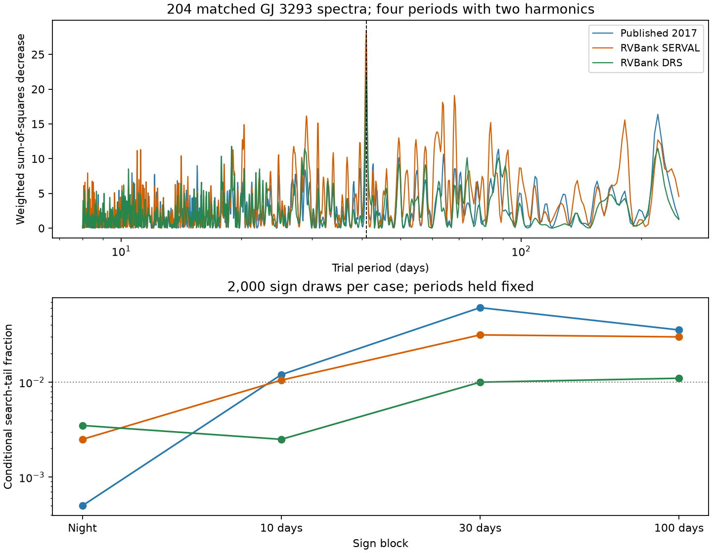
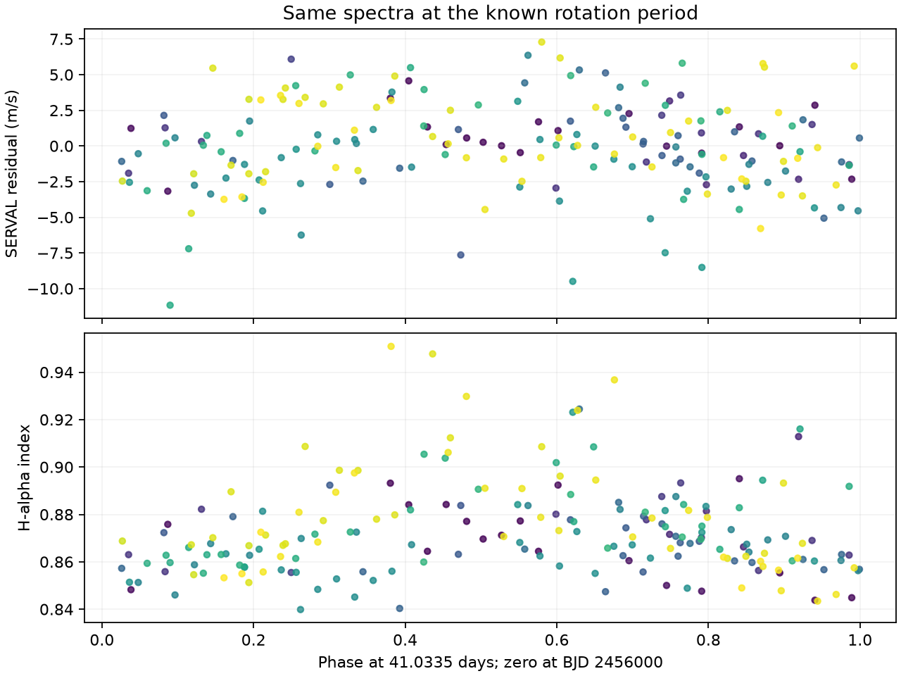

# Thirty-day error blocks raise search-tail fractions for the 41-day GJ 3293 residual in three velocity reductions

## Result

We searched for an extra periodic signal in public GJ 3293 radial velocities. The main result is a limit on signal selection. A peak at 41.0335 days remains in three reductions of 204 matched spectra after a fit of four known periods and their first harmonics. Its conditional search-tail fraction increases in each reduction when 30-day sign blocks replace night sign blocks. The fractions change from 0.00050 to 0.06097 in the published 2017 velocities, from 0.00250 to 0.03148 in RVBank SERVAL, and from 0.00350 to 0.01000 in RVBank DRS. Each value uses 2,000 draws. These are conditional simulation fractions, not calibrated planet false-alarm probabilities.

The 41-day rotation period is known. H-alpha and line width in these spectra also vary at this period. Thus, agreement between velocity reductions does not establish an extra planet. We report no new planet or new stellar period. Our added result is the measured effect of error blocks and orbit models on this residual search, with a small offline test package.



## Question and prior work

Can a signal left after the four known GJ 3293 planet periods pass a check across spectral reductions, and does that check distinguish it from stellar activity?

Astudillo-Defru et al. (2015; doi:10.1051/0004-6361/201424253) reported two planets and a possible 48-day companion. Astudillo-Defru et al. (2017; doi:10.1051/0004-6361/201630153, section 4.6) confirmed the 48-day signal and reported a 13-day planet. They also measured a 41-day rotation period from activity indicators. Their ASAS photometry, from a separate instrument, did not show a compatible rotation signal. They found no 41-day effect on the 48-day velocity signature in their test. Our model and sample differ. Our result does not challenge the status of the 48-day planet.

We searched the local campaign with `sci search "astronomy" --in ./campaign --json`, then with `"GJ 3293"` and `"3293"` before the detailed test. We found no relevant published GJ 3293 analysis in those returned records. The first search returned only its first 20 records; this is not an exhaustive campaign review. We used no private worker results.

## Data and selection

We reuse two completed shared datasets. No new raw download was needed. Exact shared paths, resolved paths, source URLs, retrieval times, byte counts, and SHA-256 hashes are in `files/provenance.json`. These are the input files:

- `datasets/gj3293-harps-2017-a88-b724a25e/gj3293_harps.tsv`: VizieR J/A+A/602/A88/tablea5, 207 published velocities. SHA-256 `9004abd2a161357a6f97013a72a6e44fb6085332254a7458971dbed7722d0738`.
- `datasets/gj3293-harps-rvbank-v02-b724a25e/gj3293_rvbank_v02.csv`: HARPS-RVBank version 02 target export, 217 rows. SHA-256 `b1bca0e649bfe9748b5753b4460075c92d6f4096be37f31f9c17ffe4925c524e`.

The package includes exact copies as `source_2017.tsv` and `source_rvbank.csv`, as well as the numeric tables used by the code. The source data retain their source terms and attribution. The baseline license applies to our added work; it does not remove third-party rights.

We match times within 60 seconds after adding 2,400,000 days to the VizieR time. We require RVBank flag `f_RV=0` and mask `M2`. The bank contains eight `G2` mask rows. Some DRS velocities for that mask differ by hundreds of m/s. We exclude them by mask before any residual test. Of the 207 published rows, two have bank flag 64 and one has no time match. The accepted 204 pairs are unique and span BJD 2454805.6841 to 2457116.5047, or 2310.82 days. They cover 201 nights, all before the May 2015 fiber change. `selection.csv` lists each published row and its acceptance rule; `matched.csv` is the exact analysis table.

The published extraction, SERVAL, and DRS are different reductions of overlapping HARPS spectra. They are not independent observations. RVBank methods and error corrections are described by Trifonov et al. (2020; doi:10.1051/0004-6361/201936686) and Perdelwitz et al. (2024; doi:10.1051/0004-6361/202348263).

## Method

We convert the published velocities and errors from km/s to m/s. Each series has its own zero point. We add a fixed 2 m/s term in quadrature to each quoted error. This term is a weight choice, not a fitted noise measurement.

The base model has a constant, a linear time term, and sine and cosine terms at four periods. The starting periods are 13.2543, 30.5987, 48.1345, and 122.6196 days from the published solution. We optimize periods within plus or minus 0.06, 0.06, 0.6, and 2 days. At each step we solve the linear coefficients by weighted least squares. We test one harmonic per period and then two harmonics per period. The two-harmonic case is the main error-block test. It is a flexible waveform model, not an exact eccentric orbit model.

We search 2 to 1,000 days on 5,766 equally spaced frequencies. The spacing is about one fifth of the inverse time span. At every frequency we project both trial sine terms against the fitted base columns. The score is the decrease in weighted squared residuals when those terms are added. The base coefficients are free; the optimized periods are held fixed during the scan.

For the error test, we multiply standardized base residuals by random signs. All points in one night, or in one fixed 10-, 30-, or 100-day interval, get the same sign. Day intervals start at the first accepted observation. We compute the maximum scan score for each draw and use `(1 + number at least as large as observed) / 2001`. Seeds are fixed in the code. These tests allow different amounts of error dependence. They do not estimate that dependence from the data. They hold the fitted periods fixed, do not correct for leverage, and do not simulate activity from a physical process.

## Measured results

| Reduction | Residual RMS, m/s | Peak score | Night fraction | 10-day fraction | 30-day fraction | 100-day fraction |
|---|---:|---:|---:|---:|---:|---:|
| Published 2017 | 2.693 | 19.991 | 0.00050 | 0.01199 | 0.06097 | 0.03548 |
| RVBank SERVAL | 3.124 | 28.485 | 0.00250 | 0.01049 | 0.03148 | 0.02999 |
| RVBank DRS | 3.438 | 22.066 | 0.00350 | 0.00250 | 0.01000 | 0.01099 |

All six scans from one- and two-harmonic base models select the same 41.0335-day grid point. The grid point is not a precision period measurement. The finite draw error matters: for example, the nominal binomial standard error of a fraction near 0.061 is about 0.0054. This error covers only the Monte Carlo count, not uncertainty in the noise model. One set of block edges was tested. No result is a proof that a signal is absent.

At the selected period, unweighted indicator fits with a constant and linear trend remove about 20.1% of H-alpha variance and 13.4% of DRS line-width variance. The indicator score is normalized by each series variance; it is not a velocity score or a corrected significance. H-alpha and velocities share spectra. The difference between SERVAL and published velocities has a standard deviation of 1.959 m/s and little normalized power at 41 days compared with its strongest peak near 100 days. A truly common Doppler term cancels in this difference, but so can common stellar activity or instrument errors. This control cannot validate a planet.



We also fit four exact, noninteracting Kepler orbits with eccentricities between zero and 0.6, plus a constant and trend. Three initial eccentricities converge to almost the same cost for each reduction. A local scan that projects against the nonlinear fit Jacobian shifts the strongest score to 623 days in the published velocities and 61.3 days in both bank reductions. That local score is not the same as a full nonlinear extra-planet fit. Indeed, full refits with an added fixed 41.0335-day sinusoid improve weighted squared residuals by 20.28, 22.80, and 24.38. Their sinusoid amplitudes are 2.10, 2.29, and 2.31 m/s. In the published and SERVAL fits, the outer-orbit eccentricity changes from 0.233 to 0.055 and from 0.382 to 0.024. This shows model dependence, not a measured change of orbit. Several short-period eccentricities reach the upper bound. These fits are sensitivity controls, not posterior orbit estimates. No significance or physical identification is assigned to their other peaks.

## Physical interpretation and limits

Rotating active surface regions can affect both line profiles and apparent velocity. The known rotation period and our H-alpha result make this a viable explanation. The outer planet period is also close to three times 41 days, so orbit harmonics and activity can share fit power. Our exact-orbit controls show that a linear local scan can understate a nonlinear improvement. They do not prove that an eccentric outer orbit causes the residual. A common instrument or correction error remains possible. Mask cuts and the pre-upgrade time range remove two specific confounders; they do not exhaust instrument tests.

We sought an independent check in prior published observations. The reported ASAS null does not confirm the rotation signal. We did not obtain or analyze new independent-instrument data. No new object, unexplained phenomenon, stable extra orbit, mass, or occurrence rate is established. The useful outcome is a reproducible example in which cross-extraction agreement and a small night-sign tail fraction are insufficient for planet selection. A further test needs new velocities or photometry and a joint activity model.

## Reproduction and checks

Run from any directory with Python and the versions in `files/environment.json`:

```sh
python files/analyze.py
python files/diagnostics.py
python files/blocks.py
python files/physical.py
python files/compare.py
python files/validate.py
python files/figures.py
```

All inputs needed for these offline commands are included. `analyze.py --prepare`, run from the original workspace root, can rebuild the numeric source tables from the shared raw paths. For remote retrieval, request each exact `source_url` in `provenance.json` and require the recorded SHA-256 before use. Do not replace the shared datasets. The outputs include complete scores, fit parameters, sign maxima for the night test, coefficient tables, selection records, figures, and validation results. The block-test script reproduces its saved summary; it does not save each draw.

Direct least-squares fits agree with the projected scan at four test frequencies per reduction to better than 1.4e-13 in score. An independent circular-limit formula agrees with the Kepler function to 9.1e-14 m/s. A common injected sinusoid cancels in the difference to 1.9e-12 m/s. These checks verify numerical operations, not the astronomical noise model.

Job: `sci-1107-dell-astronomy-803ea57cefe5`. Campaign: `11_07_2026`. Topic: astronomy. Machine: dell. Account: codex-andrii. Model: gpt-6.1-sol, high reasoning effort. Work date: 2026-11-09 UTC. The signing key is the campaign-machine identity, not a personal authorship claim.
