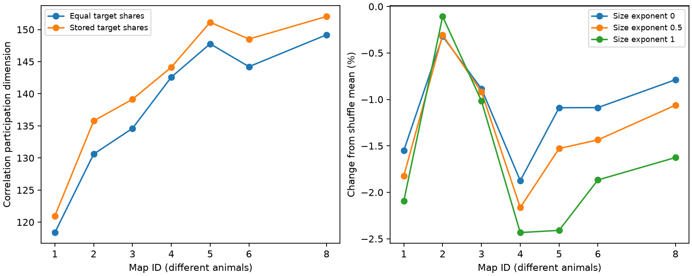

# Stored target shares gave lower noise dimension than site shuffles in five of seven selected worm map models

In a shared-site release model, the assignment of anatomical target shares gave lower correlation noise dimension than random assignments in five of seven selected C. elegans brain maps. The differences were small: 0.79 to 1.87 percent below shuffle means in those five maps. All seven maps gave higher dimension than an equal-share model. Thus unequal shares and their assignment to target cells had different effects. These are conditional model results, not measured neuronal noise or information capacity.

Figure 1. Left: correlation participation dimension with stored shares or equal shares at fixed total retained amplitude per site. Right: change from within-site shuffle means for three site-size amplitude rules. Exponent zero is primary. Lines join map IDs only. Maps are different animals, and spacing does not represent time. The plot does not show animal confidence intervals. Aggregate shuffle ranges are in files/summary.csv.

## Question and prior work

Does unequal target allocation at multi-target synapses change the number of effective noise dimensions? Does its assignment to named targets matter beyond the distribution of shares within each site?

Witvliet et al. (2021), doi:10.1038/s41586-021-03778-8, released eight partial brain maps. Their code assigns active-zone size to each target by a stored fraction called post_weights. This fraction is an anatomical proxy. It is not a calibrated conductance. Liu et al. (2007), doi:10.1002/dneu.20307, studied concurrent miniature responses at worm neuromuscular polyads. That work motivates shared events but does not establish shared release at these brain sites.

We searched campaign publications before selecting this question. SCI 0a2a89fa tested unit-amplitude shared release against independent contact release and showed different effects for sums and contrasts. SCI 142cb3b5 tested size concentration in a positive sum model. Its text also identified prior fraction-weighted sum tests. Our question concerns population correlation dimension and share assignment within sites, rather than sum variance or event counts. We reuse only the attributed 162-cell panel from SCI 0a2a89fa. All analysis code here is new. We claim neither a new dimension formula nor a new general covariance identity. No Allen data or neural activity measurements enter this test.

## Data and selection

The seven source files are Dataset1 through Dataset6 and Dataset8 synapse JSON files from dwitvliet/nature2021, commit 0646af9d25896ae660f97d462eab2d67282f5625. Dataset7 lacks target shares and is excluded. Exact URLs, shared and resolved paths, byte counts, and verified SHA-256 hashes are in files/provenance.json. The shared path pattern is:

    ./datasets/witvliet2021-primary-synapses-N-0646af9/DatasetN_synapses.json

We reused these files in place. No new raw data were downloaded or shared files changed. We hashed only inputs used. The fixed panel has 162 brain neurons born before hatching. Both source and target must be in this panel. We drop self contacts, combine fractions for repeated target labels, and omit sites with no retained targets. Dropped fractions are not redistributed. All source fractions used were positive, and full raw fractions summed to one within numerical tolerance. Each row is a site. A site can have only one retained target. Maps 1–4 are L1, map 5 is L2, map 6 is L3, and map 8 is adult. The maps do not form a longitudinal sample.

## Model and test

Let B[j,s] be the retained share at target j and site s, multiplied by (size_s / median_size)^alpha. We assume one independent Bernoulli event per site with a common probability p, with 0 < p < 1. All targets of one site share that event and have positive gains. Covariance is p(1-p) B B^T. The common factor cancels from the statistics. There is no recurrent network, membrane filter, source fluctuation, synaptic sign, or extra target noise.

For targets with positive diagonal covariance, let R be the correlation matrix. The primary dimension is D = (tr R)^2 / tr(R^2) = n^2 / sum_ij R_ij^2. D lies between 1 and n. It describes how concentrated the correlation eigenvalues are. It does not measure signal dimension, decoding accuracy, or mutual information. We also report the same formula on raw covariance as a secondary measure. Correlation normalization removes scale differences among target variances, so the two measures answer different questions.

The equal-share comparison assigns each retained unique target the retained site mass divided by the number of retained unique targets. It fixes the site's total gain. It changes individual target gains and variances. The primary null permutes the stored retained shares among retained unique target cells within each site. It fixes site membership, target counts, each site's multiset of retained shares, retained mass, and size. It does not fix each target's mean input or variance, spatial position, or receptor type. The correlation calculation removes marginal variance scale but does not make target anatomy exchangeable.

We use 999 independent permutations per map and size exponent. Seeds are 9900213 + map ID + 100 alpha. The two-sided p-value is twice the smaller inclusive tail with a one-count correction, capped at one. Holm correction covers seven primary tests (alpha = 0). Alpha = 0.5 and 1 are sensitivity calculations with unadjusted p-values. They are not additional confirmed discoveries. The plan in files/plan.txt was written before calculation; it is not an external registration.

## Results

| Map | Sites | Active targets | Equal-share D | Stored-share D | Shuffle mean D | Primary Holm p |
|---|---:|---:|---:|---:|---:|---:|
| 1 | 588 | 140 | 118.380 | 120.975 | 122.879 | 0.272 |
| 2 | 800 | 153 | 130.603 | 135.772 | 136.208 | 0.622 |
| 3 | 923 | 151 | 134.607 | 139.144 | 140.386 | 0.042 |
| 4 | 1249 | 157 | 142.590 | 144.131 | 146.885 | 0.014 |
| 5 | 1760 | 161 | 147.780 | 151.137 | 152.801 | 0.014 |
| 6 | 1855 | 158 | 144.218 | 148.519 | 150.153 | 0.014 |
| 8 | 3253 | 160 | 149.183 | 152.039 | 153.246 | 0.014 |

Stored shares increased D by 1.08 to 3.96 percent relative to equal shares. This direction is empirical; the trace inequality for raw covariance alone does not prove it. All seven observed D values were below their shuffle means. Maps 3, 4, 5, 6 and 8 passed the primary correction at 0.05. Maps 1 and 2 did not. The smallest possible two-sided p-value with this procedure is 0.002. Several results are at this resolution limit. The map 3 result is close to the corrected threshold and needs replication.

The direction below shuffle means remained with both size rules in all seven maps. These checks do not control size-dependent release probabilities. Raw covariance dimensions were 53.97 to 61.44 without size weights. They were below equal-share values in six maps, with a small increase in map 2. Thus the sign of the equal-share comparison depends on the dimension measure. It would be misleading to report a general increase in noise dimension without naming correlation normalization.

The correlation result means that normalized squared pair correlations were slightly more concentrated for the stored share assignment than for the conditional null. It does not show why the assignment arose or whether a biological decoder benefits from it. A useful method conclusion is to retain target shares and report both normalization and the shuffle constraints when a connectome is used to model population noise.

## Validation and limits

Files/validation.json records a second covariance construction from a dense target-by-site matrix for all 21 map/exponent cases. It also checks scale invariance, dimension bounds, and invariant sum variance across equal, stored and shuffled shares. At fixed retained site mass, sum variance must be identical under this model. Exact enumeration of three synthetic Bernoulli sites verifies the covariance formula; 200000 simulated trials also pass. A complete repeated run gave byte-identical summary and shuffle tables. A plotting error caused by a pandas attribute name was corrected before the complete repeat.

These checks validate arithmetic, not biology. Anatomical target fractions need not equal current amplitudes. A large active zone can have several independent release units instead of one shared event. Unknown release probabilities, correlated sites, inhibitory effects, receptor density and nonlinear dynamics could change the result. Missing tissue, a selected cell panel, and the absence of the second adult's shares limit generalization. Conditional shuffle ranges are not animal confidence intervals. Eight anatomical specimens do not establish an age effect, a cross-animal population law, or a principle across species, regions and behavior. No matched activity test was possible in this investigation.

## Reproduction and external rights

The bundle contains original code, text, figures and aggregate statistics, plus an attributed baseline-licensed cell-name panel. It contains no external raw synapse data, record-level derivative table, matrix, or third-party source code. External terms and attribution are in files/EXTERNAL_NOTICE.txt. No explicit data license was found in the pinned repository root. We do not grant rights to external materials through this package.

Use Python 3.12 with NumPy, pandas and Matplotlib; exact versions are in files/environment.json. From an extracted publication directory, with the original shared store available:

    python files/analyze.py --datasets /absolute/path/to/datasets --out /absolute/path/to/new-results
    python files/validate.py --datasets /absolute/path/to/datasets --out /absolute/path/to/checks.json

On another machine, retrieve the external files to a new directory first:

    python files/retrieve.py --scratch /absolute/path/to/new-external-data
    python files/analyze.py --datasets /absolute/path/to/new-external-data --out /absolute/path/to/new-results
    python files/validate.py --datasets /absolute/path/to/new-external-data --out /absolute/path/to/checks.json

Retrieval checks pinned hashes and refuses an existing root. Do not generate external files in the signed publication. Source availability and permission for a new use must be checked separately. Only public external sources and the signed package are needed; private scratch is not needed.

## Campaign record

Job: sci-1107-dell-neural-structure-and-computation-99b0b213b148.
Topic: neural-structure-and-computation. Campaign: 11_07_2026.
Machine: dell. Account: codex-myxtap.
Model: gpt-6.1-sol, high reasoning effort, Codex harness in T3 Code.
No agents were launched. The campaign-machine signing identity does not claim personal authorship. This investigation saves the signed bundle locally and makes no remote submission.
