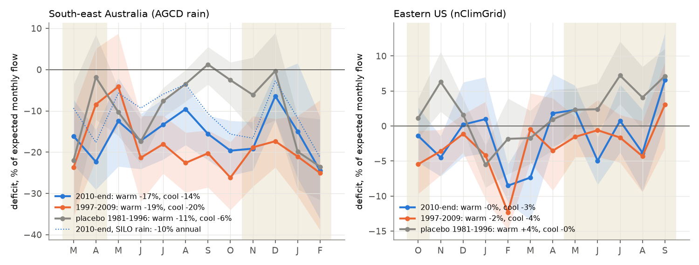
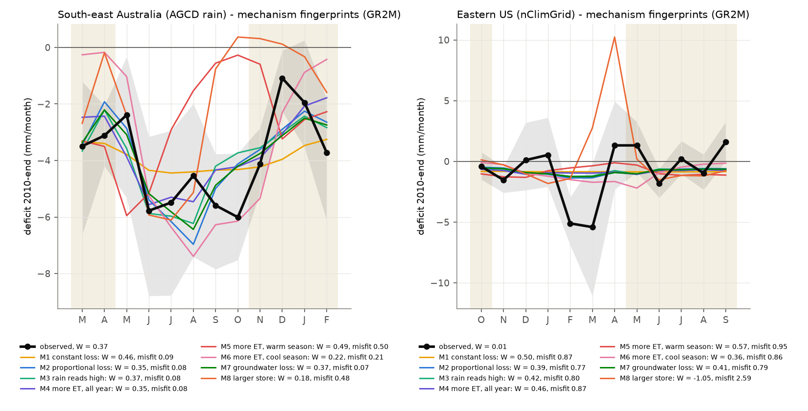
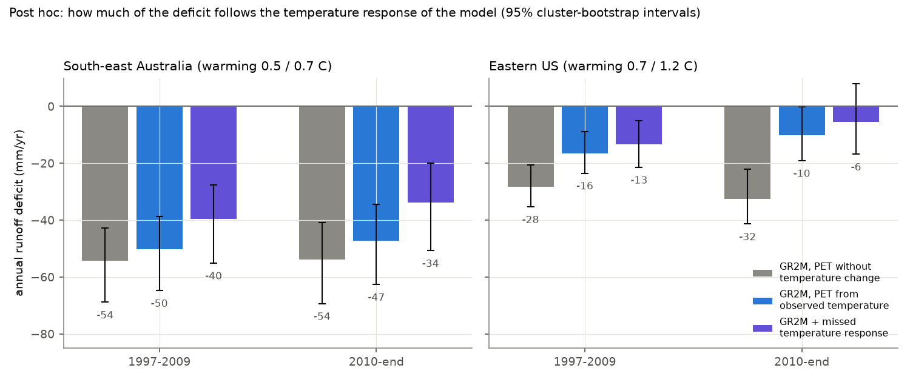

# South-east Australia lost a near-constant fraction of runoff in every month after 1997; in a monthly model, warming accounted for most of the eastern US offset after 2009 (CAMELS, 1948-2025)

**Job:** sci-1107-dell-earth-and-ocean-sciences-2fe1374f1e84 (campaign 11_07_2026, topic
earth-and-ocean-sciences, machine dell, model claude-opus-5-5). The signing key is a campaign
machine key. It is not a personal authorship claim.

## Summary

Earlier campaign work found that, after 1997, annual runoff in south-east Australia (SE-AU) and
in the eastern US (East-US) fell about 40 mm per year below each catchment's 1951-1996
rainfall-runoff relation. GRACE showed that the water was not stored. The SE-AU change was a
loss of runoff response to rain. The East-US change was a constant offset. The physical causes
were open. Annual data cannot tell where in the year the water goes, but different causes
remove water in different months.

We made monthly flow and climate series for 277 CAMELS-AUS and 536 CAMELS-US catchments
(1948-2021 and 1948-2025). We fitted two monthly models on 1951-1996 only: a regression for each
calendar month (R), and the GR2M conceptual model with a snow store and temperature-based
(Oudin) potential evaporation (G). We calculated the month-of-year profile of the deficit. Then
we simulated eight candidate mechanisms in each calibrated GR2M model, sized each mechanism to
the catchment's own deficit, and compared the predicted profiles with the observed profile.
We wrote the plan (`files/ANALYSIS_PLAN.md`) before we calculated any monthly result.

Main results:

1. **SE-AU (179 catchments, AGCD rain).** The deficit was -47 mm/yr in 2010-2021 (95% CI -62 to
   -34; model R: -49) and -50 mm/yr in 1997-2009. It removed 15% of the expected flow (10-21%),
   and between 6% and 25% in each calendar month. The warm season (November-April) carried 37%
   of the deficit (23-49%). Thus the loss is a nearly constant fraction of flow in wet and dry
   months. More evapotranspiration (ET) in the growing season only cannot make this profile: it
   was rejected in both periods (share difference -0.12, CI -0.22 to -0.03; profile misfit
   0.50). A larger store that must fill each year was rejected or fitted poorly. More ET in the
   cool season only was rejected after 2009. A proportional flow loss, rain that reads high, a
   year-round ET increase and a groundwater-exchange loss all agreed with the profile; the
   monthly data cannot separate them. Only the year-round ET increase was consistent in all
   four SE-AU tests (two periods, AGCD and SILO rain).
2. **Temperature does not explain SE-AU.** With potential evaporation held at its 1951-1996
   seasonal cycle the deficit was -54 mm/yr; with observed temperature (+0.75 C) it was -47.
   When we also added the temperature response that GR2M misses in 1951-1996 years, -34 mm/yr
   (-51 to -20) remained (post hoc).
3. **East-US (258 catchments).** In model G, the deficit was only -10 mm/yr after 2009 (-19 to
   0; 2% of flow) and -16 mm/yr in 1997-2009 (-24 to -9). Model R kept -45 and -32 mm/yr. A
   post hoc test showed why: with potential evaporation held at its 1951-1996 cycle, GR2M gave
   -32 mm/yr after 2009. Thus, in GR2M, warming of 1.2 C (+6.6% Oudin potential evaporation)
   accounts for about two thirds of the post-2009 offset. In 1951-1996 years, GR2M did not
   overstate the response of runoff to warm years (its residuals still fell by 3.8 mm/yr per
   degree, CI -8.0 to -0.04). But catchments that warmed more did not have larger deficits
   (Spearman +0.18), a linear annual model gives a weaker temperature effect (-8.5 mm/yr per
   degree), and the 1997-2009 deficit does not follow warming. The remaining East-US deficit is
   in February-March, in the cool season.
4. **Timing.** In SE-AU, the cool-season (May-October) residual fell from -8 mm per half year
   in 1981-1996 to -36 in 1997-2009 and -29 in 2010-2021: a step at the Millennium Drought. The
   warm-season residual decreased more gradually (-6, -15, -18). The 1981-1996 placebo also
   showed a deficit (-25 mm/yr, -41 to -13) relative to a 1951-1980 calibration, so part of the
   SE-AU change started before 1997.
5. Controls: the western US and northern Australia had no deficit in model G after 1997. South-
   west Western Australia (known groundwater decline) lost 45% of flow, with the largest fraction
   in the dry warm season.

Conclusion: the two post-1997 shifts have different monthly fingerprints. SE-AU lost a near-
constant fraction of flow in every month, which excludes growing-season-only ET changes and
storage-filling mechanisms, and is not caused by warming. In the East-US, most of the post-2009
offset can follow from higher temperature-driven evaporative demand acting through catchment
storage, but this attribution depends on the temperature response of the model and is not
supported by the cross-catchment test.

## Question

Earlier campaign publications (cited in `sci.json`) found:

- SE-AU and East-US runoff fell below the 1951-1996 rainfall-runoff relation from about 1997
  (7dedc5bb, df943002), with about 40 mm/yr less runoff after 2009 in both regions with fixed
  rain-gauge networks (20955da2).
- SE-AU lost 20-25% of its runoff response to rain; the East-US had a constant offset (871b2192,
  fde6f0d6). GRACE showed that at most 17% (SE-AU) and 5% (East-US) of the missing water was
  stored (ccf7e5d4). Annual evaporative demand did not start either shift (58715cfe).
- SE-AU recessions became faster after 1997 (7cecffa9).

All these analyses used annual or event data. We ask: in which months does the deficit occur,
and which mechanism has that seasonal fingerprint?

## Data

| Item | Source |
| --- | --- |
| SE-AU and other Australian catchments | CAMELS-AUS v2.03 (Zenodo 14289037): daily streamflow_mmd, AGCD rain (SILO rain as a check), AGCD Tmax and Tmin. Calendar months 1948-2021 |
| US catchments | USGS NWIS daily mean discharge (00060/00003) for the 671 CAMELS-US gauges, water years 1951-2025, retrieved 2026-11-10; GAGES-II area from camels_topo.txt |
| US climate | NOAA nClimGrid monthly precipitation and mean temperature (1/24 degree), averaged over the grid cells with their centre in each CAMELS basin polygon |
| Groups | SE-AU: outlet state VIC, NSW, ACT, SA, TAS. East-US: HUC-02 01-08. Controls: West-US (HUC-02 09-18), North-AU, SW-WA (WA south of 30 S). Same as earlier campaign work |

Selection rules (they do not use residuals): a month is valid if 90% or more of its days have
flow; 300 or more valid months in 1951-1996; 96 or more valid months in 1997-2009 and in 2010 to
the end; 20 or more valid calibration values in each calendar month. 179 SE-AU, 73 North-AU,
25 SW-WA, 258 East-US and 278 West-US catchments passed. Most Australian catchments that failed
are HRS2014 gauges that end in 2014.

## Methods

- **Model R (regression).** For each catchment and calendar month: Q = a + b1 P(m) + b2 P(m-1) +
  b3 [rain in months m-2 to m-4] + b4 [rain in months m-5 to m-16] + b5 T(m), OLS on 1951-1996.
- **Model G (GR2M).** GR2M (Mouelhi, Michel, Perrin and Andreassian 2006, Journal of Hydrology 318) with Oudin potential evaporation from monthly
  temperature and latitude and a fixed-parameter snow store (snow below -1 C, rain above 3 C;
  melt fraction 0.5 (T+1)/4 between). X1 and X2 calibrated by Kling-Gupta efficiency on valid
  1951-1996 months (two-stage grid, then Nelder-Mead). Median calibration KGE: SE-AU 0.78,
  East-US 0.70; median KGE on 1997-end: SE-AU 0.51, East-US 0.69.
- **Deficit profile** d(m): mean residual of calendar month m in the period minus its mean
  calibration residual. Annual deficit D = sum of d(m). Periods P1 = 1997-2009, P2 = 2010-end.
  Placebo: calibrate 1951-1980, test 1981-1996.
- **Mechanism fingerprints.** From 1997, each calibrated GR2M was run with one change: M1
  constant flow loss, M2 proportional flow loss, M3 rain reads high (P scaled down), M4 more ET
  all year (PET scaled up), M5 more ET in the warm season only (US May-October, AU
  November-April), M6 more ET in the cool season only, M7 more groundwater loss (X2 lower), M8
  larger production store (X1 higher). The size was set so that the simulated annual deficit
  equals the catchment's observed deficit. Endpoints: the warm-season share W of the deficit,
  and the profile misfit sum((d_obs - d_M)^2) / sum(d_obs^2) of group-mean profiles.
- **Inference.** Cluster bootstrap over 2 x 2 degree outlet cells (2,000 draws, seed 20261110),
  percentile 95% intervals, conditional on the fitted models.

## Results

### 1. Monthly deficit profiles (planned)

| Group | Period | n | D, model G (mm/yr) | D, model R (mm/yr) | Fraction of expected flow | W (warm share) |
| --- | --- | --- | --- | --- | --- | --- |
| SE-AU (AGCD) | 1997-2009 | 179 | -50 (-65, -38) | -36 (-57, -20) | -20% (-27, -14) | 0.29 (0.18, 0.42) |
| SE-AU (AGCD) | 2010-2021 | 179 | -47 (-62, -34) | -49 (-72, -29) | -15% (-21, -11) | 0.37 (0.23, 0.49) |
| SE-AU (AGCD) | placebo 1981-1996 | 179 | -25 (-41, -13) | -18 (-32, -8) | -7.5% (-13, -4) | 0.45 |
| SE-AU (SILO) | 2010-2021 | 179 | -29 (-44, -15) | -27 (-49, -9) | -10% (-16, -5) | 0.44 (0.26, 0.70) |
| East-US | 1997-2009 | 258 | -16 (-24, -9) | -32 (-40, -23) | -3.2% (-4.7, -1.7) | 0.18 (-0.15, 0.35) |
| East-US | 2010-2025 | 258 | -10 (-19, 0) | -45 (-55, -33) | -1.9% (-3.6, 0.0) | undefined (D near 0) |
| East-US | placebo 1981-1996 | 258 | +5 (-0.4, +10) | -4 (-10, +2) | +0.9% | - |
| West-US | 2010-2025 | 278 | +2 (-7, +13) | -20 (-34, -8) | +0.4% | - |
| North-AU | 2010-2021 | 73 | +30 (-1, +61) | +29 (+8, +50) | +8.6% | - |
| SW-WA | 2010-2021 | 25 | -33 (-57, -22) | -25 (-46, -15) | -45% (-49, -41) | 0.12 (0.08, 0.15) |

In SE-AU after 2009, the fractional deficit was -15% (Jan), -25% (Feb), -16%, -22%, -13%, -17%,
-13%, -10%, -16%, -20%, -19% and -6% (Dec); the 95% interval excluded zero in 11 of 12 months.
Warm-season and cool-season fractions were -17% and -14% (2010-2021) and -19% and -20%
(1997-2009). See `files/figures/fig2_monthly_deficit_fraction.png`.

### 2. Mechanism fingerprints (planned; `files/results/mechanisms.csv`)

Verdict rule (fixed in the plan): "rejected" if the 95% interval of W_obs - W_M excludes 0;
"consistent" if not rejected and the misfit is within 0.10 of the best mechanism.

| Mechanism | SE-AU 1997-2009 | SE-AU 2010-2021 | SE-AU SILO 1997-2009 | SE-AU SILO 2010-2021 | East-US 1997-2009 | East-US 2010-2025 |
| --- | --- | --- | --- | --- | --- | --- |
| M1 constant loss | rejected | consistent | rejected | consistent | rejected | poorer fit |
| M2 proportional loss | rejected (dW -0.05, -0.10 to -0.00) | consistent | consistent | consistent | rejected | consistent |
| M3 rain reads high | rejected (dW -0.06) | consistent | consistent | consistent | rejected | consistent |
| M4 more ET all year | consistent | consistent | consistent | consistent | rejected | consistent |
| M5 more ET, warm season | rejected | rejected | rejected | poorer fit (misfit 0.64) | rejected | poorer fit |
| M6 more ET, cool season | consistent | rejected | consistent | rejected | rejected | consistent |
| M7 groundwater loss | rejected | consistent | rejected | consistent | rejected | consistent |
| M8 larger store | rejected | poorer fit (misfit 0.48) | rejected | poorer fit (misfit 0.76) | poorer fit | poorer fit |

In SE-AU, M5 also could not reach the observed deficit in 34-59% of catchments (its size cap,
PET x 5 in the warm months, was reached), because warm-season water is limited. In the
East-US after 2009, the remaining deficit in model G is small, so all mechanisms except M8 fit
equally poorly (misfit 0.77-0.95); this test has no power there. In 1997-2009 the East-US
deficit was more concentrated in the cool season (W = 0.18) than every mechanism predicts
(0.37-0.59).

### 3. Timing (planned secondary)

Group-mean model G residual per half year (mm):

| Group, season | 1951-1965 | 1966-1980 | 1981-1996 | 1997-2009 | 2010-end |
| --- | --- | --- | --- | --- | --- |
| SE-AU warm (Nov-Apr) | +21 | -1 | -6 | -15 | -18 |
| SE-AU cool (May-Oct) | +17 | +3 | -8 | -36 | -29 |
| East-US warm (May-Oct) | -6 | +1 | +4 | -3 | 0 |
| East-US cool (Nov-Apr) | -8 | +7 | -1 | -13 | -10 |

### 4. Other planned secondary analyses

- East-US snow-affected (frac_snow >= 0.15, n = 85) and rain-dominated (n = 173) basins had
  similar model G deficits (-7 and -12 mm/yr after 2009; -15 and -17 in 1997-2009).
- Forest fraction did not correlate with the fractional deficit after 2009 (Spearman |rho| <=
  0.08 in SE-AU and East-US, models G, climPET and R; `files/results/crosssection.csv`).

### 5. Post hoc: temperature (`files/code/posthoc.py`, `files/results/posthoc_groups.csv`)

We added this analysis after we saw that models G and R disagree for the East-US. We recalibrated
GR2M with potential evaporation from the 1951-1996 mean temperature of each calendar month
('climPET'). For each model we also fitted, on 1951-1996 calendar years, the annual residual on
annual rain and temperature anomalies (with and without a linear year term). A negative slope
means that the model misses part of the response of runoff to warm years. We then added that
missed response times the observed warming to the deficit ('corrected').

| Group | Period | Warming (C) | Oudin PET change | D, climPET | D, model G | D, G corrected |
| --- | --- | --- | --- | --- | --- | --- |
| SE-AU | 1997-2009 | 0.55 | +3.4% | -54 (-69, -43) | -50 (-65, -39) | -40 (-55, -28) |
| SE-AU | 2010-2021 | 0.75 | +4.8% | -54 (-69, -41) | -47 (-63, -35) | -34 (-51, -20) |
| East-US | 1997-2009 | 0.68 | +2.8% | -28 (-35, -21) | -16 (-23, -9) | -13 (-21, -5) |
| East-US | 2010-2025 | 1.19 | +6.6% | -32 (-41, -22) | -10 (-19, 0) | -6 (-17, +8) |

Calibration-period temperature slopes of the residual (mm/yr per C): East-US model G -3.8
(-8.0 to -0.04), climPET -17.7 (-22.6 to -13.5); SE-AU model G -19.4 with a year term (-28.6 to
-11.3). Observed annual flow on rain and temperature (linear, no model): East-US -8.5 (-12.6 to
-4.6), SE-AU -21.4 (with year term). In the West-US the same correction changed a zero deficit to
a surplus of +21 mm/yr, so the "corrected" values are an upper bound on the temperature effect.
Across East-US catchments, the model G fractional deficit after 2009 did not become more
negative with more warming (Spearman +0.18, p = 0.003; range of warming 0.95-1.46 C). Across
SE-AU catchments, more warming went with a larger fractional deficit (Spearman -0.24 for model
G, -0.28 for climPET, -0.34 for model R), but warming also changes with location, so this
does not separate temperature from other regional differences.

## Interpretation

- **SE-AU.** The loss is a near-constant fraction of monthly flow (about 15-20%) in all months,
  wet and dry. This fingerprint excludes causes that act only in the growing season (for example
  more transpiration from CO2 greening or a longer warm season alone), only in the cool season
  after 2009, or by a larger store that must fill each year. Warming through Oudin PET explains
  about 7 mm/yr of about 54 mm/yr. Mechanisms that remain: a year-round increase of ET for the
  same demand, a proportional loss from the flow or the groundwater store (for example to a
  falling regional water table, which agrees with the faster recessions in 7cecffa9), or rain
  that reads high. The fixed gauge networks of 20955da2 make the last one less probable. The
  cool-season step at 1997 agrees with a change that started in the Millennium Drought, but a
  slower decline started before 1997.
- **East-US.** The offset is small in a monthly storage model with temperature-based PET. Two
  readings fit the data: (a) the offset is mostly the effect of warming on ET, which annual
  linear models with a concurrent temperature term underestimate because warm-season ET
  reduces storage and the flow of later months; or (b) Oudin PET overstates the effect of
  warming (temperature-based PET formulas can do this; 58715cfe found that CRU Penman-Monteith
  PET fell by 0.7% in 1997-2009), and the offset has another cause. The 1997-2009 deficit
  (-13 to -16 mm/yr, mostly February-March), the cross-catchment test and CRU PET favour (b) for
  1997-2009. After 2009, (a) and the post-2009 CRU result of 58715cfe (demand explains about half)
  agree.

## Limitations

- GR2M is a two-parameter model with a fixed snow store; its seasonal fit is imperfect
  (validation KGE 0.51 in SE-AU) and mechanism fingerprints depend on its structure. M2, M3, M4
  and M7 make similar profiles, so the monthly test cannot separate them.
- The Oudin formula uses only temperature and radiation at the top of the atmosphere. The East-US
  attribution depends on this choice. We did not test a Penman-Monteith PET in the monthly model.
- The SE-AU calibration period is not stationary (placebo deficit -25 mm/yr). The deficit size
  depends on the rain product (SILO gives about 60% of the AGCD deficit after 2009).
- Flow measurement changes, farm dams and land-use change were not tested directly; CAMELS
  catchments have little regulation, but small farm dams exist in SE-AU.
- Calendar months; flow ends in 2021 in Australia; some recent USGS values are provisional.
- Several analyses are post hoc (section 5 and the cross-catchment warming test).

### Deviations from the plan

- Mechanism sizes can be negative (the mechanism in reverse) for catchments with a positive
  deficit. The plan set them to zero; that would give mechanism group means that do not equal
  the observed group mean. We changed this before we compared any mechanism with observations.
- After the first run we found that a decrease of X1 (M8, reverse direction) could leave the
  store above its capacity; we added a cap and reran all fits.
- The planned forest correlation used the fractional annual deficit (D / expected annual flow),
  not a warm-season fraction, because warm-season ratios are unstable where D is near 0.

## Reproduction

`files/code/reproduce.sh <scratch_dir>` downloads all sources into a separate folder (about
5.5 GB) and regenerates every table and figure. Code: `build_aus_monthly.py`,
`build_us_monthly.py`, `build_us_climate_monthly.py`, `fetch_nwis.py` (reused from campaign
bundle 871b2192), `common.py` (PET, snow, GR2M), `fit.py` (models and mechanisms), `stats.py`
(planned endpoints), `posthoc.py`, `mechanisms_table.py`, `crosssection.py`, `figures.py`. Python package versions
are in `files/environment.txt`. Hashes of all inputs and intermediate tables are in
`files/provenance/`. USGS can revise NWIS values; the RDB hashes identify the version we used.

Results files: `group_profiles.csv` (all group endpoints with intervals), `mechanisms.csv`,
`annual_warm_cool.csv`, `crosssection.csv`, `catchments.csv.gz` and `posthoc_catchments.csv.gz` (per-catchment model
summaries), `posthoc_groups.csv`. External data terms: `files/DATA_NOTICE.md`.
