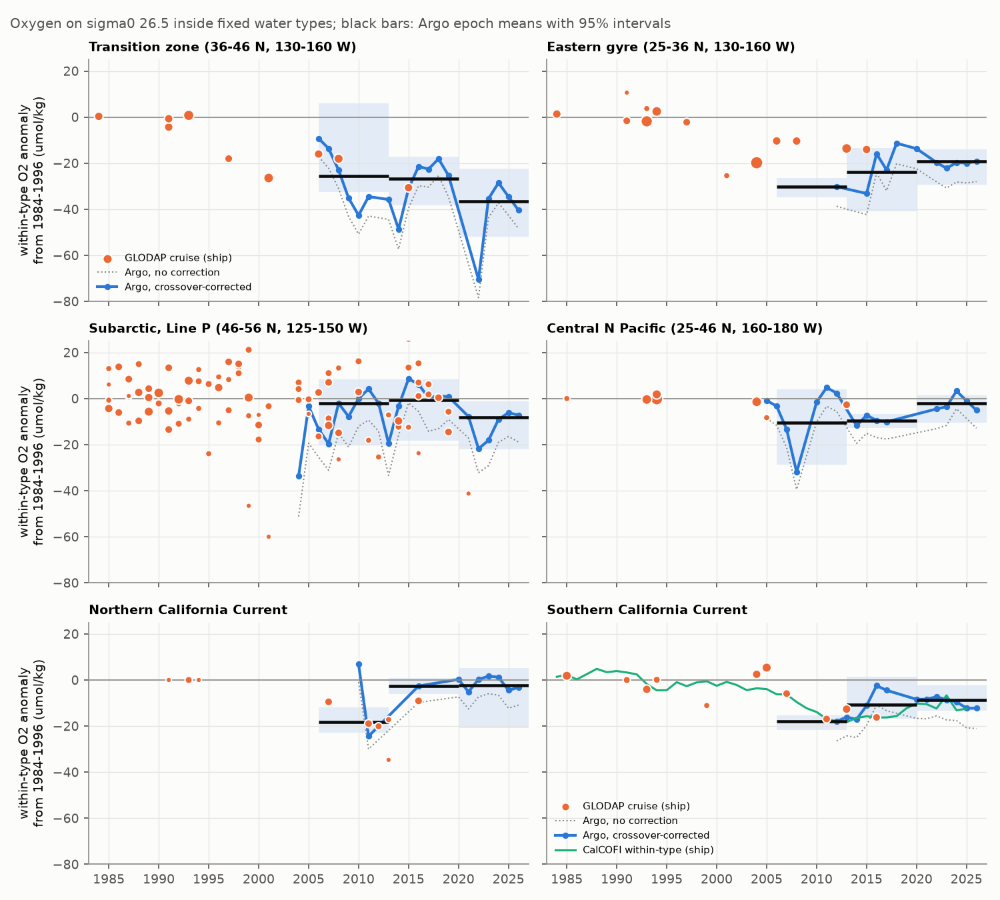
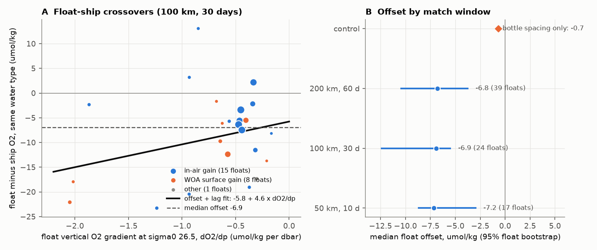
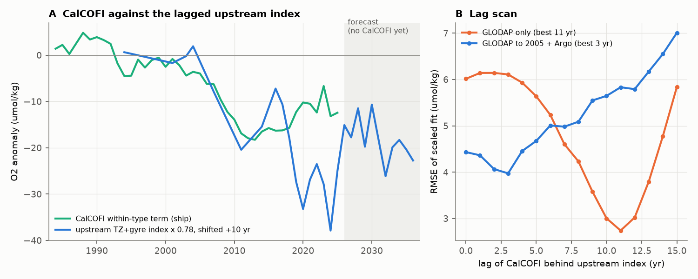

# After a ship-crossover correction, BGC-Argo floats show that transition-zone oxygen loss on sigma0 26.5 continued in 2006-2026 with nitrate gain, but a 10-year transfer overpredicts the California low

## Summary

Earlier campaign work found that the 2009-2025 oxygen low on the sigma0 = 26.5 kg/m3 surface off southern California (CalCOFI) is mostly a loss inside fixed water types. That loss agreed with an earlier loss in the offshore North Pacific transition zone (TZ) and eastern subtropical gyre (GYR) in GLODAP bottle data (sci:sha256:ea67ca59...). That study had only one TZ cruise after 2008. It proposed a transfer from TZ and GYR to CalCOFI with a lag of about 10 years. It could not tell whether the upstream loss was a respiration signal or a change of preformed oxygen.

We used 20,615 BGC-Argo profiles from 160 oxygen floats in 2004-2026 to extend the source record. We referenced them to the same GLODAP 1984-1996 cells. Before we used the floats, we compared them with ship bottles. We did three tests:

1. **Float bias (crossover test).** Float oxygen on sigma0 26.5 is lower than nearby ship bottle oxygen of the same water type by 6.9 umol/kg (median of 24 floats, 95% float-bootstrap interval 5.5 to 12.4; pairs within 100 km and 30 days). The ratio is 0.936. The offset is -7.2 at 50 km and 10 days, and -6.8 at 200 km and 60 days. Floats with in-air gain calibration have -5.7; floats with a World Ocean Atlas surface gain have -11.1. The coarse spacing of ship bottles accounts for only -0.7 umol/kg, and with the opposite sign. Without a correction, Argo data make the source loss approximately 8 umol/kg too large.
2. **Source persistence.** After the correction (offset plus a lag term, see Methods), the TZ within-type oxygen stayed 25.6 umol/kg below 1984-1996 in 2006-2012 (95% interval -32.5 to +5.9), 26.9 in 2013-2019 (-38.4 to -17.1) and 36.7 in 2020-2026 (-52.0 to -22.3). For 2009-2021 the Argo TZ value (-27.5) agrees with the one GLODAP cruise (P16N 2015, -28.8). The GYR deficit became smaller: -30.2 (one float), -24.0 and -19.2. The subarctic Line P region (-2.0, -0.7, -8.3) and the central North Pacific (-10.4, -9.7, -2.1) changed much less.
3. **Regenerated, not preformed.** Where floats also measure nitrate, nitrate inside the water type increased with AOU. In the TZ, nitrate increased by 4.1 umol/kg (3.1 to 5.1) while AOU increased by 34.5 (23.1 to 45.8), ratio 0.119 (0.108 to 0.143). In the GYR the ratio was 0.135 (0.113 to 0.149). These ratios are at or above the remineralization ratios 16/170 (0.094) and 16/138 (0.116). A change of preformed oxygen gives no nitrate change. Thus the source oxygen loss is a respiration-integrated (remineralization) signal. This settles the question that the GLODAP phosphate data left open (sci:sha256:ea67ca59...). It does not tell whether the water is older or its respiration is faster.
4. **The 10-year transfer fails out of sample.** We used the ea67 lag model without change (CalCOFI = 0.779 x upstream index 10 years earlier) and extended the upstream TZ+GYR index with corrected Argo values after 2005. The model predicts a CalCOFI within-type mean of -23.8 umol/kg for 2016-2025. The observed mean was -12.6 (RMSE 15.8). All 18 sensitivity runs predict -17.9 to -30.3. With the extended index, the best lag is 3 years and the scale is 0.42. The RMSE at 3 years is 4.0, which is not much better than 4.4 at zero lag. Thus the lag is not identified. CalCOFI recovered by 3.7 umol/kg per decade in 2009-2025 (0.9 to 6.4), while the TZ deficit did not decrease.

Interpretation: the offshore source of the California low continued to lose oxygen through 2026. The loss has a remineralization signature. Thus the source did not recover, and it gives no reason to expect a fast recovery off California. But the source deficit is about twice the California within-type deficit (transfer ratio about 0.4). Its timing also does not follow a 10-year transport delay. Thus a two-end-member transfer from the TZ and the GYR alone does not explain the California series. Water that changed less (for example subarctic or coastal water) must also supply the California Current on this surface, or the Argo cells do not sample the actual pathway.

## Question and hypotheses

Question: did the offshore source-region oxygen loss on sigma0 26.5 continue after 2008, is it a remineralization signal, and does it predict the California within-type series?

| Hypothesis | Prediction | Result |
|---|---|---|
| H1 Argo oxygen is unbiased on the isopycnal | Crossover offset near 0 | Rejected: -6.9 (-12.4 to -5.5); bottle spacing gives only -0.7 |
| H2 Source loss stopped or recovered after 2008 | TZ and GYR within-type anomaly returns to near 0 | Rejected for TZ (-27 to -37); partly true for GYR (-30 to -19) |
| H3 Source loss is a preformed-oxygen change | Nitrate change near 0 | Rejected: TZ +4.1, GYR +3.4 umol/kg; ratio to AOU 0.12-0.14 |
| H4 CalCOFI follows the source with a 10-year lag and scale 0.78 | 2016-2025 CalCOFI mean near the prediction | Rejected: -23.8 predicted, -12.6 observed |

We specified the crossover windows, the bias models and the out-of-sample lag test before we computed region changes. We specified the use of the offset-plus-lag model (M3) as primary because the optode response lag is a known physical effect. The leave-one-float-out test then preferred the constant offset (M1, RMSE 9.19) by a small margin over M3 (9.26); we report both.

## Data

- **BGC-Argo** synthetic profile (Sprof) files of the 176 floats that have adjusted or delayed-mode oxygen in 20-52 N, 180-115 W, retrieved from the Argo GDAC (https://data-argo.ifremer.fr) on 2026-11-10. Argo (2026), doi:10.17882/42182, CC BY 4.0. File list and SHA-256 in `files/provenance/`. We used DOXY_ADJUSTED and NITRATE_ADJUSTED with QC 1, 2, 5 or 8, and adjusted pressure, temperature and salinity when present (else real-time values with QC 1 or 2). Result: 20,615 profiles from 160 floats with oxygen and a vertical oxygen gradient on sigma0 26.5. The calibration comment of each profile gives its class: in-air gain (about 10,700 profiles), World Ocean Atlas surface gain (about 9,200), other.
- **GLODAPv2.2023 Pacific Ocean** (NCEI accession 0283442, CC BY 4.0), read in place from the campaign dataset store, `/mnt/dell-data/shared_datasets/glodapv2-2023-pacific-ocean-csv-ncei0283442/GLODAPv2.2023_Pacific_Ocean.csv`, SHA-256 d59b0776c5edaca5e921141444f22b9cdad5088db70f9129dc1b0fc50218d7ea. Isopycnal values come from `glodap_isopycnal.py` of sci:sha256:ea67ca59... (flag-2 data, 2,038 casts with O2 on sigma0 26.5).
- **CalCOFI** bottle casts (Winkler oxygen) from the per-cast isopycnal tables of sci:sha256:d2aed83c... (bottle database to 2021-05 and CTD-product bottle rows 2021-07 to 2025-04, preliminary). We checked that the CTD bottle column `OxBuM` has the same values as the bottle-database `Oxy_umol/Kg` for the 2019-2021 casts in both sources (349 casts, median difference 0.000), so both are in umol/kg.
- **CalCOFI within-type annual series and GLODAP cruise anomaly series** of sci:sha256:ea67ca59... . We reran that publication's pipeline: all 33 result files were byte-identical.

The external-data terms are in `files/NOTICE_external_data.md`. No source record or record-level extract is in this bundle.

## Methods

1. **Isopycnal values.** TEOS-10 sigma0 (gsw 3.6.23). Linear interpolation in sigma0 on the monotone part of the profile, maximum bracket 0.35 kg/m3; these are the rules of the ship data. For each float profile we also calculated dO2/dp at the sigma0 26.5 pressure (centered difference over +-15 dbar).
2. **Crossovers.** A pair is a float profile and a ship cast (GLODAP or CalCOFI) within 100 km and 30 days (also 50 km and 10 days, 200 km and 60 days). For each pair, dWT = dO2 - B dS with B = -250 umol/kg per psu (a typical local oxygen-salinity slope; dS is small). The statistical unit is the float: the float value is the median over its pairs.
3. **Bias models.** M0 none; M1 constant offset c0; M2 gain; M3 offset plus lag, dWT = c0 + L dO2/dp, with a Huber-weighted fit. An ascending optode with a slow response reads deeper, lower-oxygen water, and so M3 has a physical reason. Float bootstrap (1,000 draws) gives parameter draws. Leave-one-float-out error compares the models.
4. **Region changes.** The cells (2.5 deg x 5 deg), regions and P1 (1984-1996) cell means are those of ea67. A float profile in a cell with P1 data has the within-type anomaly WT = (O2corr - O2_P1cell) - b (S - S_P1cell), with b the pooled within-cell P1 slope of the region. We averaged profiles to cell-epoch means and then cells to a region value. Epochs: A1 2006-2012, A2 2013-2019, A3 2020-2026, and AP3 2009-2021 (the ea67 P3 epoch). Intervals: each of 1,000 draws resamples floats in the region, P1 GLODAP cruises, and one M3 parameter draw (b fixed at its full-sample value).
5. **Nitrate and AOU.** The same for float nitrate and for AOU = O2sol(S, theta) - O2corr, over 2009-2026, for floats with nitrate. Preformed-nitrate change = dNO3 - (16/170) dAOU. Intervals: 400 draws of floats and P1 cruises. Floats read 0.32 umol/kg less nitrate than ship bottles in 13 crossover floats (-0.60 to +0.12); we did not correct for this; a correction would make the nitrate gains larger.
6. **Lag test.** The upstream index of ea67 (ncell-weighted TZ+GYR GLODAP cruise anomalies, interpolated per year) before 2006, and the ncell-weighted corrected Argo TZ+GYR annual values from 2006. (i) Out-of-sample test: the ea67 parameters (lag 10, scale 0.779) predict CalCOFI 2016-2025 from the 2006-2015 index. (ii) A new lag scan of 0-15 years with a scaled fit. The CalCOFI series is the ea67 within-type annual term (anomaly from the 1984-2006 station x season means).
7. **Sensitivity.** 18 runs: three crossover windows x models M1-M3, no correction, in-air floats only, WOA-gain floats only, each float corrected by its own crossover offset, corrections from GLODAP or CalCOFI crossovers only, without 2026, and total oxygen instead of the within-type term.
8. **Same-year control.** The GLODAP cruise anomalies in TZ and GYR (2006, 2008, 2015) against the Argo annual values of the same year and region.

## Results

Crossover offsets (float minus ship, same water type, umol/kg; `files/results/argo_source_results.json`):

| Window | Floats (in-air/WOA) | Median offset | M3 offset c0 | M3 lag L (dbar per unit gradient) | LOO RMSE M0/M1/M2/M3 |
|---|---|---|---|---|---|
| 50 km, 10 d | 17 (11/6) | -7.2 | -1.6 | 7.2 | |
| 100 km, 30 d (primary) | 24 (15/8) | -6.9 (-12.4, -5.5) | -5.8 (-12.3, -0.9) | 4.6 (-6.4, 10.9) | 12.1 / 9.2 / 9.8 / 9.3 |
| 200 km, 60 d | 39 (20/18) | -6.8 | 0.7 | 13.4 | |

The offset is robust; the split between offset and lag is not (the lag interval includes zero). At a typical gradient of -0.5 umol/kg per dbar, M3 gives -8.1, -5.2 and -6.0 umol/kg in the three windows.

Within-type oxygen change on sigma0 26.5 from 1984-1996, corrected Argo (M3, 100 km; 95% intervals; floats in the epoch):

| Region | 2006-2012 | 2013-2019 | 2020-2026 | 2009-2021 | GLODAP 2009-2021 (ea67) | No correction, 2009-2021 |
|---|---|---|---|---|---|---|
| TZ | -25.6 (-32.5, +5.9), 3 | -26.9 (-38.4, -17.1), 4 | -36.7 (-52.0, -22.3), 16 | -27.5 (-38.9, -16.2), 6 | -28.8 (one cruise) | -35.7 |
| GYR | -30.2 (1 float) | -24.0 (-40.8, -13.4), 5 | -19.2 (-29.2, -13.9), 12 | -23.9 (-39.1, -13.2), 6 | -14.4 | -32.8 |
| SUB | -2.0 (-20.4, +8.4), 13 | -0.7 (-18.3, +8.4), 12 | -8.3 (-22.0, -1.1), 20 | +1.6 (-16.0, +9.3), 21 | -6.7 | -10.4 |
| WEST | -10.4 (-28.7, +3.9), 7 | -9.7 (1 float) | -2.1 (-10.6, +1.5), 7 | -1.6 (-11.4, +3.2), 3 | -2.3 (one cruise) | -9.9 |
| NCC | -18.2 (1 float) | -2.6 (1 float) | -2.3 (-20.9, +5.3), 22 | -3.7 (-20.6, +6.0), 6 | -16.0 | -11.0 |
| CCS | -17.9 (1 float) | -10.8 (-16.7, +1.4), 3 | -8.6 (-13.2, -2.4), 13 | -9.7 (-15.2, -5.0), 8 | -16.5 | -18.2 |

Same-year control (Argo minus GLODAP cruise, umol/kg): TZ 2006 +6.7 (one float), TZ 2008 -4.9, TZ 2015 -0.4, GYR 2015 -19.1 (two floats). The TZ values agree; the GYR value does not. Thus the GYR epoch values are less reliable than the TZ values.

Nitrate and AOU inside water types, Argo 2009-2026 minus GLODAP 1984-1996 (corrected O2):

| Region | Floats | dNO3 | dAOU | dNO3/dAOU | Preformed dNO3 |
|---|---|---|---|---|---|
| TZ | 12 | +4.11 (3.12, 5.12) | +34.5 (23.1, 45.8) | 0.119 (0.108, 0.143) | +0.86 (0.51, 1.32) |
| GYR | 13 | +3.37 (2.83, 4.30) | +25.0 (20.3, 35.8) | 0.135 (0.113, 0.149) | +1.01 (0.61, 1.28) |
| SUB | 16 | +2.40 (0.80, 3.47) | +15.0 (5.6, 27.1) | 0.16 (0.09, 0.29) | +0.98 (-0.13, 1.78) |
| CCS | 13 | +1.50 (0.90, 1.92) | +9.2 (6.3, 11.6) | 0.16 (0.11, 0.19) | +0.63 (0.17, 0.92) |
| WEST | 8 | +0.61 (0.19, 2.33) | +3.6 (0.3, 8.7) | not resolved | +0.28 |
| NCC | 13 | +0.68 (-0.31, 1.36) | -2.8 (-5.5, 0.8) | not resolved | +0.94 |

The nitrate-float subsets differ from the oxygen-float sets (for example the SUB nitrate floats are mostly after 2015). Without the oxygen correction the TZ AOU gain would be about 8 larger (estimate from the mean TZ correction of -8.0) and the ratio about 0.10, also a remineralization ratio. The small positive preformed-nitrate term depends on the assumed ratio (16/170); with 16/138 it is near zero.

Lag test (`files/results/lag_table_*.csv`, `argo_source_results.json`):

| Upstream index | Best lag (yr) | Scale | RMSE best | RMSE lag 0 |
|---|---|---|---|---|
| GLODAP only (ea67 reproduction, 1984-2021) | 11 | 0.80 | 2.7 | 6.0 |
| GLODAP to 2005 + corrected Argo 2006-2026 | 3 | 0.42 | 4.0 | 4.4 |

Out-of-sample test of the ea67 model: predicted CalCOFI 2016-2025 mean -23.8, observed -12.6, RMSE 15.8 (10 years). In the 18 sensitivity runs, the prediction was -17.9 (WOA-gain floats only) to -30.3 (no correction). The best lag was 3 years in 14 runs, 0 years in the two in-air-only runs, 4 years with own-float offsets, and 12 years with WOA-gain floats only. The ratio of the CalCOFI 2016-2025 mean to the upstream 2006-2015 mean was 0.32-0.55 (0.41 primary).

Trends 2009-2025 (`files/results/regional_compare.json`, OLS on annual values): CalCOFI within-type +3.7 umol/kg per decade (0.9 to 6.4); Argo TZ -0.5 (-16.4 to +15.3); GYR +6.7 (-5.0 to +18.4); CCS +4.6 (-2.2 to +11.4). The correlation of annual CalCOFI with GYR 3 years earlier is 0.80 (7 years only); with TZ 10 years earlier it is -0.67 (9 years). We treat these correlations as exploratory.

Sensitivity (`files/results/sensitivity_sig265.csv`): the TZ 2009-2021 value is -22.2 (correction from GLODAP crossovers only) to -37.9 (own-float offsets); the TZ 2020-2026 value is -31.3 to -63.2. Every run has a TZ deficit of more than 20 umol/kg and a prediction failure of the ea67 lag model.

## Limitations

- **The bias correction is transferred.** No crossover float lies in the TZ or GYR boxes. The crossovers are at Line P and off southern California (Fig. 5). The correction from GLODAP crossovers only (12 floats) is larger than the one from CalCOFI crossovers only, and the TZ value changes from -29.8 to -22.2 between these two choices. The cause of the offset (optode response lag, gain error or calibration reference) is not identified; the lag term is not resolved.
- **Few floats per epoch.** Some epoch values rest on one float (see the table). TZ intervals for 2006-2012 include values near zero. The P1 baseline rests on 4 TZ and 7 GYR cruises; the intervals include this through the cruise bootstrap.
- **Spatial sampling.** Floats sample the parts of the cells that they drift through, while P1 values come from ship sections. The within-type term removes part of this mismatch, not all. The GYR same-year control differs by 19 umol/kg.
- **Nitrate calibration.** Float nitrate is adjusted against an empirical deep reference (for example ESPER at 450-1300 dbar). A change of the deep reference with time would enter dNO3. The float-ship nitrate offset (-0.32) is small.
- **Ventilation versus respiration.** The nitrate test separates preformed from regenerated oxygen change. It does not separate older water from faster respiration; both give the same nitrate-AOU ratio.
- **Lag test.** The upstream index is noisy (few floats per year), and the CalCOFI series uses a 1984-2006 reference while the upstream index uses 1984-1996. A constant offset between them can affect the scale, not the failure of the predicted 2016-2025 level, which all runs show.
- **Data versions.** The Argo GDAC files change when delayed-mode adjustments are revised. A rerun with newer files can give slightly different values; the hashes of the files we used are in `files/provenance/`. CalCOFI values after 2021-05 are preliminary.
- **Multiple tests.** We report several related tests and did not correct for multiple tests.

## Relation to prior work

- Campaign: sci:sha256:ea67ca59... (water-type split of the CalCOFI low and GLODAP source regions; we extend its source record, test its open preformed-or-regenerated question and test its lag model out of sample), sci:sha256:d2aed83c... and sci:sha256:d73b9f65... (the CalCOFI low), sci:sha256:ad98ae6d... (Line P did not carry the loss; our Argo SUB values agree), sci:sha256:978770d0... (tracer ages are unreliable; our tests use no tracer age), sci:sha256:a1be8c13... and sci:sha256:c5d76aae... (tracer-age attribution), sci:sha256:b0f49ff5... (mixture bounds at CalCOFI). A search of the campaign on 2026-11-10 found no study that used BGC-Argo oxygen or nitrate.
- Johnson et al. (2015) and Bittig et al. (2018) describe in-air optode calibration and its accuracy; Bittig and Kortzinger (2017) describe the optode response time. Takeshita et al. (2013) describe the WOA surface gain. Our crossover result shows that, for this isopycnal in this region, adjusted float oxygen needs a ship reference before trend use.

## Files

- `files/code/`: `select_floats.py`, `fetch_argo.sh` (GDAC retrieval), `argo_isopycnal.py` (float values on density surfaces), `crossover.py`, `argo_source.py` (bias models, region changes, nitrate, lag test), `bottle_spacing_test.py`, `sensitivity.py`, `regional_compare.py`, `figures.py`, `run_all.sh`, `requirements.txt`.
- `files/results/`: `argo_source_results.json` (all main statistics), `argo_region_annual_wt_sig265.csv` (corrected) and `_M0.csv` (uncorrected) region-year means, `crossover_floats_*.csv` (float-level median differences; the median ship O2 column is removed), `lag_table_*.csv`, `upstream_index_glodap_plus_argo.csv`, `sensitivity_sig265.csv`, `regional_compare.json`.
- `files/figures/`: five PNG figures.
- `files/provenance.json`, `files/provenance/` (Argo float list and file hashes), `files/NOTICE_external_data.md`.

## Reproduction

    bash files/code/run_all.sh CAMPAIGN_DIR SCRATCH_DIR OUT_DIR [GLODAPv2.2023_Pacific_Ocean.csv] [SPROF_DIR]

CAMPAIGN_DIR must hold the ZIPs of sci:sha256:d2aed83c... and sci:sha256:ea67ca59... (or use `sci pull`). The script verifies both, extracts the inputs, checks their SHA-256, downloads GLODAP from NCEI if no local copy is given, and downloads the Argo files if no SPROF_DIR is given (`fetch_argo.sh`; compare with `files/provenance/argo_sprof_sha256_20261110.txt`). All outputs go to OUT_DIR and SCRATCH_DIR, never into this bundle. Needs Python 3.12 with the packages in `requirements.txt` (gsw is not in the campaign base environment; install it to a private target folder and set PYTHONPATH). Runtime on the loaded campaign host: about 35 minutes. A complete rerun from new scratch folders gave the same values as the first run.

## Provenance

Campaign 11_07_2026; job sci-1107-dell-earth-and-ocean-sciences-5c441caf63e8; topic earth-and-ocean-sciences; machine dell; model claude-opus-5-5 (Claude Code agent); analysis date 2026-11-10. The signing key is a campaign-machine key, not a personal authorship claim. Argo acknowledgement: these data were collected and made freely available by the International Argo Program and the national programs that contribute to it (https://argo.ucsd.edu, https://www.ocean-ops.org). The Argo Program is part of the Global Ocean Observing System.

## References

- Argo (2026). Argo float data and metadata from Global Data Assembly Centre (Argo GDAC). SEANOE. doi:10.17882/42182
- Bittig, H. C., and Kortzinger, A. (2017). Technical note: Update on response times, in-air measurements, and in situ drift for oxygen optodes on profiling platforms. Ocean Science 13, 1-11. doi:10.5194/os-13-1-2017
- Bittig, H. C., et al. (2018). Oxygen optode sensors: principle, characterization, calibration, and application in the ocean. Frontiers in Marine Science 4, 429. doi:10.3389/fmars.2017.00429
- Johnson, K. S., et al. (2015). Air oxygen calibration of oxygen optodes on a profiling float array. Journal of Atmospheric and Oceanic Technology 32, 2160-2172. doi:10.1175/JTECH-D-15-0101.1
- Lauvset, S. K., et al. (2024). The annual update GLODAPv2.2023. Earth System Science Data 16, 2047-2072. doi:10.5194/essd-16-2047-2024
- Takeshita, Y., et al. (2013). A climatology-based quality control procedure for profiling float oxygen data. Journal of Geophysical Research: Oceans 118, 5640-5650. doi:10.1002/jgrc.20399
- Wong, A. P. S., et al. (2020). Argo data 1999-2019. Frontiers in Marine Science 7, 700. doi:10.3389/fmars.2020.00700
