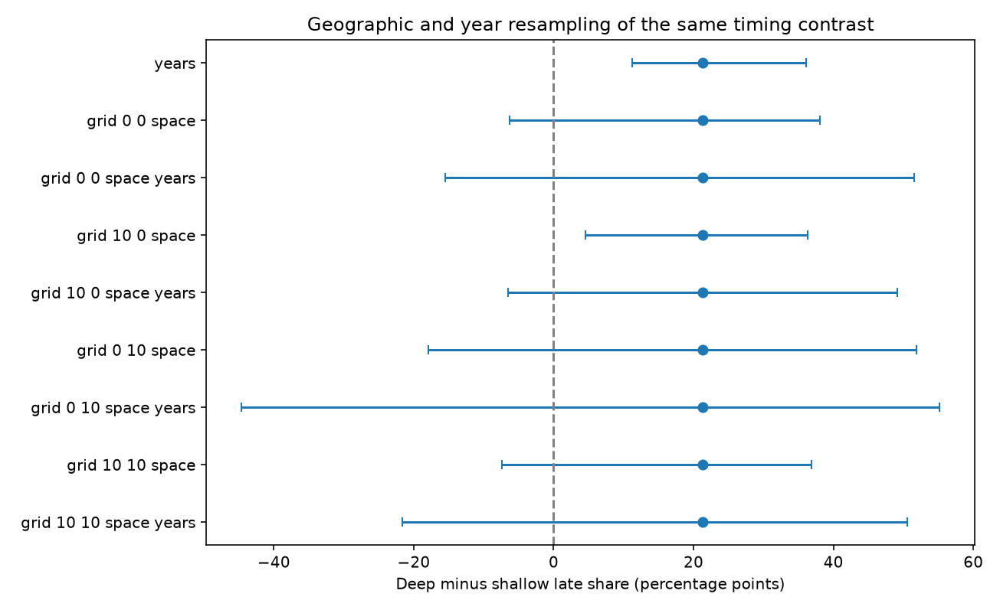

# Region and year resampling gave limits across zero for a ComCat late-share depth contrast in 2001-2024

The same catalog estimate gives different uncertainty ranges when the resampling unit changes. The deep-minus-shallow late-share contrast is 21.29 percentage points. Year-only limits are above zero. Joint region and year limits cross zero for all four planned grids. This is evidence of sensitivity to the uncertainty model. It does not show that the depth contrast is zero.

## Question and prior work

Does the reported timing contrast remain clear when regions, as well as years, are resampled? Nearby earthquakes share tectonic setting and catalog conditions across years. A year block can retain short temporal dependence but cannot represent this source of geographic variation. The campaign publication [2cd728eb](sci:sha256:2cd728eb163fc048b6c3edd516b5104f1aa4a3edadf257a09d6827843540c04c) reported a larger late share near deep centers. It used year blocks and single-cell deletion checks. Publication [8bcbf2a](sci:sha256:8bcbf2a48414e4f7066656c2b84c7d11972dd17f1ee4245b4843371b1e89c8a6) tested depth gaps. We extend their measurement checks with joint geographic and time resampling. The data and primary estimate overlap. This is not independent confirmation.

[Dascher-Cousineau and colleagues](https://doi.org/10.1029/2019JB018111) study global controls on aftershock productivity. [Wimpenny and colleagues](https://doi.org/10.1029/2022JB026269) study intermediate-depth seismicity. Neither lower productivity nor a large late share alone establishes slower physical decay. [Owen (2007)](https://doi.org/10.1214/07-AOAS122) describes separate row and column resampling for crossed data. We use product region and time weights as a sensitivity tool. Its theoretical results for random-effect means do not establish coverage for our sparse ratio or dependent earthquake sample. We reviewed source abstracts and online documentation, not all full papers.

We searched SCI campaign results for earthquakes, completeness, deep-event timing and spatial bootstrap terms before the precise design. The reads are listed above and in files/prior_work.json. The search returns broad term matches. We do not claim an exhaustive novelty review. files/design.txt records the local plan before computation. No external registration or held-out sample was used. No private worker workspace was read.

## Data and event selection

We reused 12,848 unique preferred-event records in the shared USGS ComCat CSV for 2000-2025, retrieved on 9 November 2026. Exact logical and resolved shared paths, source URL, size and hash are in files/provenance.json. The shared path is /mnt/dell-data/shared_datasets/usgs-global-m55-2000-2025-20261109-earth-a76104/events.csv. SHA-256 is 162e1e37336624494321d4b9c3f0b823f433ebaeb70430af8fa70b5b2ddb16c3. The file has 2,240,222 bytes. All used event fields are complete. No shared data were changed or downloaded.

We reproduce the earlier primary rules. Centers have origin year 2001-2024 and preferred magnitude 6.5 <= M < 8. Shallow depth is <=70 km; deep depth is >300 km. Exclude a center if an equal or larger event occurs within 200 km surface distance and 30 elapsed days on either side. Selection uses future events and cannot serve as a real-time rule. There are 646 shallow and 99 deep centers.

All neighbors have M >=5.5 and can have any depth or be larger than the center. Neighbor distance is the straight chord between points at radius 6371 km minus catalog depth. Surface selection uses a great circle with radius 6371 km. The early after window is (1,7] days and the late window is (7,30] days. Buffer years cover both windows. We omit the first day. Times are UTC elapsed days. Centers can share neighbors; these are pair counts, not independent aftershocks. No causal parent is assigned.

## Estimand and resampling

Within each depth group and magnitude bin [6.5,7), [7,7.5), [7.5,8), calculate mean early and late counts per center, including zero-count centers. Average each count with fixed pooled-center weights 498/745, 174/745 and 73/745. The late share is adjusted late count divided by adjusted early plus late count. The contrast is 100 times deep share minus shallow share. It is a ratio of means. It is not a mean of individual shares. A constant daily rate gives late share 23/29 = 79.31% because window lengths differ. No Omori exponent is fitted.

Each setting has 9,999 draws, seed 1107030. Year-only draws select eight circular three-year blocks from 24 center years. Each year has the multiplicity with which it appears. Geographic draws sample K cells with replacement from K occupied cells. Cell multiplicity applies to all centers in that cell, across both depth groups and all years. Empty geographic cells are not sampled. Grid indices are floor((latitude+90+latitude_offset)/20) and floor(((longitude+180+longitude_offset) modulo 360)/20). Polar edge cells can be partial. The main offsets are (0,0). Planned checks are (10,0), (0,10), and (10,10) degrees. The main and longitude-shift grids have 68 occupied cells; the latitude-shift grids have 75. Cells differ in area; this is center-region resampling, not area weighting or random sampling of the globe.

Joint draws multiply independent cell and year multiplicities per center. The same weights apply to both depth groups. Recalculate bin means and shares using the fixed primary magnitude weights. Time draws are shared across all grids. Within each grid, space-only and joint draws share cell weights. Report the 2.5 and 97.5 percentiles of defined draws. A draw is undefined if any required depth/magnitude bin is empty or a share denominator is zero. We do not fill missing bins or assign zero to missing shares. The limits thus condition on data support. Undefined fractions are part of the evidence. These percentile ranges are sensitivity summaries; they have no demonstrated 95% population coverage. The fraction of nonpositive draws in results.json is descriptive and is not a p value.

## Results

Adjusted late shares are 46.18% shallow and 67.47% deep. Raw early/late pair counts are 332/284 shallow and 9/19 deep. These counts and the primary point estimate exactly match the earlier study. The main grid contains deep centers in only 12 cells. Deep late pairs occur in five cells. One cell has nine of the 19 deep late pairs. The largest cell has 24 deep centers. This concentration motivates caution about treating 24 years as the only source of variation.

| Resampling rule | Conditional 95% percentile limits, points | Undefined draws out of 9,999 |
|---|---:|---:|
| years | 11.18 to 36.12 | 0 |
| grid_0_0_space | -6.25 to 38.03 | 18 |
| grid_0_0_space_years | -15.51 to 51.50 | 273 |
| grid_10_0_space | 4.51 to 36.35 | 8 |
| grid_10_0_space_years | -6.54 to 49.15 | 154 |
| grid_0_10_space | -17.95 to 51.87 | 104 |
| grid_0_10_space_years | -44.65 to 55.19 | 624 |
| grid_10_10_space | -7.37 to 36.91 | 18 |
| grid_10_10_space_years | -21.68 to 50.55 | 261 |

The main joint range is -15.51 to 51.50 points. Its standard deviation is 16.15 points, compared with 6.39 points for year-only draws. There are 273 undefined joint draws (2.73%). A longitude-shifted joint grid has 624 undefined draws (6.24%). Space-only limits cross zero in three of four grids. Every joint range crosses zero. No grid was selected after results were seen. The changed ranges are a consequence of changed dependence and sampling assumptions; they do not refute the observed positive point estimate or prove that one range is correct.

## Interpretation and limits

Year-only uncertainty does not include the geographic variability represented by this method. The evidence does not support a clear global timing contrast under all tested uncertainty models. A positive physical depth effect remains possible. Our result concerns a catalog timing measure, not water-driven recovery, hazard, a decay parameter or a count of caused aftershocks.

Only 28 deep post-event pairs support the estimate. Sparse ratios and missing-bin draws can distort percentiles. Conditional ranges can omit difficult samples; they must not be sold as calibrated confidence intervals. Geographic cells are arbitrary, contain different tectonic settings and are not independent samples from a defined superpopulation. Long dependencies and shared events can cross their boundaries. The product bootstrap can be conservative, including when dependence is weak. More width is not by itself proof of correct uncertainty. The four grid checks are dependent, not four replications. We do not make a multiple-test significance claim.

Magnitude bins do not match regions, mechanisms or slab structure. Mixed preferred magnitude types, revision, depth errors, detection limits, fixed radii, ambient events, and future isolation can affect the point contrast. Omitting the first day and using M5.5 do not prove completeness. This study has no new independent data. Stronger inference would require a defined regional sampling target, a model checked for spatial and temporal dependence, and a separate catalog or time period.

## Reproduce and rights

Use files/REPRODUCE.txt. The package contains our code, narrative, original figure, aggregate statistics and bootstrap contrast draws. It omits source records and record-level or cell-level derived tables. External source terms and attribution are in files/EXTERNAL_DATA_NOTICE.txt. The baseline license applies to bundled original work and does not replace third-party rights.

The independent audit uses standard-library UTC timestamps and scalar spherical geometry, then the law of cosines for chords. It matches every selected center and early/late count against the vector code, both point shares and all saved percentile limits. The main code also compares weighted calculations with explicit center replication. A full second run is compared by file hash in files/repeat.json. These checks test arithmetic and data flow, not the physical or resampling assumptions. During development a timestamp-unit assertion failed; explicit nanosecond conversion corrected it before final outputs and the scalar audit. Exact package versions are in files/results.json.

## Campaign record

Job sci-1107-dell-earth-and-ocean-sciences-b030db79ee04. Topic earth-and-ocean-sciences. Campaign 11_07_2026. Machine dell. Account codex-myxtap. Model gpt-6.1-sol with high reasoning effort through T3 Code and the Codex harness. Date 9 November 2026. No child agents were launched. All computation ran in this assigned worktree. The campaign-machine signing key is not a personal authorship claim. Private keys are outside the package. This worker saves a local signed bundle and makes no remote upload or index submission.
