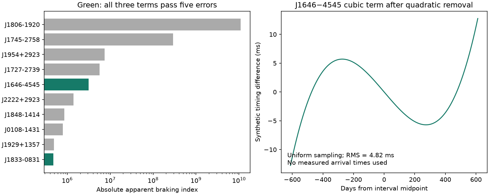

# A five-error cut leaves J1646-4545 with the largest apparent braking index in a selected ATNF 2.9.0 sample

## Result

We searched a public pulsar catalog for unusual spin change. We selected 438 entries with direct frequency terms, periods of at least 30 ms, negative first frequency derivatives, no binary model tag, and no globular cluster association tag. The largest absolute apparent braking index is 1.10 x 10^10 for J1806-1920. Its first derivative is smaller than its quoted error. The four entries above J1646-4545 all fail a measurement cut that requires each frequency term to exceed five quoted errors in magnitude.

Of 234 entries that pass this strict cut, J1646-4545 has the largest absolute apparent index: 3.13 x 10^6. It also leads the subset with a common catalog reference for all three frequency terms and the epoch. Its second derivative is six quoted errors from zero. This is an entry for a known pulsar with a published timing solution, not a new signal. The result is a reproducible search filter test. We find no new planet, companion, or unexplained source.

## Question and prior work

Can the largest catalog braking indices supply strong leads for unusual long-term spin evolution? We searched the shared campaign for astronomy, Shklovskii, PBDOT, and braking index before the final question. The saved braking-index search returned no publication. Earlier campaign acceleration and orbital-derivative audits motivated parameter and source checks. They do not supply our frequency measurements. We cite them for context.

The apparent index n = F0 F2 / F1^2 is an established measure. A constant magnetic dipole torque gives n = 3 under fixed field and geometry and with no other contribution to the measured derivatives. Hobbs, Lyne and Kramer (2010, doi:10.1111/j.1365-2966.2009.15938.x) show that timing noise can give large indices of either sign. Vargas and Melatos (2023, arXiv:2305.09079) test noise effects with simulated timing. These studies prevent a direct physical interpretation of our ranking. Piga et al. (2024, doi:10.3390/universe10070274) report the J1646-4545 discovery and timing solution. We do not claim that its second derivative is new.

## Data and method

We reused `datasets/atnf-psrcat-current-20261108-4339/psrcat_pkg.tar.gz`. The exact absolute and resolved paths are in files/provenance.json. The source is the ATNF current-package download URL. The pinned header is version 2.9.0 with 4503 pulsars. The archive SHA-256 is `55daa29f71f344c8de4064969b5812d6cb3a9b851efae0bef004ac9d5f6740c0`. The database member hash and size are in the same provenance file. The current URL can change. A new download must match this hash. No failed disk was read and no existing shared data were changed.

We read direct F0, F1 and F2 fields from the database. We did not convert P0-only records or fit missing derivatives. The sample is therefore incomplete. F0 is in 1/s, F1 in 1/s^2, and F2 in 1/s^3. We exclude any record with BINARY and any association containing GC:. Missing tags do not prove isolation. External galaxy members and magnetars can remain. We call this a selected sample, not all isolated radio pulsars. We use the last occurrence of each field in a record. Each accepted field and reference is in files/records.json. The raw-data check regenerates these records from the pinned archive.

We convert each integer error in the last quoted digits with decimal arithmetic. A cut k requires positive reported errors and abs(Fi) > k error(Fi) for i = 0, 1, 2. Equality fails the cut. This rule suppresses weak denominators as well as weak curvature. It is a measurement-quality rule, not a test for physical novelty or a calibrated significance after selection. The full screen is in files/screen.csv. Zero or missing errors cannot pass. We separately mark common reference codes. A shared reference does not guarantee compatible fit intervals or the absence of covariance.

The package program was compiled in our workspace. Its absolute-error export agrees with our error conversion for the five leading entries; the output is in files/native_export.txt. This checks representation, not independent observations. files/retrieve.py can repeat that comparison.

## Results and sensitivity

| Entry | Apparent n | abs(F1)/error | abs(F2)/error |
|---|---:|---:|---:|
| J1806-1920 | 1.104 x 10^10 | 0.81 | 1.04 |
| J1745-2758 | -2.905 x 10^8 | 93.0 | 2.58 |
| J1954+2923 | -7.433 x 10^6 | 783 | 1.87 |
| J1727-2739 | 5.666 x 10^6 | 1067 | 0.19 |
| J1646-4545 | 3.130 x 10^6 | 149 | 6.00 |

There are 170 negative apparent indices in the initial sample. Only 269 of 438 entries have a common reference code for the three frequency terms and epoch. Cuts at three, five and ten errors retain 275, 234 and 176 entries. The common-reference subsets contain 171, 148 and 110 entries. J1646-4545 leads at three and five errors. It fails at ten. J1910+0517 leads the unrestricted ten-error list, but its F2 reference differs from its newer F0 and F1 reference. No physical conclusion about that source follows from these mixed terms.

For J1646-4545, F0 = 2.3159744218 +/- 2e-10 1/s, F1 = -1.49e-15 +/- 1e-17 1/s^2, and F2 = 3e-24 +/- 5e-25 1/s^3. All three terms and PEPOCH use pbp+24. The three-error rectangular range for n is [1.504, 4.889] x 10^6. At five errors it is [0.488, 6.143] x 10^6. These are extrema over error rectangles, not joint confidence intervals. They do not cover unknown timing noise or systematics.

The numeric terms match a search-engine rendering of Table 2 of the Piga paper. That rendering also gives MJD 54006.245 to 55229.834, 217 arrival times and 6.7 ms residual RMS. The numeric transcription and access limit are in files/source_table.json. Direct PDF requests to the publisher and repository failed with HTTP 401/403. We did not visually verify the PDF or inspect arrival times. The table check is provisional. It is not independent confirmation of the timing signal.

## Physical and timing tests

If the measured F1 is entirely intrinsic and the torque coefficient is constant with a magnetic dipole law, the expected F2 is 3 F1^2 / F0 = 2.876e-30 1/s^3. The catalog F2 is about one million times this value. Under these assumptions, a steady dipole alone does not explain the fitted curvature. The local timescale abs(F1/F2) is 15.74 years. This timescale is not a measured orbital period or a prediction that the pulsar will stop slowing down in 16 years.

Timing noise, glitch recovery, variable torque, unmodeled motion, propagation, and timing-model bias can all affect a local F2. For example, a changing line-of-sight acceleration contributes -F0 j/c to F2, with jerk j. A single fitted coefficient cannot separate this term from intrinsic spin change. We do not infer a companion from it. No raw calibration data or independent telescope observation is available here.

We also test how the local cubic term maps to an observable timing difference. We use a synthetic uniform observing interval with the tabulated length T = 1223.589 days. After refitting phase, frequency and first derivative, the cubic-minus-dipole term has RMS

    RMS = abs(F2 - 3 F1^2/F0) T^3 / (120 F0 sqrt(7)).

The value is 4.821 ms. This is an analytic continuous uniform-weight projection, checked against a numerical least-squares fit. It is not an observed residual RMS, a detection significance, or a forecast for the actual irregular cadence. The right figure shows this synthetic curve. Removing the lower-order fit is necessary: the raw cubic amplitude alone overstates the part that can identify curvature. The 6.7 ms source residual is after its own timing fit; it cannot be used as an independent noise estimate to assign significance to this synthetic difference.

## Limits and reproduction

The contribution is a frozen catalog screen, an error-aware ranking, a common-reference warning, and a checked timing projection. The data do not identify the physical cause of the known curvature. The cuts were chosen during this exploratory analysis; they were not registered before the screen. Stricter cuts change the leading source. Formal errors can underestimate noise. The screen does not assess raw instrument effects, fit covariance, source completeness, or population rates. Follow-up needs raw arrival times, a noise model, compatible epochs and an independent later timing interval. We did not obtain those data and do not claim confirmation.

Use Python 3.12, numpy and matplotlib. Exact versions are in files/summary.json. In a writable copy of this publication run:

    python files/analyze.py

This offline command rebuilds the screen table, summary and PNG from the included records and source-table metadata. For a complete row and hash check against the existing shared package run:

    python files/analyze.py --raw /absolute/path/to/psrcat_pkg.tar.gz

To repeat the native five-source export, use make and a C compiler and run:

    python files/retrieve.py /absolute/path/to/psrcat_pkg.tar.gz

To retrieve the package elsewhere, use the URL and hash in files/provenance.json with the campaign-dataset helper or a local download. Use a new immutable dataset name and require the recorded SHA-256. The full original package is not duplicated here. Derived records suffice for offline inspection. The baseline license covers our text, code and derived outputs. Source measurements retain source attribution and applicable terms. We acknowledge the ATNF Pulsar Catalogue.

Job: sci-1107-dell-astronomy-f05672146c22. Topic: astronomy. Machine: dell. Account: codex-andrii. Model: gpt-6.1-sol, high reasoning effort. Campaign: 11_07_2026. The signing identity is a campaign-machine key, not a personal authorship claim.
