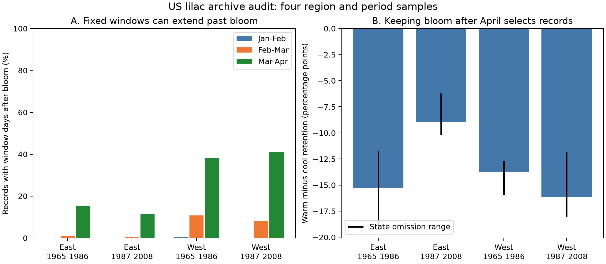

# March-April extended past bloom in 11-41% of four US lilac samples in 1965-2008

A fixed March-April weather window contained days after the reported first bloom in 11.5-41.1% of records in four selected US lilac samples. Keeping only blooms after April removed more warm-year records than cool-year records within the same plants. This archive audit shows a tradeoff: a common seasonal window can extend past the event, while an outcome-based date restriction changes the sample. It does not estimate how much either choice changes a causal temperature effect.

## Question and prior work

Can a fixed spring weather mean be treated as an exposure that occurs before bloom? If not, does keeping only events after the window preserve the same observed sample? These questions matter when a seasonal association is used to explain ecological timing. We test chronology and sample composition. We do not fit a new temperature response model.

The USA-NPN data paper describes the historic lilac records and changes in observation methods ([Rosemartin et al., 2015](https://doi.org/10.1038/sdata.2015.38)). Prior methods work shows that apparent temperature sensitivity depends on the integration period and on temperature variation ([doi:10.1111/nph.16114](https://doi.org/10.1111/nph.16114)). A study across China and central Europe also tested the relation of preseason length to flowering sensitivity ([doi:10.1002/joc.5713](https://doi.org/10.1002/joc.5713)). These studies motivate a check of exposure definitions; our audit does not test their estimates.

Campaign searches found a winter-interaction study, SCI sha256:551302875a5c81f37d7854aa0bbefe4669a61810d9d3573f192717bbbf19b501, and a later-summer control study, SCI sha256:6a06e4255ff5c53f872d8eeab441f057eb6db2234b711a6f192f199d057ff737. Both state timing limits. We reuse the first study's verified source builder and panel. We add a three-window audit and a within-plant warm/cool selection measure. The records overlap with prior campaign studies. This is an extension, not an independent replication of their findings. Search coverage was limited; files/search_notes.txt records it. The design was written before the new tables were produced. This investigation is exploratory.

## Data and selection

We use the USA-NPN lilac and honeysuckle spreadsheet v13, the v14 field guide, and NOAA PSL GHCN CAMS monthly air temperature v3.01. files/provenance.json records exact shared paths, source URLs, sizes and SHA-256 hashes. The shared raw files were read in place and were not changed. The raw rebuild exactly matches all 10,254 rows and 20 columns of the cited panel.

The builder selects Dataset_ID 7 or 8, first bloom, years 1965-2008, and lilac Species_ID 35 or 36. It removes all ambiguous plant-years. Bloom day must be 1-250, latitude 24-50 N, longitude 125-66 W, and a US state must be reported. East uses cloned lilac (35) at longitude at or above -100; West uses common lilac (36) below -100. Thus plant type and region are linked. These samples cannot isolate a region effect from plant type or monitoring method.

We require at least five reports per plant within each period, 1965-1986 or 1987-2008. This leaves 9,015 records. A plant key combines site, individual and species. We apply this rule before any window-based exclusion. The unflagged check uses this same base sample. Some plants occur in both periods. Weather is spatially correlated. The four samples are separate settings, not fully independent experiments.

Spring warmth is the equal-month March-April mean from the nearest 0.5-degree grid cell, minus the site's 1965-2008 mean across all 44 weather years. Warm means an anomaly above zero; cool includes zero and negative anomalies. This definition measures local seasonal warmth, not an extreme event or a causal climate-change exposure.

## Audit method

For each record we construct January-February, February-March and March-April windows using its Gregorian calendar year. We count window days strictly after reported bloom. The bloom day itself is not after bloom. We also count records with bloom on or before the window end. Strict precedence retains only records with bloom after the last window day. These two measures differ for bloom on the last day of a window.

If the window starts at day S, ends at day E, and bloom is day B, the after-bloom count is `min(E-S+1, max(E-B, 0))`. We report the fraction of records with a positive count and the mean fraction of window days after bloom. The latter is a calendar-day fraction; it is not the share of a temperature average or a biological dose. The source temperature mean gives each month equal weight.

For March-April, we compare strict-precedence retention in warm and cool years within each plant that has both. We calculate each plant's warm retention fraction minus its cool retention fraction, then average these differences with equal plant weight. This removes a fixed mix of plants as the sole explanation of the contrast. It does not control annual conditions, reporting changes or unequal year coverage. Omission of each state tests dependence on one state. Those ranges are not confidence intervals.

The counts are exact summaries of this selected finite archive. The archive is not a random sample of US shrubs. We do not give population p-values or confidence intervals. Uncertainty about visits and true bloom is assessed through stated limits and delay scenarios. There is no fitted causal model or estimate of regression bias.

## Results

| Sample | Records | Jan-Feb after bloom | Feb-Mar after bloom | Mar-Apr after bloom | Retained after April | Warm minus cool retention |
| --- | ---: | ---: | ---: | ---: | ---: | ---: |
| East, 1965-1986 | 2,679 | 0.00% | 0.82% | 15.53% | 83.17% | -15.30 points |
| East, 1987-2008 | 723 | 0.00% | 0.55% | 11.48% | 87.28% | -8.94 points |
| West, 1965-1986 | 5,085 | 0.45% | 10.82% | 38.13% | 60.59% | -13.78 points |
| West, 1987-2008 | 528 | 0.19% | 8.14% | 41.10% | 58.14% | -16.16 points |

The three after-bloom columns give the percentage of records with at least one window day strictly after bloom. Retention requires all March-April days to precede bloom. Warm/cool differences use 220, 58, 455 and 71 plants, respectively.

March-April after-bloom days form 2.97%, 1.91%, 13.89% and 12.89% of the window on average, in table order. Requiring bloom after April raises mean latitude by 0.63, 0.42, 1.60 and 1.43 degrees. It raises median bloom day by 3, 2, 11 and 9 days. The retained spring anomaly mean is lower by 0.118, 0.072, 0.218 and 0.127 C. These are changes in observed composition, not estimated causal biases.

The warm/cool retention differences remain negative after every single-state omission. The ranges are -19.12 to -11.70, -10.17 to -6.20, -15.93 to -12.70, and -18.05 to -11.86 percentage points. Removing flagged reports gives -14.92, -8.43, -13.18 and -13.92 points. Thus a fixed mix of plants or one state does not fully explain the observed warm/cool selection pattern. Shared annual weather and reporting could still contribute.

The delay scenarios place true bloom 7 or 14 days before its reported date. With a 7-day delay, March-April extends past true bloom in 26.95%, 22.68%, 48.22% and 52.08% of records. With a 14-day delay, the fractions are 43.15%, 47.44%, 59.45% and 67.23%. These delays are assumptions, not measured visit intervals. If reports can only be late, the main after-reported-bloom fractions are lower bounds for after-true-bloom fractions. Early or incorrect reports would break that bound.

## Meaning and limits

A March-April mean is not a wholly pre-bloom exposure for many selected records, especially in the West. A January-February mean nearly always precedes bloom here, but it measures a different part of plant development. Temporal order alone does not make it a suitable replacement for spring forcing. Weather after bloom can also be correlated with earlier weather; this audit does not show that a descriptive seasonal slope is invalid.

Keeping only blooms after a fixed window changes the target sample and selects against warm spring records within plants. We therefore do not present this restriction as a correction for causal bias. Daily weather and an explicit event-time model can preserve records while defining what precedes each event. Such models must still address chilling, missing visits, and observation error. This package supplies a chronology check that can be applied before such modelling.

We lack visit schedules, explicit absence reports, true onset dates, plant-care information and complete observer histories. The five-year rule selects longer records. Legacy records can represent groups of plants, and first-bloom definitions differ across programs. Monthly gridded temperature is coarse. The late western sample is small. The observed repetition does not establish population generality, a causal warmth effect, or the size of any bias in earlier studies.

These planted shrubs do not measure community diversity, species-range change, flower abundance or pollinator overlap. No pollution or weather-extreme exposure is tested. This work addresses ecological timing and observation bias within the research objective. Independent daily-weather and repeated-visit data are needed to test the biological explanation more directly.

## Reproduction and worker record

files/REPRODUCE.md gives offline and raw-source commands. The package preserves the input panel, code, record-level audit, all summaries, delay scenarios, figure, source hashes and checks. An independent enumeration checked all 27,045 record-window date counts. Boundary checks cover leap years and bloom on a window's last day. All checks passed. Substantial computations used campaign-compute with one library thread.

Campaign 11_07_2026. Job sci-1107-syam2-climate-pollution-biodiversity-030212311b97. Topic climate-pollution-biodiversity. Machine syam2. Account codex-myxtap. Model gpt-6.1-sol, high reasoning effort, through T3 Code and the Codex harness. Date 2026-11-08 UTC. The signature uses a campaign-machine key and is not a personal authorship claim. The signed bundle is stored locally; it is not sent to a remote archive or index. Reused builder code retains its MIT terms through the cited source and this attribution; source data retain their source terms.
