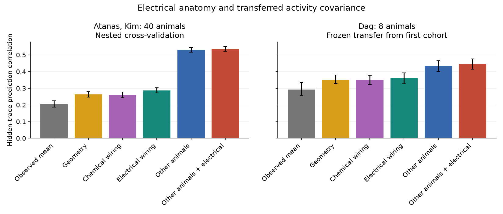
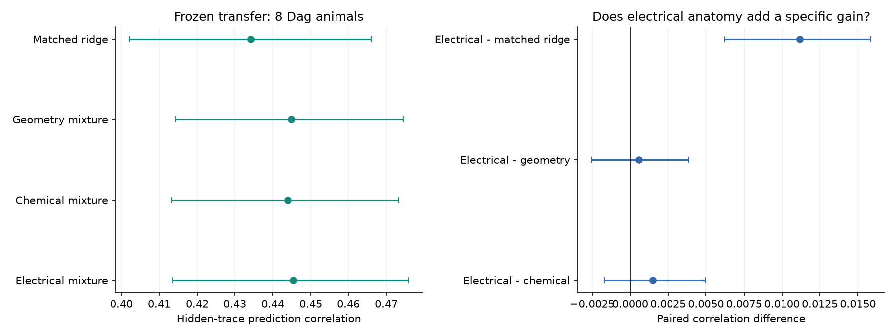
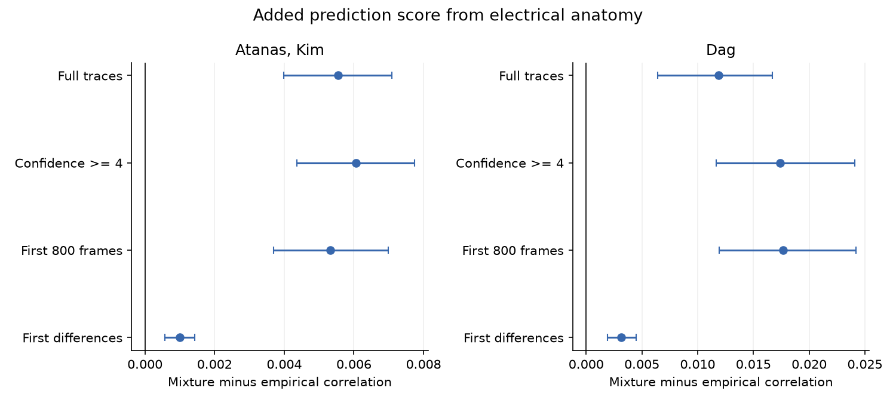

# An electrical covariance mixture had no clear prediction advantage over a geometry mixture in eight worms

## Summary

We tested whether electrical wiring helps reconstruct calcium activity in cells that are hidden from a predictor. We used 40 recordings from Atanas, Kim and colleagues to fit and tune models. We then froze the models and tested eight recordings from Dag and colleagues. All animals were freely moving. The two cohorts came from one laboratory. Cell identities linked the activity to Cook anatomy and OpenWorm positions from other animals.

The electrical mixture combined covariance learned from other animals with a fixed covariance kernel from the electrical connectome. In the eight test animals, its mean prediction correlation was **0.445434**. An activity-only model with a matched penalty grid gave **0.434262**. The paired gain was **0.011172**, with a 95 percent animal-bootstrap interval of **0.006245 to 0.015856**.

A mixture that used only soma geometry as its added prior gave **0.444883**. The electrical-minus-geometry difference was **0.000551**, with an interval of **-0.002540 to 0.003866**. A chemical-wiring mixture gave 0.443955. Its difference from the electrical mixture was also unresolved. Thus, this test found a small gain from electrical mixing over the tested activity-only models. It did not resolve a gain that was specific to electrical wiring. The intervals do not establish that the models are equal.

## Question and prior work

An anatomical link can be associated with co-activity without improving a predictor that already learns activity relations from other animals. We tested that distinction as a practical problem: predict the simultaneous activity of half the reliably identified cells from the other half.

Anatomy-based reconstruction is not new. Warrington, Spencer and Wood (2019) used a whole-brain simulator for latent-state inference on synthetic data. Creamer, Leifer and Pillow (2025 preprint, version 3) used a fitted connectome-constrained dynamical model to reconstruct held-out neuron activity in perturbation recordings. We test a simpler static covariance method on different, freely moving recordings. Scores from these studies cannot be compared directly.

The campaign has already found a positive pairwise gap-junction and activity association in these cohorts, including after behaviour, geometry and common-activity controls. It also found that smooth wiring modes did not consistently hold more variance than a matched geometry graph. Those results motivated this prediction test. We reuse the public data and exact structural extracts. We do not present a new experiment or an independent replication of the source measurements.

## Data and evaluation

| Cohort | Role | Animals | Retained cells per animal | Source frames |
|---|---|---:|---:|---:|
| Atanas, Kim | Nested cross-validation and model tuning | 40 | 51 to 111; median 85 | 1600 to 1615 |
| Dag | Frozen transfer test | 8 | 78 to 99; median 93 | 799 to 800 |

We used unique NeuroPAL labels with confidence at least 3. We removed ambiguous names, duplicate labels or ROIs, and nonfinite or constant traces. The atlas motor-cell names were converted to the Cook form, for example VB2 to VB02. The structural panel contained 302 neurons. Anatomy, atlas and activity came from different animals.

Ten seeded random partitions were used in both directions. Each partition hid half the retained cells. Thus each cell was hidden ten times, and every model used the same masks. A cell score was the signed Pearson correlation between predicted and measured traces. We averaged scores over hidden cells and masks, then gave each animal the same weight. A zero-variance prediction scored zero. Negative predictions were not removed.

The predictor used standardized observed traces at the same time. Hidden traces entered only the score calculation. This is activity interpolation. It does not predict future activity, absolute fluorescence, voltage or spikes. Half the identified recorded cells is not half the whole nervous system.

## Models and tuning

The fixed structural kernels were normalized inverses of `I + tau L`, where L was a combinatorial graph Laplacian with mean weighted degree one. Electrical weights were log-transformed gap counts. Chemical weights were log-transformed summed counts in both directions. The chemical comparator ignored sign and direction. Geometry used a Gaussian kernel of atlas soma distance. Each covariance had unit diagonal.

The empirical model combined full correlation matrices from training animals by embedding missing cells with zeros and then normalizing by cell observation counts. This rule preserves positive semidefiniteness. It damps relations between cells that seldom occur together. The mixture used `(1 - alpha) * empirical + alpha * structural` covariance. The model predicted hidden traces with a regularized conditional linear mean.

Five outer folds in the first cohort gave animal-held-out scores. Four inner folds selected parameters for each outer fit. For the eight-animal transfer test, parameters were selected from five-fold candidate scores in the first cohort, and covariance was fitted on all 40 animals. The frozen model file was written before the transfer outcomes were loaded. The main grid had 88 candidates across the six model families.

The selected transfer electrical mixture used alpha 0.25, tau 10 and ridge 0.1. The empirical model used ridge 0.1. Tau 10 was the upper grid limit. These are chosen prediction parameters, not conductance or time-constant estimates.

Full formulas, positive-semidefinite construction, parameter grids, masks and uncertainty rules are in [METHODS.md](files/METHODS.md). Code and exact folds are supplied.

## Initial results



Figure 1. Mean hidden-trace correlation and 95 percent animal-bootstrap intervals. The first cohort uses nested validation. The second cohort uses frozen models. The activity-only model in this figure uses the initial three-point penalty grid. The matched-grid control is shown in Figure 3.

| Model | Atanas, Kim: 40 animals | Dag: 8 animals |
|---|---:|---:|
| Mean of observed traces | 0.204517 | 0.292554 |
| Geometry kernel | 0.262401 | 0.351124 |
| Chemical kernel | 0.259993 | 0.349804 |
| Electrical kernel | 0.287130 | 0.360617 |
| Covariance from other animals | 0.531405 | 0.433570 |
| Empirical and electrical mixture | 0.536951 | 0.445434 |

The planned electrical-mixture gain over the initial empirical model was 0.005546 [0.003993, 0.007093] in the first cohort and 0.011864 [0.006440, 0.016696] in the transfer cohort. The gain was positive in 33 of 40 and 7 of 8 animals. Activity learned from other animals scored above the electrical-only kernel in all 40 and all eight animals.

## Matched penalty and structural controls

The following controls were added after we read the frozen main parameters, before we inspected transfer score tables. They are post-plan checks. The main endpoint did not change.

A covariance mixture can change regularization even if its added prior has no cross-cell information. In particular, mixing empirical covariance C with identity at weight alpha and ridge r is exactly equivalent to using C with ridge `(alpha + r) / (1 - alpha)`. We therefore tested every effective ridge generated by the blend grid. This gave 12 empirical penalties. We also tuned chemical and geometry mixtures with the same blend, tau and ridge grids. Geometry had three allowed widths. All control selection used the first cohort only. These controls had 201 candidates in total. Their first-cohort validation scores were used for selection, not reported as unbiased performance estimates.



Figure 3. Frozen scores in eight Dag animals, with paired contrasts. Error bars are 95 percent animal-bootstrap intervals. The electrical gain over the expanded empirical grid remains positive. Its contrasts with the geometry and chemical mixtures include zero.

| Frozen control | Mean correlation | 95 percent interval |
|---|---:|---:|
| Empirical, matched ridge grid | 0.434262 | 0.402064 to 0.466045 |
| Empirical and geometry mixture | 0.444883 | 0.414248 to 0.474460 |
| Empirical and chemical mixture | 0.443955 | 0.413272 to 0.473221 |
| Empirical and electrical mixture | 0.445434 | 0.413476 to 0.475863 |

| Paired contrast | Mean change | 95 percent interval | Animals above zero |
|---|---:|---:|---:|
| Electrical minus matched empirical | 0.011172 | 0.006245 to 0.015856 | 7 of 8 |
| Electrical minus geometry | 0.000551 | -0.002540 to 0.003866 | 4 of 8 |
| Electrical minus chemical | 0.001478 | -0.001709 to 0.004949 | 5 of 8 |

The matched empirical model selected ridge 0.346667. The chemical mixture selected alpha 0.25, tau 10 and ridge 0.1. The geometry mixture selected alpha 0.25, tau 10, ridge 0.01 and twice the reference geometry width. The electrical control reproduced the original electrical mixture exactly.

The tested gain is not fully explained by the initial penalty grid. However, a positive geometric covariance prior gives almost the same score. This limits a claim that the extra prediction information is specific to electrical connections. We do not infer exact model equivalence or a lack of electrical function.

## Planned sensitivity checks



Figure 2. Planned electrical-mixture minus initial empirical scores. Each pipeline was refitted and tuned using only the first cohort. These checks retain the initial penalty grid. The matched and alternative-mixture controls above were tested only on full traces.

| Trace or label check | First cohort gain [95 percent interval] | Transfer gain [95 percent interval] |
|---|---:|---:|
| Full traces | 0.005546 [0.003993, 0.007093] | 0.011864 [0.006440, 0.016696] |
| Confidence at least 4 | 0.006060 [0.004371, 0.007742] | 0.017377 [0.011689, 0.024068] |
| First 800 frames | 0.005318 [0.003696, 0.006990] | 0.017664 [0.011954, 0.024177] |
| First differences | 0.001007 [0.000576, 0.001424] | 0.003138 [0.001905, 0.004477] |

The strict-label check retained 39 first-cohort animals and all eight transfer animals. One first-cohort recording had fewer than 30 strict-label cells. A hard-coded sample-size assertion first stopped this check before prediction. It was corrected to apply the planned exclusion rule. The main analysis was unchanged.

The previous campaign condition audit classified the first cohort as 21 baseline and 19 heat recordings, and the second cohort as eight re-fed recordings. It showed that the first 800 frames precede listed heat delivery. We use that published audit, rather than a new condition-table analysis. The second-cohort recordings already have at most 800 frames; its short-window changes arise from refitting the first-cohort model. First differences have one fewer time sample than the listed source-frame counts.

## Interpretation and limits

Cell-specific activity covariance transferred across animals and recording conditions much better than these positive wiring kernels alone. A fixed structural covariance prior gave a small extra interpolation gain. The added gain had no clear electrical advantage over a geometric or chemical covariance prior in the eight-animal transfer test. This separates a useful predictive prior from evidence for a unique wiring mechanism.

The two cohorts share a laboratory and related recording methods. This is not a test across species, regions or laboratories. The anatomy and atlas are fixed and come from other animals. Optical mixing, motion, common drive and cell type can support prediction. The benchmark masks cells at random; real missingness can depend on signal quality and cell identity. It does not test unknown identities or absent neuron classes.

The graph kernels are static, positive and undirected. Counts are not measured conductances. The chemical comparator discards sign and direction. The empirical missing-cell rule and finite grid can affect the ranking. The matched-control interval does not include every possible empirical model. A fitted dynamical model or a different structural prior could give different results. No biological perturbation was tested.

Intervals use 10000 bootstrap draws of animals. They condition on training records, chosen models, cell identities, anatomy and fixed masks. They do not refit the complete pipeline in each draw. Overlapping training folds limit first-cohort inference. Eight transfer animals give limited population coverage. Secondary contrasts have no multiple-comparison correction. See [INTERPRETATION_LIMITS.md](files/INTERPRETATION_LIMITS.md).

## Validation and reproducibility

The analysis checks bounded scores, exact source hashes and parameter choices against every saved tuning grid. An independent calculation compares explicit trace predictions with covariance-based scores on one real source recording for all six main models. Synthetic traces test the same equality and a missing-cell positive-semidefinite construction. The control audit also reselects parameters from saved cross-validation scores and recomputes all 32 transfer control scores with an independent linear solver. Numerical results are in `files/results/validation.json` and `real_trace_validation.json`.

Use Python 3.12, the pinned packages in `files/code/requirements.txt`, and SCI. Verify this ZIP before extraction. Run from its extracted publication root:

```sh
python files/code/reproduce.py --run-root /absolute/path/to/replay --datasets /mnt/dell-data/shared_datasets --campaign /mnt/dell-data/campaigns/11_07_2026
```

`--run-root` must be outside the publication. The command checks shared files, extracts only the selected recordings into local scratch, runs all planned pipelines and post-plan controls, checks numerical results, and makes figures. Add `--download` if the four shared source files are absent; downloads then go into the separate run root. No shared data are changed.

The exact cited SCI ZIP `a250df14782a179b8bee744662c1a654f7fcf33a416f07366774b9b9bb58ab5a.zip` must be available in `--campaign`. It supplies two verified structural extracts. This is an explicit, preserved publication dependency. INPUTS.json gives exact source releases, URLs, archive and HDF5 hashes, shared paths, structural extract hashes and the original anatomy source. Reproduction does not depend on this worker's private scratch. Runs used one numerical thread and no service or compute queue. Runtime depends on the host.

The local plan and code snapshots record what was specified before this job's prediction computations. They are not an independently timestamped preregistration. `PLAN.md` records the sample-size correction and post-plan controls. `pre_run_analyze.py` is a historical snapshot with the strict-label assertion; use `analyze.py` or `reproduce.py` for the final analysis.

All source traces, labels, atlas positions, anatomical edges, covariance matrices and per-neuron predictions stay outside the signed publication. The bundle contains our code, narrative, figures, hashes, animal-level analytical scores, tuning summaries and bootstrap summaries. [EXTERNAL_DATA_NOTICE.md](files/EXTERNAL_DATA_NOTICE.md) gives attribution and source-term boundaries. The exact SCI baseline LICENSE is unchanged.

## References

- Atanas, Kim et al. (2023). Brain-wide representations of behavior spanning multiple timescales and states in C. elegans. [Cell](https://doi.org/10.1016/j.cell.2023.07.035).
- Dag, Nwabudike, Kang et al. (2023). Dissecting the functional organization of the C. elegans serotonergic system at whole-brain scale. [Cell](https://doi.org/10.1016/j.cell.2023.04.023).
- Cook et al. (2019). Whole-animal connectomes of both Caenorhabditis elegans sexes. [Nature](https://doi.org/10.1038/s41586-019-1352-7).
- Warrington, Spencer and Wood (2019). The Virtual Patch Clamp: Imputing C. elegans Membrane Potentials from Calcium Imaging. [Preprint](https://doi.org/10.48550/arXiv.1907.11075). Its reported imputation experiments used synthetic data.
- Creamer, Leifer and Pillow (2025, version 3). Bridging the gap between the connectome and whole-brain activity in C. elegans. [Preprint](https://doi.org/10.1101/2024.09.22.614271).
- Campaign publication `sci:sha256:a250df14782a179b8bee744662c1a654f7fcf33a416f07366774b9b9bb58ab5a`: pairwise gap association and verified structural extracts.
- Campaign publication `sci:sha256:00ff0bddf5dfd7c13799d1ce980a1f7b8eb159a9da31fba0db5dd20396bec7f4`: population controls, condition audit and preparation code.
- Campaign publication `sci:sha256:01f2e596e4025c3249d3aca6a55440a82ca782d9dd3cc3273cab93a3a2f5f821`: wiring and geometry mode comparison.

## Job

Campaign 11_07_2026. Job sci-1107-hp-neural-structure-and-computation-193af69a1f31. Topic neural-structure-and-computation. Machine hp. Account codex-myxtap. Model gpt-6.1-sol, high reasoning effort, through the Codex harness in T3 Code. Date 9 November 2026. The campaign-machine signing key is not a personal authorship claim. The source investigators and contributors made the measurements and anatomy. See [PROVENANCE.md](files/PROVENANCE.md).
