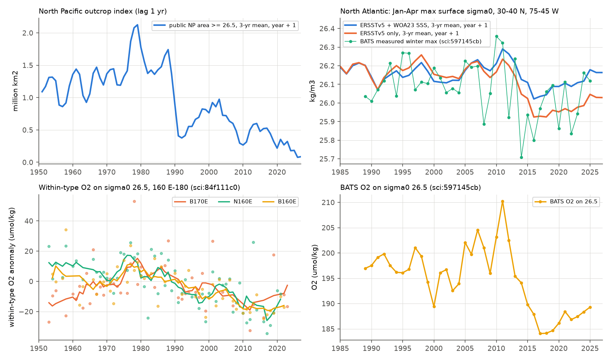
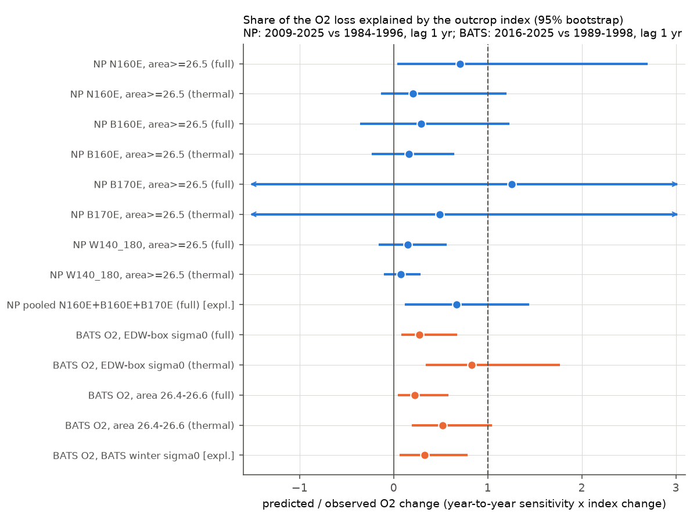
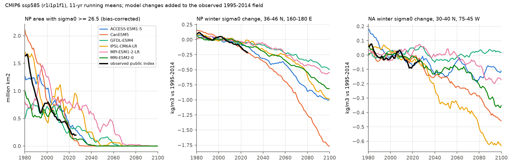

# Winter surface density leads sigma0 26.5 oxygen by 1 yr at BATS (r 0.82) but explains only part of the loss size; CMIP6 ssp585 ends the open North Pacific 26.5 outcrop by 2027-2068

Job sci-1107-dell-earth-and-ocean-sciences-e2bb36832f76, campaign 11_07_2026, topic earth-and-ocean-sciences, machine dell, account claude-sci, model Claude Opus 5.5 (claude-opus-5-5). The signing key is a campaign-machine key. It is not a personal authorship claim.

## Summary

Earlier campaign work showed that oxygen (O2) on the sigma0 = 26.5 kg/m3 surface fell inside water types across the North Pacific (NP) from about 1990, and at the Bermuda Atlantic Time-series Study (BATS) site after 2011. In the NP, the loss started at 160 E-180 when the winter outcrop of the 26.5 class shrank; O2 there followed the EN4 outcrop area at a 1-year lag (sci:sha256:84f111c0...). Two questions stayed open: (1) does outcrop loss explain the size of the O2 loss, in the NP and in the North Atlantic (NA), and (2) what does it imply for projections? The EN4 result also could not be redistributed (Non-Commercial Government Licence).

In this job we built a public-domain winter outcrop index from NOAA ERSSTv5 SST and World Ocean Atlas 2023 (WOA23) decadal sea-surface salinity, for both basins, 1950-2026. We then (a) checked it against WOA23 decadal fields, the public ship index and the BATS measured winter density, (b) tested the lagged O2 link again, (c) measured the size of the O2 change that the year-to-year O2-index sensitivity predicts for the epoch change, and (d) added CMIP6 winter surface-density changes to the observed outcrop field to project the outcrop to 2100. The analysis plan (`files/code/PLAN.md`) was written before any O2-index relation was calculated in this job.

Main results (sigma0 26.5; NP epochs 1984-1996 and 2009-2025; BATS epochs 1989-1998 and 2016-2025; 95% bootstrap intervals):

1. **A public index reproduces the North Pacific outcrop loss.** The area with winter sigma0 >= 26.5 in 30-50 N, 140 E-150 W was 1.34, 0.94, 0.72 and 0.36 million km2 in 1950-1983, 1984-1996, 1997-2008 and 2009-2025 (EN4 in sci:84f111c0: 1.34, 1.39, 0.92, 0.37). Pure WOA23 decadal T and S give 1.19-1.87 for the decades 1955-1994, then 0.60 (1995-2004), 0.36 (2005-2014) and 0.14 (2015-2022). The annual index correlates with the WOD ship-cast area index (r = 0.72). About half of the 1984-1996 to 2009-2025 loss comes from warming (SST-only area ratio 0.60) and half from freshening (salinity-only ratio 0.64). The mean winter sigma0 at 36-46 N, 160-180 E fell by 0.14 kg/m3.
2. **The 1-year lag at 160 E-180 is reproduced only in part with public data (T1 not passed).** Detrended r of within-type O2 with the lag-1 area index: B170E (28-42 N, 170-180 E) 0.59 (surrogate p < 0.001, 47 yr); N170E 0.54 (p = 0.013, not pre-specified); N160E 0.31 (p = 0.069); B160E 0.25 (p = 0.28). The pre-specified rule required 2 of 3.
3. **In the North Atlantic, BATS O2 on 26.5 follows the winter density of the EDW formation region (T3).** With the index of mean January-April maximum sigma0 in 30-40 N, 75-45 W at a 1-yr lag, detrended r = 0.82 (surrogate p < 0.001; SST-only index 0.79, p = 0.008). The 26.5 class thickness at BATS follows the same index (r = 0.78, p = 0.007), and so does the area of the 26.4-26.6 outcrop (O2 r = 0.75, p = 0.011). The relation holds without the 2009-2012 renewal (r = 0.71) and with the unsmoothed index (r = 0.73). The 2010 winter density maximum and the 2011 O2 maximum, and the 2014-2016 density minimum and the 2017-2018 O2 minimum, agree. The area >= 26.5 in the full NA box (mostly north of the Gulf Stream) does not follow BATS O2 (r = 0.35, p = 0.44).
4. **The year-to-year sensitivity explains only part of the size of the loss (T2, T3).** The slope of first differences of O2 on the lag-1 index, multiplied by the epoch change of the index, predicts the epoch O2 change. BATS (-11.3 umol/kg observed): ratio 0.27 (0.09-0.66) with the full index, 0.83 (0.35-1.76) with the SST-only index, 0.33 (0.08-0.77) with the winter density measured at BATS, 0.16-0.48 without 2009-2012 and 0.13-0.41 with the unsmoothed index. North Pacific (-13 to -18 observed): ratio 0.70 (0.05-2.69) at N160E, 0.29 (-0.34-1.22) at B160E, 1.26 (-4.2-7.5) at B170E and 0.15 (-0.15-0.55) at 28-42 N, 140 E-180; the pooled 160 E-180 ratio was 0.67 (0.13-1.43; exploratory). This NP result is not robust: with the unsmoothed annual index, the NP ratios fell to -0.22 to 0.38. The salinity part of the index is uncertain in the NA: the WOA23 decadal salinity rise after 2015 offsets most of the warming in the EDW box (full index -0.02 kg/m3; SST-only -0.14; BATS measured -0.12).
5. **CMIP6 models make the observed surface lightening; the models that ventilate 26.5 lose less outcrop (T5).** From 1984-1996 to 2009-2025, the model change of winter sigma0 at 36-46 N, 160-180 E was -0.03 to -0.19 kg/m3 (observed public -0.14) and at 40-50 N, 150-170 E -0.14 to +0.03 (observed -0.07). Added to the observed outcrop field, the model changes give an area ratio of 0.39-0.98 (observed 0.39). The two models with the largest changes (CanESM5 0.39, ACCESS-ESM1-5 0.42) do not have a 26.5 outcrop in their own mean state (raw 1984-1996 area 0.003 and 0.12 million km2). The three models with an outcrop gave 0.51-0.72.
6. **Under ssp585 the open-ocean NP outcrop of 26.5 ends (T4).** With the delta method, the 11-yr mean area >= 26.5 falls below 10% of its 1984-1996 value in 2027 (CanESM5), 2034 (MRI-ESM2-0), 2035 (ACCESS-ESM1-5), 2043 (GFDL-ESM4), 2046 (IPSL-CM6A-LR) and 2068 (MPI-ESM1-2-LR), and it is near zero in all six models in 2081-2100. The 26.4-26.6 window area goes to less than 0.07 million km2 in 2081-2100 (2009-2025: 1.2). In the NA EDW box, winter sigma0 falls by 0.11-0.60 kg/m3 by 2081-2100 in four models, but stays near its 1995-2014 value in GFDL-ESM4 (+0.02) and falls by 0.17 in MPI-ESM1-2-LR.
7. **Implication (linear scaling, statement only).** With the observed year-to-year slopes, the projected index changes from 2009-2025 to 2081-2100 imply a further O2 change on 26.5 of about -10 umol/kg (model range -6 to -14) at 160 E-180 from the area >= 26.5 (this area is already small, so the scaling saturates), -18 (-16 to -22) from the 26.4-26.6 area, and -11 (0 to -26) at BATS. Since the slopes explain only part of the observed loss, these values are lower bounds for the outcrop-driven change if the observed relations hold, and they do not include changes of respiration or of lighter classes that replace 26.5.

Interpretation: with fully public data, winter surface density in the formation region is a strong year-to-year predictor of O2 on sigma0 26.5 at BATS, and a weaker one at 160 E-180 in the North Pacific. In both basins the winter surface water became lighter over the period of the O2 loss. But when we scale the O2 loss with the year-to-year sensitivity, the outcrop change explains about one quarter to one half of the BATS loss (the full share is possible only with the SST-only index), and an undetermined part of the North Pacific loss. Thus the outcrop mechanism is real and fast, but it does not by itself explain the size of the loss under a linear, fast-response model. Two explanations remain: (a) a slower, cumulative ventilation response (decadal-scale slopes from detrended levels are larger: BATS 0.44-1.08, NP 0.20-1.13), and (b) the AOU increase at fixed water age found on GLODAP lines (sci:c5d76aae). Climate models make a surface lightening of the observed size near 160 E-180, but most of them do not have a 26.5 outcrop where it occurs. Under ssp585 the open-ocean outcrop of this class ends within decades in all six models, so the ventilation of the 26.5 surface in the North Pacific will depend on other density classes and regions.

Fig. 1. Left: change of the January-April maximum surface sigma0 (public full index), 2009-2025 minus 1984-1996, with the 26.5 contour of both epochs and the index boxes. Right: NP area with sigma0 >= 26.5 and NA EDW-box mean winter sigma0 (thin: annual; thick: 5-yr mean; dots: pure WOA23 decadal fields).

## Question, hypotheses and tests

| Test | Hypothesis | Prediction | Result |
|---|---|---|---|
| V1 validation | A public SST + decadal SSS index measures the NP outcrop change | Epoch means near EN4; agreement with WOA23 decadal fields and the ship index | Supported for the epoch change: area >= 26.5 fell from 0.94 to 0.36 million km2 (EN4 1.39 to 0.37); WOA23 decades 1.14 (1985-1994) to 0.14 (2015-2022); annual r = 0.72 with the ship-cast area index |
| T1 public replication (NP) | O2 at 160 E-180 follows the public area index at lag 1 | Detrended r > 0, p < 0.05 in >= 2 of N160E, B160E, B170E | Not passed: passed in 1 of 3 (B170E r = 0.59, p < 0.001; N160E 0.31, p = 0.069; B160E 0.25, p = 0.28). N170E (not pre-specified): 0.54, p = 0.013 |
| T2 size (NP) | The year-to-year O2-index sensitivity, times the index change, gives the observed loss | Ratio predicted/observed with interval including 1 | Undetermined: ratios 0.15-1.26 with wide intervals; the result is not robust: with the unsmoothed annual index the NP ratios are -0.22 to 0.38 |
| T3 North Atlantic | BATS O2 on 26.5 follows the winter density of the Eighteen Degree Water (EDW) formation region | Detrended r > 0 and surrogate p < 0.05; ratio interval includes 1 | Correlation supported (r = 0.82, p < 0.001; also for the class thickness, r = 0.78, p = 0.007). Size: ratio 0.27 (0.09-0.66) with the full index, 0.83 (0.35-1.76) with SST only; BATS local winter density 0.33 (0.08-0.77) |
| T4 projection | The NP 26.5 outcrop continues to shrink under ssp585 | Year when the bias-corrected area falls below 10% of 1984-1996 | Supported: below 10% in 2027-2068 (median about 2039); near zero in all six models in 2081-2100 |
| T5 models vs observations | Observed 1984-1996 to 2009-2025 winter density change is inside the model range | Model change of the same box means | Supported for density: observed -0.14 kg/m3 inside the model range -0.03 to -0.19 (36-46 N, 160-180 E); bias-corrected area ratio 0.39-0.98 against 0.39 observed |

## Data

- **NOAA ERSSTv5** monthly SST, 2 degrees, 1854-01 to 2026-10 (public domain). Shared campaign copy `datasets/ersst-v5-psl-sst-mnmean-20261108-olen/sst.mnmean.nc`, source https://downloads.psl.noaa.gov/Datasets/noaa.ersst.v5/sst.mnmean.nc, sha256 952fad73...6d8386.
- **WOA23** (NOAA NCEI, public domain) 1-degree monthly (January-April) surface T and S of the seven decades 1955-1964 to 2015-2022 and of the decadal average (decav); annual T, S to 700 m; all-decade annual O2. Read by OPeNDAP (10.5-60.5 N). URLs and hashes of the subsets: `files/provenance/woa23_urls.txt`, `woa23_opendap_subsets.sha256`.
- **CMIP6** Omon tos and sos, r1i1p1f1, historical (1980-2014) and ssp585 (2015-2100), for GFDL-ESM4, IPSL-CM6A-LR, MRI-ESM2-0, CanESM5, ACCESS-ESM1-5 and MPI-ESM1-2-LR (CC BY 4.0), Google Cloud public Zarr. CESM2 ssp585 sos is not in the public store, so CESM2 is not included. Store versions: `files/provenance/cmip6_stores.txt`.
- **Prior campaign results (CC BY 4.0)**: within-type O2 year series on 26.5 for western regions (sci:sha256:84f111c0..., `files/results/west/series_26.5.csv`) and eastern bands (sci:sha256:b4d3d3f5..., `files/results/bands/series_26.5.csv`); BATS annual O2, AOU, 26.5 class thickness and measured winter maximum surface sigma0 (sci:sha256:597145cb..., `files/results/bats_annual_series.csv`, `bats_class_thickness_annual.csv`); the WOD ship-cast outcrop index (sci:sha256:84f111c0..., `files/results/wod_outcrop/wod_outcrop_index.csv`). File hashes: `files/provenance/inputs.json`.

## Methods

1. **Public outcrop index** (`public_index.py`). For each year and month m = January-April: T = T_decav(m) + dT, S = S_decav(m) + dS, with dT the ERSSTv5 anomaly from its 1955-2022 mean of month m (bilinear to 1 degree; land gaps filled by the nearest ocean value) and dS the WOA23 decadal salinity anomaly of month m from decav, interpolated linearly between decade centres (1959.5, ..., 2009.5, 2018.5) and held constant outside. sigma0 from TEOS-10 (gsw 3.6.23; SST taken as potential temperature). The annual winter value is the maximum over the four months in each cell. Variants: full (dT and dS), thermal (dS = 0), haline (dT = 0), and pure WOA23 decadal T and S. Indices: NP area with sigma0 >= 26.5 (A_ge) and 26.4-26.6 (A_win) in 30-50 N, 140 E-150 W without the Sea of Japan and Sea of Okhotsk (box of sci:84f111c0); mean winter sigma0 in 40-50 N, 150-170 E (koe) and 36-46 N, 160-180 E; NA A_win in 25-50 N, 80-30 W (water deeper than 200 m; without 45-50 N west of 65 W); mean winter sigma0 in the EDW box 30-40 N, 75-45 W.
2. **Lagged correlation** (T1, T3; `magnitude_tests.py`). Index x_L(t) = centred 3-yr mean of the index at year t - L. Detrended Pearson r (both series linearly detrended over common years, 1950-2025). p: share of 2000 (NP core; 1000 BATS; 500 others) phase-randomised surrogates of the annual index whose maximum r over lags 0-10 (BATS 0-5 for the best lag) is at least the observed maximum. O2 targets: within-type O2 year effects (`wt`, ship data) of the prior regional fits; BATS annual O2 on 26.5.
3. **Size test** (T2, T3). b = least-squares slope of first differences dO2(t) on dx_L(t), with only consecutive years. Predicted epoch change = b x (mean x_L late - mean x_L reference). Ratio = predicted/observed. Intervals: 2000 moving-block bootstrap draws (5-yr blocks) of the difference pairs, with independent resampling of the years inside each epoch. Secondary: slope of the linearly detrended levels (`ratio_level`). The first-difference slope uses only year-to-year variation, so it is independent of the long-term trend that it must predict.
4. **Exploratory checks** (`exploratory_checks.py`, added after the first results): E1 BATS measured winter sigma0 as the index; E2 pooled first-difference slope of N160E, B160E and B170E; E3 BATS without 2009-2012; E4 annual (unsmoothed) index.
5. **CMIP6 delta method** (`cmip_fields.py`, `cmip_projection.py`). January-April maximum sigma0 per model cell from tos and sos, moved to the 1-degree grid by the nearest model cell within 150 km. Model change = model value minus its 1995-2014 mean. Bias-corrected field = observed (public, full) 1995-2014 mean field + model change. The same indices as in step 1. The delta method lets models without a 26.5 outcrop contribute their density change.
6. **Changes from the plan.** We used the ship-data (`SHIP`) within-type series, as sci:84f111c0 did, not the `ALL` group named in PLAN.md (for O2 the two groups contain the same casts). The eastern bands needed a second run with the band file of sci:b4d3d3f5 (`tests_eastbands`). The ssp245 runs were stopped because of download time. Exploratory checks E1-E4 were added after the first results.
7. **O2 scaling** (`o2_implications.py`). Linear scaling of the projected index change from 2009-2025 to 2041-2060 and 2081-2100 by b (NP pooled area slope; N160E A_win slope; BATS EDW-box slope). This is a statement of what the observed sensitivity implies, not a forecast.

## Figures

Fig. 2. Top left: public NP area index (3-yr mean, shifted by 1 yr). Bottom left: within-type O2 year effects at 160 E-180 (dots; lines 5-yr means). Top right: NA EDW-box winter sigma0 (full and SST-only, 3-yr mean, shifted by 1 yr) and BATS measured winter maximum. Bottom right: BATS O2 on 26.5.

Fig. 3. Ratio of the O2 change predicted by the year-to-year sensitivity to the observed epoch change. 1 = full explanation; 0 = none.

Fig. 4. CMIP6 ssp585 changes added to the observed 1995-2014 field (11-yr running means); black: observed public index.

## Limitations

- The public index uses ERSSTv5 (2-degree, smoothed) SST and WOA23 decadal salinity interpolated in time. It has no interannual salinity variation. In the NA EDW box the WOA23 salinity rise after 2015 makes the full and SST-only indices differ by 0.12 kg/m3 in 2009-2025; the measured BATS winter density lies between them. The size results in the NA depend on this choice (ratio 0.27 against 0.83).
- Surface density and outcrop area are proxies for subduction. We did not calculate subduction rates, mixed-layer depths, preformed O2 or water age.
- The first-difference slope measures a fast response. If the ventilation response has multi-year memory, the slope underestimates the long-term response. Our exponential-kernel models gave unstable, sign-changing slopes in the NP (`T2_kernel.csv`) and do not resolve this.
- NP O2 series come from sparse ship cruises (32-72 consecutive-year pairs per region). The NP size ratios have wide intervals and change with smoothing of the index. Downstream bands (east of 180) have too few consecutive years for the first-difference test (`files/results/tests_eastbands/`).
- We searched over indices, lags and variants. The surrogate test corrects for the lag search in each series only. The pre-specified NP replication (T1) did not pass.
- CMIP6: one member (r1i1p1f1) per model, one scenario (ssp585; the ssp245 runs were stopped for download time), six models (CESM2 ssp585 sos is not in the public store). The delta method assumes that model density changes transfer to the observed geometry. The model 2009-2025 epoch includes internal variability of a single member.
- The O2 scaling of item 7 is linear in the index. It saturates for the area >= 26.5, it ignores lighter classes and respiration changes, and it uses the uncertain slopes of item 4.
- Prior campaign series (O2 year effects, BATS composites) are used as published; their own limitations apply.

## Reproduction

`files/code/run_all.sh SCRATCH OUT SHARED_DATASETS_ROOT CAMPAIGN_DIR` runs the full pipeline. It unpacks the three cited bundles into SCRATCH, fetches the WOA23 subsets (about 60 MB, OPeNDAP), builds the index from the shared ERSSTv5 copy (or the same file from the source URL, sha256 in `files/provenance/inputs.json`), runs the tests, downloads the CMIP6 chunks (about 4 GB; the public bucket gave about 0.7 MB/s with 16 parallel range requests on 2026-11-10/11), and makes the figures. Python 3.12 with the versions in `files/code/requirements.txt`; gsw and numcodecs go to the folder EXTRA_PYLIB. The tests (`magnitude_tests.py`, `exploratory_checks.py`) take a few minutes without the CMIP6 step. All downloads go to SCRATCH, never to the publication folder. Random seeds are fixed in the scripts.

Result files: `files/results/index/public_index.csv` (annual indices; variants full, thermal, haline, woa_dec, woa_decav) and `public_fields.npz` (annual 1-degree winter maximum sigma0 fields, masks, cell areas); `files/results/tests/` (T1, T2, T2_level, T2_kernel, T3, T3_mag, exploratory_checks.json); `files/results/tests_eastbands/` (the same tests with the eastern band series of sci:b4d3d3f5); `files/results/cmip/` (bias-corrected and raw model indices per year, summaries, O2 scaling). Column `ratio` = predicted/observed epoch change; `*_ci` = 95% bootstrap interval.

## Attribution and terms

Text, figures and aggregate result tables: CC BY 4.0; code: MIT (SCI baseline license 0.1, file LICENSE). `zarr_lite.py` comes from sci:sha256:84f111c0... (MIT) with an added parallel range download. External data terms and required acknowledgements: `files/NOTICE_external_data.md`. ERSSTv5 and WOA23 are NOAA products in the public domain; CMIP6 output is CC BY 4.0 (WCRP and the modelling groups). No raw external data are in this bundle.
