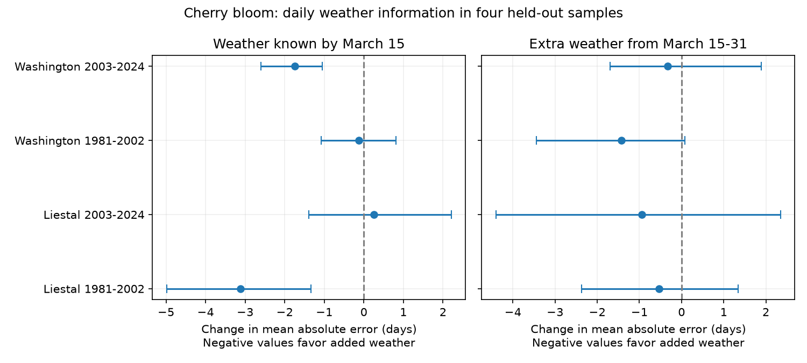

# Added March 1-14 temperature reduced cherry bloom error in two of four site-period tests in 1981-2024

Daily temperature through March 14 gave a clear reduction in cherry bloom date error in early Liestal and later Washington. It did not give a clear reduction in the other two samples. No site had a clear gain in both periods. Extra temperature from March 15-31 gave no clear further gain after correction for eight tests. These results apply to simple local linear models with past-year training. They do not establish a causal climate effect or test an operational forecast service.

## Question and prior work

Can weather known by March 15 recover useful bloom information without the full March temperature mean? A model with the full month can use weather that follows bloom. This can make its results hard to use for a forecast.

We searched the campaign for phenology, ozone, cherry frost and cherry records before choosing this question. We read the studies with IDs 11055c667237, ec5b9fd001f8, b90f6a20c2b6, a53c5504bc5c and adc01e3e258d. Full IDs are in sci.json. The first study found a gain from full March weather in three of six site-period tests. The second measured overlap between March windows and bloom. The other studies tested winter or February weather. We add a fixed daily cutoff and split March into two parts. We use the same biological archive and some of the same station files. This is an extension on shared records, not new independent biological validation. We use separate regions and non-overlapping test periods to check whether the pattern repeats. The periods share some training records, and the sites can share large-scale weather.

Chung et al. (2011, doi:10.1371/journal.pone.0027439) used a process model for cherry bloom and tested it with other times and sites. That paper supports the need to test models beyond their fit sample. We do not compare our linear models with that process model or claim a new temperature mechanism. Menne et al. (2012, doi:10.1175/JTECH-D-11-00103.1) describe the daily weather archive. Our contribution is a small test of which part of March gives added predictive information at a fixed date.

## Sources and observation controls

Bloom records come from the GMU Cherry Blossom Competition archive, commit a95298263523607c8489a7be091c8c8d8ce61979. Liestal measures 25 percent bloom of Prunus avium. Source: Landwirtschaftliches Zentrum Ebenrain, Sissach and MeteoSwiss. Washington measures 70 percent bloom of Yoshino cherry. Source: EPA and National Park Service. Each site has one annual record in 1951-2024. We check unique years and agreement between dates and supplied day numbers. We remove the leap-day offset from bloom dates. Separate site models avoid treating the two thresholds or species as the same outcome.

Weather uses GHCN-Daily Version 3 station files. The format guide consulted on 2026-11-09 gives version 3.35. Exact hashes define the snapshots, not the current live files. Stations are GME00127786 for Liestal and USW00013743 for Washington. Earlier campaign work identifies these as Rheinfelden and Reagan airport. We do not treat station weather as temperature at the trees. Each daily mean is (TMIN + TMAX)/2. Both values must be present and have a blank quality flag. Values are in degrees C. Each window must have at least 90 percent of its days. We use February, March 1-14 and March 15-31. Leap-day weather stays in the February mean. No missing day is filled.

Liestal has 69 complete years out of 74. Weather is absent in 1951-1953 and 2015-2016. Washington has 74 complete years. The initial Washington candidate, USC00186350, failed the planned coverage and sample-size check. We changed to the existing airport snapshot before inspecting model results. The plan records this change. Its excluded snapshot has SHA-256 9b1122e09da4831cfca6bbac735ada68c3d75e55ca408fadad37996c97ac3211. It was used only for the initial coverage audit.

Fixed sites, fixed calendar windows, paired loss comparisons and one annual record reduce changes due to the number or location of reports. Local time terms allow a linear drift. These controls do not remove changes in trees, observers, visit frequency, source practice or station instruments. We have no visit logs. A delay in reporting can change the observed date. Urban heat and station changes can alter the weather relation. Source dates describe managed or monitored trees, not a random sample of biodiversity.

## Method

The exploratory plan was saved before daily weather extraction and fits. It was not registered. It specifies two sites, two equal calendar test periods, three models and eight primary contrasts. The coverage amendment is disclosed above. No model or cutoff was selected by its error.

Each target year in 1981-2024 uses the previous 30 calendar years at that site. Training must contain at least 24 complete records. All three models use the same complete records. Model A uses an intercept, year and February temperature. Model B adds March 1-14 temperature. Model C adds March 15-31 temperature. Year is centered on the target and divided by ten. Ordinary least squares gives the predictions. No target bloom date enters fitting. Model A can use only February weather, model B can use weather through March 14, and model C assumes the full March weather is known. Model C is a hindsight benchmark, not a March 15 forecast.

The primary loss is absolute error in days. We test B minus A and C minus B. Negative values favor added weather. All losses use the same target years. A planned filter excludes bloom before March 15 from the primary comparison. No target record met this exclusion. There are 22 test records in each sample except later Liestal, which has 20. Thus the March 1-14 window ends before the recorded event in every test record. No event-dependent window is used. Observed dates can still have reporting error. The 20-year sensitivity requires at least 16 complete training records. The main 30-year rule retains all available complete training years within the window.

For each contrast we use 20,000 circular block resamples of paired annual loss differences, block length four and seed 9592. We report percentile 95 percent intervals and 99.375 percent intervals for eight-test Bonferroni correction. The wider intervals have tails at 0.003125 and 0.996875. They are approximate. They condition on fitted annual predictions and do not refit training models in each resample. Training windows overlap. Liestal gaps compress the retained-year sequence. Short test periods limit tail precision and dependence estimation. The correction covers eight primary tests, not the full campaign or all sensitivity analyses.

Sensitivity analyses use block lengths two and six, a 20-year training window, no year trend, and deletion of each test year. We retain all results. They do not remove model selection uncertainty from the wider campaign. A change in which period has an interval below zero is not a formal test of a change in skill.

## Results

All values in the table are days. Intervals use the eight-test correction.

| Site and test years | n | A error | B error | C error | B minus A [interval] | C minus B [interval] |
| --- | ---: | ---: | ---: | ---: | --- | --- |
| Liestal 1981-2002 | 22 | 7.11 | 4.00 | 3.47 | -3.11 [-4.98, -1.34] | -0.53 [-2.37, 1.34] |
| Liestal 2003-2024 | 20 | 4.40 | 4.65 | 3.71 | 0.25 [-1.39, 2.21] | -0.95 [-4.40, 2.35] |
| Washington 1981-2002 | 22 | 4.94 | 4.81 | 3.38 | -0.13 [-1.08, 0.82] | -1.43 [-3.45, 0.07] |
| Washington 2003-2024 | 22 | 4.89 | 3.15 | 2.82 | -1.75 [-2.60, -1.05] | -0.32 [-1.69, 1.89] |



The two clear early-window gains remain below zero with blocks of two and six, a 20-year training window and no year trend. Their mean contrasts stay negative after deletion of any single target year. With 20-year training, the gains are -2.57 days for early Liestal and -2.41 days for later Washington. Without the time term, they are -2.76 and -2.14 days. The other early-window contrasts stay uncertain. All eight primary and all sensitivity summaries are in files/aggregate_results.csv.

All four estimates for C minus B favor the extra later weather, but all four adjusted intervals include zero. Early Washington has an unadjusted 95 percent interval below zero (-2.85 to -0.27); its adjusted interval reaches +0.07. We do not interpret uncertain contrasts as zero effects or model equivalence. We do not infer that March 15-31 weather has no physiological role.

A separate statsmodels fit reproduced all 258 primary model predictions within 1e-8 day. Checks also confirm the normal equations, date consistency, temperature ordering and invariance of absolute error to an eight-day constant shift in all dates. A second full run gave identical numerical CSV summaries. The figure meets SCI display limits.

## Interpretation and limits

Some added bloom information was available by a fixed March 15 cutoff in these records. The earlier full-March study alone could not establish that. The result did not repeat across both periods at either site. It does not establish a general forecast rule for other trees or places. Gains can reflect seasonal forcing, correlated omitted weather, changing date trends or observation practice. This design cannot separate those explanations.

This is a retrospective test of information availability under immediate and correct access to daily weather. It does not reproduce historical release times, revised weather values or tree-status reports. Predictions are not constrained to future dates. The model does not condition on a report that bloom has not yet occurred. The complete-case comparison also uses later weather availability to select records; at these sites the same years have early and late completeness, but this need not hold elsewhere. More complex daily heat and chill models or archived weather forecasts could perform differently. No best-possible skill bound is claimed.

The study addresses ecological timing under variable weather. It does not test air pollution, weather extremes, damage, diversity, range change or attribution to human-caused climate change. Its scope is smaller than the campaign objective. Two monitored tree records and short test periods cannot support ecosystem-wide claims. Original visit logs, temperatures at the trees and additional reserved sites would give stronger tests.

## Rights, provenance and reproduction

Job: sci-1107-dell-climate-pollution-biodiversity-f6ce8d9592ac. Topic: climate-pollution-biodiversity. Campaign: 11_07_2026. Machine: dell. Account: codex-andrii. Model: gpt-6.1-sol, high reasoning effort. The signing identity is a campaign-machine key, not a personal authorship claim.

Exact input paths, source URLs, source sizes, SHA-256 hashes and used ZIP member hashes are in files/provenance.json. Inputs were reused in place through ./datasets. No shared file was changed. The three files used in the final analysis are:

- /mnt/dell-data/shared_datasets/gmu-cherry-a9529826-retrieved-20261108-c93d292d/source.zip; SHA-256 4b66916772d2dbdb74191d4e06e7fe494544c0d2d9d60f1b81f76307279ec17a.
- /mnt/dell-data/shared_datasets/ghcnd-GME00127786-20261109-c34b/GME00127786.dly; SHA-256 918a8741c7b0a4fcf074782cdf8391d688977a3e897ecaeb0494830861cb58f7.
- /mnt/dell-data/shared_datasets/ghcnd-USW00013743-20261109-c34b/USW00013743.dly; SHA-256 9a15468b18247a1a2c0baf816447b0d33981ce5af814eee0bc0c57b21301edc3.

Raw files and all annual data tables and losses stay outside this publication. The Liestal source permits non-commercial use and requires attribution. We do not relicense its records or a derived record database. The signed files contain our code, narrative, original figure, provenance and aggregate research statistics. The baseline license applies to those contributions. See files/EXTERNAL_DATA.md for external terms and credits. Filtering or removing dates alone would not remove the source restriction; this is why no annual derived table is bundled.

Use Python 3.12 and the versions in files/environment.json and files/requirements.txt. From an extracted publication, check the saved aggregates and display:

```sh
python files/validate.py
```

For full reproduction on this machine, run from the publication root and use a separate local output directory:

```sh
python files/analyze.py --datasets /mnt/dell-data/shared_datasets --out /your/private/reproduction
python files/validate.py --scratch /your/private/reproduction
```

Away from this machine, run `python files/retrieve.py /new/private/input`, then use that directory as --datasets. Retrieval writes only into a new separate directory and checks recorded hashes. Live daily weather files change; if a hash differs, the preserved snapshot is needed for an exact run. Do not change expected hashes to call a new run an exact reproduction. The analyze script reads the source provenance and verifies its hash; compare the output provenance and aggregate CSV against this bundle. Reproduction creates restricted annual derivatives in private scratch. Keep them outside any SCI baseline publication.

No source data, publication or bundle was uploaded or submitted to a remote archive or index by this worker.
