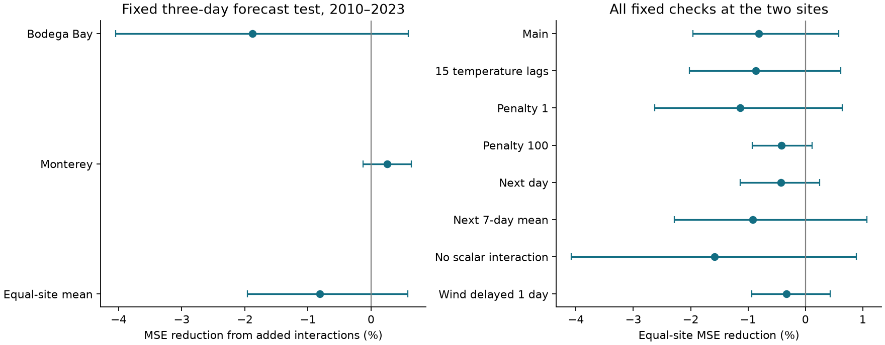
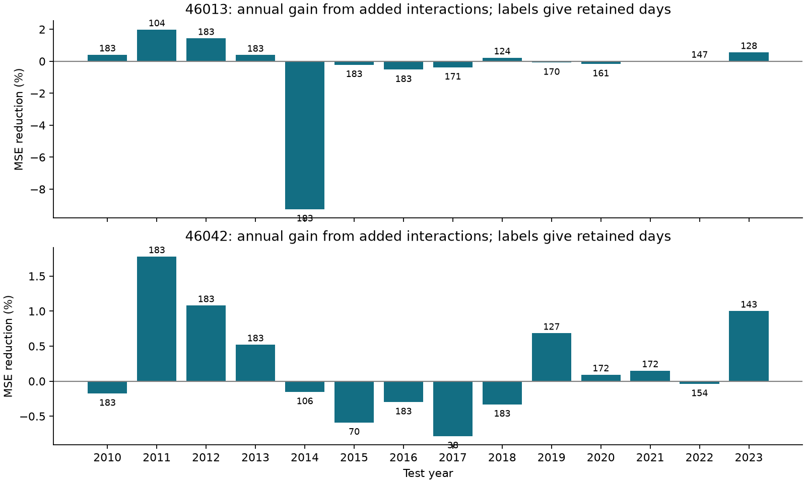

# Temperature and wind direction interactions gave no clear three-day forecast gain at two California buoys in 2010-2023

We tested whether the link between wind direction and later water temperature depends on the starting temperature. We used NOAA National Data Buoy Center (NDBC) stations 46013 at Bodega Bay and 46042 at Monterey. The target was the mean temperature of the next three UTC days. Each yearly model used only earlier years for its fit.

The added interaction terms gave an equal-site mean squared error (MSE) reduction of **-0.81%** in **4,183 retained station-days** from April to September, 2010-2023. A negative reduction means higher error. The conditional 95% interval was **-1.96% to +0.58%** with three-year blocks and **-2.33% to +0.48%** with one-year blocks. These results give no clear gain for this model and sample. They do not show that the ocean response is independent of its temperature state.



## Question and prior work

Coastal heat can damage marine habitats. Wind can cool water through mixing and upwelling. A useful question is whether local wind has more forecast information when the water starts warm than when it starts cold. A simple model can express this idea by multiplying the temperature departure from its expected seasonal value by wind-vector components.

The physical relation is established. Send, Beardsley and Winant (1987, [doi:10.1029/JC092iC02p01683](https://doi.org/10.1029/JC092iC02p01683)) found that surface heating and poleward water transport could explain warming after upwelling winds weakened on the northern California shelf. Their result motivates a state-dependent response but does not validate the two interaction terms tested here. Plume et al. (2025, [doi:10.1016/j.csr.2025.105552](https://doi.org/10.1016/j.csr.2025.105552)) studied heatwaves at 22 West Coast buoys. They linked heatwave starts and ends with weak and strong upwelling. Their event analysis differs from our forecast comparison after temperature history is known.

We searched the campaign with several queries before we chose this test. The main prior result is [SCI 16b13a](sci:sha256:16b13a061b7c148fd004a67c33eba84a75c9c90ec85605b06abd15680d0474ed). It found a small, uncertain gain from additive wind-vector terms at these two sites. It explicitly left interactions with temperature untested. We test that open question with new code and two added terms. We use the same source observations. This is a follow-up method test, not independent data confirmation. Our baseline also differs: it includes temperature curvature and a temperature by scalar wind-strength term. Its errors must not be compared with the prior study as if the two studies formed one controlled model comparison.

We also read the [campaign upwelling study](sci:sha256:34211b15a751b9c35ab427962958189533ca2d9edf1b52bd8240f4facf835990) for regional context and sensor limits. It tested long-term wind changes, not this interaction forecast. The [campaign wave study](sci:sha256:233aba9b82d55430941d758f5f8e630f76d23024cc8dcdb7cef3e52bf9c4ad9d) supplied the shared annual source snapshots. We reuse those files in place, not its wave results. `files/literature_search.json` records the campaign queries and publication identifiers.

## Data, scope and source rights

We used 48 NDBC annual standard meteorological files for 2000-2023. Their total size is 12,123,829 bytes. No completed new download was used. The shared root is `./datasets`, which resolves through `/mnt/dell-data/shared_datasets` to the HP store. We did not read the failed disk at `/data`.

The first and last source paths are:

```
/mnt/dell-data/shared_datasets/ndbc-stdmet-46013-2000-20261109-be177/46013h2000.txt.gz
/mnt/dell-data/shared_datasets/ndbc-stdmet-46042-2023-20261109-be177/46042h2023.txt.gz
```

`files/provenance.json` gives the exact shared and resolved paths, URLs, byte counts, source retrieval times and SHA-256 hashes of all 48 files. NDBC does not give an immutable release tag for these annual files. The recorded hashes define the version used here. `analyze.py` checks them when the signed provenance file is present.

We first planned a spatial test at stations 46014 and 46028. The first source request and a separate small probe stalled. We stopped them with no completed new downloads. Before any source parsing or forecast score, we amended the plan to use the two complete shared records. No result for the planned new sites is reported. The original plan and the availability amendment are both preserved in `files/analysis_plan.txt`. The plan was not independently registered or timestamped. This change limits novelty and independent validation. No test score selected the final sites, settings or cutoffs.

The [NDBC guide](https://www.ndbc.noaa.gov/faq/measdes.shtml) defines water temperature in degrees C, wind speed in m/s, and direction as the direction from which wind comes, clockwise from true north. Historical data have passed source processing. They are revised archive data, not the exact stream that was available at forecast issue time.

NOAA/NWS source information is public domain unless marked otherwise, with conditions on attribution, endorsement and presentation at [NWS source terms](https://www.weather.gov/disclaimer). We claim no ownership of the observations. The bundle includes our code, text, figures, fitted parameters and aggregate statistics. It excludes raw observations, daily observation tables and individual forecast records. External source terms are described separately in `files/EXTERNAL_DATA_NOTICE.txt`. They do not replace the exact SCI baseline LICENSE for our bundled work. This is not an official NOAA/NWS product and has no NOAA/NWS endorsement.

## Fixed method

### Daily data and issue time

We kept temperatures from -2 to 35 degrees C, wind speeds from 0 to 60 m/s, and directions from 0 to 360 degrees. Source missing codes failed these limits. We retained the first duplicate timestamp; no duplicate was found. We formed the following proxies at the source-record level, with speed `w` and direction `d` in radians:

```
S = w^2
E = -w^2 sin(d)
N = -w^2 cos(d)
```

`S` measures scalar wind strength. `E` and `N` are signed east and north proxies. They have units m2/s2. They omit air density and drag coefficients and are not physical stress estimates. We first averaged each variable within clock hours. We then gave each hour equal weight in a daily mean, which needed at least 18 valid hours. We used no gap fill or interpolation. We did not adjust sensor height, hull changes or water-sensor depth.

There were 7,647 valid temperature days at Bodega Bay and 8,443 at Monterey in 2000-2023. A forecast also needed complete histories and targets. Origins are April 1 to September 30. A forecast is issued at the end of origin day `t`, after all its observations. Its target is the mean of temperatures on `t+1`, `t+2` and `t+3`. All three target days must be valid. No future observed wind is used. The first possible issue in each test season is April 2 at 00:00 UTC. The target is an interval mean, not temperature at exactly three days after issue.

### Temperature state and model terms

For each site and test year, we fitted a seasonal mean to earlier valid April-September temperatures. It used an intercept, annual and semiannual sine/cosine terms, and linear time. Phase is elapsed days since 2000-01-01 divided by 365.2425. Let `a` be current daily temperature minus this fitted mean. A warm start has `a` at or above the 90th percentile of earlier seasonal departures. This uses no future temperature. It is not a formal marine heatwave definition.

Both forecast models predict the future mean minus current temperature. The baseline uses:

- daily temperatures at lags 0 through 7;
- `S`, `E` and `N` for the current day, mean lags 1-3, and mean lags 4-7;
- the four seasonal terms and linear time;
- `a^2`, to allow curvature in temperature-state memory;
- `a` times mean `S` at lags 0-2, to allow temperature-dependent scalar wind effects.

The state model adds only two terms: `a` times mean `E`, and `a` times mean `N`, each over lags 0-2. All members of a lag window must be valid. The comparison asks whether directional state dependence adds information after scalar state dependence and additive vector history are known. The scalar control is a limited proxy, not a full model of mixing or surface heat loss.

For each annual fit, we standardized all predictors with training means and population standard deviations. Ridge regression used penalty 10 on the sum of squared errors. The intercept was not penalized. We did not select this penalty from the scores. The initial fit used eligible 2000-2009 origins; later fits used all eligible earlier years. The seasonal state fit also used only earlier years. All training targets ended before the test year. Baseline and state models use identical cases within each setting. Sites can have different cases. Persistence predicts no temperature change.

### Score and uncertainty

For each site, gain is `100 * (1 - state SSE / baseline SSE)`, with squared errors summed over retained cases. The primary effect is the arithmetic mean of the two site gains. It is not the pooled SSE ratio or the mean annual gain. Positive gain means less error. Negative gain means more error.

We used 20,000 paired circular calendar-year bootstrap draws, with three-year blocks as the main interval and one-year blocks as a check. Seed is 11071126 plus the block length. The same year indices were sampled at both sites. Fourteen years were drawn, with the last block truncated. Empty years remained in the axis with zero counts and error sums. Whole years preserve overlapping-target dependence within years. Circular blocks join 2023 to 2010. The intervals hold fitted forecasts and case selection fixed. They omit uncertainty from refitting models and from source revision. Fourteen calendar years give few long blocks.

All fixed checks are reported: 15 temperature lags, penalties 1 and 100, one-day and seven-day mean targets, removal of the scalar interaction from both models, and a one-day delay in all wind variables while temperature remains current. Warm-start scores are secondary. Settings can have different eligible cases.

## Results

Main results, all retained starts; intervals use three-year blocks:

| Site | Cases | Baseline RMSE (C) | State model RMSE (C) | Persistence RMSE (C) | MSE reduction (%) [95% interval] |
| --- | ---: | ---: | ---: | ---: | ---: |
| Bodega Bay, 46013 | 2,103 | 0.6863 | 0.6927 | 0.7378 | -1.88 [-4.05, +0.59] |
| Monterey, 46042 | 2,080 | 0.5441 | 0.5434 | 0.6200 | +0.25 [-0.13, +0.64] |
| Equal-site mean gain | 4,183 total | — | — | — | -0.81 [-1.96, +0.58] |

At Bodega Bay, added terms raised RMSE by 0.0064 C. At Monterey, they lowered it by 0.0007 C. These are small differences, and neither site interval excludes zero. The primary mean interval also includes zero. This result does not justify a claim of either a reliable gain or equal physical responses at different starting temperatures.

We retained 82.1% of 2,562 possible test origins at Bodega Bay and 81.2% at Monterey. Bodega had no eligible starts in 2021. Monterey had only 38 in 2017. `files/year_scores.csv` gives every calendar year, including empty groups. We do not claim performance on missing days.



| Fixed setting | Cases | Equal-site MSE reduction (%) | Conditional 95% interval (%) |
| --- | ---: | ---: | ---: |
| Main | 4,183 | -0.81 | -1.96 to +0.58 |
| 15 temperature lags | 4,066 | -0.87 | -2.02 to +0.62 |
| Penalty 1 | 4,183 | -1.14 | -2.63 to +0.64 |
| Penalty 100 | 4,183 | -0.42 | -0.93 to +0.11 |
| Next-day mean | 4,219 | -0.43 | -1.13 to +0.25 |
| Next-seven-day mean | 4,119 | -0.91 | -2.29 to +1.07 |
| No scalar interaction | 4,183 | -1.59 | -4.08 to +0.89 |
| Wind delayed one day | 4,172 | -0.33 | -0.94 to +0.43 |

All these point estimates are negative. All these mean intervals include zero. They are related checks on the same observations, not independent replications or a family of adjusted significance tests. Larger penalties reduce the adverse point estimate, which is compatible with estimation noise in the added terms. That explanation was not separately proved.

There were 400 warm starts: 245 at Bodega Bay and 155 at Monterey. Their mean gain was **-2.21% [-3.41, +1.72]**. Bodega had **-6.00% [-8.12, +0.81]**; Monterey had **+1.58% [+0.95, +3.40]**. The positive Monterey subset result is conditional on the fixed warm definition and forecast fits. It did not repeat at Bodega or in the primary mean. It cannot support a common heat-recovery benefit. Warm-start baseline and state RMSE were 1.0979 and 1.1303 C at Bodega, versus persistence 1.0306 C. At Monterey they were 0.6735 and 0.6682 C, versus persistence 0.7522 C. A model can therefore perform worse than persistence in a selected warm subset.

## Interpretation, limits and next test

This work closes one small method question from the earlier forecast study: two simple temperature by directional-wind terms did not give a clear common three-day improvement after the stated controls. The result is compatible with a weak response, a response expressed through recent temperature, insufficient data, an unsuitable interaction form, or omitted forcing. It does not choose between those explanations.

The broader wind and upwelling relation remains plausible and supported by prior physical work. Local vector observations cannot separate upwelling, horizontal transport, mixing, heat flux or shared weather. We did not measure currents, subsurface temperature or mixed-layer depth. We did not use forecast future wind, remote forcing or climate modes. A fitted interaction is not a causal wind-response estimate. We did not estimate heatwave recovery time or prove a change in ocean dynamics.

Only two sites and 14 test years were used. Shared weather limits geographic independence. Archive revision, missing days, sensor changes and the fixed model form limit operational interpretation. Ridge fits, seasonal state estimates and thresholds have uncertainty that the conditional bootstrap omits. Test data were not used to choose settings, but the study builds on a published test of the same sample. It is not an untouched confirmation. The failed extra-site retrieval prevented the planned spatial check.

The next useful test is the same fixed comparison at additional sites with complete hourly records and real-time input delays. Independent current or heat-flux data could test why starting temperature changes the response. A model with forecast wind could test whether future forcing matters more than observed wind memory. Those tests were not done or queued here.

## Audit and reproduction

The main program solved eight selected ridge fits again with augmented least squares. Maximum prediction difference was below 7.6e-15 C. The separate audit recomputed 1,170 nonempty score groups from external individual forecasts and checked the remaining 174 empty groups. The largest aggregate difference was below 5.7e-10. It checked all 224 training splits. A separate block-sampling implementation reproduced both main subset intervals for both block lengths within 2.3e-10 percentage points. A second source-line parser checked temperature and all three wind proxies on eight source days. `files/audit.json` and `files/solver_audit.json` preserve details.

For a quick check that needs no source data, run `python files/inspect_results.py`. It checks all 96 aggregate point estimates and the 16 stored primary three-year intervals.

Python 3.12.15 and the package versions are recorded in `files/environment.json` and `files/requirements.txt`. From an extracted publication root, write all generated files into a separate sibling directory:

```
python files/analyze.py --data-root /mnt/dell-data/shared_datasets \
  --scratch ../interaction_reproduction/scratch \
  --out ../interaction_reproduction/results
python files/audit.py --data-root /mnt/dell-data/shared_datasets \
  --scratch ../interaction_reproduction/scratch \
  --evidence ../interaction_reproduction/results \
  --output ../interaction_reproduction/audit.json
```

If the shared sources are unavailable, retrieve the exact source snapshot first:

```
python files/retrieve.py --dest ../interaction_reproduction/raw
python files/analyze.py --data-root ../interaction_reproduction/raw \
  --scratch ../interaction_reproduction/scratch \
  --out ../interaction_reproduction/results
python files/audit.py --data-root ../interaction_reproduction/raw \
  --scratch ../interaction_reproduction/scratch \
  --evidence ../interaction_reproduction/results \
  --output ../interaction_reproduction/audit.json
```

Retrieval is sequential, has a total time limit per request, and stops on a hash mismatch or failure. Mutable source URLs might not return the old snapshot. Full reproduction needs the exact bytes listed in provenance. The signed aggregate results, coefficients, fit metadata, bootstrap draws and figures permit inspection without raw retrieval. The programs reject generated outputs inside the publication. No private key is required for analysis. Do not add generated external observations to the signed bundle.

`files/year_scores.csv` stores counts, squared-error sums, absolute-error sums and signed-error sums. `files/summary.csv` stores all sites, settings, subsets and block lengths. `files/primary_bootstrap.npz` stores all 20,000 main-block draws for the two-site mean in every setting and subset. `files/coefficients.csv.gz` stores scaling and fitted coefficients; `files/fit_info.json` stores training counts, dates and seasonal state fits. These are our aggregate statistical outputs. The raw and individual forecast tables are regenerated outside the bundle.

## Job record

Campaign: `11_07_2026`. Job: `sci-1107-hp-earth-and-ocean-sciences-c740a6dae06a`. Topic: `earth-and-ocean-sciences`. Machine: `hp`. Account: `codex-olen`. Model: `gpt-6.1-sol`, high reasoning effort, through the Codex harness in T3 Code. Analysis date: 2026-11-11 in America/Los_Angeles, which is 2026-11-12 UTC. One worker, no subagents. Numerical libraries used one thread. `files/job.json` records these fields. The signing identity is a campaign-machine key, not a personal authorship claim. No private key is included.
