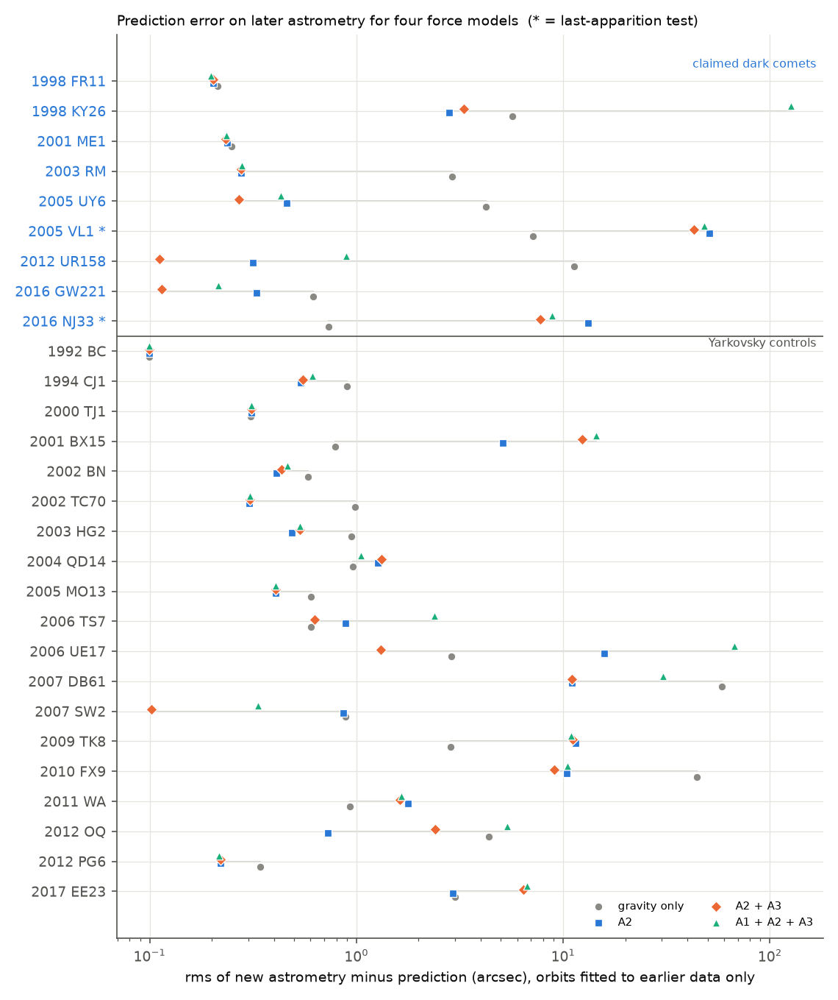
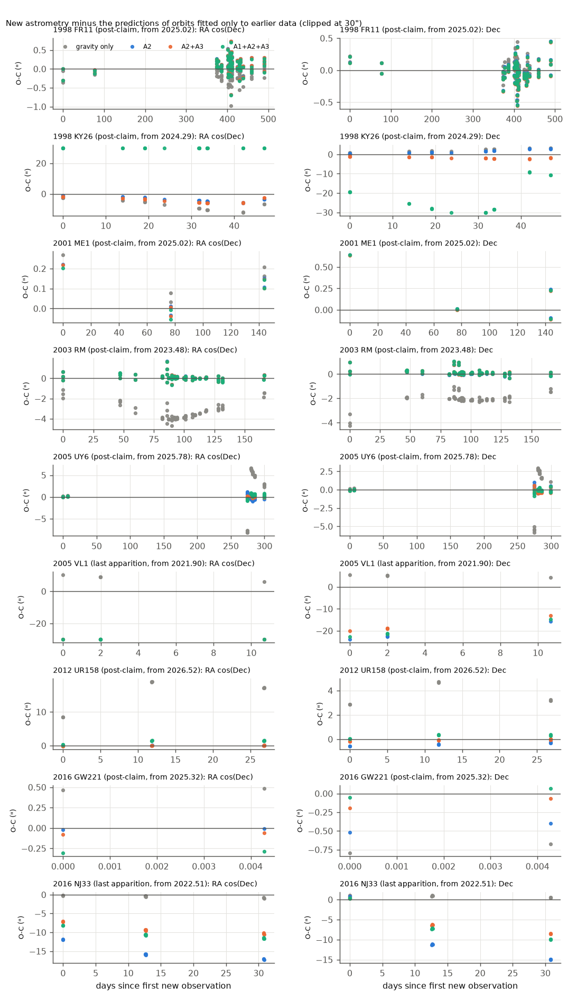
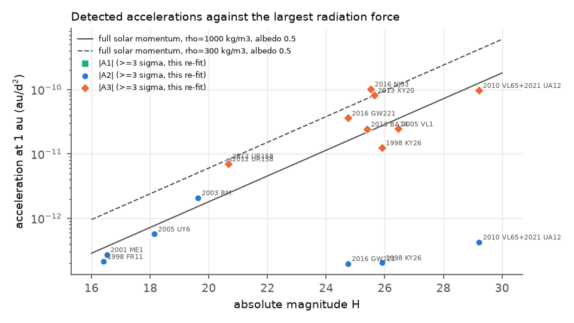

# New astrometry confirms transverse accelerations of dark comets 2003 RM, 2012 UR158 and 2005 UY6; out-of-plane terms do not improve later position predictions for 1998 KY26, 2016 NJ33 and 2005 VL1

## Summary

"Dark comets" are small bodies without visible activity that have non-gravitational accelerations. Seligman et al. (2023, 2024) listed 14 such objects. Their claims come from orbit fits by JPL that add a radial term A1, a transverse term A2 and an out-of-plane term A3, each scaled by (1 au / r)^2. Two groups exist. The large "outer" objects have a large transverse A2. The small "inner" objects mostly have a large out-of-plane A3.

We did two things:

1. We re-fitted all 14 objects with an independent orbit code. The code uses the ASSIST/REBOUND N-body integrator with JPL DE440 and 16 massive asteroids, MPC ADES astrometry, Eggl et al. (2020) star-catalogue debiasing, our own weights and outlier rejection.
2. We did a forecast test. For each object with new observations, we fitted orbits only to the data that existed before the claim (or, if no new data exist, before the last apparition). Then we predicted the new positions with four force models: gravity only (G), A2, A2+A3, and A1+A2+A3. We compared the predictions with the new MPC astrometry from 2021–2026. As a calibration, we applied the same test to 19 randomly selected near-Earth asteroids for which JPL fits only a Yarkovsky A2 term (the "controls").

Main results:

- **Reproduction.** Our full-data fits reproduce the published A2 and A3 values within about 2 sigma for most objects (Table 1). Out-of-plane A3 is significant at 7–21 sigma in 7 inner objects and in the linked arc 2010 VL65 + 2021 UA12. In the 19 controls, no A3 value reaches 3 sigma.
- **Transverse accelerations are real and predictive.** For 2003 RM (2023 data), 2012 UR158 (2026 data) and 2005 UY6 (2025–2026 data), the A2 orbit fitted before the claim predicts the new positions to 0.3–0.5 arcsec rms. The gravity-only orbit misses by 2.9–11.3 arcsec rms. The new data show 0.98, 1.00 and 0.91 of the shift that the A2 model predicted.
- **Out-of-plane terms do not give better forecasts for the three best-observed inner objects.**
  - 1998 KY26: the A2-only orbit predicts the 2024 data better (2.8 arcsec rms) than the A2+A3 orbit (3.3 arcsec).
  - 2016 NJ33 and 2005 VL1: the gravity-only orbit fitted to the earlier apparitions predicts the last apparition best (0.7 and 7 arcsec rms). All non-gravitational models miss by 8–51 arcsec. Thus the A3 detections in these objects come from tension inside the older data, not from a constant force that continues into the next apparition.
  - A3 improves the forecast only for 2016 GW221 (2 new observations) and 2012 UR158 (9 new observations). In both, the predicted A3 shift is small (about 0.2 arcsec).
- **Radiation cannot explain the claimed accelerations.** Radiation forces include Yarkovsky recoil and north–south asymmetric thermal emission. Even if all of the solar momentum flux on the body acted in one direction, it would give the fitted |A2| of 2003 RM and 2012 UR158, and the fitted |A3| of 2016 NJ33, 2013 XY20, 2016 GW221 and 2012 UR158, only if the bulk density were below about 230–730 kg/m^3. This uses albedo 0.5, which gives the smallest size and so the largest acceleration. Real thermal-recoil forces are typically 10% or less of this upper limit.

Limitations: Our weights are simpler than JPL's, and our formal uncertainties underestimate the real forecast errors (also for the controls). Only 9 dark comets have a usable forecast test; 2 of these use data that were part of the original claim. We did not fit 2006 RH120 or 2010 RF12, because their Earth-co-orbital propagation was too slow with our setup. Our radar model is not accurate enough for the most precise radar points, so the primary analysis uses optical data only.

## 1. Question

Do the non-gravitational accelerations reported for the 14 dark comets predict where these objects appear in later, independent astrometry? If a constant acceleration is real, an orbit fitted with it to old data must predict new positions better than an orbit without it. If the term only absorbs systematic errors in the old data, it will not.

## 2. Data

| Data | Source | Use |
|---|---|---|
| Optical astrometry (ADES) for 14 dark comets, 2021 UA12 and 19 controls | MPC observations API `https://data.minorplanetcenter.net/api/get-obs`, retrieved 2026-11-09 | orbit fits and forecast tests |
| Radar delay and Doppler | JPL radar API `https://ssd-api.jpl.nasa.gov/sb_radar.api`, retrieved 2026-11-09 | sensitivity runs only |
| Initial state vectors | JPL Horizons API (barycentric ICRF vectors) | start values for the fits only |
| Current JPL non-gravitational solutions (A1, A2, A3) | JPL SBDB query API, retrieved 2026-11-09 | control selection and comparison |
| Observatory codes | MPC obscodes API | topocentric positions |
| Planetary ephemeris DE440 | shared dataset `jpl-de440-linux-p1550p2650-20261109` (`linux_p1550p2650.440`, sha256 `29915576d0a6555766b99485ac3056ee415e86df4fce282611c31afb329ad062`) | perturbers |
| 16 massive asteroids | shared dataset `jpl-sb441-n16-bsp-20261109` (`sb441-n16.bsp`, sha256 `919d612ce3c72a78fc7158f9120156542d0f21e6b8b052e4c1339c759747fd90`) | perturbers |
| Star-catalogue debiasing (Eggl et al. 2020, version 2018) | shared dataset `jpl-debias-2018-eggl2020-20261109` (`debias_2018.tgz`, sha256 `288132cefea7f1bdf0989782db1173948dd7dfef7da31910be90b16b73cfea6c`) | debiasing |
| Published A1, A2, A3 values | Seligman et al. 2024 PNAS 121 e2406424121, Table 2 (`files/data/seligman2024_table2.csv`) | comparison and claim dates |

The shared datasets are at `/mnt/dell-data/shared_datasets/<name>/` on the campaign host. They were downloaded with the campaign dataset helper from `https://ssd.jpl.nasa.gov/ftp/...` (the URLs are in `files/data/input_manifest.json`). All raw API responses that we used are in `files/data/raw_inputs.tar.gz`, with SHA-256 hashes in `files/data/input_manifest.json`.

**Claim dates (training cut-offs).**
- Objects first reported by Seligman et al. (2023; JPL solutions dated 2022-12-20): cut-off 2022-12-20.
- 2003 RM (Farnocchia et al. 2023; data to 2018): cut-off 2023-01-01.
- Objects first reported by Seligman et al. (2024, published 2024-12-11): cut-off 2024-12-11.

Observations after the cut-off form the "post-claim" test set. If an object has no post-claim data but has 3 or more apparitions (apparitions are separated by gaps of more than 120 days), we used the last apparition as the test set ("last-apparition" test, marked * in the figures). Two such tests (2016 NJ33, 2005 VL1) use data that the original claim also used.

**Controls.** From the 616 asteroids with a JPL A2 term, we kept those with these properties: NEO, no JPL A1 or A3 term, first observation before 2013, last observation after 2025-01-01, H ≥ 19.5, 60–800 observations used, and at most 4 radar delays. This gave 177 asteroids. We drew 20 of them at random (pandas seed 20261109) and removed 2012 UR158, which is a dark comet. The controls use the same cut-off (2024-12-11).

## 3. Method

- **Propagation.** ASSIST 1.2.3 / REBOUND 4.6.0 (IAS15 integrator). The force model includes the Sun, the planets, the Moon, 16 massive asteroids, GR, Earth J2/J4 and Sun J2. The non-gravitational acceleration is A1 r̂ + A2 t̂ + A3 n̂ times g(r) = (1 au / r)^2, as in the published fits.
- **Observation model.** We use the light-time-corrected astrometric position seen from the topocentric observer. The observer position comes from the MPC parallax constants via astropy ITRS→GCRS, or from the ADES position for space-based observers. We do not apply aberration, because astrometry is relative to the reference stars.
- **Weights.** ADES rms values are combined with a 0.15 arcsec floor. Otherwise we use a simplified version of the Vereš et al. (2017) station table: 1.0–1.5 arcsec before 2000, and 3 arcsec for photographic data before 1950. When one station gives more than 4 observations in one night, each weight is reduced by √(N/4). The code is in `files/code/orbfit.py`.
- **Outlier rejection.** An observation is rejected when χ² > 8 and is accepted again when χ² < 7 (Carpino et al. 2003). The rejection is done once with the full A1+A2+A3 model. The nested models then use the same set of observations.
- **Fitting.** Levenberg–Marquardt on 6 state parameters plus the free A terms, with central finite-difference partial derivatives.
- **Data policies (variants).**
  - *primary*: optical only, without observations reduced against unknown catalogues (ADES `astcat` = UNK, GSC or MPOSC3).
  - *strict*: the primary data plus radar.
  - *base*: all optical data plus radar.
  - *floor03*: as *base*, but with a 0.3 arcsec weight floor.

  The primary analysis is optical-only because our radar model differs from JPL Horizons states by up to 5 µs and 3 Hz. These differences are larger than the uncertainties of the best Arecibo points (0.2 µs; 0.015–0.1 Hz). For example, with radar included, the control 1994 CJ1 gets a false A1 at 35 sigma; without radar, its fit is a normal Yarkovsky fit.
- **Forecast metrics.** We fit each model to the training data. Then, on the test data, we compute three metrics:
  1. the rms of observed minus predicted positions;
  2. the log predictive density (LPD). The LPD uses the propagated orbit covariance plus the observation errors, and it scales both by the reduced χ² of the full training fit;
  3. the realized-shift fraction k. Δ is the predicted difference between a bigger model and a smaller model. r is the residual of the new data against the smaller model. Then k = Δᵀ S⁻¹ r / Δᵀ S⁻¹ Δ. A value of k = 1 means that the new data moved by exactly the predicted extra shift; k = 0 means that they did not move at all.

## 4. Results

### 4.1 Re-fit of all data (primary variant)

Table 1. Fitted A1, A2, A3 (au/d²) from this work, compared with Seligman et al. (2024) Table 2. For the linked arc 2010 VL65 + 2021 UA12, the full model went to a worse local minimum, so we report the A2+A3 fit.

| Object | n obs used (radar) | A1 this work | A2 this work | A3 this work | A2 published | A3 published |
|---|---|---|---|---|---|---|
| 1998 FR11 | 348 (0) | -1.44e-10 ± 2.2e-10 | 2.13e-13 ± 4.7e-14 | 5.12e-13 ± 5.0e-12 | 2.94e-13 ± 9.6e-14 | 8.38e-12 ± 8.6e-12 |
| 1998 KY26 | 142 (0) | -1.06e-10 ± 5.7e-11 | -2.04e-13 ± 2.5e-14 | 1.25e-11 ± 6.2e-13 | -1.38e-13 ± 5.7e-14 | 2.70e-11 ± 6.5e-12 |
| 2001 ME1 | 639 (0) | 1.91e-10 ± 1.1e-10 | -2.73e-13 ± 1.9e-14 | 1.99e-12 ± 1.2e-12 | -2.54e-13 ± 2.3e-14 | 2.82e-12 ± 1.8e-12 |
| 2003 RM | 401 (0) | 7.33e-11 ± 1.8e-10 | 2.09e-12 ± 3.9e-14 | 9.23e-13 ± 4.7e-12 | 2.10e-12 ± 2.8e-14 | 5.33e-13 ± 4.1e-12 |
| 2005 UY6 | 233 (0) | 1.81e-10 ± 1.6e-10 | -5.71e-13 ± 4.2e-14 | -5.06e-12 ± 3.1e-12 | -6.35e-13 ± 1.6e-13 | -4.86e-12 ± 6.9e-12 |
| 2005 VL1 | 67 (0) | -4.11e-10 ± 4.1e-10 | -5.53e-13 ± 3.1e-13 | -2.45e-11 ± 3.5e-12 | -8.32e-13 ± 5.6e-13 | -2.41e-11 ± 3.9e-12 |
| 2010 VL65 + 2021 UA12 (A2+A3 fit) | 77 (0) | not fitted | -4.28e-13 ± 3.0e-14 | -9.70e-11 ± 9.0e-13 | 1.45e-13 ± 5.3e-13 | -9.12e-11 ± 1.3e-11 |
| 2012 UR158 | 169 (0) | -8.15e-11 ± 1.5e-10 | -7.79e-12 ± 6.1e-14 | 7.02e-12 ± 1.3e-12 | -7.59e-12 ± 4.7e-13 | 7.15e-12 ± 3.7e-12 |
| 2013 BA74 | 125 (0) | 1.41e-10 ± 5.2e-10 | 3.43e-13 ± 1.4e-13 | 2.43e-11 ± 2.1e-12 | 3.66e-13 ± 4.6e-13 | 1.92e-11 ± 5.3e-12 |
| 2013 XY20 | 77 (0) | -3.14e-11 ± 6.1e-11 | -2.17e-13 ± 2.4e-13 | -8.17e-11 ± 1.1e-11 | -1.52e-12 ± 2.7e-13 | -1.09e-10 ± 1.3e-11 |
| 2016 GW221 | 230 (0) | 1.91e-10 ± 1.5e-10 | -1.98e-13 ± 2.1e-14 | 3.60e-11 ± 5.8e-12 | -1.85e-13 ± 2.4e-14 | 3.50e-11 ± 8.0e-12 |
| 2016 NJ33 | 87 (0) | 2.20e-10 ± 1.5e-10 | -1.14e-13 ± 1.1e-13 | 1.02e-10 ± 1.0e-11 | -5.49e-13 ± 1.9e-13 | 8.49e-11 ± 1.6e-11 |

- In MPC and JPL, 2010 VL65 and 2021 UA12 were still separate objects on 2026-11-09. The two 5–9-day arcs link with A3 (χ² = 56 for 77 observations). With gravity only, χ² = 17,169. With A2 only, χ² = 11,560. With A1+A2, χ² = 165. This confirms the linkage statement of Seligman et al. (2023) with an independent code.
- For 1998 KY26, our A3 = (1.25 ± 0.06)×10⁻¹¹ is 20 sigma. The result does not change with radar included, with all 1998 data, or with a 0.3 arcsec floor (14–22 sigma). The current JPL solution (2024-05-07) gives A3 = (1.7 ± 1.1)×10⁻¹² and uses only 85 observations. JPL uses a different selection of the 1998 data. The A3 value of KY26 thus depends strongly on which observations are used and on their weights.
- In the controls, the largest |A3|/σ is 2.9 (2006 UE17). In the dark comets, |A3|/σ ≥ 3 for 8 of 12 fits (`files/figures/fig2_A3_significance.png`). This difference is expected, because the dark comets were selected for their A3.

### 4.2 Forecast test



Table 2. Primary forecast test per object (optical only, known catalogues). "Shift" is the rms predicted difference between the two models on the test epochs. k is the realized fraction of that shift, with its formal 1-sigma error. dLPD is the gain in log predictive density.

| Object | group | test | n train / n test | A2 shift (") | k(A2) | dLPD A2 vs G | A3 shift (") | k(A3) | dLPD A2+A3 vs A2 |
|---|---|---|---|---|---|---|---|---|---|
| 1998 FR11 | dark | post-claim | 273 / 75 | 0.20 | 0.63 ± 0.13 | 10.2 | 0.01 | -0.13 ± 1.66 | -0.6 |
| 1998 KY26 | dark | post-claim | 120 / 23 | 2.95 | 3.23 ± 0.09 | 564.6 | 2.47 | 0.43 ± 0.01 | 939.2 |
| 2001 ME1 | dark | post-claim | 634 / 5 | 0.04 | 1.59 ± 0.81 | 1.7 | 0.01 | 4.45 ± 3.48 | 0.3 |
| 2003 RM | dark | post-claim | 322 / 79 | 3.00 | 0.98 ± 0.01 | 13357.5 | 0.02 | 0.06 ± 0.81 | -0.8 |
| 2005 UY6 | dark | post-claim | 200 / 33 | 4.63 | 0.91 ± 0.04 | 321.2 | 0.47 | 0.01 ± 0.35 | -2.4 |
| 2005 VL1 | dark | last apparition | 62 / 5 | 58.04 | 0.13 ± 0.01 | 72.7 | 8.19 | 7.64 ± 0.66 | 60.5 |
| 2012 UR158 | dark | post-claim | 159 / 9 | 11.32 | 1.00 ± 0.00 | 26589.4 | 0.24 | 1.19 ± 0.19 | 18.3 |
| 2016 GW221 | dark | post-claim | 228 / 2 | 0.40 | 1.38 ± 0.19 | 24.5 | 0.24 | 1.35 ± 0.32 | 8.4 |
| 2016 NJ33 | dark | last apparition | 78 / 10 | 13.17 | 0.00 ± 0.01 | -24.4 | 5.46 | 2.03 ± 0.15 | 87.3 |

The rows for the 19 controls are in `files/tables/table_holdout_primary.md`. Per-model rms and LPD values are in `files/tables/prediction_rms_lpd.csv`.

**Outer objects (large A2).**
- For 2003 RM, 2012 UR158 and 2005 UY6, the transverse acceleration predicts large shifts (3–11 arcsec), and these shifts appear in the new data (k = 0.98, 1.00, 0.91).
- For 1998 FR11 and 2001 ME1, A2 is real in the fit, but the predicted shifts on the test epochs are small (0.04–0.20 arcsec). Thus the test is weak for these two objects.
- In the controls, k(A2) has a median of 0.63 (interquartile range 0.39–0.86, for 15 controls with a predicted shift > 0.5 arcsec). A2 lowers the rms error in 12 of 19 controls. Thus the outer dark comets' A2 forecasts are as good as or better than ordinary Yarkovsky forecasts.

**Inner objects (large A3).**
- *1998 KY26* (2024 data, post-claim): the A2 orbit has the smallest error (2.8 arcsec rms). The A2+A3 orbit has 3.3 arcsec, and gravity only has 5.7 arcsec. Only 43% of the predicted A3 shift appears (k = 0.43). This agrees with the 2024 JPL refit, which lowered A3 from 4 to 1.5 sigma.
- *2016 NJ33 and 2005 VL1* (last apparition): the orbit fitted with gravity only to the earlier apparitions predicts the last apparition to 0.7 and 7.2 arcsec rms. The non-gravitational orbits miss by 7.8–13 arcsec (NJ33) and 43–51 arcsec (VL1). The A3 models get a higher LPD than A2 (+60 to +87), but only because their prediction uncertainty is much wider. Their centre is not closer to the data than the gravity-only centre.
- *2016 GW221 and 2012 UR158* (post-claim): A2+A3 has the smallest error (0.11 arcsec for both), and the A3 shift appears (k = 1.35 ± 0.32 and 1.19 ± 0.19). The predicted A3 shifts are only 0.24 arcsec, and GW221 has only 2 new observations.
- *2013 BA74, 2013 XY20, 2010 VL65*: no new apparition exists, so no forecast test is possible.

The time series of the test residuals is in the next figure.



Summary counts:
- dLPD(A2+A3 vs A2) > +5: dark comets 5 of 9, controls 1 of 19 (2006 UE17). Fisher exact p = 0.007.
- Lowest rms error: in the dark comets, a model without A3 has the lowest rms error for 1998 KY26, 2016 NJ33 and 2005 VL1. These are the three inner objects with a multi-apparition test.
- In 6 of 19 controls, gravity only gives the best forecast. Thus extra force terms that are fitted to few apparitions often extrapolate badly, also for ordinary asteroids.

### 4.3 Can radiation explain the accelerations?



The largest possible radiation acceleration at 1 au is a = 3F/(4cρR), with F = 1361 W/m². This value is the full solar momentum flux on the cross-section, acting in one direction. For each ≥ 3-sigma term, `files/tables/radiation_bound.csv` gives the bulk density ρ that this limit needs. We used the H-based size for albedo 0.5, which gives the smallest body and so the most generous case. Densities for albedo 0.1 are also given.

| Term | Density needed at full momentum, albedo 0.5 (kg/m³) |
|---|---|
| A2, 2003 RM | 730 |
| A2, 2012 UR158 | 316 |
| A3, 2016 NJ33 | 229 |
| A3, 2013 XY20 | 297 |
| A3, 2012 UR158 | 350 |
| A3, 2016 GW221 | 481 |
| A3, 2013 BA74 | 894 |
| A3, 2005 VL1 | 1,438 |
| A3, 2010 VL65 + 2021 UA12 | 1,302 |
| A3, 1998 KY26 | 2,158 |

Thermal recoil (Yarkovsky) or north–south asymmetric emission gives typically 10% or less of the full momentum flux. Thus no radiation force can produce these values for plausible densities (1,000–2,500 kg/m³). The A1 terms of the tiny bodies are not significant in our fits. If the accelerations are real, a non-radiative cause such as mass loss is necessary. But the forecast test shows that the A3 terms of KY26, NJ33 and VL1 do not act as constant forces across apparitions. The out-of-plane signal of these three objects is thus not established as a physical acceleration. Systematic astrometric errors in older data are a possible cause. A force that changes with time or with spin state is also possible.

### 4.4 Sensitivity

We ran four data variants: *base*, *strict*, *floor03* and *primary*. The conclusions do not change. Over these variants, these values stay the same:

- The best point-forecast model for each object: A2 for 1998 KY26 and 2003 RM, gravity only for 2016 NJ33 and 2005 VL1, and A2+A3 for 2012 UR158.
- k(A2) for the outer objects: 0.98 for 2003 RM, 0.99–1.00 for 2012 UR158, and 0.91 for 2005 UY6.
- k(A3) for KY26: 0.43–0.47.

Other values change more with the variant: k(A2) of KY26 is 2.1–3.2, and k(A3) is 2.0–2.5 for NJ33 and 6–14 for VL1. A3 significance stays at 6 sigma or more for KY26, NJ33, GW221, BA74, XY20 and VL1. The values are in `files/tables/full_fits.csv` and `files/tables/holdout_tests.csv` (column `variant`).

## 5. Interpretation

The new data support two claims:
- The large transverse accelerations of 2003 RM, 2012 UR158 and 2005 UY6 are real. They act as constant forces over many years, and they are too large for radiation forces at plausible densities.
- The linkage of 2010 VL65 and 2021 UA12 needs an out-of-plane term.

The new data do not support one claim: the out-of-plane accelerations of the best-observed inner dark comets (1998 KY26, 2016 NJ33, 2005 VL1) do not act as constant (1/r²) forces. A constant A3 fitted to earlier apparitions does not predict the next apparition better than models without A3. For KY26, this is important for planning the Hayabusa2 encounter in 2031. Orbit predictions for KY26 can depend more on how the 1998 and 2020 data are weighted than on the A3 model.

## 6. Limitations

- Our weighting and outlier rules are simpler than JPL's. Formal uncertainties of k are too small. For the controls, k(A2) has an interquartile range of 0.39–0.86, but the formal errors are only 0.01–0.2.
- The number of testable objects is small (9). Two tests (NJ33, VL1) use apparitions that the original claims also used, and four tests have ≤ 9 new observations (VL1, ME1, UR158, GW221).
- Training sets with only two apparitions give poorly constrained 8–9 parameter fits. Large extrapolation errors are thus expected for any extra force term. We used each object's own forecast to judge this, not a fixed threshold.
- We did not fit 2006 RH120 and 2010 RF12. One propagation of RH120 over its 2006–2007 arc took about 8 minutes, because of its Earth-bound path. 2013 BA74, 2013 XY20 and 2010 VL65 have no test apparition.
- The radar model omits second-order relativistic and tropospheric terms. Thus the primary analysis does not use radar.
- The radiation limit uses H-based sizes and does not use measured albedos (for example, 0.02 for 1998 FR11 and 2001 ME1). Larger true sizes make the limit stricter.
- Sizes, densities and spin states are unknown for most objects.

## 7. Reproduce

Requirements: Python 3.12 with numpy, scipy, pandas, astropy and matplotlib. Install `pip install --target pylib --no-deps rebound==4.6.0 assist==1.2.3 healpy==1.20.1`. Get the three JPL files listed in Section 2.

```
mkdir work && cd work
tar xzf files/data/raw_inputs.tar.gz              # -> raw/mpc, raw/radar, raw/sbdb, raw/horizons, raw/mpc_obscodes.json
mkdir -p raw/debias && tar xzf debias_2018.tgz -C raw/debias
# edit PLANETS / ASTEROIDS in code/orbfit.py if the ephemeris files are not at ../datasets/<name>/
cp -r files/code code; mkdir -p data; cp files/data/seligman2024_table2.csv data/
# to only rebuild tables and figures from the stored fits: tar xzf files/results/results_json.tar.gz, then run the last line
code/run_batch.sh code/jobs_dark.txt strict 12     # repeat for base, floor03; jobs_radar.txt with strict_noradar
code/run_batch.sh code/jobs_control.txt strict 10
HORIZONS_DES="2021 UA12" python3 code/run_object.py "2010 VL65 2021 UA12" dark 0 strict
python3 code/analyze.py && python3 code/figures.py && python3 code/summary.py
```

The JSON results of every fit (fitted parameters, covariances, test residuals and Jacobians) are in `files/results/results_json.tar.gz`. `analyze.py` reads them directly. A full run took about 1.5 h on 24 cores under heavy shared load. The runs for 2006 RH120 and 2010 RF12 do not finish in reasonable time.

## 8. Provenance

- Campaign job `sci-1107-dell-astronomy-d9f1c9310c03`, topic astronomy, machine `dell`, account `claude-andrii`. Model: Claude Opus 5.5 (`claude-opus-5-5`), working as an automated research agent. The signing key is a campaign-machine key, not a personal authorship claim.
- Software: ASSIST 1.2.3, REBOUND 4.6.0, healpy 1.20.1, astropy 8.0.2, scipy 1.18.1, Python 3.12.
- The data were retrieved on 2026-11-09 (UTC). MPC and JPL databases change. The `input_manifest.json` hashes identify the exact inputs.

## References

- Seligman D.Z. et al. 2023, Planetary Science Journal, "Dark Comets? Unexpectedly Large Nongravitational Accelerations on a Sample of Small Asteroids", arXiv:2212.08115.
- Seligman D.Z. et al. 2024, PNAS 121, e2406424121, "Two distinct populations of dark comets delineated by orbits and sizes", arXiv:2412.07603.
- Farnocchia D. et al. 2023, Planetary Science Journal (non-gravitational acceleration of 2003 RM).
- Eggl S. et al. 2020, Icarus 339, 113596 (star-catalogue debiasing).
- Vereš P. et al. 2017, Icarus 296, 139 (astrometric weights).
- Holman M.J. et al. 2023, PSJ 4, 69 (ASSIST).
- Carpino M., Milani A., Chesley S.R. 2003, Icarus 166, 248 (outlier rejection).
