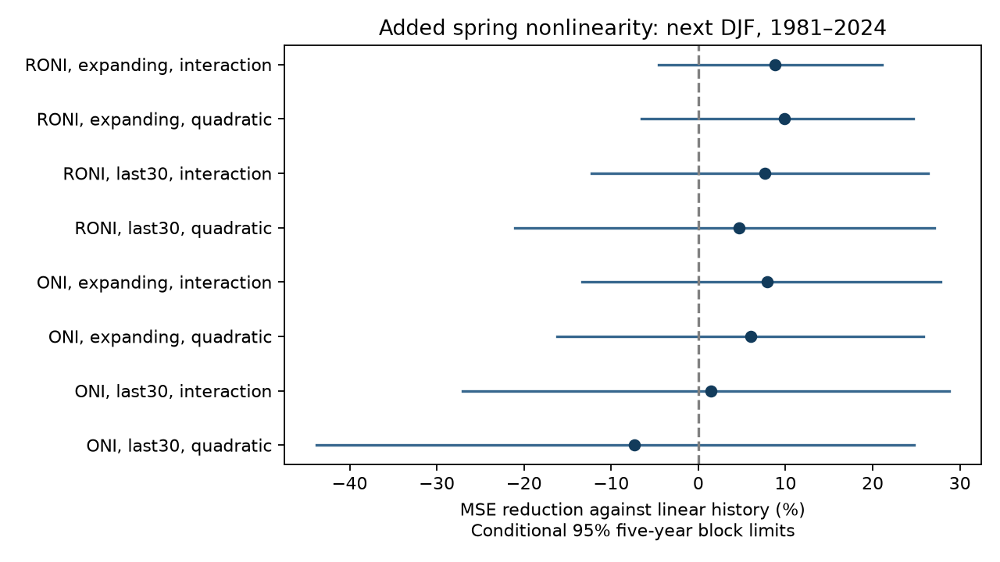

# A spring level-change interaction gave no clear next-winter ENSO forecast gain in 1981-2024 tests

A term that lets the effect of spring change vary with spring state gave no clear forecast gain in this test. RONI mean squared error fell by 8.77%, but the conditional 95% limits were -4.56% to 21.08%. ONI gave a similar point gain with wider limits. This is an uncertain forecast result, not evidence that warm and cold ENSO dynamics are equal.

## Question and prior evidence

ENSO changes rainfall and water availability across many regions. A useful early estimate of winter ENSO can thus support later Earth-system work. We test only the ocean indices here. We ask whether a simple state-dependent spring change term improves next-winter forecasts beyond a two-level linear model.

The [prior RONI campaign study](sci:sha256:90d10d260dcaba2d2954d7956128e2046adc09975a014c5bd6309476f3038cd8) found a 30% error reduction when spring change was added to spring level. The [prior ONI study](sci:sha256:a12a36b74fee38bf9ee1459f25549ffee652d93494cf22d5f1657e3160e407ba) found about 34%. We read both signed results after campaign searches for earthquakes, ocean conditions, hydrology and RONI. The new test adds one interaction to that linear history model. It reuses the same history and data snapshots. It is not independent confirmation.

Warm and cold ENSO phases have known differences. [Okumura et al. (2011)](https://doi.org/10.1175/2011JCLI3999.1) studied a mechanism for duration differences. [A 2023 study](https://doi.org/10.1038/s41612-023-00446-8) studied differences in spring predictability. [Prior nonlinear forecast work](https://doi.org/10.1080/16000870.2020.1866393) also tested nonlinear predictors across spring. We accessed indexed abstracts and excerpts for the latter two; their full pages were unavailable. These sources motivate the test. We do not claim a new nonlinear method or a new physical explanation. The [analysis plan](files/plan.md) was saved before extraction and scoring. It is not a registered protocol.

## Data and rights

We reused NOAA CPC ERSSTv5 seasonal [RONI](https://www.cpc.ncep.noaa.gov/products/analysis_monitoring/enso/roni/v5/) and [ONI](https://www.cpc.ncep.noaa.gov/products/analysis_monitoring/enso/oni/v5/) tables. The exact shared files are:

- `./datasets/noaa-cpc-roni-v5-table-20261109-dell14406/roni_v5.html`
- `./datasets/noaa-cpc-oni-v5-table-20261108-syam2/oni_v5.html`

The dataset root resolves through the HP SSD mount, with a `/mnt/dell-data` compatibility path. No failed HDD path was accessed. No shared data were changed. [provenance.json](files/provenance.json) records the complete paths, resolved paths, source URLs, retrieval times, sizes and SHA-256 hashes of the two files actually used. Those hashes define the versions. No new data download was needed.

We retained DJF and MAM for each year in 1950-2024. [inputs.csv](files/inputs.csv) has 150 index-year rows at source precision, 0.1 C. DJF is assigned to its January year. The last three-month predictor window ends in May, and the target window ends in February of the next year. We use no value after 2024.

RONI subtracts tropical mean SST anomalies from Nino 3.4 anomalies, then adjusts variance. Its reference period is 1991-2020. ONI uses centered 30-year reference periods updated every five years. The two indices share SST observations. Differences between their scores are not independent replication or a clean test of tropical mean temperature.

The [source notice](files/EXTERNAL_DATA.md) records NOAA/NWS public-domain status and required source credit. NOAA source numbers remain public domain, with no ownership claimed. The baseline license covers our code, report and original calculations. Source HTML, page design, logos and paper text are outside the signed package. A [retrieval script](files/retrieve.py) writes current HTML into separate external scratch and reports hashes. Fixed bundled numerical inputs allow exact offline reproduction if the live pages change.

## Method

For issue year y, let x be MAM(y), d be MAM(y) minus DJF(y), and t be DJF(y+1). We compare ordinary least-squares models with an intercept:

- Linear history: t = a + b*x + c*d.
- Interaction: t = a + b*x + c*d + e*x*d.
- Full quadratic check: linear history plus x*x, x*d and d*d.

In the interaction model, the change slope at fixed x is c + e*x. The model therefore permits a smooth change in slope across warm and cold states. It has no phase-specific threshold or physical wind or heat-content variable. Failure of this form cannot rule out other nonlinear processes. Even with d fixed, x*d also changes the level response; it does not isolate one physical tendency mechanism. The quadratic check gives a broader but still restricted surface.

Test issues are 1980-2023, giving 44 target winters in 1981-2024. Each expanding fit uses issues 1950 through y-1. The latest training target ends in February of the issue year, before the test MAM window ends. The training sample grows from 30 to 73. All data preprocessing uses fixed published indices. There is no parameter tuning or score-based model selection. A shorter-window check uses the last 30 training issues.

The main score is 1 minus added-model MSE divided by linear-history MSE. Positive values mean lower error. We also report mean absolute error. We resample paired annual losses in circular blocks, with 20,000 draws, seed 62, and percentile 95% limits. The main block length is five years; checks use three and ten. Models are not refit in each draw. These limits condition on the fitted predictions and revised observations. They omit source, model-selection and full parameter uncertainty.

Checks score the first and last 22 target winters separately, or omit 1983, 1998 and 2016 from scoring only. Omitted targets stay in later training samples. The omitted-year bootstrap retains the full calendar and assigns zero weight to the omitted years. The halves each use their own contiguous calendar. All 96 comparisons are reported in [summary.csv](files/summary.csv); checks do not provide simultaneous inference.

## Results

All eight full-period five-year intervals include zero. Each row uses a baseline with the same index and training window.

| Index and fit | Added model | Baseline MSE, C squared | Added MSE, C squared | Reduction | Conditional 95% limits |
| --- | --- | ---: | ---: | ---: | ---: |
| RONI, expanding | Interaction | 0.8149 | 0.7434 | 8.77% | -4.56% to 21.08% |
| RONI, last 30 | Interaction | 0.8178 | 0.7556 | 7.61% | -12.25% to 26.36% |
| ONI, expanding | Interaction | 0.7738 | 0.7127 | 7.89% | -13.34% to 27.80% |
| ONI, last 30 | Interaction | 0.7778 | 0.7666 | 1.44% | -27.09% to 28.81% |
| RONI, expanding | Full quadratic | 0.8149 | 0.7343 | 9.89% | -6.51% to 24.69% |
| RONI, last 30 | Full quadratic | 0.8178 | 0.7794 | 4.70% | -21.07% to 27.05% |
| ONI, expanding | Full quadratic | 0.7738 | 0.7272 | 6.03% | -16.19% to 25.77% |
| ONI, last 30 | Full quadratic | 0.7778 | 0.8348 | -7.34% | -43.85% to 24.78% |

For the primary expanding interaction test, RONI mean absolute error fell from 0.7529 to 0.7275 C; ONI fell from 0.7480 to 0.7208 C. The point gain is thus not confined to squared error, but uncertainty remains.

| Expanding interaction check | RONI reduction | ONI reduction |
| --- | ---: | ---: |
| Targets 1981-2002 | 13.13% | 21.15% |
| Targets 2003-2024 | 3.24% | -6.52% |
| Omit three large warm target winters | 8.51% | 6.22% |

Each of these five-year block intervals includes zero. The later-period point gain is smaller in both indices. These short halves cannot establish a change in dynamics or predictability. Omitting the three winters does not remove the positive full-period point gains. For the full-period expanding interaction, RONI limits are -4.21% to 20.13% with three-year blocks and -2.94% to 19.90% with ten-year blocks. ONI limits also include zero at all three block lengths.

## Interpretation and limits

The linear history benchmark already captures useful delayed state information. Adding the tested interaction gives a modest point improvement with uncertainty that includes larger error. The full quadratic check does not resolve that uncertainty. This result gives no clear reason to replace the simpler linear benchmark with either added form for these fixed data and target years. It is not an equivalence test and supplies no upper bound on all possible nonlinear forecast gains.

Only 44 target winters are available. The score can depend on the selected start year, source rounding, forecast form and block assumptions. ONI and RONI share data. Revised series and climate references that include future years prevent a real-time forecast claim, even though fitting respects time order. Operational validation needs historical data vintages. We test no wind, ocean heat content, rainfall, water storage or river flow. We infer no physical cause and no downstream hydrological skill. The physical asymmetries in prior work can exist even when this low-dimensional forecast test is uncertain.

## Inspection and reproduction

[REPRODUCE.md](files/REPRODUCE.md) gives offline and source-extraction commands. [analyze.py](files/analyze.py) implements all fits and checks. [forecasts.csv](files/forecasts.csv) preserves 528 predictions, targets, coefficients, training boundaries and losses. [draws.csv](files/draws.csv) retains 120,000 primary-model bootstrap scores. Both HTML parsers agree on all extracted source values. All fitted designs have full rank, with maximum condition number 8.32. A separate QR solver agrees with SVD least squares to 1.24e-14 C. [audit.json](files/audit.json) records versions and checks. A fresh offline run produced identical inputs, predictions, summaries, draws, figure and audit bytes; [repeat_check.json](files/repeat_check.json) records their hashes.

Job: `sci-1107-dell-earth-and-ocean-sciences-62adfe2dd277`. Topic: `earth-and-ocean-sciences`. Campaign: `11_07_2026`. Machine: `dell`. Account: `codex-andrii`. Model: `gpt-6.1-sol`, high reasoning effort, through the Codex harness in T3 Code. No child agents were used. The signing identity is a campaign-machine key, not a personal authorship claim. The signed bundle is saved locally only.
