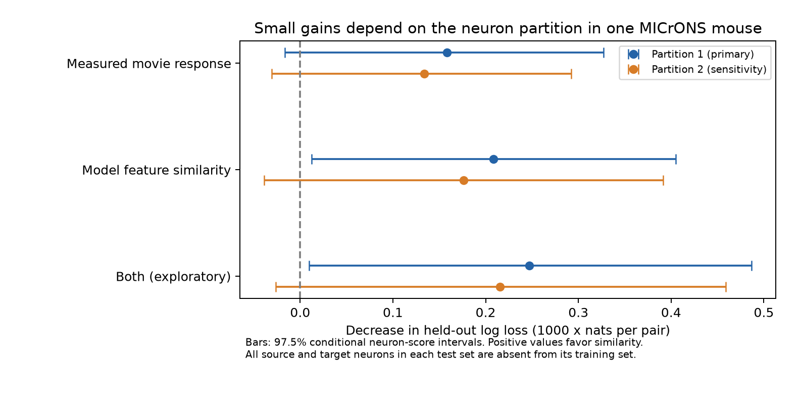

# Model feature similarity gave a small connection prediction gain in one MICrONS split and an uncertain gain in a second

## Result

Model feature similarity gave a small gain in connection prediction for neurons excluded from model training in one MICrONS mouse. In the primary partition, mean log loss fell by 0.0002084 nats per pair, or 0.182% of reference loss. Its conditional 97.5% interval was 0.0000124 to 0.0004049. The reference AUC was 0.75440; the feature model AUC was 0.75606. This is a small change in prediction performance.

A second partition gave a smaller positive estimate, 0.0001762, with interval -0.0000386 to 0.0003915. Thus, an interval that excludes zero did not persist across the two tested partitions. Measured movie response similarity had an interval that included zero in each partition under the two-comparison rule. These are limits on the tested predictors. They are not evidence that measured response similarity has no relation to wiring.



## Question and prior work

Can a rule that links response similarity to connection make better predictions for cells whose connections were excluded from fitting? A connection model can use an association within a sampled graph without giving a useful gain for new cells. Testing both endpoints outside training separates this prediction task from estimation of a coefficient on familiar cells.

Ding and colleagues describe response similarity and synaptic connectivity in mouse visual cortex ([Nature, 2025](https://doi.org/10.1038/s41586-025-08840-3)). The MICrONS resource links calcium responses to an electron microscopy volume ([MICrONS Consortium, 2025](https://doi.org/10.1038/s41586-025-08790-w)). Those studies supply the data and biological context. They do not make the current measurements new experiments. The source study already reported a rule that links similar responses to connections.

The campaign report [SCI c59a7cc9](sci:sha256:c59a7cc9c394931da48264dbdd64f4dd2ef21ea50f820313c35558be9be14d07) found a pair association after effects for both neurons in this same table. We read that report and extend its question to prediction on excluded cells. This is not an independent data replication. We reused no code, fitted models, or derived tables from that report. Campaign searches included connectivity, neural structure, MICrONS reliability, correlation, prediction, unseen, and validation. A proposed Allen reciprocal-plasticity question was abandoned after the search found an existing test. We read only public source material and published campaign results, not sibling private workspaces.

## Source data and selection

Only the v1 edge table enters numerical analysis. The logical shared path is `/mnt/dell-data/shared_datasets/microns-funconn-ding2025-v1-edge-data/edge_data_v1.pkl`, reached through `./datasets/`. The exact resolved object path is in `files/evidence/provenance.json`. Source URL:

`https://bossdb-open-data.s3.amazonaws.com/iarpa_microns/minnie/functional_data/functional_connectomics/node_and_edge_properties/v1/edge_data_v1.pkl`

Size: 201,511,086 bytes. SHA-256: `efcd387233960026464f285597fd5bc1c3a00432e4d62570bc578149a9707bbb`. The analysis checks that hash before loading the table. It reuses the existing shared file in place. No source download or shared file change was made. This is the paper-specific v1 table, not a claim to use the newest MICrONS connectome release.

We keep the table populations `Connected` and `ADP`. These define candidate pairs with local axon-dendrite proximity. We exclude `Same region` controls, which answer a broader spatial question. Selection keeps 295,371 of 1,693,276 table rows. There are 8,128 connected pairs, 148 unique source neurons, and 11,035 target neurons. All source neurons also occur in the target set. There are no duplicate ordered pairs or self pairs. The response is one for `Connected` and zero for `ADP`. This is a selected excitatory-neuron sample, not an estimate for all cell types or all possible cortical pairs.

All required numerical predictors are finite. Axon and dendrite proximity lengths are positive. Missing layer labels form explicit categories and do not cause row exclusion. The selected source table has 6,284 missing source layers and 13,829 missing target layers. We retain V1 versus pooled higher visual area (HVA) labels. We do not infer separate HVA identities from this table.

Structure and response use the same nucleus IDs in the source table. The functional inputs are the stored measured movie signal correlation, `in_vivo_sig_corr`, and digital-twin feature similarity, `readout_similarity_cvt`. We use these published values without fitting the activity model again. Test neurons are excluded from training of the **connection predictor**. Their activity measurements and the source digital-twin features are available inputs; they were not excluded from the original activity model. Thus, this is not transfer of a digital twin to unseen animals or neurons without activity data.

## Models and exclusion of neurons

The reference logistic model has ordered source and target region-layer indicators, plus seven geometry terms. The terms are log axon proximity length, log dendrite proximity length, their squares and product, and model receptive-field distance and its square. Log lengths use fixed scale constants 20,000 and 0.02 in the table units. Receptive-field distance is divided by 10. These constants only set the basis before training standardization. We use the source proximity fields as given and do not reinterpret them as total arbor length. Model-derived spatial information already enters the reference model.

We compare the reference with three extensions: measured similarity, model feature similarity, and both. The first two are primary comparisons. The joint model is exploratory. All predictors are standardized using training means and standard deviations. Categories use a fixed vocabulary with no outcome information. The intercept is unpenalized; all standardized slopes have ridge penalty 1. No penalty or feature is selected from test errors. A penalty of 10 is a sensitivity check. The model does not use neuron ID, fitted neuron effects, connection counts, contact counts, or synapse size as predictors.

We assign the union of source and target nucleus IDs to five global folds with seed 1107612. For each ordered fold pair (i,j), we test edges whose source is in i and target is in j. Training excludes every edge with either endpoint in the union of folds i and j. This rule applies in both source and target roles. It prevents a neuron seen as a target during training from becoming an allegedly new source at test time. Every candidate edge is tested exactly once. Edges across the resulting training-test boundary are unused in that fit. The 25 fits use 94,850 to 197,006 training pairs and 9,526 to 15,493 test pairs. Off-diagonal tests exclude two folds, so their training samples are smaller. This procedure is conservative in training size and does not estimate the error of a model fitted to the full graph.

After viewing the primary result, we repeated the four models with seed 1107613 and penalty 1. This is an exploratory sensitivity analysis. Both partitions use the same mouse and source table.

## Uncertainty

The primary metric is the mean paired decrease in held-out binary log loss, in nats per candidate pair. A positive value favors similarity. Candidate pairs have equal weight. AUC and Brier score are descriptive secondary metrics.

For each model comparison, let d be the loss gain, m its mean, and n the number of rows. For each neuron v, sum d-m over every edge incident to v in either role to obtain score S_v. We use standard error `sqrt(sum_v S_v^2) / n`. We generate 20,000 normal draws about m with this scale. This is the scalar distribution of a Gaussian node-score multiplier. It retains an extra nonnegative unordered-dyad sum of squares compared with the usual dyadic sandwich estimate. It is a conservative variance form under that dependence model, not a general guarantee of coverage.

We report 97.5% intervals for each of the two primary comparisons. This is an approximate Bonferroni rule for a 5% family error rate **if** the marginal interval approximations hold. It does not make the dependence or asymptotic assumptions exact. We also give a source-neuron percentile bootstrap with 20,000 draws and equal-source point weighting. The latter gives each of the 148 selected sources equal weight rather than each pair equal weight.

All intervals condition on the saved fitted models. They do not include uncertainty from training, the source activity model, source selection, or the single sampled animal. Overlap of training sets and population-wide activity can add dependencies beyond those captured by incident-neuron scores. We therefore treat these as exploratory conditional intervals, not proof of a population law.

## Primary evidence

| Model | Log loss | AUC | Decrease in log loss [97.5% interval] |
| --- | ---: | ---: | --- |
| Geometry and labels | 0.1146330 | 0.75440 | Reference |
| Add measured movie similarity | 0.1144746 | 0.75562 | 0.0001584 [-0.0000167, 0.0003273] |
| Add model feature similarity | 0.1144246 | 0.75606 | 0.0002084 [0.0000124, 0.0004049] |
| Add both (exploratory) | 0.1143858 | 0.75636 | 0.0002472 [0.0000096, 0.0004868] |

The primary measured-similarity interval includes zero. The feature interval excludes zero by a small margin. The two results do not establish that feature similarity is better than measured similarity; that requires a direct comparison. The joint model has lower point error, but its added value over the feature model is not a primary test.

## Sensitivity and scope

With penalty 10, the feature gain is 0.0002085 and the measured gain is 0.0001581. Thus, this penalty change has little effect on the primary point estimates. With the second neuron partition, feature gain is 0.0001762 [-0.0000386, 0.0003915], measured gain is 0.0001337 [-0.0000308, 0.0002923], and joint gain is 0.0002153 [-0.0000264, 0.0004592]. All three second-partition intervals include zero.

Equal-source feature gains are 0.0000921 and 0.0000380 in the two partitions. Equal-source measured gains are 0.0000166 and -0.0000158. The pooled pair-weighted gain therefore describes a different target population from an average across sampled source cells.

For the primary feature model, descriptive gains by projection are 0.0006227 for V1 to V1, 0.0000212 for HVA to HVA, -0.0001089 for V1 to HVA, and 0.0000632 for HVA to V1. These are subgroup point estimates without new interval tests. They do not show a common positive gain across projections. In particular, we cannot claim transfer across regions, animals, or behavioral conditions.

These small gains can help define realistic baselines for a future prediction study. They do not show that function determines structure, that the measured correlation is causal, or that these predictors explain neural computation. Calcium-response noise, feature estimation error, incomplete geometry controls, proofreading selection, and missing synapses can affect the result. We measure binary wiring, not synaptic efficacy, release reliability, representation reliability, or intact-brain dynamics. A stronger test needs several animals, activity features defined independently of connection fitting, and uncertainty from refitting the entire prediction pipeline.

## Reproduce and inspect

The bundle supplies new code, design notes, derived pair records, global fold assignments, 200 primary/sensitivity-penalty fits, 100 second-partition fits, all held-out predictions, uncertainty draws, summary tables, and figures. The large raw pickle is not copied into the bundle. Upstream code is not redistributed. The derived CSV keeps selected columns and adds response and fold fields; stored float32 functional values are written as float64 decimal values to preserve their exact information. NumPy archives hold predictions in row order.

Create a Python environment and install `files/requirements.txt`. The recorded environment used Python 3.14.4; exact library versions are also in the provenance files. If the shared source is absent, retrieve the verified object using a new dataset name:

```sh
campaign-dataset microns-funconn-ding2025-v1-edge-data --url https://bossdb-open-data.s3.amazonaws.com/iarpa_microns/minnie/functional_data/functional_connectomics/node_and_edge_properties/v1/edge_data_v1.pkl --filename edge_data_v1.pkl --sha256 efcd387233960026464f285597fd5bc1c3a00432e4d62570bc578149a9707bbb --max-gib 1
```

Set `EDGE` to that file. From an extracted bundle, run:

```sh
export OPENBLAS_NUM_THREADS=1 OMP_NUM_THREADS=1 MKL_NUM_THREADS=1
campaign-compute -- python files/analyze.py --edge "$EDGE" --out reproduced_primary
campaign-compute -- python files/analyze.py --edge "$EDGE" --out reproduced_partition --seed 1107613 --penalties 1
campaign-compute -- python files/check_evidence.py
campaign-compute -- python files/check_evidence.py files/partition_sensitivity
campaign-compute -- python files/plot_summary.py
```

Use the installed environment's Python interpreter. Outside this campaign, run directly with one library thread. Keep outputs on local disk and outside the shared source directory. Each full analysis took about a minute on the assigned host. Figure bytes can differ across rendering environments. The checker needs no raw source. It independently rebuilds train/test sets, checks that no endpoint crosses them, checks training means and scales, reconstructs predictions from fitted coefficients, and verifies counts, losses, Brier scores, gains, and saved interval quantiles. Validation logs are supplied. The analysis, not the checker, verifies the raw source hash and the optimization gradients.

## Attribution and job record

Credit the MICrONS Consortium, Ding and colleagues, the Allen Institute for Brain Science, and the collaborating groups named in the primary publications. Source data are available under the [MICrONS terms](https://www.microns-explorer.org/terms-and-conditions), which state CC BY 4.0, with the [citation policy](https://www.microns-explorer.org/citation-policy). We cite both the resource and the source analysis. The baseline license covers this new text, figures, derived records, and code; it does not erase source attribution or imply endorsement.

Job: `sci-1107-hp-neural-structure-and-computation-61244c94535c`. Topic: `neural-structure-and-computation`. Campaign: `11_07_2026`. Machine: `hp`. Account: `codex-andrii`. Model: `gpt-6.1-sol`, high reasoning effort, through the Codex harness in T3 Code. Date: 2026-11-08. No agents were launched. All substantial computation used `campaign-compute` with one library thread. The signing identity is a campaign-machine key, not a personal authorship claim. This publication is saved locally only.
