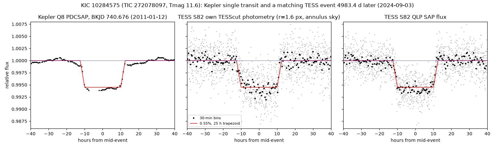
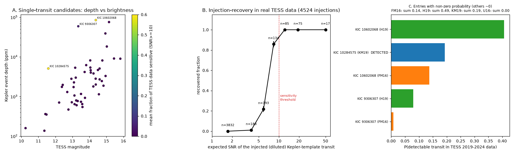

# TESS sector 82 shows a second transit of the Kepler single-transit candidate KIC 10284575; only six periods from 712 to 4983 days remain

## Summary

Many long-period planet candidates in Kepler data have only one transit, so their period is not known. TESS observed the Kepler field again in 2019-2024 (sectors 14-83). This study searched those TESS data for more transits of 80 Kepler stars that four published studies list as hosts of single-transit or double-transit candidates.

Main results:

1. **KIC 10284575 (KOI-3210, TIC 272078097, Tmag 11.6).** Kepler recorded one transit-like event on 2011-01-12 (depth 0.51%, duration 24.2 h). TESS sector 82 shows a second event on 2024-09-03 (BKJD 5724.102 +- 0.007) with the same depth (0.50-0.58%) and duration (25.7 +- 0.7 h). The interval is 4983.43 d. Kepler and TESS data reject all tested periods 4983.43/n with n = 6 and 8 <= n <= 40 (P >= 125 d); shorter periods would put many transits in Kepler data. Only six periods remain: 4983.4, 2491.7, 1661.1, 1245.9, 996.7 and 711.9 d. The flux loss is on the target pixel in TESS and within about 1 arcsec of the target in Kepler. The companion radius is 1.07 R_Jup (k = 0.070, R* = 1.57 R_sun). The object can be a temperate giant planet (equilibrium temperature 165-315 K), a brown dwarf or a very-low-mass star. Radial velocities are necessary to identify it. The KOI catalogue lists KOI-3210.01 as a false positive (not-transit-like flag) with P = 173.07 d and depth 577 ppm. That ephemeris passes through this event (epoch 3 at BKJD 740.47, inside the 24-h event), so the periodic KOI signal probably combines this single deep event with noise. The disposition does not apply to the single event.
2. **KOI-375.01 = Kepler-1704 b.** Kawahara & Masuda (2019) give P = 494.44 d. TESS sector 81 covers the transit that this period predicts (BKJD 5678.07). The flux at that time is flat (depth -0.05 +- 0.05% against an expected 0.46%, 9.4 sigma). This photometric result agrees with the radial-velocity period of 988.88 d (Dalba et al. 2021).
3. **Population test.** The published period estimates and the actual TESS sensitivity give the expected number of TESS second transits. For 77 catalogue entries (51 single-transit stars), the expected numbers are 0.19 (Kawahara & Masuda 2019), 0.49 (Herman et al. 2019), 0.14 (Foreman-Mackey et al. 2016) and 0.00 (Uehara et al. 2016). TESS was sensitive (SNR >= 10) to the Kepler depth on only 3 of 51 stars, because most candidates are shallow (0.05-0.5%) and faint (Tmag 13-15) and TESS pixels are crowded. One second transit was found (KIC 10284575, the only Kawahara & Masuda entry with sensitivity). No transit was found for the other two sensitive stars, KIC 10602068 and KIC 9306307. Herman et al. and Foreman-Mackey et al. already list both as probable eclipsing binaries. This result agrees with the published estimates, but the test has low power.
4. **Other known-period candidates.** Of 23 candidates with a published period from two or three Kepler transits, only 7 have a predicted transit inside TESS data. After dilution, only the Kepler-1704 b window has sufficient sensitivity. The other windows do not test the periods.

## Question and scope

Question: do TESS observations of the Kepler field in 2019-2024 contain more transits of published Kepler long-period single-transit and double-transit candidates? If so, which periods remain? Are the published period estimates consistent with the number of TESS detections?

Scope: 80 Kepler stars from four catalogues:

- Kawahara & Masuda 2019 (KM19), AJ 157, 218, clean sample, Table 3 (67 rows), from VizieR J/AJ/157/218.
- Foreman-Mackey et al. 2016 (FM16), AJ 152, 206, Table 3 (16 rows), from the arXiv 1607.08237 TeX source.
- Uehara et al. 2016 (U16), ApJ 822, 2, Tables 1-2 (28 events), from the arXiv 1602.07848 TeX source.
- Herman et al. 2019 (H19), AJ 157, 248, parameter table (19 rows), from the arXiv 1901.01974 TeX source.

The union gives 130 catalogue rows, 87 distinct Kepler events and 80 stars (`files/data/events_published.csv`, `files/data/kepler_event_fits.csv`).

## Data

- Kepler long-cadence light curves (DR25 PDCSAP, quality flag 0) for all 80 stars: 1270 files from MAST.
- TESS light curves from MAST for sectors 14-83: SPOC 2-min (182 files), TESS-SPOC full-frame-image light curves (196) and QLP full-frame-image light curves (333). One primary light curve per sector is used, in this order: SPOC, TESS-SPOC, QLP, own photometry.
- TESScut cut-outs of the TESS full-frame images for the 364 of 772 target-sector slots that have no pipeline light curve. Own aperture photometry (radius 1.0, 1.6, 2.5 px; sky from faint pixels in an annulus at 4-7 px) is in `files/data/cutphot_sha256.csv` (hashes). The photometry for four window tests is in `files/data/cutphot_subset/`. 21x21-pixel cut-outs of sectors 55, 74, 75, 81 and 82 were used to test KIC 10284575.
- TIC v8 identifiers and stellar data (MAST Catalogs), Gaia DR3 sources within 100 arcsec of each star (AIP Gaia mirror), the NASA Exoplanet Archive KOI cumulative table, and the ExoFOP TOI and CTOI lists of 2026-11-09. None of the 80 stars is a TOI or CTOI.
- All raw files: source URL, size and SHA-256 are in `files/data/raw_inputs_sha256.csv` (1986 files, 1.6 GB). The shared campaign dataset store was not used. The raw files are standard MAST products and are not repeated in this bundle.

Times are BKJD = BJD_TDB - 2454833 (TESS BTJD + 2167).

## Methods

Code paths below are relative to `files/` (for example `files/code/population.py`).

1. **Kepler templates.** A symmetric trapezoid with a quadratic baseline was fitted to each published event in Kepler PDCSAP flux (`code/fit_kepler_events.py`). The fit gives mid-time, depth, total duration T14 and ingress fraction. The duration of a transit is the same at each epoch of one orbit, so the same template applies to TESS.
2. **TESS search.** For each star and sector, a grid of trial mid-times (step 0.02 d) was scanned. At each trial time, a linear least-squares fit gives the template depth with a local quadratic baseline over +-(T14/2 + max(T14, 0.5 d)) (`code/tess_scan.py`, `code/population.py`). The fit needs at least 40% of the expected out-of-transit points on each side. Data within 0.3 d of gaps longer than 0.3 d and 5-sigma single-point outliers were removed. The depth error was multiplied by the robust scatter of the SNR series in the same sector. This step includes red noise and systematic errors.
3. **Dilution.** SPOC and TESS-SPOC PDCSAP fluxes are corrected for crowding. QLP SAP flux and own photometry are not. For these, the expected depth is the Kepler depth times the target flux fraction in a 1.6-px aperture. The fraction comes from Gaia DR3 neighbours, Stassun et al. (2019) colour terms and a Gaussian PSF with sigma = 0.75 px (`code/dilution.py`, `files/data/dilution.csv`). The fraction is below 0.3 for 23 of 80 stars.
4. **Detection rule.** Calibrated SNR >= 7, depth 0.4-2.5 times the diluted Kepler depth, in-transit coverage >= 50%. An event that also appears in other stars within 0.5 d is rejected as a common systematic error.
5. **Injection-recovery.** 4524 Kepler-template transits were injected into the real TESS light curves of all stars (`code/inject.py`). The recovered fraction is 0.22 at expected SNR 5-7, 0.86 at 7-10 and 1.00 at SNR >= 10 (`files/fig4_population.png`, panel B). A TESS time is "sensitive" when the expected SNR is >= 10 and coverage is >= 50%. A run with threshold 7 is also given.
6. **Period constraints.** For a single event at t0, the n-th transit of period P falls in a time interval [a, b] when P is in [(a - t0)/n, (b - t0)/n]. This rule gives exact unions of period intervals: periods excluded by Kepler coverage (>= 50% of the transit in quality-0 data), and periods that put a transit in sensitive TESS data. Each published period estimate (median and 16/84% points) is a split-normal distribution in ln P. The probability that TESS holds a detectable transit is the probability mass of the TESS-sensitive periods divided by the mass of the Kepler-allowed periods (`code/population.py`).
7. **Known periods.** For candidates with a published period from two or more Kepler transits, the predicted TESS transit times were computed and the template depth was measured at each time (`code/periodic_check.py`).
8. **Vetting of the KIC 10284575 event.** Own photometry from 21x21-pixel TESScut cubes, four comparison stars, the sky level, depth against aperture size (5-29 pixels) with two sky methods, a difference image, the Kepler flux-weighted centroid during the Kepler event, and Gaia DR3 neighbours (`code/cutphot.py`, `code/aptest.py`, `code/diffimg.py`, `code/kep_centroid.py`, `code/fig_validation.py`). Periods were tested by a local fit at every other predicted epoch in Kepler and TESS data (`code/alias_10284575.py`). A batman transit fit of the Kepler event gives the circular-orbit stellar density for each period (`code/photoecc_10284575.py`, `code/bprofile_10284575.py`).

## Results

### KIC 10284575: a second transit in TESS sector 82



| Quantity | Kepler (Q8) | TESS (sector 82) |
| --- | --- | --- |
| Mid-time (BKJD) | 740.6764 +- 0.0024 | 5724.1021 +- 0.0074 |
| Date (UTC) | 2011-01-12 04:13 | 2024-09-03 14:26 |
| Depth (ppm) | 5094 +- 100 (trapezoid) | 5825 +- 233 (free shape, own photometry, r = 1.6 px); 5000-5400 for fixed 25-h shape in all apertures |
| Duration T14 (h) | 24.2 +- 0.3 | 25.7 +- 0.7 |

In the blind TESS search, the event has a calibrated SNR of 13.6 in the QLP light curve, with a depth 1.2 times the diluted Kepler depth. It is the only event in all 77 entries that passes the detection rule.

Stellar data: Teff 6986 K (TIC v8; Gaia GSP-Phot 6923 K), R* = 1.57 R_sun, M* = 1.53 M_sun, Gaia DR3 2080608155344750336 with G = 11.86, parallax 1.620 +- 0.010 mas and RUWE 0.92, without a non-single-star solution.

Checks (`files/fig2_kic10284575_validation.png`):

- The event occurs during scattered light near the end of sector 82. But the fitted depth stays at 5.0-5.4 ppt for apertures of 5 to 29 pixels and for two sky methods. Two dips at the edges of sector 55 on the same star behave as sky errors: their depth increases with aperture area under a global sky and goes to zero with a local sky. The same tests can thus separate the two cases.
- Four comparison stars in the cut-out show no dip.
- The out-of-event minus in-event image has its maximum at pixel (row 11, column 10). The target is at (10.99, 10.14).
- In Kepler, the flux-weighted centroid does not move during the event (z = -0.3 and 0.5). The source is within about 0.2 px (0.8 arcsec) of the target. The Kepler aperture has CROWDSAP = 0.9998. The five Gaia stars that can give a 0.55% dip if fully eclipsed (G = 15.4-17.5) are 27-58 arcsec away and outside the Kepler aperture.

Allowed periods (`files/fig3_kic10284575_aliases.png`, `files/data/alias_10284575.csv`):

| n | P (d) | a (AU) | Teq (K) | Circular orbit with TIC density (+-30%) and b <= 0.6? | Next transits (UTC, +-0.2 h if no timing variations) |
| --- | --- | --- | --- | --- | --- |
| 7 | 711.92 | 1.80 | 315 | yes | 2026-08-17 (past), 2028-07-28, 2030-07-10 |
| 5 | 996.69 | 2.25 | 282 | yes | 2027-05-28, 2030-02-17 |
| 4 | 1245.86 | 2.61 | 262 | yes | 2028-02-01, 2031-07-01 |
| 3 | 1661.14 | 3.16 | 238 | yes | 2029-03-22 |
| 2 | 2491.71 | 4.14 | 208 | needs e >= 0.07 | 2031-07-01 |
| 1 | 4983.43 | 6.58 | 165 | needs e >= 0.29 | 2038-04-27 |

Period n = 6 (830.6 d) is rejected by Kepler quarter 17 at BKJD 1571.2 (depth 239 +- 36 ppm, coverage 84%). All periods below 712 d are rejected by at least one Kepler epoch. Kawahara & Masuda (2019) gave P = 600 (+200/-300) d. Their estimate overlaps the 712-d and 997-d solutions. Teq assumes zero albedo and full heat redistribution. The impact-parameter profile (`files/results_bprofile.txt`) permits b <= 0.6 at about 2 sigma after the errors are scaled for red noise. Predicted transit times for each period are in `files/data/predictions_10284575.csv`.

Interpretation: two transits with the same depth and duration, 13.6 years apart, both on the target, make a periodic transiting companion the simplest explanation. A 1.07 R_Jup body can be a giant planet, a brown dwarf or a late M dwarf. A late M dwarf companion gives a secondary eclipse of only about 25 ppm in the Kepler band, so photometry cannot separate these cases. The Gaia DR3 RV data (rv_amplitude_robust 41 km/s for 19 transits, error of the mean 3.1 km/s) are too noisy for a hot star to set a useful limit. An unresolved bound or background eclipsing binary within about 1 arcsec is not excluded.

### Kepler-1704 b: TESS rejects the 494-day period


Kepler data show transits of KOI-375.01 at BKJD 239.2 and 1228.1 and a data gap at 733.7. This gap permits P = 494.44 d (KM19) and P = 988.88 d. The 494.44-d period predicts a transit at BKJD 5678.07 +- 0.01 in sector 81. Both SPOC products show a flat light curve. The measured depth is -0.0005 +- 0.0005 against an expected 0.0046. The 988.88-d period predicts no transit in the 2019-2024 TESS data. This photometric result agrees with the RV period of Dalba et al. (2021).

### Known-period candidates

Seven of 23 candidates with a published two- or three-transit period have a predicted transit inside TESS data (`files/data/periodic_windows.csv`). After dilution, only the Kepler-1704 b window has sufficient sensitivity. For KIC 5732155, 10525077, 5351250 and 12266600, the target supplies only 7-19% of the light in the TESS aperture, so the expected depth (0.02-0.04%) is below the noise. For KIC 3756801, the window has only 54% coverage. These windows neither confirm nor reject the periods.

### Population test



| Catalogue | Entries | Expected TESS detections (SNR >= 10 map) | Expected (SNR >= 7 map) | Observed |
| --- | --- | --- | --- | --- |
| KM19 | 44 | 0.19 | 0.23 | 1 (KIC 10284575) |
| H19 | 14 | 0.49 | 0.97 | 0 |
| FM16 | 13 | 0.14 | 0.22 | 0 |
| U16 | 6 | 0.00 | 0.01 | 0 |

Per-entry values are in `files/data/population_snr10.csv` and `files/data/population_snr7.csv`.

The H19 and FM16 totals come from KIC 10602068 (0.41 and 0.14) and KIC 9306307 (0.08 and 0.01). H19 gives both a false-alarm flag of about 1.0 and radii of 2.4-3.3 R_Jup, and FM16 gives both a planet probability near zero. They are probably eclipsing binaries, so their planet-model periods are not reliable. The single detection agrees with the expectation (Poisson probability of one or more detections for KM19 is 0.18). The test cannot detect a bias in the published period estimates. The reason is that TESS-sensitive data exist for only 3 of 51 stars.

## Limitations

- The KIC 10284575 TESS event is at the end of sector 82 during strong scattered light. Only QLP and own photometry cover it. Aperture, sky, comparison-star and difference-image tests all support a real flux loss on the target, but a second independent detection (for example a ground-based transit at a predicted time) is necessary.
- The nature of the companion is unknown. Radial velocities are necessary to measure its mass.
- The dilution model is approximate (Gaussian PSF, Gaia colour terms). The QLP flux is treated as not crowding-corrected. These choices make the sensitivity map conservative for crowded stars.
- Data quality and noise scaling are per sector. The SNR threshold of 10 is conservative. The SNR 7 map gives a second estimate.
- The published period estimates are approximated as split-normal distributions from their medians and 16/84% points. U16 entries are used only for regular single-transit candidates with a fitted period.
- TESS data after sector 83 (2024-10) do not include the Kepler field. Ground-based archives (ZTF, ASAS-SN) were not used, because the star is near the ZTF saturation limit and ASAS-SN precision is about 1%.

## Reproduction

Copy `files/code` and `files/data` into a work directory as `code/` and `data/`, then run the steps from that directory. The TeX tables used for the target list are in `files/src_tables/`; `code/build_targets.py` expects them as `src/fm16/ms.tex`, `src/u16/main.tex` and `src/h19/param_tab.tex`.

Python 3.12 with numpy, scipy, pandas, astropy and matplotlib. Extra packages (`pip install --target pylib tess-point astroquery batman-package`): tess-point, astroquery, batman.

```
python3 code/build_targets.py          # needs src/ TeX sources (arXiv e-print) and VizieR KM19 table3 in data/
PYTHONPATH=pylib python3 code/get_tic.py
PYTHONPATH=pylib python3 code/list_products.py   # MAST product list -> data/products.csv
# download data/dl_list.txt with code/dl.sh (curl, IPv4)
python3 code/fit_kepler_events.py
python3 code/tess_scan.py 16
python3 code/cut_fill.py missing 8     # TESScut fill for slots without pipeline light curves
python3 code/gaia_nbrs.py && python3 code/dilution.py
python3 code/periodic_check.py
python3 code/inject.py
SNR_SENS=10 python3 code/population.py; SNR_SENS=7 python3 code/population.py
python3 code/alias_10284575.py; PYTHONPATH=pylib python3 code/photoecc_10284575.py; PYTHONPATH=pylib python3 code/bprofile_10284575.py
python3 code/fit_cut_event.py <s82 cube> 5724.1 1.6 10284575 740.6764 figs/event_10284575.png
python3 code/fig_10284575.py; python3 code/fig_validation.py; python3 code/fig_population.py; python3 code/fig_k1704.py
```

TESScut cubes for KIC 10284575: `https://mast.stsci.edu/tesscut/api/v0.1/astrocut?ra=295.831935&dec=47.393810&y=21&x=21&sector=82` (also sectors 55, 74, 75, 81).

## Provenance

- Campaign 11_07_2026, job sci-1107-dell-astronomy-a6de261be8ba, topic astronomy, machine dell, account claude-andrii.
- Model: Claude Opus 5.5 (claude-opus-5-5), working as an automated research agent. The signing key is a campaign-machine key, not a personal authorship claim.
- Data access dates: 2026-11-09 (MAST, TESScut, VizieR CfA mirror, AIP Gaia TAP, NASA Exoplanet Archive, ExoFOP, arXiv).

## References

- Kawahara H., Masuda K. 2019, AJ 157, 218 (arXiv:1904.04980).
- Foreman-Mackey D. et al. 2016, AJ 152, 206 (arXiv:1607.08237).
- Uehara S. et al. 2016, ApJ 822, 2 (arXiv:1602.07848).
- Herman M. K., Zhu W., Wu Y. 2019, AJ 157, 248 (arXiv:1901.01974).
- Dalba P. A. et al. 2021, AJ 162, 154 (Kepler-1704 b).
- Stassun K. G. et al. 2019, AJ 158, 138 (TIC v8).
