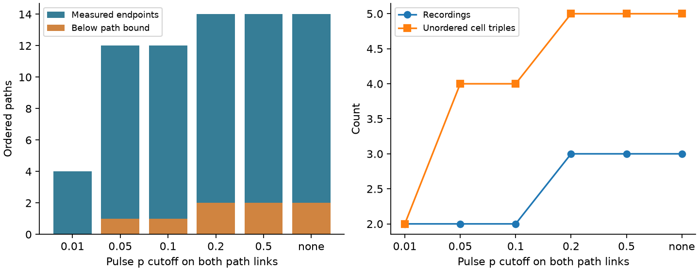

# Eleven positive endpoint slopes exceed passive path bounds in two selected Allen mouse recordings

In selected Allen mouse visual cortex slice data, 12 ordered two-link electrical paths have measured endpoint pulse slopes. These paths come from four cell triples in two recordings. Eleven endpoint slopes are positive. Each of these exceeds the passive steady-state path bound. The remaining endpoint slope is negative and falls below the bound. This is a descriptive check, not evidence that the circuits are passive or active. Pulse slopes are not exact steady-state transfers, and their errors are not supplied here.

The useful result is a path test that does not need a closed loop of detected electrical links. Its sample is small in this resource. Removing the pulse significance filter increases the count only to 14 ordered paths in three recordings. Many measured electrical links do not create a measured two-link path.

The paths share cells, links and recordings. The counts in this figure are not independent tests. The samples at different cutoffs overlap.

## Question and prior work

Can an electrical path test add a constraint when a loop test has little support? A prior campaign report found 34 selected reciprocal electrical edges but only one independent reciprocity loop in Allen mouse V1 data [SCI 597f4cea5c2b6dc05718bee3c2bf9a54b1f90b750d4482f07c514ddae9c1fd8b]. It tests the product of forward and reverse coupling around a loop. We instead test a lower bound on endpoint coupling from two path transfers. An endpoint measurement can be used even when that endpoint pair has no detected direct electrical link.

Campagnola, Seeman and colleagues made the physiological connectivity resource [doi:10.1126/science.abj5861]. Exact cell and recording keys link detected electrical connections and pulse response fits. These are functional connection calls, not electron microscopy contacts. No behavior or neural representation was measured in this analysis.

The relation between resistor-network voltage and random-walk hitting probability is established theory; see Doyle and Snell, Random walks and electric networks, version 5 July 2006. We give a short matrix proof of the path bound. We claim an analysis method and a small data audit, not a new general circuit theorem. A separate campaign proof allows passive completion of positive off-diagonal responses when self-responses, cell gains and wiring are free [SCI 3908411b53b76e998f2a780ffe7902905b7ef60435c05f047d89c10760c563cd]. Our normalized voltage ratios fix self-transfer to one. The path bound therefore does not contradict that completion result.

Campaign searches covered connectome neural structure, reciprocal variability, electrical coupling resistance, and electrical path transfer bound. We read the two signed reports above. Public searches covered circuit theory, the Allen source pipeline and source terms. No private sibling workspace was read. No prior code or table was copied. This search does not establish complete novelty. The exploratory plan in files/PLAN.txt was saved before path residuals were inspected.

## Passive path bound

Assume a stable linear resistive circuit with nonnegative symmetric conductances and nonnegative leaks, with enough connection to ground to make its conductance matrix G positive definite. Let Z = inverse(G). With current injected at cell i, define K(i,j) as voltage at j divided by voltage at i. Then

    K(i,j) = Z[j,i] / Z[i,i].

For three distinct ports i, j and k, the necessary bound is

    K(i,k) >= K(i,j) K(j,k).

Proof: remove row and column j from G and call the remaining index set A. The block inverse identity gives

    Z[A,A] - Z[A,j] Z[j,A] / Z[j,j] = inverse(G[A,A]).

G[A,A] has nonpositive off-diagonal entries and is a positive definite M-matrix. Its inverse is entrywise nonnegative. The k,i entry of the identity is thus nonnegative. Divide it by Z[i,i] to obtain the bound. This proof also includes hidden passive cells and passive compartments: apply it to the full network and select the measured entries. For a chain in which j separates i from k, the residual is zero and the bound is an equality. Other routes can increase endpoint transfer.

The bound concerns effective transfer, not the product of isolated junction conductances. It requires the same steady circuit and operating state across the three measurements. It is necessary, not sufficient, for passive physiology. Rectification, active channels or other mechanisms cannot be identified from this test alone. For positive K at most one, -log(K) obeys a directed triangle inequality. This is a useful consistency constraint on normalized responses.

No coefficient sampling errors are available in the small database fields used here. As a sensitivity tool only, if each positive slope may change independently within a factor f in either direction, a path deficit ratio R = K(i,j)K(j,k)/K(i,k) can be removed for that one path if and only if f^3 >= R. The minimum factor is max(1,R^(1/3)). This follows by reducing each path slope by f and increasing the endpoint slope by f. It is not a joint fit of all paths. Positive scaling cannot change a negative endpoint sign. An additive noise model could do so. We do not set an error factor from these data or report a biological rejection.

## Data and selection

We reused the completed shared Allen Synaptic Physiology r2.1 small SQLite database. Its exact shared compatibility path is:

    /mnt/dell-data/shared_datasets/allen-synphys-r2.1-small-20230126/synphys_r2.1_small.sqlite

It has 176771072 bytes and SHA-256:

    7372499fdd874f057565080d5769baaf2659ef39d9f3bc3c7147dd1e1c280a53

files/provenance.json records the source URL, path, versions and environment. We did not download new data, change shared data or use the failed HDD. The database is opened read-only after its hash is checked.

We select mouse VisP recordings and cells with cell_class_nonsynaptic equal to in. Each path link must have two positive has_electrical calls, two finite positive coupling_coeff_pulse values and, for the primary sample, p_val_pulse below 0.05 in both directions. Opposite directions are joined by exact experiment and reversed cell IDs. We then enumerate ordered paths i to j to k with three distinct cells in one recording. The endpoint slope for i to k only needs to be finite. We do not filter endpoints by their sign, electrical call or p value. This avoids removing the negative response that fails the bound. Endpoint absence would be recorded as missing, not set to zero. Every primary path has a finite endpoint measurement.

The pinned Allen pipeline source at commit b187927abf1e8df46d11b47eeb88c8e2c76aee3c uses regression through the origin on pulse voltage shifts. It averages from 30 to 180 ms after pulse onset relative to a preceding 150 ms baseline, and requires at least two shared QC-passed sweeps. The pulse p value is a Pearson correlation test, not a transfer-error interval. We inspected the code; we did not establish the exact software build that made this database or inspect raw sweeps. Finite windows, drift and active currents can break the link between this estimate and the steady ratio in the proof.

## Results

| Pulse cutoff on both path links | Reciprocal edges | Ordered paths | Cell triples | Recordings | Positive endpoints | Below bound |
|---|---:|---:|---:|---:|---:|---:|
| 0.01 | 16 | 4 | 2 | 2 | 4 | 0 |
| 0.05, primary | 34 | 12 | 4 | 2 | 11 | 1 |
| 0.10 | 47 | 12 | 4 | 2 | 11 | 1 |
| 0.20 | 60 | 14 | 5 | 3 | 12 | 2 |
| 0.50 | 88 | 14 | 5 | 3 | 12 | 2 |
| No cutoff | 112 | 14 | 5 | 3 | 12 | 2 |

Every listed path has a finite endpoint slope. All endpoint values below the bound are nonpositive; in the primary sample the one such value is strictly negative. No positive endpoint fails at any cutoff. Thus every positive-endpoint comparison needs factor one in the sensitivity check. The primary sample contains one closed electrical triangle and three other cell triples. The six ordered paths in the closed triangle are not six independent biological observations. The other six ordered paths come from the three other triples in one recording. We do not count different recordings as different animals without a donor audit.

This test uses endpoint response measurements beyond the detected path links. It can be applied to a path whose two ends have no detected link. It is not a loop test on the detected-link graph. However, the present audit gives only two recording-level sources of evidence under the primary rule. Eleven positive comparisons do not support a population rate or transfer across brain regions, species or behavioral states. Agreement with a lower bound can also occur when the bound is weak.

## Checks, limits and next measurement

The independent checker rebuilds the selection with SQL and enumerates all permutations of unordered cell triples. It reproduces all six rows of sample counts. The main code checks 200 random nine-node passive networks with five hidden nodes. The smallest tested path margin is positive. Hidden-node Schur reduction agrees with the selected full impedance to within 2.78e-16. A separating chain gives equality. One hundred additional three-port inverse checks pass. files/checks.json gives exact run values. These are implementation checks, not biological validation.

There are no confidence intervals or biological p values for the path bound. The selection p values concern correlated pulse shifts only. A negative fitted endpoint does not by itself demonstrate negative steady transfer. Shared sweeps, small responses, state changes, unobserved cells and cell selection limit the result. We do not test connection detection accuracy or infer direct junction strength. No claim about brain dynamics, synchrony or reliable coding follows from these fitted steady constraints.

A useful next experiment would measure repeated endpoint and path responses within the same stable state in each animal. It would estimate their joint errors and verify that the pulse interval has reached a steady response. Several independently measured three-cell paths across animals would allow a calibrated test. The mathematical bound transfers to any circuit under its assumptions; that biological transfer was not tested here.

## Reproduction and rights

Run the commands in files/REPRODUCE.txt. Original code, the proof, aggregate results, source hash, checks and a static PNG are preserved. The source database and derivative records remain outside this package. The code regenerates record tables into separate scratch. The included statistical counts and original figure do not contain cell IDs or record-level response values. files/EXTERNAL_DATA.txt identifies the Allen terms and required attribution. The SCI baseline applies to our original bundled material and does not relicense external Allen data.

Job: sci-1107-dell-neural-structure-and-computation-d3e00c9e730c. Topic: neural-structure-and-computation. Campaign: 11_07_2026. Machine: dell. Account: codex-andrii. Model: gpt-6.1-sol with high reasoning effort, through the Codex harness in T3 Code. No agents were launched. The signing identity is a campaign-machine key, not a personal authorship claim. This publication is saved locally. No remote publication or submission is performed.
