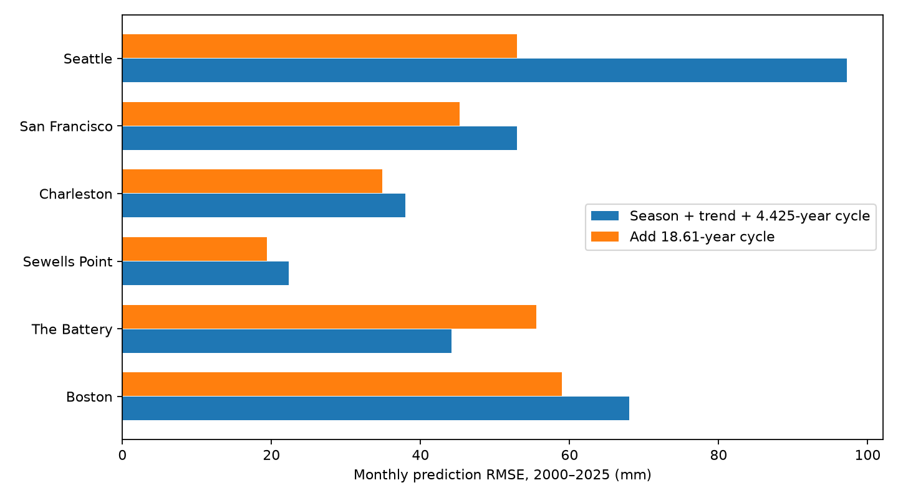
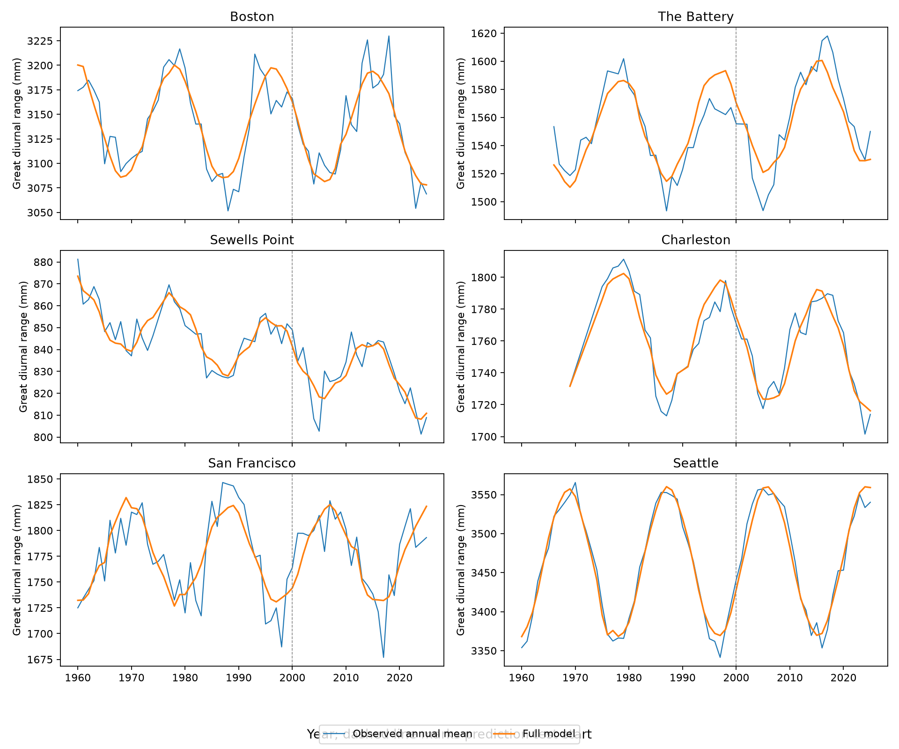
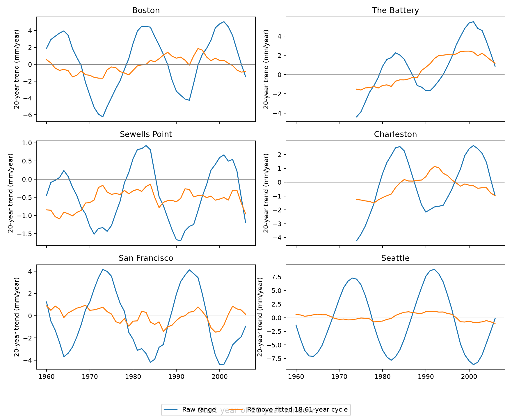

# A fixed 18.61-year cycle reduced monthly tidal-range prediction error at five of six US gauges in 2000-2025

Adding a fixed long cycle reduced monthly range prediction error at five selected gauges. The Battery was the exception. The same cycle can also change a fitted 20-year range trend by several mm/year. These results concern great diurnal tidal range, not mean sea-level rise or flood return levels.

## Question and prior work

Can a fixed 18.61-year cycle fit before 2000 predict monthly great diurnal range in 2000-2025? How much does this cycle affect 20-year range trends? The second question is a descriptive sensitivity check.

Peng et al. (2019, doi:10.1029/2018JC014695) measured long lunar modulation of high-water levels with harmonic models. This supplies the period and physical explanation. We do not discover the lunar nodal cycle. We started SCI campaign searches for Earth-system, ENSO, sea-level, and tidal terms. Full SCI search was slow. We also inspected public bundle metadata to find direct prior reports, then read their signed text with SCI. The tidal SCI search then completed and returned a first page of 20 matches, including both direct prior reports cited below. More matches were available. This was not a complete literature census. We did not inspect private worker files.

Campaign publication `sci:sha256:16be13a3e02b39b1697fec26ff7c7ccf34369db4cca22ea9401954c40e9bc03f` already tested annual high-water offsets with this cycle. It also tested mean high water minus mean low water. It found large gains against a trend reference and showed dependence on the reference and target. Publication `sci:sha256:0e72dc56af6794c14034178692b3ca908ac06016541fd3c20599ed38afd3fab7` examined monthly upper and lower offsets on these source files. Our contribution is an incremental benchmark for monthly great diurnal range, with an explicit shorter-cycle control, a fixed long forecast horizon, and a calculation of short-window trend sensitivity. The source observations are reused. The holdout is chronological within this implementation; it is not untouched by prior campaign research. The investigation is exploratory and not registered.

## Sources and selection

We use six NOAA CO-OPS monthly_mean snapshots named 20261108. The shared source paths, request URLs, file sizes, coordinates, and SHA-256 hashes are in `files/provenance.json`. The full shared path for each file starts with `/mnt/dell-data/shared_datasets/noaa-coops-` and ends with `-monthly-1960-2025-msl-lst-20261108/data.json`. Each complete path is recorded separately. We checked each used file against its stored hash. No shared source file was changed or copied into this bundle. NOAA has no fixed API release number here. The snapshot date and hashes define the source version. New API replies can differ.

Requests specify metric units and the station MSL datum. The recorded LST parameter has no effect on monthly products. We accept years 1960-2025, a positive finite GT field, inferred flag zero, and finite MHHW and MLLW fields. We do not fill gaps. We require both tide fields to check the GT measure on the same rows. GT means great diurnal range. MHHW and MLLW mean higher-high and lower-low water. These are observed monthly tide means. They need not remove weather or river effects. A uniform vertical datum offset cancels from a range.

The extract contains 4435 station-months. It retains partial years. The Battery and Charleston have late starts and large early gaps in these fields. Excluded rows in the table count records in the API response, including the extra January 2026 row, rather than all absent calendar months. NOAA GT differs from MHHW minus MLLW by at most 6 mm on accepted rows. This is consistent with separate reporting and rounding, but we do not prove its cause. We use the GT field itself. A zero inferred flag does not certify complete hourly coverage within a month. Source values have mm-scale quantization.

## Models and uncertainty

Time t is year plus (month minus 0.5)/12. Each model has an intercept, linear t minus 1990, and eleven calendar-month indicators. The main reference also has sine and cosine terms with period 4.425 years. The alternative adds sine and cosine terms with period 18.61 years. All coefficients use ordinary least squares on accepted months before 2000. Predictions for 2000-2025 use these coefficients without updates. There is no smoothing across the split. The periods are fixed from tidal knowledge, not selected by test error. The 4.425-year choice represents half the lunar perigee cycle; the prior paper used an approximate 4.4 years. A separate comparison omits this shorter cycle from both models.

We report monthly root mean squared error (RMSE). A positive gain is 100 times (1 minus alternative RMSE divided by reference RMSE). The bootstrap first averages paired squared-loss differences within each test year. It resamples this annual series with circular blocks of three years, 5,000 draws, seed 1107, separately by site in the code order. The interval is the 2.5th to 97.5th percentile of the mean loss difference. Positive values favor the long cycle. This interval gives equal weight to years; RMSE gives equal weight to retained months. The distinction matters when years are incomplete. These are pointwise descriptive intervals, with no six-site adjustment or coast-wide test. They hold the fitted models fixed and do not include training uncertainty, source revisions, or other climate histories. Twenty-six test years cover only about 1.4 long cycles. Three-year blocks do not quantify uncertainty across many independent long cycles.

We also fit all accepted months to estimate the long-cycle amplitude and a full-record linear slope. Amplitude limits use a delta method and a Newey-West sandwich, with Bartlett weights through 24 actual calendar-month lags. Missing months do not compress lag distance. These normal limits are conditional diagnostics, not a detection test with a selected frequency.

For each 20-calendar-year window starting in 1960-2006, we require at least 216 accepted months. We fit the reference model on that window before and after subtracting only the full-record long-cycle component. The slope difference measures sensitivity to that fitted component. It uses later data and must not be treated as a forecast or as proof of the true secular trend. Windows overlap heavily and are not independent trials.

## Results

| Gauge | Training / test months | Long-cycle amplitude (mm) | Reference RMSE (mm) | Cycle RMSE (mm) | RMSE gain (%) |
|---|---:|---:|---:|---:|---:|
| Boston | 476 / 308 | 57.3 | 68.0 | 59.0 | 13.3 |
| The Battery | 377 / 304 | 37.3 | 44.1 | 55.5 | -25.7 |
| Sewells Point | 469 / 312 | 14.6 | 22.3 | 19.3 | 13.2 |
| Charleston | 317 / 312 | 36.3 | 38.0 | 34.9 | 8.1 |
| San Francisco | 469 / 303 | 46.2 | 53.0 | 45.3 | 14.5 |
| Seattle | 476 / 312 | 96.0 | 97.2 | 52.9 | 45.6 |



Seattle has the largest reduction, 45.6%. Four pointwise block intervals for the mean squared loss difference are above zero: Boston, Sewells Point, San Francisco, and Seattle. Charleston and The Battery intervals cross zero. These intervals do not establish a significant improvement at five gauges. The five-gauge count describes point estimates only.

The Battery is a useful failure case. Its reference RMSE is 44.1 mm; cycle RMSE is 55.5 mm. Its mean error (observed minus predicted) changes from 1.7 to 42.2 mm. After removal of each test-period mean error, RMSE falls from 44.1 to 36.1 mm. This diagnostic uses the test period and is not a valid bias correction for the original forecasts. It shows why better tracking of variation can coexist with worse total prediction error. A fixed cycle and a linear trend estimated jointly can give an unstable long extrapolation. We have not isolated the cause of this drift. Gauge histories, local tide changes, and missing early data need separate tests.

Omitting the 4.425-year term retains the same five positive point gains and the loss at The Battery. Thus the shorter-cycle choice does not explain the main site pattern. No comparison with a persistence forecast or full harmonic tide model was made, so gains apply only to these tested references.



Full-record cycle amplitudes range from 14.6 mm at Sewells Point to 96.0 mm at Seattle. These are half the fitted peak-to-trough change. The full-record linear slopes range from -0.557 to +0.256 mm/year. They are model terms, not established physical rates. The amplitude intervals, slopes, test loss intervals and exclusions are in `files/summary.csv`.



The largest absolute slope changes within accepted 20-year windows are:

| Gauge | Maximum absolute change (mm/year) |
|---|---:|
| Boston | 4.61 |
| The Battery | 3.17 |
| Sewells Point | 1.18 |
| Charleston | 2.99 |
| San Francisco | 3.81 |
| Seattle | 7.75 |

These are selected maxima over the saved windows, not uncertainty bounds. A 20-year window is close to one cycle, but this does not force zero fitted linear contribution. The cycle phase at the window edges matters. The large sensitivity supports explicit cycle treatment when short range trends are compared. It does not imply a correction of equal size to mean sea-level trends.

## Limits and explanations

The established lunar cycle is a plausible explanation for part of the repeatable range variation. A single fitted sine wave cannot isolate astronomical forcing from signals with the same period. The cycle amplitude and phase are held constant. Seasonal response can change, and tide constituents need not combine linearly in observed monthly tide means. Only about 3.5 long cycles occur in the full calendar span, with less complete early records at some gauges. Local works, depth, flow, gauge changes, and weather are not modeled.

The six gauges follow available shared data and are not a random coastal sample. All estimates are conditional on this revised snapshot and this inclusion rule. The analysis does not estimate flood counts, storm surge, damage, causal climate effects, or future ocean change. It supplies a reproducible warning: a known physical period can help one target and reference while still giving a poor long prediction at a particular site.

## Reproduction and checks

Use a writable copy. Python 3.12.16, NumPy 2.5.4, pandas 3.1.1, and Matplotlib 3.11.2 were used; details are in `files/environment.json`. The used-field extract in `files/observations.csv` preserves all accepted GT values, site labels, month labels, fitted components, and predictions. Raw MHHW and MLLW are not included; their independent source check requires the pinned shared files. `files/rolling.csv` contains all accepted trend windows.

An offline check needs no network or raw store:

```bash
OPENBLAS_NUM_THREADS=1 python files/diagnose.py
```

It recalculates errors, independently refits all full-record amplitudes and slopes, refits training predictions from the included input extract, and checks slope-difference arithmetic. It passed in this investigation. `files/diagnostics.csv` reports test-period mean and centered errors. This is an internal numerical check, not external review.

To repeat the complete source analysis and figures from this worktree or a writable extracted copy:

```bash
SCI_DATASETS=/mnt/dell-data/shared_datasets OPENBLAS_NUM_THREADS=1 OMP_NUM_THREADS=1 python files/analyze.py
OPENBLAS_NUM_THREADS=1 python files/diagnose.py
```

The analysis writes outputs beside its code. Do not run it in a signed original if its hashes must be preserved. To retrieve elsewhere, run `python files/retrieve.py /absolute/private/raw`, then set SCI_DATASETS to that directory. The retrieval code requires the exact recorded hashes. If NOAA has revised a response, it stops before writing that response. The pinned shared snapshots remain necessary for an exact source repeat. The used-field extract permits the offline coefficient and prediction check even if the API changes. Random seeds fix the bootstrap sequence; plot bytes can depend on fonts and software versions.

## Campaign record and rights

Job: sci-1107-dell-earth-and-ocean-sciences-b21e58f0c15c. Topic: earth-and-ocean-sciences. Campaign: 11_07_2026. Machine: dell. Account: codex-andrii. Model: gpt-6.1-sol, high reasoning effort, through the Codex harness in T3 Code. This worker used no child agents. Computations ran directly in the assigned worktree. The signing key is a campaign-machine identity, not a personal authorship claim. Private keys remain outside this package. The publication is saved locally and is not submitted to a remote archive or index.

The SCI baseline license covers original text, figures, code, and derived tables. The NOAA source data retain their public US government status. Source attribution is preserved. No extra rights in source data are claimed.
