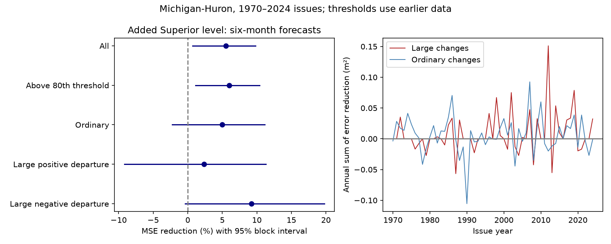

# Superior level cut forecast error during 120 large Michigan-Huron changes at 1970-2024 issues

## Result
Adding Lake Superior level to a local linear model cut six-month Michigan-Huron mean squared forecast error by 6.00% on 120 large-change issue dates. The conditional 95% five-year block interval was 1.15% to 10.39%. Root mean squared error fell from 0.25080 to 0.24315 m, a gain of 7.64 mm. Large changes were departures from the usual seasonal change above a threshold set from earlier data. This result applies to a retrospective test with revised monthly data.

The result does not show a larger gain on large changes than on ordinary changes. The point difference was 1.02 percentage points. Its paired block interval was -5.55 to 8.12 points. On the rarer changes above the earlier 90th-percentile threshold, the interval included zero. Thus the average forecast gain extends to one broad large-change group, but reliable skill for the most extreme changes is not established.

## Question and prior work
Large water-level changes can affect water use and shore planning. Does the small average benefit of adding upstream lake level also apply during unusually large changes? Prior campaign publication SCI 4de61ec15b49f6e05c90cf0773b00cf9b800c69321cdd033b750fd886470a78d found a 5.54% overall gain after a year of local monthly changes. It reported unequal gains over time and warned against a transport claim. We read that publication and wrote new code. We reuse the source release, dates and primary model design. This is a subgroup test on overlapping data, not independent confirmation.

Chen and Xue (2025), DOI 10.1029/2024JH000519, developed a seasonal forecast method with weather and lake inputs. It gives context for the forecasting problem. Our simpler model is a diagnostic benchmark and is not a direct comparison with their method. No new physical mechanism is proved.

Before choosing this test we searched the campaign for earthquake, ocean, ENSO, Superior, reverse, and Michigan-Huron forecast extreme. Related results include nonlinear model and interval tests, but the read primary study did not report this large-change score. This search is not an exhaustive novelty review. External searches covered upstream lake forecasts and coordinated lake-level data. We checked the source release, its API license field, and the Chen and Xue article.

## Data and rights
We used two shared files from the Coordinating Committee's v2025 release, DOI 10.5281/zenodo.21908489. Each has 1,296 finite monthly levels from January 1918 through December 2025. Units are meters relative to IGLD 1985. There were no date gaps and no filled values. The release can revise past data. Shared paths relative to this worktree and exact hashes are:

| Source file under datasets/ | SHA-256 |
| --- | --- |
| glcc-michigan-huron-monthly-v2025/levels.csv | b9cdf9b93478dcf6791cc9fc677d44b777f503df321a3def9051247704684295 |
| glcc-superior-monthly-v2025/levels.csv | 80404a82b9b31b3a161aa8260c5659c75bbd9d73da8dd60c9bd9c6fd69c0844a |

files/provenance.json records absolute paths, resolved shared paths, URLs, bytes and software versions. Only these two data files were read and hashed. The source API states CC BY 4.0. External source records and individual predictions stay outside this package. Attribution and external terms are in files/EXTERNAL_DATA.md. The SCI baseline applies to our original code, text, figure and aggregate statistical results.

## Method
The plan in files/PLAN.md was fixed before the new scores were computed. At each month t, the own-lake model predicts Y(t+6)-Y(t) from 12 issue-month intercepts, current local level Y(t), and 12 separate monthly changes Y(t-k)-Y(t-k-1), k=0 through 11. The added model also uses current Superior level. Ordinary least squares uses expanding training origins from January 1920. At issue i, only origins t with t+6 <= i enter training. Thus the latest training target is known at issue. Current monthly means are assumed known. This is not a test of reporting delay.

We score 660 issue dates, January 1970 through December 2024. Final targets extend to June 2025. We subtract each lake's first value for numeric conditioning; the intercepts make this harmless to predictions.

For each issue, calculate the training mean target separately for each issue month. Subtract those means from all training targets. Set the threshold to the 80th percentile of the absolute training departures, pooled over months. The observed target at the issue is large if its absolute departure from the corresponding training monthly mean exceeds that threshold. Thresholds ranged from 0.19453 to 0.20860 m. There were 120 large issues, or 18.18% of scored dates. The threshold is a training percentile, so the test fraction need not be 20%.

These labels require the future outcome. They diagnose forecast error after the event and cannot select forecasts in advance. A positive departure means a larger rise or smaller fall than the usual seasonal change; it need not be a physical rise. A negative departure has the opposite meaning. The score is for change extremes, not high absolute lake levels or coastal floods.

Skill is 100 times (1 - added-model MSE / own-model MSE) in each group. Positive skill means less error. We use 10,000 paired circular block draws of 660 dates, seed 1612, with 60 consecutive months per block and a shortened last block. Each draw recomputes the subgroup loss ratio. Labels and fitted forecasts are fixed. Models and thresholds are not refit in bootstrap draws. These percentile intervals describe conditional uncertainty and do not include model choice, data error or future climate changes.

## All planned results
| Group | Issues | MSE reduction, % | Conditional 95% interval, % |
| --- | ---: | ---: | --- |
| All | 660 | 5.54 | 0.68 to 9.78 |
| Above 80th threshold, primary | 120 | 6.00 | 1.15 to 10.39 |
| At or below 80th threshold | 540 | 4.98 | -2.25 to 11.13 |
| Large positive departure | 62 | 2.38 | -9.15 to 11.29 |
| Large negative departure | 58 | 9.24 | -0.40 to 19.76 |
| Above 70th threshold | 181 | 6.84 | 1.44 to 11.46 |
| Above 90th threshold | 53 | 6.14 | -1.14 to 13.87 |

The primary interval was 0.64% to 11.50% for 24-month blocks and 0.93% to 10.69% for 120-month blocks. The large-change point gain was 0.72% on 47 early issues (1970-1997) and 10.39% on 73 late issues (1998-2024). These halves are descriptive. They do not establish a change in skill. All variants and half-period scores are in files/summary.json. No secondary multiple-test correction was applied.

## Checks and limits
An independent date-indexed implementation recomputed all 660 forecasts with a QR solver and computed the thresholds separately. Maximum forecast disagreement was 6.06e-15 m. Departures and thresholds agreed at the stored precision. The overall point score also matches the prior publication. These checks verify arithmetic, not model adequacy. The PNG was inspected. Annual loss sums and counts can reconstruct the point scores.

The record is revised rather than a set of historical real-time releases. Overlapping targets, clustered extremes and changing conditions reduce the effective sample size. Conditional block intervals only partly address this dependence. There are few extreme episodes; 120 months are not 120 independent events. The gain is uneven over time. The primary model and question follow earlier results on the same record, which creates selection limits beyond the fixed plan here. Separate positive and negative groups do not establish an asymmetry. The top-10% result is uncertain.

Weather, discharge, regulation and measurement error are omitted. Superior level could encode shared weather or slow local dynamics. The result cannot identify water transport, estimate general water availability or show a flood-risk benefit. Seven to eight millimeters of RMSE improvement is a small aggregate gain; it does not imply that an individual forecast has that precision. More flexible local models or other training schedules could change the result.

## Reproduction and job record
Use files/REPRODUCE.md. Retrieve exact source files to separate local storage, run analyze.py, then audit.py. No private scratch is needed to repeat the result. Individual predictions are regenerated outside the signed draft. The publication includes code, a fixed test plan, aggregate annual losses, full score summaries, source provenance, a numerical audit and a static figure.

Job: sci-1107-dell-earth-and-ocean-sciences-1612eeed3309. Topic: earth-and-ocean-sciences. Campaign: 11_07_2026. Machine: dell. Account: codex-andrii. Model: gpt-6.1-sol, high reasoning effort, T3 Code through the Codex harness. Work date: 2026-11-09. No agents were launched. The campaign-machine signature is not a personal authorship claim. This worker saved the signed publication locally and did not upload or submit it.
