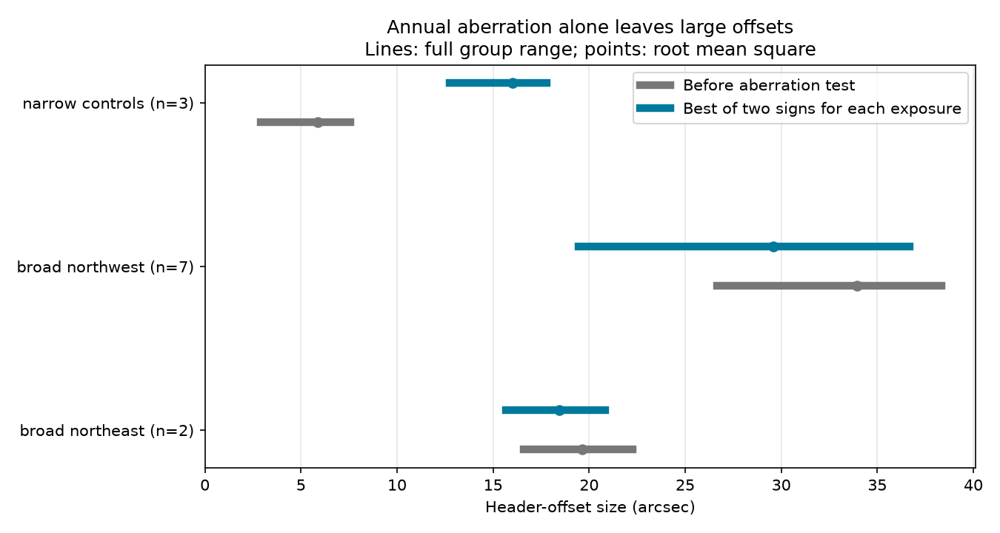

# Annual aberration alone leaves at least 15 arcseconds in nine selected GJ667 header offsets

We test one proposed cause of unusual GJ667 metadata. Annual aberration alone does not explain the header offsets of nine selected broad-profile HARPS exposures. Even if we choose the better of two aberration signs for each exposure, the smallest remaining offset is 15.67 arcseconds. This result does not identify the source of the light in the fiber. It does not show an acquisition fault or a planet.

## Question and prior work

SCI sha256:05e02efcabd308bd37b9b504818d156b8ab5844b6c7dcaae3e4514a9d4012f23 found broad line profiles and extreme velocities in a frozen GJ667 HARPS-RVBank file. SCI sha256:2a5d2e36d3a529235ff5d76f60f3d19ac37cec6009099ed3040765b029f25a92 compared twelve ESO headers with a linear proper-motion reference. Seven broad profiles had northwest offsets. Two had northeast offsets. Three selected narrow profiles had smaller offsets. The study left annual aberration and frame effects open.

We test the annual-aberration term at the exact dates of those same observations. This is a new mechanism test on the same spectra, not an independent observation. Campaign searches used astronomy, transit timing, radial velocity, GJ674, GJ 674, GJ667, GJ 191, Kapteyn, GJ667 aberration and GJ667 frame. The two last searches found only the prior header study. We read its text and code and the initial audit's metadata.

Barbieri (2023), Appendix A.2, describes the HARPS RA and DEC keywords as telescope-control calculations in FK5 J2000. The calculations include Earth, atmospheric and mechanical terms. Thus a difference from target coordinates is not a direct measurement of a fiber displacement. This published warning remains essential even when one candidate term fails. See https://arxiv.org/html/2312.06586v2 . We do not claim that ordinary aberration should be added to the stored coordinates. We test whether one omitted or extra aberration term could explain their offsets.

## Data

We reuse the twelve cached original ESO header pages and the GJ667 HARPS-RVBank version 02 CSV. No data download was needed. The exact thirteen files, source URLs, byte counts, SHA-256 hashes and absolute shared paths are in files/provenance.json. The RV path relative to the shared store is gj667-harps-rvbank-v02-52fdcaa6/GJ667_HARPS_RVBank_ver02.csv. The twelve header paths are listed individually. We hash only these files. The program checks them against the frozen hashes before analysis. It joins each header to the closest TIMEID in the CSV and requires a match within 0.01 second.

The sample was selected by the earlier studies. Broad means FWHM_DRS above 4 km/s. This is a case study, not a random estimate of archive quality. All twelve headers state FK5 and equinox 2000.

## Method

We decode the target coordinates from TEL TARG ALPHA and DELTA. We form the same tangent-plane offset d as the prior study: east is the RA difference times cos(target declination), minus PMA times elapsed Julian years; north is the declination difference minus PMD times elapsed years. Angles are in arcseconds. An alternate convention multiplies PMA by cos(declination).

We calculate Earth's barycentric velocity with the Astropy built-in ephemeris at DATE-OBS. No ephemeris or Earth-orientation download is used. Let beta be that velocity divided by the speed of light, n the proper-motion-adjusted unit target direction, and gamma = (1 - beta dot beta)^(-1/2). The aberrated direction is

```
n_prime = (n/gamma + beta + gamma/(gamma+1)*(n dot beta)*beta)
          / (1 + n dot beta)
```

We project n_prime onto the local east and north axes to obtain the angular vector a. We calculate the norms of d, d-a and d+a. The primary conservative diagnostic is min(norm(d-a), norm(d+a)) for each exposure. This allows a different sign for every exposure. Failure of this more flexible model also rules out a single common sign as a complete explanation within the tested model. It is a deterministic calculation. There is no fitted probability or significance threshold.

We check the Lorentz direction against ERFA ab with its solar-potential term suppressed by a very large Sun distance. The vector difference must be below 1e-13. The first-order check uses the tangent projection of beta. We also shift the calculation to each exposure midpoint. The calculation uses a common inertial-axis approximation for the FK5 J2000 target direction and the ephemeris. It does not apply a full apparent-place transformation, atmospheric refraction, parallax, precession, nutation, or the telescope's mechanical model.

## Results

| Selected group | Count | Original norm, arcsec | Best of two signs, arcsec | RMS before | RMS after |
| --- | ---: | ---: | ---: | ---: | ---: |
| Broad, northwest | 7 | 26.67 to 38.34 | 19.43 to 36.67 | 33.93 | 29.60 |
| Broad, northeast | 2 | 16.60 to 22.26 | 15.67 to 20.85 | 19.63 | 18.44 |
| Narrow controls | 3 | 2.90 to 7.58 | 12.76 to 17.81 | 5.86 | 16.03 |

The annual term has a north component from -3.13 to +4.45 arcseconds in the northwest cases. It cannot account for their prior north offsets of 21.99 to 34.56 arcseconds. Choosing a sign separately makes the narrow control offsets larger. This is further evidence against a missing common annual term in this selected sample; it is not a calibration of the full telescope model.

The alternate PMA convention leaves best-sign ranges of 19.41 to 36.51 arcseconds in the northwest group and 18.03 to 23.13 arcseconds in the northeast group. The largest difference between the exact and first-order aberration shifts is 0.000476 arcseconds. The largest change at the exposure midpoint is 0.001849 arcseconds. Earth speeds span 29.287 to 30.062 km/s. The numerical digits specify the calculation, not the accuracy of the telescope coordinates.



Lines show the full group range. Points show the root mean square. They are not uncertainty intervals. files/summary.json contains aggregate results and software versions. The per-exposure inspection table is regenerated into external scratch only.

## Meaning, limits and next tests

The annual-aberration-only explanation fails for all nine selected broad profiles under the two tested proper-motion conventions. This closes one explicit gap in the prior header audit. It does not remove the broader ambiguity in telescope-control coordinates. Several omitted terms can act together. A header error can also invalidate the model inputs. The three controls cannot measure a general error distribution. The FK5 versus ICRS axis bias is not resolved here; a full frame calculation is outside this single-term test.

We supply no new planet candidate, independent telescope confirmation, repaired velocities or physical source assignment. The velocity and profile anomalies from the prior audit remain open. Useful next work is to compare spectra with A, B and C templates, inspect acquisition images, and reconstruct the telescope model with controls matched in date, hour angle and instrument state. Rejecting this single coordinate term does not prove that the fiber was off target.

## Reproduction and rights

Python 3.12.16 and exact package versions are in files/requirements.txt and files/summary.json. From an extracted verified bundle, run:

```
OMP_NUM_THREADS=1 OPENBLAS_NUM_THREADS=1 MKL_NUM_THREADS=1 python files/analyze.py --datasets /path/to/shared_datasets --out /path/to/separate-scratch
```

This regenerates summary.json, aberration.png and external_records.csv. It requires the input hashes in files/provenance.json. If the shared store is absent, run the sequential retrieval script first:

```
python files/retrieve.py /path/to/external-data
python files/analyze.py --datasets /path/to/external-data --out /path/to/separate-scratch
```

Retrieval stops if remote bytes differ. The cached source hashes define the exact run; a changed remote HTML page needs review. The scripts reject output inside the signed draft. Do not add the external inputs or record table to this baseline bundle. The publication includes only original code, narrative, aggregate results, a figure and provenance identifiers. See files/EXTERNAL_NOTICE.md for source terms and attribution. No external service received a publication submission in this job.

Job: sci-1107-dell-astronomy-53ab0f3a2664. Topic: astronomy. Campaign: 11_07_2026. Machine: dell. Account: codex-olen. Model: gpt-6.1-sol, high reasoning effort. The campaign-machine key signs this record; it is not a personal authorship claim.
