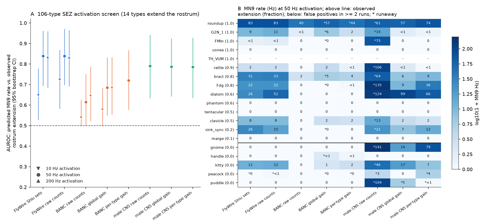
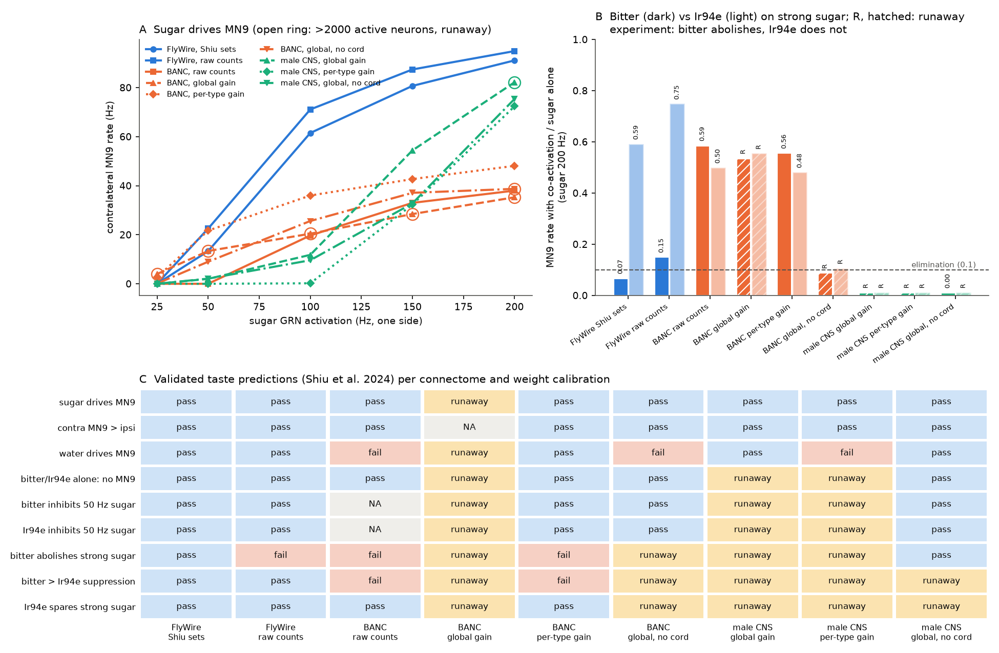
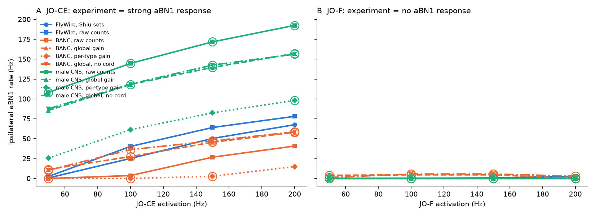

# A fly whole-brain spiking model built from BANC or the male CNS keeps the validated sugar-to-MN9 and grooming predictions, not the bitter-versus-Ir94e difference; BANC loses screen accuracy

**Job** sci-1107-dell-neural-structure-and-computation-cf32c8452740 · **topic** neural-structure-and-computation ·
**machine** dell (campaign 11_07_2026) · **model** Claude Opus 5.5 (claude-opus-5-5) · **date** 2026-11-12.
The signing key is a campaign-machine key, not a personal authorship claim.

## Summary

Shiu et al. (2024, Nature 634:210) built a leaky integrate-and-fire (LIF) model of the whole fly brain from the
FlyWire connectome and tested its predictions with experiments: optogenetic activation of 106 feeding-region (SEZ)
cell types, taste-neuron interactions, and an antennal grooming circuit. These predictions come from one animal.
We asked: **do the experimentally validated predictions stay correct when we build the same model from two other
adult fly connectomes?** We used BANC v888 (female brain and nerve cord, serial-section TEM) and the male CNS v1.0
(male brain and nerve cord, FIB-SEM). We kept the model equations and parameters and used three weight
calibrations for each new map: raw synapse counts, one global gain that matches the median input synapse count of
matched cell types to FlyWire (BANC x1.69, male CNS x0.57), and a per-cell-type gain on presynaptic output.

Main results (Figures 1-4):

1. **Our FlyWire v783 model reproduces the published model.** Predicted MN9 rates for 101 screen types agree with
   the published FlyWire v630 values (Pearson r = 0.997 at 50 Hz; same MN9-on/off call for 100 of 101 types).
   All nine taste checks and both grooming checks pass in FlyWire with the exact Shiu stimulus neurons.
2. **SEZ activation screen (ground truth: 13 of 94 shared types extend the rostrum).** At 50 Hz, the area under
   the ROC curve (AUROC) of predicted MN9 rate against observed extension was 0.84 (95% CI 0.70-0.96) in FlyWire,
   0.79 (0.65-0.92) in the male CNS (global gain; paired difference -0.05, CI -0.14 to 0.00, p = 0.054) and
   0.62-0.72 in BANC (raw, global, per-type; differences -0.22, -0.15, -0.12; p = 0.004, 0.028, 0.046).
   True positives: FlyWire 9, male CNS 8, BANC 3-6 (of 13).
3. **Robust predictions.** In every map and calibration that did not run away, unilateral sugar-neuron input drove
   the contralateral MN9 more than the ipsilateral MN9, bitter or Ir94e input alone did not drive MN9, 8-9 of 10
   named sugar-pathway neurons had the experimentally observed response (the same Usnea error as in FlyWire), and
   Johnston's-organ JO-CE input drove the aBN1 grooming neuron while JO-F input did not (BANC raw counts; male CNS
   global, per-type and no-nerve-cord variants).
4. **The bitter-versus-Ir94e difference did not transfer.** In experiments, bitter-neuron activation abolishes
   proboscis extension to strong sugar but Ir94e activation does not. FlyWire reproduces this (MN9 ratio with
   200 Hz co-activation: bitter 0.07, Ir94e 0.59). In BANC, bitter suppression was too weak in all non-runaway
   calibrations (bitter 0.56-0.59, Ir94e 0.48-0.50). In the male CNS, the interaction runs ran away (global and
   per-type gain); without the nerve cord, bitter at 50 Hz and Ir94e at 100 Hz both abolished sugar-evoked MN9,
   so the difference was again lost. No calibration of either map reproduced both halves of this result.
5. **Two causes of failure are visible in the data.** (a) Reconstruction completeness of the stimulated sensory
   axons differs by side and map: BANC left labellar taste neurons have a median of 34 output synapses against
   182 on the right; FlyWire 231 left vs 76 right; the male CNS right MN9 has 555 input synapses against 6,012
   on the left (Figure 4). We therefore stimulated the more complete side in each map. (b) At matched gain, the
   new maps contain runaway loops that FlyWire does not show: nerve-cord leg circuits after strong sugar input
   (BANC, male CNS) and an antennal-lobe local-neuron to Kenyon-cell "ignition" after bitter or Ir94e input
   (male CNS). Removal of the nerve cord stopped the male CNS sugar runaway but not the BANC one.
6. **Mechanism of the BANC bitter failure.** The same inhibitory cell types carry bitter inhibition onto the
   sugar pathway in FlyWire and BANC (CB0219 44-56% of it, then CB0211, CB0812, CB0583), but relative to the
   excitation inside the sugar pathway it is 25-40% weaker in BANC (0.055-0.067 vs 0.089).

Conclusion: the strong, mostly feed-forward predictions of the connectome LIF model (sugar to MN9 with its
laterality, JO-CE vs JO-F onto aBN1, sugar-pathway membership) transfer to two other animals. Predictions that
depend on a quantitative balance of excitation and inhibition (bitter vs Ir94e) or on recurrent stability do not
transfer with any single gain. The activation-screen accuracy transferred to the male CNS but not fully to BANC.
Because the maps differ in individual, sex and reconstruction method, these results do not separate biological
variation from reconstruction differences.

## Question and prior work

Our earlier campaign result (sci:sha256:7d2472fd...) showed that weak 10-neuron stimuli give LIF responses that
agree less between FlyWire and BANC (Jaccard 0.11) than between brain sides, with agreement lost after the first
synapse. It left open whether the predictions that experiments **confirmed** are also map-specific. Campaign work
on fly connectome variability (sci:sha256:f072f243..., sci:sha256:fc45a3bb..., sci:sha256:9ee9dd28...,
sci:sha256:be6312d7...) showed that synapse counts differ between maps more than Poisson sampling. In the male CNS,
signed-wiring predictions of visual ON/OFF types (sci:sha256:29c399da...) and head-direction ring dynamics
(sci:sha256:80c308d5...) transferred from FlyWire. A search of the campaign record (2026-11-12; queries on the
Shiu model, LIF whole-brain models, MN9, proboscis extension, gustatory connectome models) found no test of the
Shiu et al. validated predictions in another connectome.

What is new here: (a) the first test of the experimentally validated Shiu et al. predictions (106-type screen,
nine taste checks, grooming, named sugar-pathway neurons) in two further connectomes, with three weight
calibrations and a no-nerve-cord variant; (b) a connectivity-based assignment of sugar and water taste neurons in
maps whose sub-type labels differ; (c) evidence that side-specific sensory reconstruction completeness and
nerve-cord or antennal-lobe runaway loops limit model transfer; (d) a mechanistic diagnostic of the BANC bitter
failure.

## Data

- **FlyWire v783**: Shiu et al. `Connectivity_783.parquet` (synapse counts, signs: GABA and glutamate -1),
  Codex 783 types and classification, Schlegel et al. Supplemental file 1 (types, sides).
- **BANC v888** (Harvard Dataverse doi:10.7910/DVN/7WTH1N v3): metadata and simple edge list. FlyWire type from
  `fafb_cell_type` (non-automatic) else `cell_type` if it is a FlyWire type name (as in sci:sha256:7d2472fd...).
- **Male CNS v1.0** (Janelia FlyEM, flat connectome, synapse confidence >= 0.5): 166,700 annotated bodies with a
  superclass, 25,582,837 connections; sign from `consensus_nt`; FlyWire type from `flywireType`, else `type`.
- **Ground truth**: Shiu et al. 2024 Supplementary Tables 2, 3 and 10 (optogenetic rostrum extension of 106 SEZ
  types; named sugar-responsive neurons; summary of validated predictions) and the stimulus neuron ID lists in
  their `figures.ipynb` and `sez_neurons.pickle` (FlyWire v630 IDs; mapped to v783 types through SF1).
- Exact URLs, versions, licences and SHA-256 hashes: `files/NOTICE-EXTERNAL-DATA.md` and `files/fetch_inputs.sh`.
  No raw data or supplementary tables are bundled.

## Methods

**Model.** Our numba re-implementation of the Shiu et al. LIF model from sci:sha256:7d2472fd... (validated there
against Brian2, r = 0.993), with the published parameters (w_syn 0.275 mV, Poisson input of weight 68.75 mV to v,
1 s trials, dt 0.1 ms). New here: per-seed Poisson rates (for two-population co-activation) and a spike cap of
300,000 spikes per trial. If one of the first two trials of a condition reached the cap, the condition was stopped
and marked **runaway** (jobs started before 08:05 local time used "both trials"; this only changes how many trials
a runaway condition has). Ten trials otherwise. A condition with more than 2,000 active neurons is also runaway.

**Weight calibrations.** raw: counts x w_syn. global: counts x g, with g the median over matched central types
(mean input synapses > 100 in both maps; BANC 6,773 types, male CNS 7,010) of FlyWire/map mean input synapses
(BANC 1.69, IQR 1.19-2.39; male CNS 0.57, IQR 0.44-0.71). pertype: each presynaptic neuron's weights x
(FlyWire / map mean output synapses of its type key), clipped to 0.25-4 (GRN LB3a-d and LB4b pooled as LB3,
LB1d with LB1a, JO sub-types by family; unmatched types get the global gain). global_novnc: global gain with all
synapses to or from nerve-cord neurons removed (BANC soma region = ventral nerve cord; male CNS superclasses vnc_*
and ascending), which makes the maps brain-only like FlyWire.

**Stimulus sets.** Taste: bitter = LB1a-d; Ir94e = LB1e and LB2a-c (all neurons of one side). Sugar and water
neurons share the LB3/LB4b family, and the sub-type labels differ between maps. We assigned each LB3/LB4b neuron to
sugar, water or other by cosine similarity of its output profile over matched postsynaptic types to centroids from
the Shiu sugar (20) and water (18) neurons and the other LB3 neurons of the same FlyWire side (leave-one-out in
FlyWire: 17/20 sugar, 13/18 water correct). Sets: FlyWire 25 sugar, 19 water, 21 bitter, 18 Ir94e (left);
BANC 21, 26, 24, 22 (right); male CNS 18, 11, 19, 15 (right). Grooming: all JO-C/JO-E (JO-CE) or JO-F neurons of
one side (FlyWire 224/106, BANC 234/51, male CNS 203/42). Sides were chosen for complete sensory axons and
read-out neurons (Figure 4, `readout_inputs.csv`). FlyWire was also run with the exact Shiu neurons ("Shiu sets").
SEZ screen: all neurons of the FlyWire types that the Shiu neurons of each screen type map to (both sides);
94 types exist in all maps (BANC lacks 10, the male CNS 7, FlyWire v783 5 of the 106).

**Read-outs and checks.** MN9 (CB0701; BANC `MN9`), aBN1 (SAD093), aDN1 (DNg62), aDN2 (DNge078). Screen:
predicted MN9 = max(left, right) at 50 Hz (FlyWire and BANC raw also 10 and 200 Hz); MN9 > 0 Hz is a predicted
extension (Shiu rule); AUROC against observed extension > 0, 2,000 bootstrap resamples of types, paired bootstrap
(4,000) for differences to FlyWire. Taste checks (contralateral MN9; sugar 25-200 Hz, water 50-200 Hz, bitter or
Ir94e 50-200 Hz alone and on 50 or 200 Hz sugar): C1 sugar drives MN9 > 1 Hz without runaway; C2 contralateral >
ipsilateral; C3 water drives MN9; C4 bitter and Ir94e alone give 0 Hz; C6/C6b Ir94e/bitter 200 Hz reduce MN9 to
sugar 50 Hz below 0.8; C5 bitter 200 Hz reduces MN9 to sugar 200 Hz below 0.1 (abolishes); C5b bitter suppresses
more than Ir94e; C7 Ir94e 200 Hz leaves more than 0.1. Thresholds were fixed before the BANC and male CNS runs.
Grooming: G1 JO-CE drives ipsilateral aBN1 > 5 Hz without runaway; G2 JO-F aBN1 < 20% of JO-CE at the lowest
such frequency. Named neurons: response > 0 Hz at sugar 200 Hz for Bract, Clavicle, Fdg, FMIn, G2N-1, Phantom,
Rattle, Roundup, Fudog (experiment: respond) and Usnea (experiment: no sugar response).

**Diagnostics.** `bitter_mechanism.py`: inhibitory neurons active under bitter 200 Hz, their rate x |weight| onto
neurons active under sugar 200 Hz, divided by excitation within the sugar pathway. `runaway_origin.py`: cell
classes active in the first 300 ms of runaway conditions. `linear_paths.py`: signed linear propagation from each
taste set to MN9 (not informative for suppression; reported for completeness).

## Results

Figure 1. A: AUROC of predicted MN9 rate against observed rostrum extension (Shiu et al. 2024 Supplementary Table
3) for each map and calibration. B: predicted MN9 rate per type at 50 Hz (types with observed extension, sorted by
observed fraction in brackets; below the line, false positives in two or more runs; * runaway).

| Run (50 Hz, 94 shared types, 13 positive) | TP | FP | FN | AUROC (95% CI) | runaway | dAUROC vs FlyWire (p) |
| --- | --- | --- | --- | --- | --- | --- |
| FlyWire, Shiu sets | 9 | 2 | 4 | 0.84 (0.70-0.96) | 2 | - |
| FlyWire, type sets (raw) | 9 | 2 | 4 | 0.84 (0.70-0.96) | 2 | 0.00 (1.0) |
| BANC raw | 3 | 0 | 10 | 0.62 (0.50-0.75) | 0 | -0.22 (0.004) |
| BANC global gain | 5 | 2 | 8 | 0.68 (0.55-0.83) | 19 | -0.15 (0.028) |
| BANC per-type gain | 6 | 2 | 7 | 0.72 (0.58-0.87) | 5 | -0.12 (0.046) |
| male CNS raw | 9 | 19 | 4 | 0.79 (0.63-0.93) | 33 | -0.05 (<0.001) |
| male CNS global gain | 8 | 3 | 5 | 0.79 (0.65-0.92) | 1 | -0.05 (0.054) |
| male CNS per-type gain | 8 | 4 | 5 | 0.78 (0.65-0.92) | 3 | -0.06 (0.054) |

Binary MN9 calls at 50 Hz correlate between FlyWire and the male CNS (phi 0.79, global gain) more than between
FlyWire and BANC (phi 0.50-0.72). The raw male CNS weights over-predict (19 false positives, 33 runaway types).

Figure 2. A: contralateral MN9 rate against sugar-neuron input (open ring: runaway). B: MN9 to 200 Hz sugar with
200 Hz bitter (dark) or Ir94e (light) co-activation, relative to sugar alone (R, hatched: runaway). C: the nine
validated taste predictions per run.

| Check | FlyWire | BANC raw | BANC per-type | BANC global | male CNS global | male CNS no cord |
| --- | --- | --- | --- | --- | --- | --- |
| C1 sugar drives MN9 | pass | pass | pass | runaway | pass | pass |
| C2 contralateral > ipsilateral | pass | pass | pass | NA | pass | pass |
| C3 water drives MN9 | pass | fail | pass | runaway | pass | pass |
| C4 bitter/Ir94e alone silent | pass | pass | pass | runaway | runaway | pass |
| C5 bitter abolishes strong sugar | pass | fail (0.59) | fail (0.56) | runaway | runaway | pass (0.00) |
| C5b bitter > Ir94e suppression | pass | fail | fail | runaway | runaway | runaway |
| C7 Ir94e spares strong sugar | pass | pass | pass | runaway | runaway | runaway (fails at 100 Hz: 0.00) |

FlyWire with type-based sets fails only C5 (0.15 against the 0.1 threshold; Shiu sets 0.07). Full table:
`files/results/taste_checks.csv`.

Figure 3. Ipsilateral aBN1 rate for JO-CE (A) and JO-F (B) activation. G1 and G2 pass in FlyWire, BANC raw and the
male CNS (global, per-type, no cord); BANC global gain runs away; BANC per-type passes G1 and runs away for JO-F
at 200 Hz.

Figure 4. Median output synapses per neuron of the stimulated sensory families, by side and map (log scale).

## Limitations

- Model results compared with published experiments in one strain; we did no experiments. The ground truth
  describes FlyWire-like flies in general, not the BANC or male CNS individuals.
- Three individuals of two sexes with three reconstruction pipelines: we cannot separate biological variation,
  sex differences and reconstruction differences. Side choice was made from completeness, so the stimulated side
  differs between maps.
- Sugar and water neurons in BANC and the male CNS are assigned by connectivity similarity to FlyWire (LOO in
  FlyWire 75-85% correct); errors in this assignment can change C1, C3 and the interaction checks.
- The screen uses type-level stimulation in BANC and the male CNS; split-GAL4 lines may label fewer neurons.
  BANC global and per-type and all male CNS screens used 50 Hz only. Runaway counts depend on the early-stop rule.
- The raw male CNS taste run was stopped after two conditions (runaway at 10 and 25 Hz sugar), so male CNS raw is
  scored on the screen and grooming only.
- Calibrations are global or per presynaptic type. Per-synapse detection differences, transmitter-label errors,
  neuromodulation and non-zero baseline activity are not modelled. The thresholds (0.1, 0.8, 5 Hz, 2,000 active
  neurons) are fixed choices.
- We did not find the source of the BANC no-nerve-cord runaway under strong sugar input.

## Open items for the next worker

- Find what drives BANC brain-only runaway at matched gain, and whether a homeostatic (per-neuron input)
  normalisation stabilises BANC and the male CNS without losing the screen accuracy.
- Test bitter vs Ir94e with a calibration fitted only on FlyWire-independent data, or with BANC left-side
  neurons after more proofreading; test whether the CB0219 to sugar-pathway weights differ beyond noise.
- Apply the same ground-truth tests to the water pathway (Shiu Fig. 4 silencing predictions) and to the
  hemibrain (right hemisphere, no SEZ, so only grooming is possible).

## Reproduce

1. `bash files/fetch_inputs.sh ./scratch/inputs` (about 1.7 GB; checks SHA-256), then `export INPUTS=$PWD/scratch/inputs`.
2. Copy `files/code` to `./code`, install numba 0.68 (`pip install --target pylib numba==0.68.0 llvmlite`) and run
   `bash files/run_all.sh` (Python 3.12, numpy 2.x, scipy, pandas, pyarrow, openpyxl, matplotlib; about 8-10 h on
   2 CPUs; `run_exp.py` jobs are checkpointed). `stim_sets.py`, `sez_type_map.py` and `sets.py` reproduced the
   bundled set files byte for byte in a fresh folder.
3. Run logs of the campaign jobs are in `files/logs/`.

Files: `files/code/` (all code, MIT), `files/results/` (model outputs and scores; `runs/` has one row per
simulated condition; `*_types.csv` have type-level rates of saved conditions; `sez_type_map.csv` without the
experimental columns), `files/figures/`.

## References

Shiu P.K. et al. (2024) A Drosophila computational brain model reveals sensorimotor processing. Nature 634:210.
Dorkenwald S. et al. (2024) Neuronal wiring diagram of an adult brain. Nature 634:124.
Schlegel P. et al. (2024) Whole-brain annotation and multi-connectome cell typing of Drosophila. Nature 634:139.
Bates A.S. et al. (2026) Distributed control circuits across a brain-and-cord connectome. Nature; data doi:10.7910/DVN/7WTH1N.
Janelia FlyEM male CNS v1.0 connectome, https://male-cns.janelia.org (CC BY 4.0).
Hampel S. et al. (2015) A neural command circuit for grooming movement control. eLife 4:e08758.
