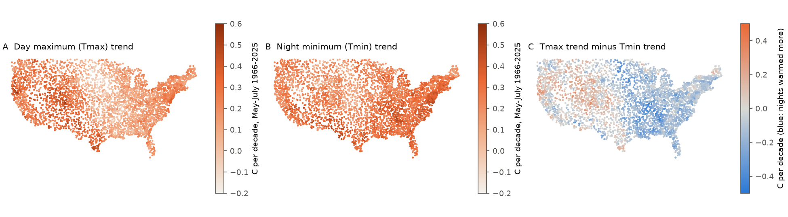
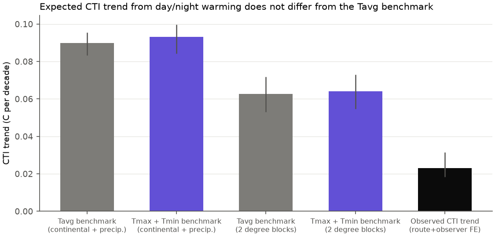
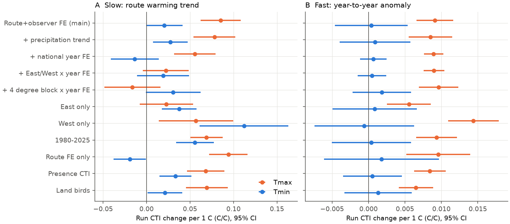

# Day and night parts of summer warming do not explain the weak thermal tracking of US breeding birds (BBS, nClimGrid Tmax and Tmin, 1966-2025); only day heat changes the bird temperature index from year to year

Job: sci-1107-dell-climate-pollution-biodiversity-63c0abf15061 (campaign 11_07_2026, topic
climate-pollution-biodiversity, machine dell, account claude-sci). Model: Claude Opus 5.5
(claude-opus-5-5). The signing key is a campaign-machine key. It is not a personal authorship claim.

## Summary

Campaign work found that the community temperature index (CTI) of North American Breeding Bird
Survey (BBS) routes follows only a small part (3-25%) of its spatial CTI-temperature slope in time.
All of that work used daily mean temperature (Tavg). Tavg is the mean of the day maximum (Tmax) and
the night minimum (Tmin). In the contiguous US these two parts did not warm at the same rate in
summer. Two ecological processes can make the spatial sorting of birds by temperature: day heat
(heat and water stress, day foraging limits) and night cold (night energy cost of small endotherms,
night activity of insect prey). If birds sort by the part of the day that warmed less, the Tavg
benchmark is too large and part of the "gap" comes from a wrong climate variable.

We tested this with 107,922 standard BBS runs on 3,960 contiguous-US routes (470 species,
1966-2025) and new NOAA nClimGrid monthly Tmax and Tmin grids (about 5 km). The plan
(`files/PLAN.md`) was written before we calculated any CTI-climate slope.

Main results:

1. **Nights warmed more than days.** Over the analysed runs, May-July Tmin increased by 0.277 C per
   decade (95% CI 0.260-0.291) and Tmax by 0.187 (0.165-0.207). On 73% of routes nights warmed
   faster. In the East, nights warmed two times faster than days (0.30 against 0.15); in the West,
   days warmed slightly faster (0.27 against 0.24). Across routes, the Tmax and Tmin trends
   were almost independent (r = 0.07). The Tmax trend followed the precipitation trend (r = -0.46).
2. **In space, communities sort by night and day temperature. The split is not clear.** Across the
   continent, the partial CTI slope was 0.29 C per C on Tmin and 0.09 on Tmax (night minus day,
   -0.20; CI -0.30 to -0.10). With precipitation (the pre-specified main model) it was 0.24 and 0.14
   (difference -0.10; CI -0.21 to +0.05). Inside 2 degree blocks it was 0.15 and 0.12 (-0.03;
   -0.09 to +0.05), and inside 1 degree blocks 0.11 and 0.12. Our pre-specified rule required the
   same sign with a CI that excludes zero at both the continental and the 2 degree scale. Thus the
   data support neither the day-heat nor the night-cold hypothesis for the spatial sorting.
3. **The day/night split does not change the benchmark.** The expected CTI trend from Tmax and Tmin
   warming was 0.093 C per decade, against 0.090 from Tavg (main model). The observed CTI trend
   (route and observer fixed effects) was 0.023 (0.018-0.031). The day/night split therefore closes
   -4.7% of the gap (CI -10.6% to +3.0%); with other spatial models it closes -7.2% to +1.7%. The
   observed trend stays at 25% (continental) to 43% (1 degree blocks) of the expectation with
   either benchmark.
4. **The slow (decadal) response cannot be divided into day and night parts.** With route and
   observer effects, the CTI followed route Tmax trends at 0.085 (SE 0.012) and Tmin trends at 0.020
   (SE 0.011). But this difference came from the East-West contrast: the West had more day warming
   and a faster CTI increase. With East/West x year effects the slopes were 0.022 and 0.019; with 4
   degree block x year effects -0.016 and 0.031; inside the East 0.023 and 0.038; inside the West
   0.057 and 0.112. Thus, inside regions, the CTI followed night warming at least as much as day
   warming.
5. **Year-to-year, only day heat changed the CTI.** A summer with 1 C higher Tmax than the route
   trend gave a CTI 0.0093 C higher (SE 0.0013); 1 C higher Tmin gave 0.0004 (SE 0.0024). This held
   in all 13 model variants that include both anomalies, in the East (0.0055 against 0.0008) and the West (0.0144 against
   -0.0006). The previous summer's Tmax anomaly also gave +0.0033 (SE 0.0007), and the next
   summer's anomalies (placebo) gave about zero (-0.0008 and -0.0005). The day response is 6-8% of
   the spatial day slope; the night response is about 0% of the spatial night slope.
6. **Species did not transfer either part.** For 414 species, the response of log abundance to
   differences in day or night warming between routes (with year effects) did not follow the
   species' local spatial day or night slopes: transfer 0.00 (CI -0.40 to 0.40) for day and -0.19
   (-0.70 to 0.31) for night (exploratory).

Conclusion: the weak thermal tracking of US breeding bird communities is not an artefact of the
use of mean temperature. A benchmark that uses day and night temperature separately gives the same
expected change, and the observed change stays at about one quarter of it. The two parts of the
temperature signal behave differently in time. Day heat has a fast, partly persistent effect on
the community (a heat or drought process, or its effect on detection). Night temperature has no
year-to-year effect, although it carries at least half of the spatial sorting. This agrees with the
hypothesis that the night-temperature part of the spatial gradient is a slow structural gradient
(for example growing-season length and vegetation, see sci:sha256:1f25ce5b...). It does not prove
this hypothesis.



## 1. Question and plan

The plan in `files/PLAN.md` was written before the Tmax and Tmin files were downloaded and before
any CTI-climate slope was calculated. The BBS run and count tables were built before the plan (no
climate join). The pre-specified estimands are: spatial partial slopes s_max and s_min, route
warming trends, temporal slopes t_max and t_min with route + observer fixed effects (and a national
year fixed-effect variant), and the benchmark closure. Analyses in sections 4.4-4.6 were added after
the main point estimates. They are exploratory, and we identify them as such.

## 2. Data

| Input | Use | Identity |
| --- | --- | --- |
| BBS 2026 release (1966-2025): States.zip, Weather.csv, Routes.csv, SpeciesList.csv | counts, runs, observers, route start points | USGS ScienceBase item 6a0b0b0ab66b0188da36aedd; sha256 in `files/NOTICE-external-data.md` |
| NOAA NCEI nClimGrid monthly tmax and tmin (server files of 2026-11-05) | route May-July day and night temperature | sha256 7c751dd8... (tmax), 1d615d49... (tmin) |
| NOAA NCEI nClimGrid monthly prcp | route precipitation (covariate, trend control) | sha256 1d9f6cb2... |
| AVONET 2022, eBird taxonomy sheet | species traits in the species table | figshare 34480856, CC BY 4.0 |

BBS, nClimGrid prcp and AVONET were read in place from the campaign shared dataset store. The
campaign download helper could not connect to the NCEI server for tmax and tmin, so we downloaded
them into private scratch with parallel HTTP range requests and recorded their hashes. Tavg is
(Tmax + Tmin) / 2, which is the nClimGrid definition.

## 3. Method

- Runs and taxa: BBS RunType 1, primary observer, contiguous US, 1966-2025, one run per route-year;
  subspecies merged; unidentified and hybrid entries removed; at least 10 species with an STI per run.
  Same rules and code as sci:sha256:b41e4848... (`01_bbs.py`, `03_cti.py` reused with changes).
- Route climate: May-July mean of the nClimGrid cells within 20 km of the route start point, for
  each year. Climatology: 1966-2025 mean.
- STI and CTI: cross-fitted. The STI of a species is its log(1+count)-weighted mean route Tavg
  climatology in one random half of the routes (5 stratified splits); the CTI of a run in the other
  half is the log(1+count)-weighted mean STI.
- Spatial slopes (`04_analysis.py`): route-mean CTI (3,712 routes with at least 5 runs) on route
  Tmax and Tmin climatology in one regression. Variants: no covariates; log May-July and log annual
  precipitation (main); plus a cubic polynomial of location; 2 and 1 degree block fixed effects with
  precipitation (mean of two grid offsets). Tavg-only slopes in the same variants.
- Temporal slopes: run CTI = route FE + observer FE + t_max tau_max + t_min tau_min + f_max a_max +
  f_min a_min + first-year-observer flag + day of year. tau is the fitted value of a route linear
  trend of the variable over 1966-2025 (slow); a = value - tau (fast). Errors two-way clustered by
  route and year (route only when year enters a fixed effect).
- Observed CTI trend O: the linear year slope of run CTI with route and observer FE and the same
  controls.
- Benchmark: E_avg = s_avg dTavg; E_joint = s_max dTmax + s_min dTmin, with dT the run-weighted mean
  route trend per decade. Closure = (E_avg - E_joint) / (E_avg - O).
- Intervals: 300 draws of a 4 degree super-block bootstrap of routes; in each draw we refitted the
  spatial slopes, the route trends and O. The temporal slopes use clustered analytic SEs.
- Exploratory: 15 variants of the temporal model (`06_extra.py`); a lead/lag timing placebo
  (`06b_fast_placebo.py`); species-level spatial slopes inside 2 degree blocks (`05_species.py`) and
  species-level temporal slopes with route, observer and year FE (`07_species_temporal.py`).

## 4. Results

### 4.1 Warming of days and nights (Figure 1)

| Mean route trend, May-July 1966-2025 (C per decade) | Estimate | 95% CI |
| --- | --- | --- |
| Tmax | 0.187 | 0.165-0.207 |
| Tmin | 0.277 | 0.260-0.291 |
| Tavg | 0.232 | 0.217-0.244 |

East of 100 W: Tmax 0.15, Tmin 0.30. West: Tmax 0.27, Tmin 0.24. The central and eastern US have the
known summer "warming hole" in day maxima (Figure 1C).

### 4.2 Spatial slopes (Figure 2)

| Model (C CTI per C) | Tavg alone | Tmax (partial) | Tmin (partial) | Tmax - Tmin (95% CI) |
| --- | --- | --- | --- | --- |
| Continental | 0.400 | 0.092 | 0.290 | -0.198 (-0.297 to -0.097) |
| + precipitation (main) | 0.388 | 0.143 | 0.239 | -0.096 (-0.207 to +0.050) |
| + precipitation + cubic location | 0.303 | 0.128 | 0.171 | -0.043 (-0.116 to +0.041) |
| 2 degree blocks + precipitation | 0.270 | 0.120 | 0.150 | -0.030 (-0.093 to +0.055) |
| 1 degree blocks + precipitation | 0.232 | 0.120 | 0.111 | +0.009 (-0.058 to +0.115) |

At a fixed Tavg, a larger diurnal range (DTR) gave a slightly lower CTI (-0.048 C per C; CI -0.103
to +0.025).


### 4.3 Benchmark accounting (Figure 5)

| Spatial model | E_avg (C/decade) | E_joint | O / E_avg | Closure (95% CI) |
| --- | --- | --- | --- | --- |
| Continental | 0.093 | 0.098 | 0.25 | -7.2% (-15.1 to -2.3) |
| + precipitation (main) | 0.090 | 0.093 | 0.26 | -4.7% (-10.6 to +3.0) |
| + cubic location | 0.070 | 0.071 | 0.33 | -2.4% (-8.1 to +1.9) |
| 2 degree blocks | 0.063 | 0.064 | 0.37 | -3.5% (-12.3 to +5.8) |
| 1 degree blocks | 0.054 | 0.053 | 0.43 | +1.7% (-11.9 to +21.0) |

Observed O = 0.023 C per decade (0.018-0.031). A negative closure means that the day/night benchmark
makes the gap slightly larger.



### 4.4 Slow and fast temporal slopes (Figure 3; variants are exploratory)

| Model | t_max (SE) | t_min (SE) | f_max (SE) | f_min (SE) |
| --- | --- | --- | --- | --- |
| Route + observer FE (main) | 0.085 (0.012) | 0.020 (0.011) | 0.0091 (0.0013) | 0.0004 (0.0025) |
| + precipitation trend and anomaly | 0.078 (0.012) | 0.027 (0.010) | 0.0085 (0.0015) | 0.0009 (0.0025) |
| + national year FE | 0.055 (0.012) | -0.014 (0.014) | 0.0089 (0.0007) | 0.0006 (0.0009) |
| + East/West x year FE | 0.022 (0.014) | 0.019 (0.015) | 0.0090 (0.0007) | 0.0005 (0.0010) |
| + 4 degree block x year FE | -0.016 (0.017) | 0.031 (0.016) | 0.0096 (0.0014) | 0.0018 (0.0020) |
| East only | 0.023 (0.016) | 0.038 (0.010) | 0.0055 (0.0015) | 0.0008 (0.0030) |
| West only | 0.057 (0.022) | 0.112 (0.026) | 0.0144 (0.0018) | -0.0006 (0.0035) |
| 1980-2025 (trends refitted) | 0.069 (0.010) | 0.056 (0.011) | 0.0093 (0.0014) | 0.0004 (0.0028) |
| Route FE only | 0.094 (0.011) | -0.019 (0.010) | 0.0096 (0.0022) | 0.0018 (0.0040) |
| Presence-based CTI | 0.068 (0.011) | 0.033 (0.009) | 0.0084 (0.0011) | 0.0005 (0.0021) |
| Land birds only | 0.069 (0.012) | 0.021 (0.010) | 0.0065 (0.0012) | 0.0013 (0.0024) |

The pooled slow difference (day > night) is a Simpson's-paradox pattern. Inside each region, the
night slope is the same or larger. The fast difference is present in every row.



### 4.5 Timing placebo for the fast response (exploratory; Figure 4)

With East/West x year FE: previous-summer Tmax +0.0033 (SE 0.0007), same summer +0.0093 (0.0008),
next summer -0.0008 (0.0007); Tmin -0.0013 (0.0010), +0.0002 (0.0010), -0.0005 (0.0010). With route
and observer FE only, the values were similar. Because Tmax and Tmin anomalies correlate at 0.68
and Tmax and precipitation anomalies at -0.52, the "day" response can include a dry-summer effect;
the precipitation control reduced it only from 0.0091 to 0.0085.


### 4.6 Species level (exploratory)

For 414 species on at least 50 routes, the local (2 degree block) spatial day slope was larger than
the night slope in 59% of species; the precision-weighted mean difference was +0.002 log units per C
(about zero). Forest and woodland species had a slightly larger day slope (median difference +0.03),
and wetland and coastal species a larger night slope. The species temporal responses to day or
night warming differences between routes did not follow these slopes (transfer 0.00, CI -0.40 to
0.40, and -0.19, CI -0.70 to 0.31; reliability of the spatial slopes 0.91-0.93).

## 5. Interpretation and relation to earlier work

- The result removes one candidate explanation for the weak tracking: a wrong climate variable.
  Tmax and Tmin warmed at different rates, but bird communities sort by both, so the benchmark is
  almost unchanged. This adds to earlier campaign results that excluded land-cover change
  (sci:sha256:b624d6a0..., sci:sha256:096d8e50...), insecticides (sci:sha256:2a5fc1a7...), traffic
  noise (sci:sha256:25079526...) and a long lag (sci:sha256:0037934e...).
- The fast response is a day-heat response. Its size (6-8% of the spatial day slope) and its partial
  carry-over to the next year agree with the small transient species responses in
  sci:sha256:91f371b5.... The same-summer part can include detection effects (birds that sing less in
  hot, dry weather or have an earlier season; sci:sha256:314c7ca6...). The previous-summer part is
  harder to explain by detection, so a demographic heat or drought effect is likely to contribute.
- Night temperature has no year-to-year effect, but it carries a large part of the continental
  spatial sorting. A slow structural gradient that follows night temperature (growing-season
  length, vegetation type) agrees with this pattern and with the forest-type mediation of
  sci:sha256:1f25ce5b.... We did not test this mechanism directly.
- Within regions, the slow CTI response to night warming was 0.04-0.11, which is 18-54% of the
  regional spatial night slope (0.21). The West responded more strongly than the East in both
  channels. This regional difference, not the day/night split, is a remaining open question.

## 6. Limitations

- Correlational design. Route warming trends are not randomly assigned; regional year effects
  change the slow day/night split, so we do not interpret it.
- Tmax and Tmin are collinear in space (the partial slopes have wide intervals) and in years
  (r = 0.68 for anomalies). Monthly means do not measure heat extremes, humidity or the hours near
  dawn when the survey takes place.
- nClimGrid at the route start point (20 km disc) does not describe the 40 km route path; we used one
  footprint only.
- No detection model. The fast day response can be partly a detection effect.
- The species-level analyses and the robustness variants were added after the main estimates.
- The temporal slopes use analytic clustered SEs; the block bootstrap refitted only the spatial
  slopes, the trends and O (an earlier full-refit bootstrap run was stopped by the host before it
  finished).
- The STI uses Tavg. An STI on Tmax or Tmin gives almost the same species order because the two
  climatologies correlate strongly across routes.

## 7. Reproduction

```
bash files/code/retrieve_data.sh DATA_DIR      # downloads BBS, nClimGrid tmax/tmin/prcp, AVONET; checks sha256
bash files/code/run_all.sh DATA_DIR SCRATCH_DIR RESULTS_DIR
```

Python 3.12 with numpy, pandas, scipy, xarray, netCDF4, pyarrow, openpyxl and matplotlib. The full
run takes about 1-2 hours on 10 cores. The bootstrap writes one file per draw into
SCRATCH_DIR/boot_main and reuses finished draws. `--boot-only` reuses an existing point_main.json.
Record-level tables are written only into SCRATCH_DIR.

Files in `files/results/`: `point_main.json` (all point estimates, also East and West),
`estimates_main.csv` (point estimates with bootstrap CIs), `boot_main.csv` (300 draws),
`temporal_robustness.csv`, `fast_timing_placebo.csv`, `route_trend_summary.json`,
`species_day_night_slopes.csv`, `species_day_night_temporal.csv`, `species_transfer_day_night.csv`.

External data terms and hashes: `files/NOTICE-external-data.md`.
