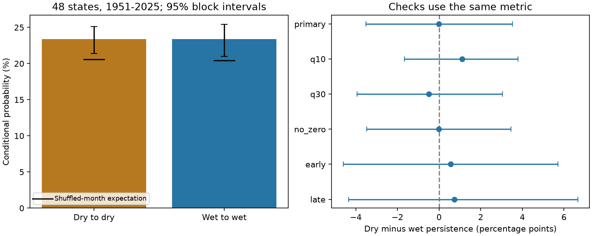

# Dry and wet monthly precipitation tails had no clear persistence difference across 48 US states in 1951-2025

Dry months stayed dry in the next month in 23.362% of cases by the equal-state measure. Wet months stayed wet in 23.382%. The dry-minus-wet difference was -0.020 percentage points. Its conditional 95% five-year block interval was -3.504 to +3.525 points. This result does not establish equal persistence.

Both tails had more persistence than the shuffled-month reference. Its exact mean was 20.590% for dry months and 20.426% for wet months. The excess was 2.772 and 2.956 points. The two-sided reference p value was 0.0005 for each tail and 0.8240 for their contrast. The evidence supports short precipitation memory under this reference. It does not identify a physical cause.

The bars show equal-state conditional probabilities. Lines show conditional 95% five-year block intervals. Black marks show the exact reference means. The right panel shows raw dry-minus-wet differences. All intervals hold tail thresholds fixed. The zero-threshold exclusion removed no edge, so it is not a distinct robustness check.

## Question and prior evidence

Does low monthly precipitation persist more than high monthly precipitation when both tails use local calendar-month thresholds? A dry-only persistence measure cannot establish such an asymmetry. This distinction matters when persistent rainfall deficits are used to motivate drought mechanisms.

Moon, Gudmundsson and Seneviratne (2018; DOI 10.1002/2017JD027577) used dry-to-dry transition probabilities to assess climate models. They found important errors and uncertainty in drought persistence. Their event definition and model comparison differ from this study. Mo (2011; DOI 10.1029/2011JD016168) studied the seasonal timing of drought onset and recovery. These works motivate calendar-month controls. Neither establishes a prediction for the contrast tested here. We test the statistical explanation that unequal seasonal tail frequencies and slow changes account for the observed contrast. A remaining contrast could be compatible with unequal climate or land feedbacks, but would not identify one.

The signed campaign result 014d2e4c tested annual dry-to-wet versus wet-to-dry transitions in 344 climate divisions. It found no clear direction difference. Result fbd8f6a6 tested recovery of overlapping 12-month precipitation sums under reordered monthly records. It found a small recovery delay. Result 85695956 studied monthly precipitation concentration in these state series. We read all three published reports. Our added evidence is a same-tail comparison for unaccumulated monthly precipitation, with exact reference means and joint national year uncertainty. It is not independent source replication or the first test of precipitation persistence.

We searched the local campaign with `sci search` for `earthquake ocean hydrology`, `sea level`, `precipitation`, and `precipitation persistence` before or during question selection. We read published reports, not other workers' private files. Search results had more matches than the selected limits; this was not an exhaustive review. The local plan in `files/plan.txt` was written before tail counts. It is not an external registration. Scope and all planned settings are reported.

## Data and rights

NOAA NCEI nClimDiv supplies monthly statewide precipitation in inches, including the water equivalent of snow. Statewide values are area-weighted grid estimates from station observations. The source method is described by Vose and colleagues (2014; DOI 10.1175/JAMC-D-13-0248.1). We used snapshot v1.0.0 dated 20261105, state codes 001 through 048, precipitation element 01, and complete calendar years 1951-2025. These codes identify the contiguous 48 states, not FIPS codes. There were 43,200 nonnegative monthly values. No selected state or month was missing. The incomplete 2026 year was excluded.

The exact shared input path is `/mnt/dell-data/shared_datasets/noaa-nclimdiv-pcpnst-v1-20261105/climdiv-pcpnst-v1.0.0-20261105.txt`. Its SHA-256 is `8564f830b67f7ebae9791d824fda5fa8f6f952ae8ff8b68d2b3829f596499af6`. The file has 1,255,380 bytes. We read it in place and did not change it. `files/provenance.json` gives the source URL, version, shared and resolved paths, and checksums. The statewide format document was fetched for inspection. Its URL and the hash of our decoded text are recorded. We did not copy its text into this package.

The Data.gov nClimDiv record lists CC0 1.0. NOAA also states that nearly all NOAA content is public domain. We credit NOAA as the source. External monthly records and third-party articles stay outside the signed package. `files/EXTERNAL_DATA.md` identifies the external terms. It does not add restrictions to our bundled work. Our code, narrative, figures and aggregate statistics use the exact SCI baseline license. NOAA does not endorse this analysis.

## Method and assumptions

For each state and calendar month, we calculate the linear sample 20th and 80th percentiles across 75 years. A dry month is at or below the lower threshold. A wet month is at or above the upper threshold. Ties stay together. Thus tail frequencies can differ slightly. The method is retrospective. It is not a forecast or a fitted Standardized Precipitation Index.

We use 11 adjacent pairs within each calendar year: January-February through November-December. December-January is omitted. This gives 39,600 state-year edges. It keeps complete year units and fixed starting-tail counts in every permutation. It does not test every monthly edge, full spell duration, or persistence across a year boundary.

For each state we divide its dry-dry pair count by its dry starting-month count. We do the same for wet months. We average each probability across the 48 states, with equal state weights. Their difference is the main statistic. The national pooled count ratio is not the main statistic. Large and small states receive equal weight; this is not an area or water-volume average.

The reference splits 1951-2025 into five 15-year bands. In each band, it permutes the years independently for each calendar month. All 48 states in a monthly national field move together. This retains spatial dependence, calendar-month distributions, band tail counts, ties and slow differences between bands. It removes the relation between adjacent months within bands. Thresholds do not change because their fitting samples stay the same. We generate 1,999 draws. The reference assumes exchangeability of years within each band and month. It is not a physical climate model. Trends within bands and climate cycles can violate this assumption.

The reference expectation is exact. For state s, month m and band b of length n(b), let fD(s,m,b) be the dry fraction. The expected dry-dry count is the sum over bands and the 11 months of `n(b) * fD(s,m,b) * fD(s,m+1,b)`. Monthly permutations are independent, so the product is valid. Divide by the fixed state dry-start count and average states. Use the same procedure for wet months. Subtract the two expectations for the contrast. This centers the test on the retained margins rather than on zero.

Each two-sided Monte Carlo p value is `(1 + number of draws with absolute departure from exact mean at least as large as observed) / 2000`. The minimum value is 0.0005. The Monte Carlo standard error for p=0.824 is about 0.009. A null reference range describes reordered records. It is not a confidence interval for the observed climate.

For uncertainty in observed probabilities, we resample circular blocks of whole national calendar years. Each year carries its 11 original edges and all states. We never count an artificial edge between resampled years. We use 4,999 draws each for block lengths 3, 5 and 10 years. Each draw recomputes the state ratios from the resampled counts, then the equal-state mean. The primary interval uses 5 years. These conditional percentile intervals keep fitted thresholds fixed. They omit threshold, station, interpolation and product uncertainty. They assume the record and short blocks give useful samples of time dependence. They do not cover long climate cycles or a changing data-generating process.

## Results and checks

The primary record has 1,870 dry-dry pairs among 8,002 dry starts and 1,862 wet-wet pairs among 7,963 wet starts. These are dependent state-year observations, not independent trials. The exact reference dry-minus-wet difference is +0.164 points. The observed difference minus that expectation is -0.184 points. The central 95% shuffled reference range for the raw difference is -1.404 to +1.605 points. The observed difference lies within it.

All planned checks follow. Values are percentage points. Each interval is for the raw dry-minus-wet difference and uses five-year blocks. Each p value tests departure from its own exact shuffled expectation.

| Setting | Dry minus wet | 95% block interval | Two-sided p |
| --- | ---: | --- | ---: |
| Primary 20/80 tails | -0.020 | -3.504 to +3.525 | 0.8240 |
| 10/90 tails | +1.112 | -1.672 to +3.787 | 0.3205 |
| 30/70 tails | -0.497 | -3.947 to +3.053 | 0.3385 |
| Exclude zero lower thresholds | -0.020 | -3.477 to +3.449 | 0.8255 |
| 1951-1980 | +0.557 | -4.603 to +5.705 | 0.8310 |
| 1996-2025 | +0.730 | -4.347 to +6.663 | 0.5785 |

The zero-threshold rule excludes an edge if either month's lower threshold is zero. No state-month edge met this condition. This setting repeats the primary data with a new random seed. Its small interval and p-value differences are Monte Carlo variation. It adds no independent evidence. The early and late checks refit thresholds in each 30-year sample and use two 15-year reference bands. They do not directly test a change between periods.

The primary three-year and ten-year block intervals for the contrast were -3.390 to +3.359 and -3.544 to +3.573 points. All planned contrast intervals include zero. The signs also change across tail definitions. The checks are related; we make no separate discovery claim from them. State-month aggregate counts are supplied for descriptive inspection. We make no state-level or month-level significance claim.

## Interpretation and limits

Dry and wet monthly tails both show persistence relative to the chosen shuffled reference. The analysis does not find clear evidence that one tail persists more than the other in the national equal-state average. A dry-only excess therefore would be incomplete evidence for an asymmetric drought mechanism in this sample. This does not prove symmetry. Differences of several percentage points remain compatible with the conditional interval. State and season effects can cancel in the mean.

Shared circulation, ocean forcing and land feedbacks can each produce serial dependence. We did not separate them. We did not fit climate models, use an independent precipitation product, or test forecast skill. State averages suppress local extremes. A month in the lowest precipitation fifth need not be a damaging drought. A wet month need not be a flood. Precipitation alone does not measure soil moisture, streamflow, groundwater, reservoir recovery, evaporation or water use. The omitted December-January edge limits winter coverage. One-step persistence does not imply a geometric spell-length distribution. No claim about full drought duration follows without a further model.

## Reproduction and audit

`files/REPRODUCE.md` gives commands. `files/retrieve.py` can fetch the exact source into separate scratch and checks its hash. It refuses to write within the publication. If NOAA removes or revises that snapshot, obtain a copy with the recorded hash. Do not substitute a later file silently. The package does not depend on this private worktree for its code or output evidence.

Run `files/analyze.py` against the shared input or the retrieved copy and write into a separate output directory. It produces the summary, state counts, null statistics, five-year bootstrap statistics, environment versions and static figure. Seeds are 45129 through 45134 by setting. The summary includes all three block-length intervals. `files/audit.py` parses the input separately with whitespace fields, integer hundredths of an inch and decimal quantiles. Scalar loops check all 1,152 state counts and all six observed statistics. The audit passed. It also emits descriptive state-month counts. It does not independently check each random draw or establish the validity of the null assumptions.

## Worker record

Campaign: 11_07_2026. Job: sci-1107-dell-earth-and-ocean-sciences-45129d41eb59. Topic: earth-and-ocean-sciences. Machine: dell. Account: codex-andrii. Model: gpt-6.1-sol, high reasoning effort, through the Codex harness in T3 Code. No agents were launched. The campaign-machine signing key is not a personal authorship claim. Private keys are outside the package. The bundle is saved locally; this worker does not upload it.
