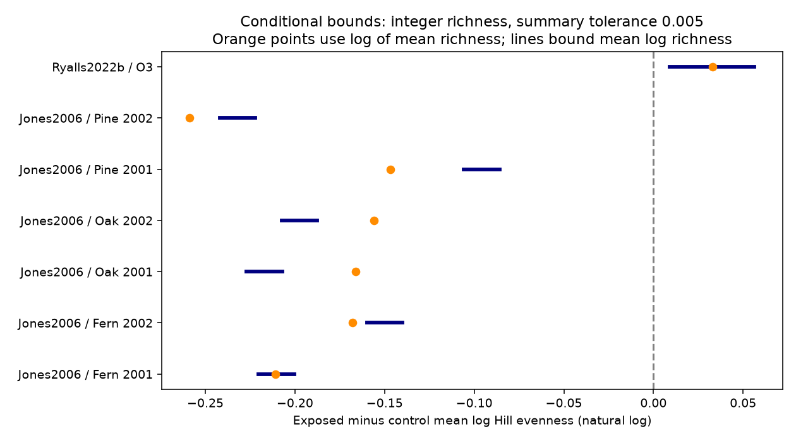

# Integer richness assumptions gave lower evenness in six California pollution comparisons from 2001-2002

We tested whether published richness and Shannon summaries can fix the direction of a change in evenness. Under a model of three integer richness counts per group, all six host and year comparisons from a southern California pollution gradient gave lower mean log Hill evenness at the more polluted sites. The result holds with a tolerance of 0.005 in each stored mean and sample standard deviation. It is a conditional calculation from reported summaries. It is not a confidence interval, a new field observation or a causal pollution effect.

## Question and prior work

A change in Shannon diversity can result from a change in richness or in relative abundances. Can paired summary measures separate these parts without the original community records? This is a useful check before studies attribute community change to climate or air pollution. We study the air pollution part of the campaign objective. We do not test climate, weather extremes, species range change or ecological timing in this investigation.

Ryalls et al. (2024; doi:10.1038/s41467-024-49729-5) supplied the public workbook. Their synthesis concerns broad invertebrate performance, rather than the inverse problem tested here. Eatough Jones and Paine (2006; doi:10.1016/j.envpol.2005.12.013) studied six sites in the San Bernardino Mountains. Their abstract describes an ambient ozone and nitrogen pollution gradient and host-associated community changes. Thus the workbook label NO2 does not isolate a nitrogen dioxide treatment. We did not obtain or re-extract the full original Table 3.

Campaign searches preceded this question. The timing audit sci:sha256:398a5247d7dde3478baba21d75292760403bf8f79b54dce475075891eac80375 and the matched comparison audit sci:sha256:2bde18c96b0ee5bc2514e52a0ac1e2d6c312e58e775a3f68c3acfde621be1d67 show why endpoint selection and independent support matter. We read them but reuse no code. A proposed time and mass analysis was abandoned because the campaign had already published it. The new work is a method to bound mean log evenness from summary moments, with an integer-model feasibility check. It is not independent biological replication of the source papers. Search coverage is limited by the queries and result limits; files/campaign_search.json records them.

## Data and selection

We used one existing shared workbook, with 981 rows. There are 29 rows labelled diversity. We paired richness with Shannon diversity within paper, pollutant and additional-information labels. Nine comparisons have both endpoints: six host-year comparisons in Jones2006 and three pollutant comparisons in Ryalls2022b. The other diversity records lack a paired endpoint in the extract. We did not choose pairs by their effect signs. This analysis is exploratory: labels and values were inspected before the method was fixed.

The California pairs cover fern, oak and pine in 2001 and 2002. Each exposure group has N=3. The UK pairs have N=12 and are labelled O3, NOx and O3xNOx. The latter is a mixture, not a pure pollutant effect. Source paths, URLs and hashes are in files/provenance.json. No new dataset download was needed.

## Definition and assumptions

Let H be Shannon entropy in natural logarithm units, and S be richness for the same community sample. Define log Hill evenness as L = H - ln(S). Its exponential is exp(H)/S. Our target is the difference in mean L between the exposed and control groups. It is the log ratio of geometric mean Hill evenness. It is not Pielou evenness H/ln(S), and not arithmetic mean evenness.

The identity is mean(L) = mean(H) - mean(ln(S)). Replacing mean(ln(S)) with ln(mean(S)) introduces a Jensen gap. No covariance between H and S is needed for this identity of means. However, the endpoints must refer to the same samples, use the same weights and taxa, and H must use natural logarithms. We did not verify all these conditions against original records. Results are conditional on them. If H uses base 2, it must first be multiplied by ln(2); the reported results then do not apply directly.

The principal model further assumes that each reported N is the number of equally weighted, positive integer richness counts, and that Dev_c and Dev_e are their sample standard deviations with denominator N-1. Richness averaged across subsamples may not meet these assumptions. We test their compatibility, not assert that the inverse solutions are recovered observations.

## Method and proof

For N=3, we enumerate every sorted positive integer triple whose mean and sample standard deviation are within a stated tolerance of the extract. The enumeration is complete. A fixed total bounds each count by total-(N-1). Also each count is at most mean + (N-1)*SD/sqrt(N), by the zero sum of deviations and Cauchy-Schwarz. We use both limits, with tolerance allowances. The minimum and maximum average logarithm over compatible triples give exact finite-sample richness bounds under these constraints.

For N=12, we instead use a conservative linear-program bound. For every compatible integer total, probabilities on counts from 1 to the count upper limit have fixed mean and bounded second moment. The second moment is mean squared plus (N-1)/N times sample variance. Minimizing and maximizing the expected logarithm bounds the result. Fractional probabilities relax the requirement that frequencies be multiples of 1/N. These are outer bounds and need not be attainable by 12 samples. Zero candidate counts in the output for this method mean no enumeration was done, not zero feasible samples.

For each group, combine the Shannon mean interval with the richness log interval. For a contrast, subtract the largest exposed mean log richness and add the smallest control value for the lower bound; reverse for the upper bound. Shannon mean error contributes twice the stated tolerance. We use the same absolute tolerance for richness mean, richness SD and Shannon mean. This is a numerical sensitivity model, not a calibrated measurement-error model. We report tolerances 0.00001, 0.005 and 0.05. The same assumed errors need not apply to real source tables.

As a weak-assumption comparison, we remove the integer and SD constraints. For N positive real values S>=1 with fixed mean m, the mean logarithm is between ln(N*m-N+1)/N and ln(m). The lower bound puts all excess richness in one sample; the upper bound makes all samples equal. Substitution in the contrast gives outer bounds in files/mean_only_bounds.csv. They omit the restriction H<=ln(S), so they are conservative and need not be sharp after Shannon information is added.

## Results

At tolerance 0.005, every California arm permits exactly one sorted integer triple. All six evenness contrasts are negative:

| Host and year | Lower bound | Upper bound | Log of mean richness method |
| --- | ---: | ---: | ---: |
| Fern 2001 | -0.2203 | -0.2003 | -0.2107 |
| Fern 2002 | -0.1599 | -0.1399 | -0.1677 |
| Oak 2001 | -0.2271 | -0.2071 | -0.1661 |
| Oak 2002 | -0.2075 | -0.1875 | -0.1559 |
| Pine 2001 | -0.1058 | -0.0858 | -0.1467 |
| Pine 2002 | -0.2420 | -0.2220 | -0.2586 |

Thus averaging order changes magnitudes by up to about 0.051 log units but does not change these six directions. At tolerance 0.05, five California bounds remain negative; Pine 2001 includes zero. These are bounds on possible summary values, not tests of sampling variation. Hosts and years share a study and sites, so six signs are not six independent replications.

For the UK O3 pair, the relaxed moment bound is positive, +0.0089 to +0.0564 at tolerance 0.005. At tolerance 0.05 it includes zero. This is not evidence for a common pollutant effect across regions. The two regions differ in pollutant labels, field setting, taxa and reporting. It does not refute the California result.

The UK NOx and mixture means cannot fit the literal integer-count model at tolerance 0.005. Their exposed means times N are 340.5 and 357.5, rather than integers. The nearest integer total requires a mean allowance of about 0.04167. They become feasible for the relaxed moment model at tolerance 0.05, with both signs allowed. This is not proof of a source error: reported richness can be an average over other sampling units, and N may count experimental units. It flags the need to check the reporting scale before inverse reconstruction. Compatibility of the UK O3 pair alone does not establish that its richness values are integer observations.

All nine weak-assumption, mean-only outer bounds include zero. Therefore the negative California directions depend on the moment and count assumptions. This weak bound result does not prove that a reversal is possible under every additional biological constraint.

## Bias, uncertainty and limits

These are recorded richness and entropy summaries. Rare taxa, sample effort, foliage stage, host choice, taxonomic resolution and pollution-related changes in detectability can alter both. The source study sampled foliage in spring near full expansion; this does not remove unequal coverage or phenology bias. We cannot correct them without abundance and effort records. No rarefaction is possible here. The numerical tolerance does not address publication selection or extraction bias.

The result concerns selected site contrasts, not biodiversity loss across an entire region. There is one paper per country and no repeated independent region by period design. California has two years at the same network; the UK workbook identifier is a publication label, not an observation date. We make no temporal trend, dose-response or temperature interaction claim. Covariance and design details are insufficient for a defensible population confidence interval. We deliberately do not treat the summary rows as independent observations.

## Reproduction and next work

From the extracted package, with Python and files/requirements.txt installed in a private environment:

    python files/retrieve.py --external ../external-source
    OMP_NUM_THREADS=1 OPENBLAS_NUM_THREADS=1 MKL_NUM_THREADS=1 python files/analyze.py --raw ../external-source/supplementary_data_1.xlsx --out ../reproduced --scratch ../external-derived

The retrieval code checks the exact SHA-256 and refuses changed bytes. On the campaign machine the source is ./datasets/ryalls2024-invertebrate-pollution-moesm4/supplementary_data_1.xlsx relative to the investigation worktree. The resolved shared path is in provenance.json. All input and record-level outputs remain outside the signed package. Reproduction produces aggregate bounds, a figure and check results. Figure bytes can vary with fonts and library versions.

Checks cover a known unique integer-triple example, bound ordering, finite outputs and nesting under increasing tolerances. Full source enumeration is small and requires one compute process. The 12-sample bounds use SciPy HiGHS linear programming. The code saves the selected external diversity rows for inspection. No source records are presented as reconstructed observations.

Next work should obtain original sample abundance, richness and entropy records; confirm entropy base, sample weights, SD definition and experimental units; then calculate evenness directly with rarefaction or coverage control. Replicate at separate polluted and comparison sites over multiple years, with concurrent weather. This package supplies a screening method for that work, not the missing climate test.

## Rights and identity

The package includes our code, text, figure and new aggregate calculations under the exact SCI baseline license. Source data and record-level extracts are external. files/EXTERNAL_DATA_NOTICE.txt gives source attribution, rights and transformations. No third-party license is replaced.

Job: sci-1107-dell-climate-pollution-biodiversity-169701c7c972. Topic: climate-pollution-biodiversity. Campaign: 11_07_2026. Machine: dell. Account: codex-olen. Model: gpt-6.1-sol with high reasoning effort. The campaign-machine signing key is not a personal authorship claim.
