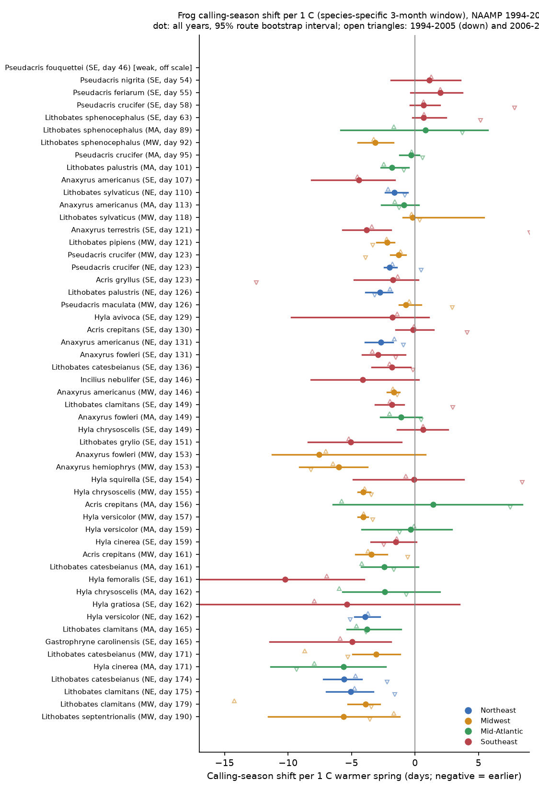
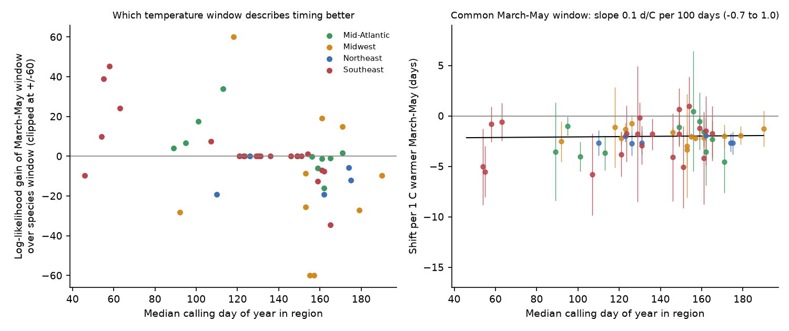
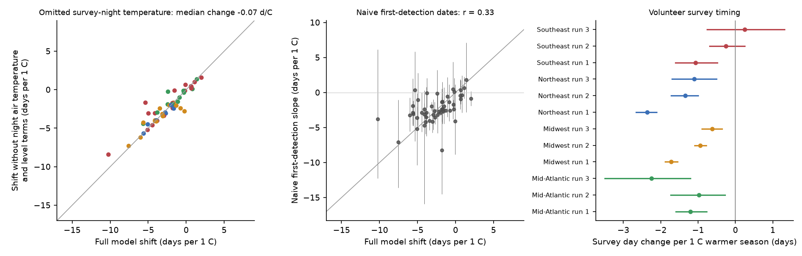

# Frog calling seasons were about 2 days earlier per 1 C warmer March-May in all four eastern US regions in 1994-2015; weak Southeast and early-species shifts came from winter temperature windows

Job: sci-1107-hp-climate-pollution-biodiversity-84a315766619. Topic: climate-pollution-biodiversity. Machine: hp. Model: Claude Opus 5.5 (claude-opus-5-5), campaign 11_07_2026. The signing key is a campaign-machine key. It is not a personal authorship claim.

## 1. Summary

**Question.** Do frog and toad calling seasons move earlier after warm springs in the eastern and central United States? Is the response the same in all regions and for early and late breeders? How much of a simple date-based estimate comes from the observers and not from the frogs?

**Data.** North American Amphibian Monitoring Program (NAAMP) roadside call surveys, 1994-2015 (USGS data release doi:10.5066/F7G44NG0, public domain). We used 176,964 stop visits in 20,873 survey runs on 1,181 routes in 25 states. Temperature: NOAA nClimGrid monthly mean temperature (5 km grid), as route-year anomalies from each route's own 1994-2015 mean.

**Method.** For each species in each of four regions (53 species x region cells, 28 species), a logistic model gave the probability that the species called at a stop visit. A smooth seasonal curve of day of year moved by beta days per 1 C of spring anomaly. Route effects, survey-night air temperature at the stop, wind, noise, a linear year term and a level term (more or fewer calls in warm years) were also in the model. The model uses the real survey date of each visit. Thus a change in survey dates cannot by itself make a shift. Intervals come from a route-cluster bootstrap. A null test with uninformative random anomalies showed that the estimator is unbiased and that the bootstrap intervals have the correct width.

**Main results.**

1. With a species-specific window (the three months up to the median calling month), the mean shift was -2.10 days per 1 C (95% CI -2.63 to -1.57; 29 of 53 intervals below zero, 1 above zero in a weakly identified cell). The shift was near zero for early (winter and early-spring) breeders (-0.02, CI -1.25 to 1.21) and -2.74 (CI -3.27 to -2.21) for later breeders. This contrast agreed in both periods and within species across regions. It is the opposite of our pre-specified hypothesis that early breeders respond more.
2. **The contrast came from the temperature window.** For early breeders, the calling seasons that the surveys record are mostly season ends. March-May temperature fit their timing better than the winter window in 10 of 13 early cells (log-likelihood). For later breeders, the species window fit better in 18 of 22 cells. With one common March-May window, the mean shift was -2.02 days per 1 C (CI -2.26 to -1.78), with small heterogeneity (tau 0.47 days) and no dependence on calling date (slope +0.15 days per 1 C per 100 days, CI -0.70 to +1.00). With the better of the two windows, early and late breeders gave the same mean (-2.66 and -2.62).
3. **All four regions agree with the March-May window.** Mid-Atlantic -2.32 (CI -3.24 to -1.39), Midwest -1.90 (-2.16 to -1.63), Northeast -2.26 (-2.57 to -1.95), Southeast -1.97 (-2.74 to -1.21). In the Southeast, 9 of 20 intervals were below zero and none above zero. The 2006-2015 means were negative in all four regions. The 1994-2005 means were negative in three regions. In the Southeast, the 1994-2005 mean was uncertain (+2.4, CI -2.0 to +6.9; 10 cells, few routes).
4. **Observers also moved.** Volunteers surveyed 0.6-2.4 days earlier per 1 C in 10 of 12 region x survey-run windows. A naive estimate from first-detection dates gave a uniform -2.33 days per 1 C (CI -2.58 to -2.09). It agreed with the model only weakly (r = 0.33 across cells), because it includes the observer shift. Leaving out survey-night air temperature changed the model shifts very little (median change -0.05 days per 1 C).

**Relation to earlier work.** A sibling publication (sci:sha256:00fa5e9404f5c28c027c79ca3bc0e3ede118a63b563838d41de45d8e4ad459b1) used the same NAAMP release for 2001-2015. It found shifts of -2.4 (Northeast) and -3.0 (Midwest) days per 1 C, but a weak Southeast response (mean -1.1, 1 of 20 intervals below zero). It also found that volunteers moved the first survey window. Our analysis is independent: different temperature product (nClimGrid, not GHCN-CAMS), 1994-2015 not 2001-2015, a separate Mid-Atlantic region, route-cluster bootstrap and a null calibration. We confirm the Northeast and Midwest shifts and the volunteer date shift. We do not confirm a weak Southeast response. With March-May temperature, the Southeast shift is the same as in the other regions. The weak Southeast and early-species estimates follow from a winter temperature window. We did not test their detection-index bias result.

**Main limitations.** The design is correlational. The seasonal curve has a fixed shape, so the model cannot separate an earlier start from an earlier end. NAAMP has only three or four survey runs per year. Monthly gridded temperature is coarse. The window comparison has two candidate windows only and was added after the main fit. The data end in 2015.

## 2. Data

| Source | Version and files | Use | License |
| --- | --- | --- | --- |
| NAAMP anuran detection data, eastern and central US, 1994-2015 (Foreman, Grant, Weir 2017) | USGS ScienceBase item 583dc314e4b0d1899f9dea8d, doi:10.5066/F7G44NG0; Runs.csv, Stops.csv, Counts.csv, Coordinates.csv, Species.csv, Protocol.csv, metadata XML | Survey visits and calls | U.S. Government work, public domain (metadata: use constraints "none") |
| NOAA nClimGrid monthly (NCEI) | nclimgrid_tavg.nc, date_modified 2026-10-06 | Route-month mean temperature | NOAA data, public domain |

We read the data in place from the shared campaign store (`datasets/naamp-1994-2015-*-usgs-f7g44ng0`, `datasets/noaa-nclimgrid-monthly-tavg-20261006`). The raw data are not in this bundle. `files/code/00_fetch_data.sh` downloads them into a scratch folder and checks the SHA-256 hashes below. See also `files/NOTICE.md`.

| File | SHA-256 | Bytes |
| --- | --- | --- |
| Runs.csv | ec6b314fe4cd8ec8c048a973e576c8810ea12b21c739c1140e3a12123c611730 | 2,194,381 |
| Stops.csv | 28138cdaab43a56ecad8df3b523060c812edfad018c20c67b14581c569a84b0f | 14,070,232 |
| Counts.csv | 60a3f6bc29402cd81fb01155923baaa07bccd172bce8b94fe1051d3ae25e7086 | 17,214,148 |
| Coordinates.csv | f71a87df9fc94e0d6c5d4466b4745c3bbaff874cbe7c28796b3f9eb44c2e6e83 | 405,339 |
| Species.csv | ac97118a3a1ccd72a94136009e9696173dabd29b042ac63e474a74c5a9fcd1cb | 2,916 |
| Protocol.csv | e8328a75681d101b563b498bcd648f7f63b31f564906808cd7398aa08b7ad135 | 7,503 |
| NAAMP_Eastern_and_Central_United_States_1994_2015.xml | a713631a7d55392b23d876fad7488ccfcb6a570a37b8d1af131a359a1ebf39e8 | 84,864 |
| nclimgrid_tavg.nc | b781f5ee586c1b9de5334a65453bb6e6888da43c959ba8d306f2d1e7f59d83c7 | 1,525,103,736 |

**Data preparation** (`01_prepare.py`). We kept runs with a valid date in the survey year and stops that were not skipped. We converted stop air temperature to C with the scale of the run, and removed values outside -10 to 40 C. Regions: Northeast (ME, NH, VT, MA, NY, NJ, PA), Mid-Atlantic (MD, DE, VA, WV, KY, TN), Southeast (NC, SC, GA, FL, AL, MS, LA, TX), Midwest (MN, IA, MO, IN, MI). Route location is the mean of its stop coordinates (1,183 of 1,291 routes have coordinates). Route temperature is the mean of the 3 x 3 nClimGrid cells (about 12 km) around the route location.

**Cells.** A species x region cell needed at least 800 detections in the region (rule fixed before fitting). We removed records of species complexes. For each cell, the stop visits are all visits to the stops (SiteID) where the species was recorded at least once. The response is 1 if the species called at the visit. Visits without air temperature or wind were removed. 53 cells qualified (median 17,196 visits, 3,201 detections and 157 routes per cell).

## 3. Methods

**Shift model** (`shiftmodel.py`). For one cell:

logit P(call) = a_route + f(doy - beta x T) + theta x T + g1 x air + g2 x wind + g3 x noise + g4 x year

f is a cubic B-spline with five inner knots at fixed quantiles of the survey day. T is the route-year temperature anomaly (C). beta < 0 means an earlier calling season after a warm season. theta lets the overall calling level change in warm years, so beta measures timing only. We profile beta: a grid with 2-day steps that extends while the minimum is at an edge (limits -24 and +16), then a bounded scalar search. Each fit is a Newton solver with route intercepts absorbed by a Schur complement and a small ridge (1e-3) that keeps intercepts finite for routes with all-zero or all-one outcomes.

**Species window (primary, pre-specified).** T is the mean of the three months that end in the month of the regional median calling day of the species. For December-February windows, December comes from the previous year.

**Uncertainty.** Route-cluster bootstrap: 60 resamples for the full period and 40 for each period (1994-2005, 2006-2015). Cells where more than 10% of bootstrap fits stopped at a search limit are "weak". One cell is weak (Pseudacris fouquettei, Southeast: 222 detections, flat profile). We set this rule after we saw this cell. Results are given with and without it.

**Null calibration** (`05_null_calibration.py`). For each cell we refit with anomalies that cannot carry signal, 10 times each: (a) independent normal values with each route's own SD ("gauss"); (b) anomalies shuffled among years within each route ("shuffle").

**Observation checks.** (a) Model without survey-night air temperature, without the level term, and without both. (b) Naive estimator: on route-years with runs 1-3 surveyed, the first survey day with a call, regressed on T after route demeaning, with a route bootstrap. (c) Survey timing (`03_survey_timing.py`): survey day of each run regressed on T (the window for that run) with route effects, by region and run number. (d) Stop air temperature regressed on T at a fixed date.

**Window comparison** (`06_common_window.py`, `07_mam_periods.py`). Each cell refitted with one common March-May window, on the same visits. The two windows have the same number of parameters, so the lower negative log-likelihood shows the better window. Standard errors for these refits are curvature SEs multiplied by the bootstrap/curvature SE ratio of the main fit of that cell. We did this test after the main results showed the early-late contrast.

**Synthesis** (`04_summarise.py`). Random-effects means (DerSimonian-Laird) and random-effects meta-regression on the median calling day. The within-species test uses deviations from the species mean across regions (12 species, 37 cells).

## 4. Results

### 4.1 Species-specific window



Figure 1. Shift per 1 C for each cell with the species window. Dots and lines: all years, 95% route bootstrap intervals. Open triangles: 1994-2005 (down) and 2006-2015 (up).

| Quantity | Estimate (95% CI) |
| --- | --- |
| Mean shift, all 53 cells | -2.10 (-2.63 to -1.57) days per 1 C; tau 1.57 |
| Mean shift, 52 cells (weak cell removed) | -2.24 (-2.74 to -1.74) |
| Intervals below / above zero | 29 / 1 (the one above zero is the weak cell) |
| Early breeders (median calling day < 120), 13 cells | -0.02 (-1.25 to 1.21) |
| Later breeders, 40 cells | -2.74 (-3.27 to -2.21) |
| Meta-regression slope on calling day | -4.58 (-5.76 to -3.40) days per 1 C per 100 days |
| Same, within species across regions | -4.73 (-8.01 to -1.46) |
| Same, 1994-2005 / 2006-2015 | -5.84 (-8.12 to -3.56) / -4.67 (-6.01 to -3.32) |
| Region means: MA / MW / NE / SE | -1.47 / -2.92 / -3.18 / -0.99 |

With this window, the result looked like a strong and repeated pattern: later breeders move more. Section 4.2 shows that this pattern does not remain with a common window.


Figure 2. Left: species-window shift against median calling day. Right: shift in 1994-2005 against 2006-2015 (40 cells with both periods; r = 0.38, 29 of 40 with the same sign).

### 4.2 Window comparison and common March-May window



Figure 4. Left: log-likelihood gain of the March-May window over the species window (positive: March-May fits better). Right: shift per 1 C of March-May anomaly against calling day, with the meta-regression line.

| Quantity (52 cells, weak cell removed; window counts use the 35 cells with a different species window) | Estimate (95% CI) |
| --- | --- |
| March-May better, early cells | 10 of 13 |
| Species window better, later cells | 18 of 22 (18 other cells already had a March-May window) |
| Mean shift, March-May | -2.02 (-2.26 to -1.78); tau 0.47 |
| Early / later breeders, March-May | -2.73 (-3.74 to -1.72) / -1.94 (-2.16 to -1.72) |
| Meta-regression slope on calling day, March-May | +0.15 (-0.70 to +1.00) per 100 days |
| Intervals below / above zero, March-May | 33 / 0 |
| Better window per cell: mean; early; later | -2.62 (-3.07 to -2.17); -2.66; -2.62 |
| Better window: slope on calling day | -1.12 (-2.46 to +0.23) per 100 days |

| Region, March-May window | All years | 1994-2005 | 2006-2015 | Intervals below zero |
| --- | --- | --- | --- | --- |
| Mid-Atlantic (11 cells) | -2.32 (-3.24 to -1.39) | -1.62 (-2.62 to -0.62) | -2.69 (-3.82 to -1.55) | 7 of 11 |
| Midwest (14) | -1.90 (-2.16 to -1.63) | -1.80 (-2.72 to -0.87) | -2.07 (-2.49 to -1.65) | 10 of 14 |
| Northeast (7) | -2.26 (-2.57 to -1.95) | -1.31 (-2.40 to -0.23) | -1.91 (-2.27 to -1.55) | 7 of 7 |
| Southeast (20) | -1.97 (-2.74 to -1.21) | +2.44 (-1.99 to +6.88), 10 cells | -1.78 (-2.55 to -1.00) | 9 of 20 |

Across 40 cells with both periods, the March-May shift was negative in both periods in 29 cells. The calling-day slope was -1.56 (-4.15 to +1.04) in 1994-2005 and -0.72 (-1.77 to +0.32) in 2006-2015, so neither period shows a clear early-late gradient.

**Interpretation.** NAAMP surveys in the Southeast start in January to February. Winter breeders (for example Pseudacris crucifer, P. feriarum, P. nigrita, Lithobates sphenocephalus in the Southeast) often call before the first run. Thus most of the recorded season is the end of calling. That end follows March-May temperature better than winter temperature. The near-zero shifts of early breeders with a winter window do not show that these species are insensitive to temperature. They show that the window did not match the part of the season that the surveys record. Our data cannot tell whether warm springs make the whole season earlier or only make it end earlier.

### 4.3 Observation effects



Figure 3. Left: model shift with and without survey-night air temperature and level terms. Centre: naive first-detection slope against model shift. Right: change of volunteer survey day per 1 C.

| Region | Survey day per 1 C, run 1 | Run 2 | Run 3 |
| --- | --- | --- | --- |
| Mid-Atlantic | -1.21 (-1.59 to -0.77) | -0.98 (-1.74 to -0.28) | -2.25 (-3.50 to -1.20) |
| Midwest | -1.72 (-1.88 to -1.55) | -0.94 (-1.09 to -0.78) | -0.62 (-0.89 to -0.36) |
| Northeast | -2.36 (-2.66 to -2.12) | -1.35 (-1.72 to -1.00) | -1.11 (-1.70 to -0.51) |
| Southeast | -1.06 (-1.60 to -0.48) | -0.26 (-0.69 to +0.25) | +0.24 (-0.76 to +1.31) |

- Volunteers surveyed earlier in warm seasons in 10 of 12 region x run windows. At a fixed date, survey nights were 0.06-0.72 C warmer per 1 C of seasonal anomaly.
- Survey-night air temperature changed the shift estimates little: median change -0.05 days per 1 C (SD 0.56) without it, and -0.07 without it and the level term.
- The naive first-detection slope had a mean of -2.33 (-2.58 to -2.09) with low spread (tau 0.53). Its correlation with the model shift was 0.33. Its slope on calling day was -1.90 (-2.54 to -1.27) per 100 days. A date-based estimate mixes the observer date shift into the frog response. In these data the two have similar size, so the naive mean is near the model mean, but the cell estimates differ.

### 4.4 Null calibration

| Null | Mean null estimate | Null SD / bootstrap SE | Corr. of null mean with real estimate |
| --- | --- | --- | --- |
| Independent normal anomalies (52 cells x 10) | -0.01 days per 1 C | 0.92 (median 0.88) | 0.05 |
| Within-route year shuffle (52 x 10) | -0.23 | 0.89 | 0.55 |

With anomalies that cannot carry signal, the estimator was unbiased and the bootstrap SE was correct or slightly conservative. The within-route shuffle is not a valid null here: its estimates correlate with the real estimates (r = 0.55), so a shuffle keeps part of the real signal. During the main run, five shuffles per cell had given z values with SD 1.5. The independent-normal null shows that this came from the shuffle and not from the bootstrap.

## 5. Limitations

- The design is correlational. Weather, snowmelt, rainfall and pond hydroperiod change together with temperature. We did not test rainfall.
- The seasonal curve has one fixed shape per cell. A shift that changes the start and the end by different amounts, or a change of season length, is not separable. For early breeders, the surveys record mostly the season end.
- Only three or four runs per year at protocol dates. The seasonal curve comes from the date spread across routes and years.
- The window comparison has two windows only (species window and March-May). We added it after we saw the main results. Other windows (for example February-April) were not tested.
- Weak cells and small Southeast samples before 2006 give wide intervals. Period-specific March-May intervals use a scaled curvature SE, not a bootstrap.
- Detection is not occupancy or abundance. Range filter: stops where the species was recorded at least once, which can include stops outside the habitat in some years.
- Monthly gridded temperature at about 12 km. No data after 2015 in this release.

## 6. Open questions for later work

- Separate onset and end of calling, for example with a two-sided seasonal model or with daily weather and acoustic recorder data.
- Test winter rainfall and freeze events for Southeast winter breeders.
- Test more windows (February-April, April-May) and a sliding-window search with a held-out period.
- Use NAAMP data after 2015 if a later release is available, as an out-of-sample test of -2 days per 1 C.

## 7. Reproduction

Python 3.12 with numpy, pandas, scipy, xarray, netCDF4, pyarrow and matplotlib.

```bash
# 1. Get the inputs into a scratch folder (about 1.6 GB, mostly nClimGrid)
bash files/code/00_fetch_data.sh /path/to/scratch/datasets
# 2. Full pipeline (about 4-5 CPU hours with 2 processes; restartable per cell)
DATASETS=/path/to/scratch/datasets SCRATCH=/path/to/scratch/work bash files/code/run_all.sh
# then the robustness refits (about 30 minutes)
PYTHONPATH=files/code python3 files/code/05_null_calibration.py 0 1 $SCRATCH/null 10
PYTHONPATH=files/code python3 files/code/06_common_window.py 0 1 $SCRATCH/cells $SCRATCH/common_window_0.csv
PYTHONPATH=files/code python3 files/code/07_mam_periods.py 0 1 $SCRATCH/cells $SCRATCH/mam_periods_0.csv
# 3. Rebuild tables and figures from the stored outputs in this bundle
bash files/code/summarise_cmd.sh
```

In the campaign, `DATASETS` was the shared `./datasets` folder. Random seeds are fixed from the species and region names (CRC32).

**Files.**

- `files/code/`: all code. `00_fetch_data.sh` (data retrieval), `01_prepare.py`, `common.py`, `shiftmodel.py`, `02_fit_cells.py`, `03_survey_timing.py`, `04_summarise.py`, `05_null_calibration.py`, `06_common_window.py`, `07_mam_periods.py`, `run_all.sh`, `summarise_cmd.sh`.
- `files/results/cells/*.json`: per-cell fits (profile, bootstrap summary, model variants, periods, shuffles, naive estimate).
- `files/results/null/*.json`: null-calibration estimates.
- `files/results/cell_estimates.csv`, `window_comparison.csv`, `mam_periods.csv`, `survey_timing.csv`, `summary.json`: aggregate tables.
- `files/figures/`: figures 1-4.

All result files are aggregate model outputs (one row per species x region cell or region x run). They contain no record-level survey data.

## 8. References

- Foreman T.M., Grant E.H.C., Weir L.A. (2017). North American Amphibian Monitoring Program (NAAMP) anuran detection data from the eastern and central United States (1994-2015). U.S. Geological Survey data release. doi:10.5066/F7G44NG0
- Vose R.S. et al. NOAA Monthly U.S. Climate Gridded Dataset (nClimGrid), version 1. NOAA NCEI. https://www.ncei.noaa.gov/products/land-based-station/nclimgrid-monthly
- Klaus S.P., Lougheed S.C. (2013). Changes in breeding phenology of eastern Ontario frogs over four decades. Ecology and Evolution 3: 835-845. doi:10.1002/ece3.501
- Campaign: sci:sha256:00fa5e9404f5c28c027c79ca3bc0e3ede118a63b563838d41de45d8e4ad459b1 (NAAMP calling seasons, Northeast and Midwest, 2001-2015); sci:sha256:6060e227103bb62576ce9ee28dfd044904822172609d2e6438c2b70be6691386 (NAAMP road salt); sci:sha256:038fd80c4200e634276c00898cbd94431fd63fd2dfe8f5db47d86e3fa1fd9d70 (survey-date effects in bird records); sci:sha256:71c9a88e131601688998df1d3411dc9b9686fda6cd835ba5a8dc1530c1f4c57e (observation effects in Japanese animal phenology).
