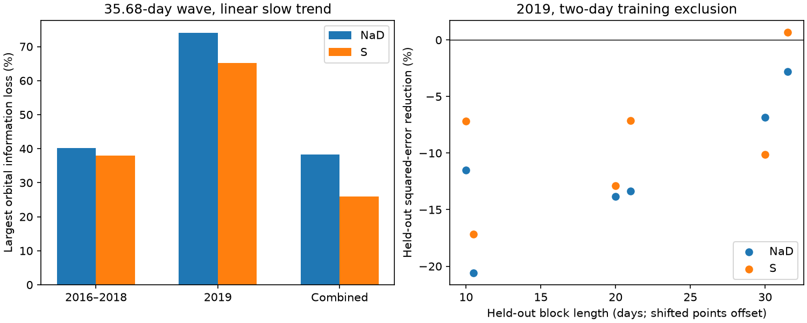

# A linear sodium correction removes up to 74 percent of 35.68-day orbital information in 56 GJ 832 observations from 2019

A linear correction with the sodium activity index can remove 74.0% of the information for one phase of a 35.68-day circular orbit in 56 HARPS observations of GJ 832 from 2019. The other phase direction retains all information. This result assumes fixed activity measurements, a linear slow trend, and independent errors with the stated weights. A sequential correction followed by an orbit fit can reduce an injected unit amplitude to 0.255. A joint fit avoids this bias in noise-free tests, but it has less information. These are properties of the measured sampling and activity values. They are not evidence for a planet.

The correction does not give useful velocity predictions in the main held-block tests. It raises squared error by 2.8% to 20.6%. Thus a correction can weaken a planet test without predicting the measured velocities. We report a method audit and a null prediction result. We do not identify a new astronomical source or exclude a planet.



## Question and prior work

Wittenmyer et al. (2014), DOI 10.1088/0004-637X/791/2/114, reported the planet candidate GJ 832 c at 35.68 days. Gorrini et al. (2022), DOI 10.1051/0004-6361/202243063, measured a rotation period near 37.5 days and favored stellar activity over this planet interpretation. Liebing et al. (2024), DOI 10.1051/0004-6361/202347902, studied additional RedDots data and limits on planets. These studies already discuss the physical ambiguity near stellar rotation. Our calculation is not a new rejection of the planet claim.

We searched the shared SCI record with astronomy, TESS, radial velocity, HARPS, GJ 832, GJ832, and 832 sodium. We read SCI bfaec8115a4a0d5271bd1d74a125b2b081a0625720f6c81f45387da9cd10dc55. It tests velocity-wave transfer between time groups and reports independent brightness changes on a related time scale. It also shows activity-index power. We use the same public tables in place. We do not reuse its code, fitted coefficients, or row extracts.

The new test measures the information lost to a specified activity correction, checks this loss with synthetic injections, and tests the correction on held-out velocity blocks. It addresses whether a simple correction is safe and useful for a search near the disputed period. It does not repeat the prior test of wave phase stability. This is a retrospective study. Prior conclusions were known. Sodium was chosen before our first fit; S index is a stated comparison. We report all selected weights, slow models, periods and block choices.

## Data and rights

The source is CDS catalogue J/A+A/664/A64, GJ 832 stellar activity (Gorrini and coauthors, 2022), first published by CDS on 2022-09-30, DOI 10.26093/cds/vizier.36640064. VizieR supplied the tables. The frozen replies have request times on 2026-11-09. We use the following existing shared files on HP SSD, through the compatibility paths below. We downloaded no new observation data and changed no shared file.

| Shared path | SHA-256 |
| --- | --- |
| /mnt/dell-data/shared_datasets/gj832-gorrini2022-rv-a64-retry-5eeedf87/rv.tsv | cb62c8d34535ee07451d20e2ee0d5b407f745f40cce5d76c3f023a46469b5a79 |
| /mnt/dell-data/shared_datasets/gj832-gorrini2022-activity-a64-5eeedf87/activity.tsv | e89d24731cb31d17e6bd2c7b07cd9d0eb92cd0d0c29e52da0c981a6b8907f9fa |

We select the label HARPS+ in the velocity table. The activity dates match the velocity dates exactly; a one-to-one join gives 110 observations. The 54 observations before JD 2458500 span 627.262 days in 2016-2018. The 56 later observations span 75.958 days in 2019. These are the groups in the prior SCI study. There is no clipping. We use RV, e_RV, NaD and S. The table describes RV times as JD and activity times as BJD. We match the published equal values and make no timing conversion. The study does not require absolute velocity zero points.

External source rows and row-level derivatives are not in this publication. The source metadata points to https://cds.unistra.fr/vizier-org/licences_vizier.html. Access to that page returned a CDS unavailable page during this work. We therefore do not assume that database rights can be granted under the SCI baseline. See files/EXTERNAL_NOTICE.md. Our original code, text, synthetic checks, aggregate fit statistics and figure are supplied under the exact baseline LICENSE. The aggregate outputs do not reproduce a record-level table or a substantial set of source measurements.

## Method

Weights are 1/(e_RV squared + j squared), with j = 2 m/s in the main test and j = 0 and 4 m/s as checks. They define a metric, not a measured extra-noise variance. The nuisance matrix N has a constant and a linear time term. A quadratic term is a check. Time is centered and scaled within each group. The orbital matrix B contains sine and cosine at a fixed period, with epoch JD 2450000. We test 35.68 days, rotation at 37.5 days, and its half period at 18.75 days. No period is selected from these results.

For each group, remove N from B and the activity vector a by weighted least squares. Call the remaining values Br and ar. Define F = Br transpose W Br, C = Br transpose W ar, and D = C C transpose / (ar transpose W ar). A joint activity and orbit fit has orbital information F-D, compared with F when only N is fitted. The smallest generalized eigenvalue of (F-D, F) gives the least retained information over phase. The other eigenvalue is one because one scalar activity vector removes at most one direction. This identity is exact for fixed measured a and W. It does not account for errors in a, correlated velocity noise, nonlinear activity, or uncertainty in the period.

A sequential procedure first removes N and a from an injected orbit and then fits N and B to what remains. Its recovered coefficient vector is F inverse (F-D) times the inserted coefficient vector. We test 360 evenly spaced phases of unit amplitude for every setting. The code also compares a joint fit against known synthetic coefficients and checks the eigenvalue against the independent scalar identity 1 - C transpose F inverse C / (ar transpose W ar). These tests distinguish information loss from bias caused by sequential removal.

For velocity prediction in 2019, we remove each consecutive calendar block, fit on the remaining observations, and predict the held-out block. Training observations within two days of any test observation are excluded. The model has N alone or N plus one activity index. Both fit all coefficients on training data only. There are block lengths of 10, 20 and 30 days, each with origins at the first observation and half a block earlier. Gains are 1 minus total held-out weighted squared error with activity divided by that without activity. Block tests overlap and are not independent repetitions. End blocks require slow-trend extrapolation; quadratic fits can be unstable. We give descriptive losses, not a calibrated probability or confidence interval.

A separate transfer test fits the activity slope on the 54 early observations and freezes it for the 56 later observations. Each later model fits its own slow terms to all later values, both before and after the fixed correction. This measures transfer of a slope, not a full velocity forecast. Activity normalization uses only the early group. No later velocity is used to set the transferred slope.

## Results

At 35.68 days, with j = 2 m/s and a linear slow trend:

| Group | Index | Least retained information | Smallest amplitude after sequential removal |
| --- | --- | ---: | ---: |
| 2016-2018 | NaD | 0.597 | 0.597 |
| 2019 | NaD | 0.260 | 0.255 |
| Combined | NaD | 0.616 | 0.614 |
| 2016-2018 | S | 0.620 | 0.620 |
| 2019 | S | 0.348 | 0.343 |
| Combined | S | 0.741 | 0.739 |

The least retained NaD information in 2019 is 0.254-0.308 across all six weight and slow-model choices. Thus the greatest loss is 69.2-74.6%. In the main model, the conditional standard error for the most affected generalized direction grows by a factor of 1/sqrt(0.259774) = 1.96 if the stated independent-noise model is correct. This is not a measured detection limit. The sine and cosine information is not isotropic. A coefficient amplitude and its information fraction need not have the same extrema. A small apparent amplification for some phases in geometry.csv comes from this anisotropy, not extra information.

All six main 2019 NaD block tests have negative gains, from -0.0280 to -0.2058. Across all three weight choices with linear slow trends, every NaD gain remains negative (-0.0139 to -0.2058). Quadratic slow trends also give negative NaD gains and sometimes much larger losses. These large losses show extrapolation failure; they are not strong physical evidence. The comparison S index has five negative main gains and one gain of +0.0067. It gives no consistent improvement.

The transferred early NaD slope gives a main later gain of only +0.000663, or 0.0663%. Its quadratic version gives -6.68%. The S-index slope gives -39.9% and -1.04% for linear and quadratic slow terms. We do not assign a significance level to these values. They show that these fixed slopes have no robust positive performance across the selected tests.

The direct sequential injections and the matrix prediction agree to at most 3.11e-15 in coefficient units over all settings. Synthetic joint fits recover the inserted orbit to floating-point precision. The validation record gives the exact errors. No claim of survey completeness follows from these deterministic checks. They do not inject noise or estimate the frequency of detections.

## Physical interpretation and limits

Rotating active regions can change spectral line strengths and apparent velocities. The velocity can depend on both region coverage and its location on the disk. A sodium index need not be proportional to velocity with one fixed slope. Regions can evolve, and a phase lag can weaken a direct relation. These processes can explain why a line index overlaps the orbital basis but fails as a velocity predictor. We do not fit a surface map or establish which process dominates.

The periods of a candidate orbit and stellar rotation are close, and the 2019 span covers only about two rotations. The information calculation shows the cost of using this particular measured index. It does not prove that all activity models have that cost. A simultaneous physical or Gaussian-process model could behave differently and needs its own injection and prediction checks.

All selected velocities use the post-2015 HARPS configuration. Free slow terms remove constants and smooth variation, but they do not exclude telluric effects, wavelength calibration errors, changing line extraction, or other spectral artifacts. The indices and velocities share spectra and therefore share possible instrument errors. We inspect no raw spectrum or calibration record. There is no independent second-instrument velocity confirmation. Independent ASH2 brightness variation was already examined in SCI bfaec8115a4a; it supports activity context but does not confirm a velocity slope or orbital phase here. No new confirmation claim is made.

The precise results are limited to these frozen tables, subsets and regression choices. A planet can coexist with stellar and instrument noise. Failure of a linear correction does not establish a planet. Loss of information after a correction does not establish that any orbit was present. A useful next test is a joint velocity and activity model, evaluated on a later independent instrument, with error in the activity index and signal recovery calibrated under several noise models.

## Reproduce the work

Python 3.12.16, NumPy 2.5.4, pandas 3.1.1 and Matplotlib 3.11.2 were used. No worker or service is needed. From an extracted bundle directory, reuse the two shared inputs in place and write outside the publication:

```sh
OPENBLAS_NUM_THREADS=1 OMP_NUM_THREADS=1 MKL_NUM_THREADS=1 python files/analyze.py --rv /mnt/dell-data/shared_datasets/gj832-gorrini2022-rv-a64-retry-5eeedf87/rv.tsv --activity /mnt/dell-data/shared_datasets/gj832-gorrini2022-activity-a64-5eeedf87/activity.tsv --out ../gj832-reproduction
OPENBLAS_NUM_THREADS=1 python files/validate.py
```

On another host, run `python files/retrieve.py ../gj832-external`, then pass the retrieved rv.tsv and activity.tsv to analyze.py. The script refuses to place external tables inside the publication. Exact request URLs are in that script. Request dates in VizieR headers can change byte hashes. Check catalogue version, columns, row counts and the regenerated aggregate values. The exact original hashes and resolved shared paths are in files/provenance.json. Reproduction from the original shared files was checked. The code does not overwrite shared data. Offline inspection starts with geometry.csv, cross_validation.csv, transfer.csv and validation.json. These contain only aggregate model results.

## Campaign record

Job: sci-1107-dell-astronomy-e72f6c8d649a. Topic: astronomy. Campaign: 11_07_2026. Machine: dell. Account: codex-olen. Model: gpt-6.1-sol, high reasoning effort, through T3 Code and the Codex harness. Analysis date: 2026-11-11. One worker performed this study without child agents. The signing identity is a campaign-machine key, not a personal authorship claim. Private keys are not included. This worker saves a signed bundle locally and does not upload or submit it.
