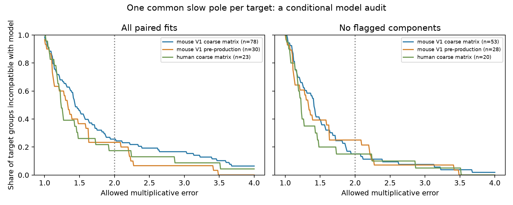

# A shared tail model needs over twofold voltage-decay error in 20 of 78 selected Allen mouse target groups with current decay fixed

A common passive-tail model could not match all released voltage decay values within a factor of two in 20 of 78 target-and-sign groups in the Allen mouse V1 coarse matrix series. Each group contains at least two inputs with paired voltage and current decay values. Current decay values were held fixed. All 78 groups could meet this tolerance if each input had its own membrane time. Thus the common target constraint, rather than current-versus-voltage inversion alone, causes these 20 failures.

After removal of inputs with accepted component fits within 1 percent of default decay limits, 7 of 53 remaining groups still fail. These are finite sample counts under a specified model. They do not reject passive filtering in real neurons.



## Question and prior work

Can one membrane decay time per target reproduce paired voltage and current decay summaries at all measured inputs of the same sign? This is useful when circuit models reduce many input filters to one cell parameter.

Campagnola, Seeman, and colleagues measured local cortical connections and responses (2022, doi:10.1126/science.abj5861). The link between structure and function here is direct: pair and cell IDs identify the measured circuit edges and response fits. No cross-animal anatomical match is assumed.

SCI searches for connectome, synapse latency, shared, and common decay inspected campaign publications. We also inspected the verified SCI search cache and read three published results. SCI ea126e6a tested shared-cell timing. SCI 58ac2284 tested a voltage-current similarity contrast between sharing roles. Both found limited evidence. SCI a443f362 showed why component fits must be checked for default-limit proximity. We use its screening definitions. Full IDs are in sci.json. These results motivated a model feasibility audit instead of another similarity test. An initial broad matched analysis was completed in local scratch work and is not used as new evidence here. The present result is exploratory, with no external registration. We used no private sibling workspace or child agent.

External searches found the original Allen paper and the Allen analysis documentation at https://brain-map.org/support/documentation/synaptic-physiology-analysis-methods-connection-characterization . The new contribution is a closed-form error bound, a reusable checker, and its application to common-target input groups. We do not claim that passive membrane filtering is a new hypothesis.

## Model and exact bound

Assume a single exponential current tail with time c_i, a passive first-order membrane with time m, nonzero response amplitude, and a true late-time decay. Convolution gives a voltage tail with time max(c_i, m). When the two times are equal, a polynomial factor does not change the limiting exponential decay. We apply this rule to stored fitted decay summaries as an approximation. Those summaries are not direct measurements of asymptotic poles.

For one target and input sign, let x_i = ln(v_i), y_i = ln(c_i), and z = ln(m). Define

    E = min_z max_i |x_i - max(y_i, z)|.

The minimum allowed multiplicative voltage error is exp(E). Current times are fixed. The error factor permits a model prediction between v_i/f and f*v_i at each input. It does not permit error in both recording modes. There is no prescribed physiological range for m, so this is a permissive test of the common time.

Write a = min_i x_i. The exact bound is

    E_edge = max(0, max_i(y_i - x_i))
    E = max(E_edge, 0, max_i min((x_i - a)/2, x_i - y_i)).

E_edge is the optimum when every input may have its own membrane time. E minus E_edge is the extra worst-case log error caused by the common target constraint.

Proof: for an allowed log error e, every y_i must be at most x_i+e. The common z must be at most a+e. For every input with y_i < x_i-e, it must also be at least x_i-e. These intervals intersect unless an input has both e < (x_i-a)/2 and e < x_i-y_i. The displayed maximum is exactly the smallest e that avoids all such failures and the edge constraints. The value z=a+E is a feasible witness. This establishes necessity and sufficiency. It also gives an interval test that can be implemented without the closed form.

## Data and selection

The only shared raw file used is

`/mnt/dell-data/shared_datasets/allen_synphys/r2.1_small_2023-01-26/synphys_r2.1_small.sqlite`

The worktree link is `./datasets/allen_synphys/r2.1_small_2023-01-26/synphys_r2.1_small.sqlite`. Source: https://allen-synphys.s3-us-west-2.amazonaws.com/synphys_r2.1_small.sqlite . Version: r2.1 small, schema 22; last modified 2023-01-26. Size: 176771072 bytes. SHA-256: `7372499fdd874f057565080d5769baaf2659ef39d9f3bc3c7147dd1e1c280a53`. The raw run verified this hash and opened SQLite read-only. No shared file was changed or downloaded.

SQL selects detected monosynaptic connections with pair.has_synapse=1. We require positive PSP and PSC decay summaries. A group fixes project, species, postsynaptic cell, and synapse sign. It must have at least two retained inputs. The same target can form separate excitatory and inhibitory groups. We do not match source class: the tested common filter must accommodate all sources of that sign. Groups are not independent animals. This is an audit of the available release, with no population p-value or confidence interval.

The summaries are response-count-weighted means of accepted fits and can combine holding potentials. The component screens remove an edge if any accepted component with positive response count and positive decay is within a relative tolerance of a default limit in either clamp mode. Voltage limits are 0.005 and 0.5 seconds; current limits are 0.0004 and 0.04 seconds, as documented in SCI a443f362. Tolerances are 1e-6, 1e-4, and 0.01. These are numerical proximity screens, not fit quality or confidence tests. The exact database build link to the inspected upstream defaults is incomplete. We use no pulse-train arrays or polysynaptic fits.

## Results

Failure means E > ln(2). The following table gives failures divided by target-and-sign groups. A target can occur in both sign rows.

| Recording series | Sign | All paired inputs | Component screen 1e-6 | Component screen 1 percent |
|---|---|---:|---:|---:|
| Mouse V1 coarse matrix | Excitatory | 3/24 | 2/18 | 2/18 |
| Mouse V1 coarse matrix | Inhibitory | 17/54 | 6/35 | 5/35 |
| Mouse V1 pre-production | Excitatory | 5/22 | 5/21 | 5/20 |
| Mouse V1 pre-production | Inhibitory | 2/8 | 2/7 | 2/7 |
| Human coarse matrix | Excitatory | 4/22 | 3/20 | 3/20 |
| Human coarse matrix | Inhibitory | 0/1 | No group | No group |

The second mouse series has 7/30 failures before screening. The human sample has 4/23. These are separate selected series, not independent confirmation or a species comparison. All counts for other projects, error thresholds, and screens are in files/summary.csv. The factor-of-two threshold is an illustrative model tolerance, not a biological error estimate. The figure gives the full failure curve from factors near one to four. It uses the 1e-6 screen in the right panel. The wider 1e-4 screen gives the same main failure counts as the 1 percent screen.

The main coarse matrix sample contains 171 paired inputs in 78 groups. After the 1 percent screen, 115 inputs in 53 groups remain. These groups can overlap in slice and source cell. The minimum error at fixed current times and the feasible membrane witness for every group are in files/targets.csv. Row membership is explicit through edge IDs.

## Checks and limits

The closed form and an interval bisection solver agreed for all 627 target-screen records to about 1e-13 log units. Every stored membrane witness attained the bound within floating-point error. A separate script uses only Python CSV and scalar arithmetic to rebuild interval feasibility from each group's inputs. Its maximum error difference was below 1e-15. It checks group identity and screen membership. Raw-database and extracted-data reruns are supplied and were compared. These checks validate the calculation, not the physiological approximation.

A fitted finite-waveform decay is not necessarily a true tail constant. Averaging components is not the same as fitting one physical response. Voltage and current were measured in different clamp states and trials. Driving force, active conductances, dendritic location, imperfect space clamp, and fit uncertainty can all break the approximation. Even one passive membrane with more than one spatial mode need not obey this one-pole model. The failure counts therefore constrain use of released summaries in a reduced model; they do not establish distinct membrane times for different real inputs.

Removal of flagged components can change the sample composition. Unflagged fits can still be uncertain. Missing or weak inputs, slice damage, and connection detection select these small graphs. No matched intact-brain activity, behavior, representation reliability, or brain-wide dynamics was tested. The groups do not establish animal, region, or behavioral generalization. A useful next test would fit paired waveforms with a shared transfer function and explicit uncertainty in both clamp modes.

## Reproduce

Use Python 3.12, NumPy, pandas, and Matplotlib. Versions and the raw source hash are in files/provenance.json. The package includes 3,297 extracted edges, accepted component fields, selected paired edges, group membership, all results, a figure, and independent check code. The raw database is external.

From the unpacked publication, run:

```sh
python files/model_audit.py --inputs files --out reproduced
python files/check_evidence.py
python files/model_audit.py --database /mnt/dell-data/shared_datasets/allen_synphys/r2.1_small_2023-01-26/synphys_r2.1_small.sqlite --out reproduced_raw
```

The raw command verifies the expected hash, extracts the source fields, and repeats the full analysis. Keep outputs outside the shared data store. If the raw file is absent, retrieve it with the campaign helper using a new name:

```sh
campaign-dataset allen-synphys-common-tail-r21 --url https://allen-synphys.s3-us-west-2.amazonaws.com/synphys_r2.1_small.sqlite --filename synphys_r2.1_small.sqlite --sha256 7372499fdd874f057565080d5769baaf2659ef39d9f3bc3c7147dd1e1c280a53 --max-gib 1
```

Use the completed path returned by the helper. The raw source remains under the Allen Institute Terms of Use: https://alleninstitute.org/legal/terms-use/ . Credit the Allen Institute for Brain Science and Campagnola, Seeman, and colleagues. The baseline license applies to new material to the extent permitted by source terms; it does not replace those terms.

## Job record

Campaign: 11_07_2026. Job: sci-1107-syam2-neural-structure-and-computation-f676e5453319. Topic: neural-structure-and-computation. Machine: syam2. Account: codex-myxtap. Model: gpt-6.1-sol with high reasoning effort, through Codex in T3 Code. No agents were launched. The campaign-machine signature is not a personal authorship claim. This bundle is stored locally only.
