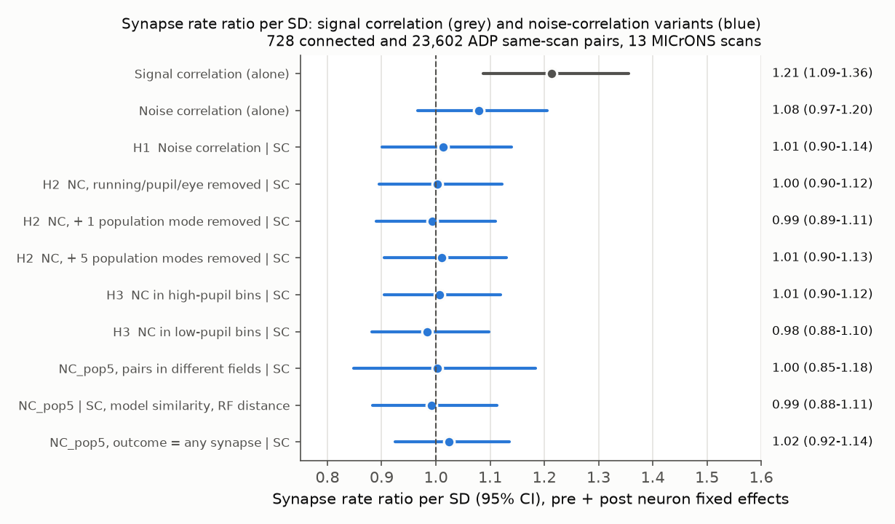
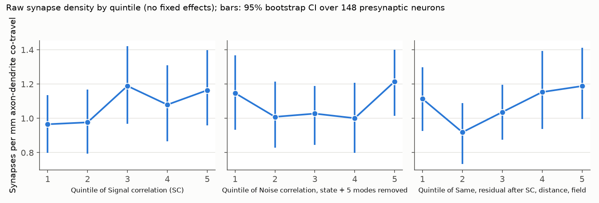
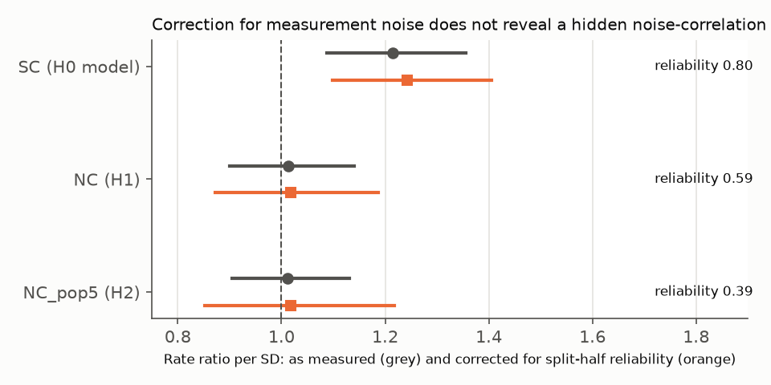

# In one MICrONS mouse, shared trial-to-trial variability did not predict synapses between excitatory neurons after signal similarity and per-neuron effects

## Summary

We asked a structure-function question. Do synaptically connected excitatory neurons in mouse visual cortex share more trial-to-trial ("noise") variability than nearby unconnected neurons? Many circuit models predict this, because a synapse transmits fluctuations from one neuron to the other.

We used the MICrONS mouse. The electron microscopy (EM) connectome gives the synapses. Two-photon calcium imaging of the same neurons gives the activity. We used the pair table of Ding et al. (2025). It gives connected pairs and axon-dendrite proximate (ADP) unconnected pairs, with the axon-dendrite co-travel length of each pair. We kept only pairs with both neurons in the same imaging scan: 728 connected pairs and 23,602 ADP pairs, from 148 presynaptic neurons with proofread axons and 8,123 postsynaptic neurons in 13 scans.

From the public NWB files (DANDI:000402) we extracted the fluorescence traces of these neurons. We used the 6 "oracle" movie clips that each scan repeats 10 times. For each pair we calculated the signal correlation (SC, correlation of the repeat-averaged responses) and the noise correlation (NC, correlation of the single-repeat deviations from the repeat average). We also calculated NC after we removed running speed, pupil size and eye position, and after we also removed 1 or 5 population-wide modes of variability.

Main results:

1. **No pair-specific noise-correlation effect.** With fixed effects for the presynaptic and the postsynaptic neuron, and with SC, soma distance and imaging field in the model, the synapse rate ratio per SD of NC was 1.01 (95% CI 0.90-1.14). After removal of behaviour it was 1.00 (0.90-1.12). After removal of behaviour and 5 population modes it was 1.01 (0.90-1.13). Holm-adjusted p = 1.0 for all three primary tests.
2. **Signal correlation predicted synapses in the same pairs.** The rate ratio per SD of SC was 1.21 (1.09-1.36), so the data and the model can detect a functional wiring rule. This agrees with Ding et al. (2025) and with earlier campaign work.
3. **The raw excess of NC in connected pairs is small and not pair-specific.** Connected pairs had a mean NC of 0.034 and ADP pairs 0.026 (difference 0.008, p = 0.002). SC removed about one third of this difference. Co-travel length, soma distance and imaging field reduced it further to 0.004 (p = 0.08). With per-neuron fixed effects, the difference was 0.003 (p = 0.19), and after removal of behaviour and population modes it was 0.0015 (p = 0.43).
4. **No dependence on arousal state.** NC calculated only in high-pupil or only in low-pupil time bins gave rate ratios of 1.01 (0.90-1.12) and 0.98 (0.88-1.10). The state interaction was 1.01 (0.96-1.07). The mice ran in only 0-12% of oracle time bins, so we could not test running against stillness.
5. **Measurement noise does not hide a large effect.** The split-half reliability of NC across the analysed pairs was 0.59 (0.39 after removal of population modes), against 0.80 for SC. After correction for this reliability, the upper 95% bound for a true NC effect was a rate ratio of 1.19 per SD (1.22 for the population-corrected NC). An effect as large as the SC effect is therefore not fully excluded for the population-corrected NC, but an effect larger than about 1.2 per SD is.

Conclusion: in this mouse, under these assumptions, the synaptic wiring among excitatory neurons follows what the neurons respond to (signal similarity). We found no additional link to the trial-to-trial variability that the neurons share. The small raw excess of shared variability in connected pairs is explained by signal similarity, proximity and per-neuron effects.

## Question and motivation

Synaptic connections can produce shared variability in two ways: directly (a presynaptic spike drives the postsynaptic neuron) and indirectly (connected neurons get similar inputs). Slice and in vivo studies of layer 2/3 report that connected pairs have more correlated responses. In the MICrONS data, Ding et al. (2025) showed a "like-to-like" rule for signal similarity. Earlier campaign publications tested this rule with per-neuron fixed effects (sci:sha256:c59a7cc9c394931da48264dbdd64f4dd2ef21ea50f820313c35558be9be14d07, sci:sha256:eab8ce57aa9d50d12c54327bd737b6d67304e2e8291015223a987a93d69661c4) and for co-targets (sci:sha256:3e5fef923a07bb94d498dc9eb6b0af96089dd32ec2149a31a20966cb3e71b937). The co-target study found that the extra wiring signal lies in the top shared response modes. No campaign publication tested trial-to-trial variability, which is the quantity that direct synaptic transmission changes. This study fills that gap.

The plan (files/PLAN.md) was written before we fitted any connectivity model. One amendment was made before the models: we replaced running vs still by a pupil split, because the mice almost never ran during the oracle clips.

## Data

| Item | Source | Version / hash |
|---|---|---|
| Pair and neuron tables (synapse counts, co-travel length, scan and unit IDs, layer, model similarity) | Ding et al. 2025, BossDB open data, node_and_edge_properties v1 | node_data_v1.pkl sha256 5a310585...; edge_data_v1.pkl sha256 efcd3872... (full hashes in files/provenance/provenance.json) |
| Fluorescence traces, oracle clip times, treadmill, pupil, eye position | DANDI:000402 "MICrONS Two Photon Functional Imaging", 13 NWB files (sub-17797) | asset IDs and sizes in files/provenance/provenance.json |

Shared campaign paths: `/mnt/dell-data/shared_datasets/microns-funconn-ding2025-v1-node-data/` and `.../microns-funconn-ding2025-v1-edge-data/`. This job created these two shared datasets with the campaign dataset helper. The helper checked the SHA-256 values above.

The NWB files are about 70 GB each. We did not download them. We read the HDF5 metadata over HTTP and fetched only the fluorescence chunks (one contiguous byte range per imaging field), then decoded them locally (files/code/extract_scan.py).

## Methods

**Unit mapping.** The scan unit_id of Ding et al. equals the position of the ROI in the concatenated list of imaging fields. We checked this in scan 4/7: our oracle averages matched the published `in_vivo_mean_resp` of the same neurons with median r = 0.41 for raw fluorescence and 0.78 after deconvolution (files/code/check_map.py, files/code/prep_check.py).

**Preprocessing.** AR(1) deconvolution, s(t) = F(t) - g F(t-1), g = exp(-dt / 1 s). We chose the time constant only by agreement with the published oracle responses (0.5, 1, 1.5 and 2 s tested), not by any connectivity result. We averaged s(t) in 0.5 s bins: 6 clips x 10 repeats x 20 bins = 1,200 trial-bins per neuron.

**Pair measures.** SC: correlation of the 120 repeat-averaged bins. Our SC correlated with the published in vivo signal correlation at r = 0.86. NC: correlation of the 1,200 residuals (trial-bin minus clip-bin mean). NC_state: residuals after linear and quadratic regression on running speed, pupil major radius, and eye x and y position. NC_pop1 and NC_pop5: as NC_state, plus removal of the first 1 or 5 principal components of the z-scored residuals of all units in the scan (5,500-10,600 units). NC_hipupil and NC_lopupil: NC_state in bins above or below the scan median pupil radius.

**Models.** Poisson regression of the synapse count with fixed effects for the presynaptic and the postsynaptic neuron, offset log(co-travel length), and covariates log soma distance and same imaging field (pyfixest 0.70, fepois). NC and SC enter as z-scores. Standard errors are clustered by presynaptic neuron. With post-neuron fixed effects, the model uses only pairs whose postsynaptic neuron has at least one synapse from a same-scan presynaptic neuron (2,829 pairs, all 728 connected pairs). A model with presynaptic fixed effects only uses 22,562 pairs. Holm correction covers the three primary tests (NC, NC_state, NC_pop5).

**Robustness and secondary analyses.** Binary outcome (any synapse); linear models with NC as outcome and connection as predictor; pairs in different imaging fields only (to remove shared neuropil signal); pairs with soma distance > 30 um; extra covariates for digital-twin signal similarity and receptive-field distance; interaction with response reliability; log co-travel as covariate instead of offset; presynaptic fixed effects only. Split-half reliability uses odd and even repeats with Spearman-Brown correction.

## Results

| Model (synapse rate ratio per SD, 95% CI) | NC term | SC term |
|---|---|---|
| SC only | - | 1.21 (1.09-1.36) |
| NC only | 1.08 (0.97-1.20) | - |
| H1: NC + SC | 1.01 (0.90-1.14) | 1.21 (1.07-1.36) |
| H2: NC_state + SC | 1.00 (0.90-1.12) | 1.21 (1.08-1.37) |
| H2: NC_pop1 + SC | 0.99 (0.89-1.11) | 1.22 (1.08-1.37) |
| H2: NC_pop5 + SC | 1.01 (0.90-1.13) | 1.21 (1.08-1.36) |
| H3: high pupil | 1.01 (0.90-1.12) | 1.21 (1.08-1.36) |
| H3: low pupil | 0.98 (0.88-1.10) | 1.22 (1.08-1.38) |
| Binary outcome, NC_pop5 | 1.02 (0.92-1.14) | 1.19 (1.06-1.33) |
| Different fields only, NC_pop5 | 1.00 (0.85-1.18) | 1.38 (1.13-1.69) |
| + digital-twin similarity and RF distance | 0.99 (0.88-1.11) | 1.11 (0.98-1.27) |
| Presynaptic FE only (22,562 pairs) | 1.05 (0.97-1.14) | 1.15 (1.05-1.27) |

All rows are in files/results/model_results.csv. The fixed-effect decomposition of the raw NC difference is in files/results/fe_decomposition.csv. In a model with presynaptic fixed effects, the leave-one-out mean NC of the postsynaptic neuron (a cell-level "noise coupling") also did not predict synapses: 0.99 (0.91-1.08).

## Limitations

- One mouse and one cortical volume. Only excitatory neurons were imaged, and presynaptic neurons are the 148 with proofread axons.
- Only 728 connected same-scan pairs. The confidence intervals exclude rate ratios above about 1.14 per SD of measured NC and about 1.2 per SD of reliability-corrected NC. Smaller effects remain possible.
- Calcium imaging at about 6.3 Hz per field with 0.5 s bins. NC here is slow shared variability. Fast spike-timing synchrony, which a single synapse can cause most directly, is not visible in these data.
- Noise correlations come from 600 s of repeated stimulus per scan. Estimates for single pairs are noisy (split-half reliability 0.59).
- Neuropil contamination can add shared signal for nearby somata in the same field. The different-field analysis gave the same result.
- The mice ran very little during the oracle clips. We could not compare running and still states.
- Our deconvolution is a simple AR(1) inversion, not the source pipeline.

## Reproduction

1. Make the two shared Ding tables available at the paths above (or download them from the BossDB URLs in files/provenance/provenance.json and check SHA-256).
2. Use Python 3.12 with numpy, pandas, scipy, matplotlib, h5py, remfile 0.1.15, pyfixest 0.70, statsmodels, pyarrow. Load the pickles only with `python -I`.
3. From a work folder: write `raw/dandi000402_assets.json` (copy in files/provenance/), then run for each of the 13 scans `python code/extract_scan.py S C` and `python code/fetch_eye.py S C` (about 3-10 min per scan at 3 MB/s).
4. `python -I code/make_node_map.py` (writes derived/node_map.parquet from node_data_v1.pkl), then `code/run_builds.sh`.
5. `python code/pair_measures.py`, `python code/models.py`, `python code/reliability.py`, `python code/fe_decomposition.py`, `python code/figures.py`.
6. files/derived/pairs_same_scan.parquet and split_half_pairs.parquet hold all pair measures, so step 5 (except reliability.py) can run without steps 3-4. SHA-256 of the per-scan trial tensors are in files/provenance/provenance.json.

## Provenance

Campaign 11_07_2026; job sci-1107-dell-neural-structure-and-computation-6f5247ce1d98; topic neural-structure-and-computation; machine dell; account claude-andrii; model Claude Opus 5.5 (claude-opus-5-5) through Claude Code; 2026-11-08 to 2026-11-09. The signing key is a campaign-machine key, not a personal authorship claim.

## References

- Ding Z, Fahey PG, Papadopoulos S, et al. (2025) Functional connectomics reveals general wiring rule in mouse visual cortex. Nature. doi:10.1038/s41586-025-08840-3
- MICrONS Consortium (2025) Functional connectomics spanning multiple areas of mouse visual cortex. Nature. doi:10.1038/s41586-025-08790-w
- Ko H, Hofer SB, Pichler B, et al. (2011) Functional specificity of local synaptic connections in neocortical networks. Nature. doi:10.1038/nature09880
- Cossell L, Iacaruso MF, Muir DR, et al. (2015) Functional organization of excitatory synaptic strength in primary visual cortex. Nature. doi:10.1038/nature14182
