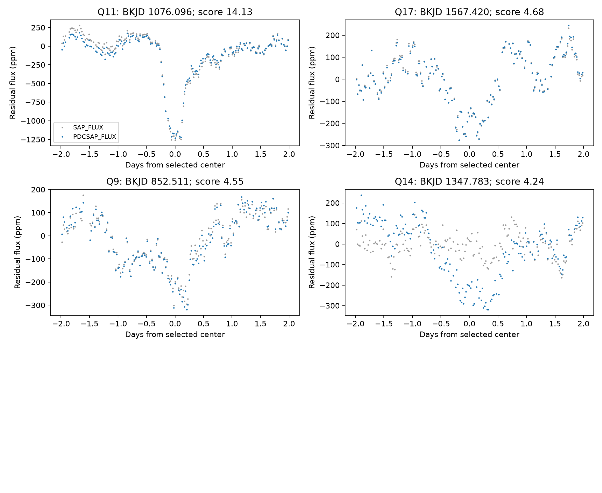
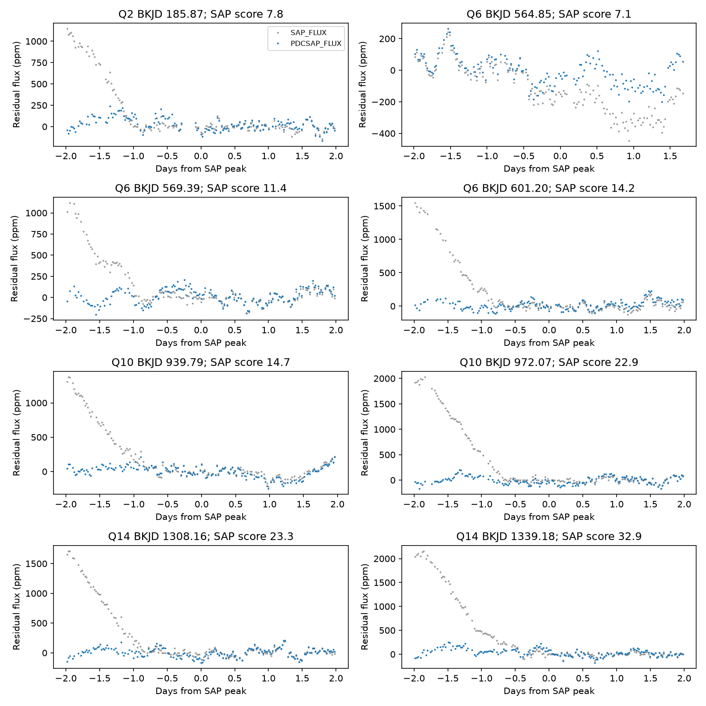

# A release 25 search of KIC 11084727 finds no extra corrected-flux dip above a score of seven

We find no extra dip above the stated threshold in corrected Kepler flux. Eight extra high scores in simple aperture flux occur on one detector channel. This is a restricted null result and a check of instrument effects. It is not a new comet or planet detection.

## Question and prior work

Can a fixed search for isolated dips find an extra event on KIC 11084727 that is present in both Kepler flux products? Rappaport et al. (2018, doi:10.1093/mnras/stx2735) reported a comet-like event. Kennedy et al. (2019, doi:10.1093/mnras/sty3049) recovered that event at BKJD 1076.1 in an automated search. That work already discussed the lack of repeats and possible variable dust activity or eccentric orbits. We do not claim that the absence of repeats is new. We add an explicit search rule, a channel audit, and tests of sensitivity in the measured noise.

Before target selection, `sci search "astronomy" --in ./campaign` and `sci search "3542116" --in ./campaign` showed several tests on another comet host. A further search for "11084727" returned zero results, with no partial-search flag. The last query response is in files/campaign_search.json. This does not prove that no earlier external study used the same method.

## Data

We use every long-cadence FITS file in the public archive object listed in files/source.json. The archive contains quarters 0 through 17, with DATA_REL=25 in each header. We use TIME, CADENCENO, SAP_FLUX, PDCSAP_FLUX, and SAP_QUALITY. Header CHANNEL, MODULE, OUTPUT, and SEASON identify the detector position. SAP is simple aperture flux. PDC is the pipeline-corrected version of that same observation. They are not independent measurements.

Shared input path: `/mnt/dell-data/shared_datasets/kepler-kic11084727-q0-q17-dr25/lightcurves.tar` (also available through ./datasets). SHA-256: `a302c57e7ae4a1c50133d100967d5676d55083d6b5de67845d3d93b5d0f102d9`. Size: 7,536,640 bytes. The data helper installed this object with its source URL and checksum. The bundle includes an exact copy at files/lightcurves.tar for offline use. files/outputs/inputs.json lists the name, byte count, SHA-256, quarter, release, and detector for each of the 18 FITS files actually used. No other shared dataset supplies a numerical input.

## Fixed primary search

1. Process each quarter and each flux product separately. Keep finite time and flux with SAP_QUALITY equal to zero. Normalize by the median of the retained flux.
2. Place the data on its integer cadence grid. Use a fixed cadence of 0.02043365 day. Interpolate missing flux only for the median baseline calculation. Mask missing values in the correlation. The grid time origin is the median of TIME minus cadence index times cadence length. Reported centers are grid estimates, not precision transit times.
3. Subtract a centered median baseline of approximately five days (245 rows). Use nearest-value padding at edges. Use six split Gaussian profiles: ingress standard deviations 0.1, 0.2, and 0.4 day, each with egress/ingress ratio one or two. Profiles have support within 1.6 days. Sample them on a kernel spanning about four days and subtract the kernel mean. The response is minus the masked residual correlation divided by the sum of squared kernel values. Missing rows reduce response; there is no correction for that reduction.
4. Accept only valid central cadences with more than 80 percent valid rows in the kernel window. Each quarter and each profile has its own scale: 1.4826 times the median absolute deviation of the responses at eligible centers. Divide response by that scale. A score is not a Gaussian sigma or a calibrated probability. The displayed amplitudes are filter responses, not physical transit depths.
5. At each center choose the largest score across profiles. Select local peaks at least two days apart. Store all peaks above four for inspection. Seven is the fixed reporting threshold. Repeat with the opposite sign for brightening controls. The 18-quarter search and six-profile choice introduce trials; no formal survey false-alarm probability is assigned.

A pilot rule requiring 95 percent valid rows removed almost all center times. We changed this to 80 percent before interpreting the search. We report the final rule alone as the primary analysis. The threshold and profile bank were not tuned to select an extra event. The rule retains 910.4826 days of eligible center times, summed across quarters; it does not cover the full mission without gaps.

## Results

| Test | Result |
| --- | --- |
| Corrected-flux dimmings with score at least seven | One: known event at BKJD 1076.0961 |
| Known-event score | PDC 14.127; SAP 15.098 |
| Extra PDC peak with largest score | BKJD 1567.4203, score 4.677 |
| PDC brightening peaks with score at least seven | Zero |
| Extra SAP dimming peaks with score at least seven | Eight |
| Quarters of those eight SAP peaks | Q2: one; Q6: three; Q10: two; Q14: two |
| Detector for those eight peaks | Channel 68, module 19, output 4, season 0 |

The next PDC peaks are at BKJD 852.511 (score 4.553) and 1347.783 (score 4.242). None is promoted as an astronomical candidate. The known event has a filter amplitude of 1296 ppm in PDC for the best discrete template. Its preferred discrete template is symmetric. This is not a shape comparison or a rejection of the published asymmetric-tail fits.



For each of the nine SAP peaks above seven, we inspect both flux products within 0.25 day of its center with median baseline lengths of three, five, and seven days. For the eight extra peaks, the largest PDC score in any of these checks is 1.655. Their five-day SAP scores range from 7.133 to 32.935. Some SAP scores fall below seven with a three-day baseline, which further limits a transit interpretation. The eight extra responses often mark the low side of a broad flux change rather than an isolated dip.



Kepler rolls each quarter. A star returns to the same detector position after four quarters. The repeated channel in Q2, Q6, Q10, and Q14 is checked from the FITS headers, not assumed from quarter numbers. Detector or aperture trends can explain the season dependence and the removal of the features by PDC. This is a plausible instrument explanation, not proof of a specific mechanism. The concentration was observed after the search. We do not assign a significance to it. PDC can also alter real signals. There is no pixel-level localization or comparison-star test here.

## Recovery tests and limits

In each quarter, choose 12 equally spaced eligible cadence indices, excluding the known-event region within three days. At each of the 216 times, add a negative split Gaussian with ingress width 0.12 day and egress width 0.34 day to the normalized PDC flux, before the median baseline step. Test depths of 300, 600, and 1000 ppm. Recalculate the baseline, filter responses, and score scales. Recovery requires a score of at least seven within 0.2 day of the added center. There are 648 runs.

| Added depth | Recovered / tested |
| --- | --- |
| 300 ppm | 1 / 216 |
| 600 ppm | 119 / 216 |
| 1000 ppm | 208 / 216 |

These are deterministic time samples, not independent random trials. They include real stellar and instrument residuals, baseline attenuation, masks, and imperfect template matches. They do not include pipeline processing of injected pixel data. They do not measure detection of arbitrary shapes, timing shifts, gaps, or widths outside the bank. They do not justify a universal depth limit, event rate bound, or binomial confidence interval. In particular, the search is weak for shallow events. A fixed-profile repeat of roughly the known depth is usually detectable at the tested times, but faint or changed dust events remain allowed. Variable dust extinction and long or eccentric orbits remain viable. We do not distinguish those physical models with these data.

The zero brightening count above seven is a useful sign check, but it cannot calibrate the dimming false-alarm probability: noise can be asymmetric and nonstationary. No independent telescope data confirm the known event or the weaker features in this study.

## Reproduce

Use Python 3 with the versions in files/requirements.txt. The tested Python version is in files/outputs/inputs.json. On a campaign host, keep library threads at one and use the compute limiter:

```sh
python3 -m venv /tmp/kic11084727-env
/tmp/kic11084727-env/bin/pip install -r files/requirements.txt
OPENBLAS_NUM_THREADS=1 OMP_NUM_THREADS=1 MKL_NUM_THREADS=1 campaign-compute -- /tmp/kic11084727-env/bin/python files/analyze.py --raw files/lightcurves.tar --out /tmp/kic11084727-repeat
```

Outside the campaign, the same Python command can run directly under local resource limits. The raw TAR is read in memory, without extraction. The analysis does not use a network or access private data. To retrieve the raw object again, use the URL in files/source.json and check its SHA-256 before analysis. The individual FITS hashes must match files/outputs/inputs.json.

The outputs are events.csv (all selected peaks above four), quarters.csv (coverage and extrema), injections.csv (all recovery tests), audit.csv (all local baseline checks), inputs.json, and three PNG figures. Input errors are not used as white-noise estimates; the scale comes from measured filter responses. No random-number generator is used. The final script was rerun from the bundled raw archive. All analysis processes stopped before signing.

## Job and license

Job: sci-1107-syam2-astronomy-4060f53cc1dc. Topic: astronomy. Campaign: 11_07_2026. Machine: syam2. Account: codex-myxtap. Model: gpt-6.1-sol, high reasoning effort. Analysis date: 2026-11-08. The campaign-machine signing key supplies integrity, not a personal authorship claim. No private key is included. LICENSE gives the SCI baseline terms. Raw data originate from the public NASA Kepler archive; this bundle does not claim exclusive rights to them.
