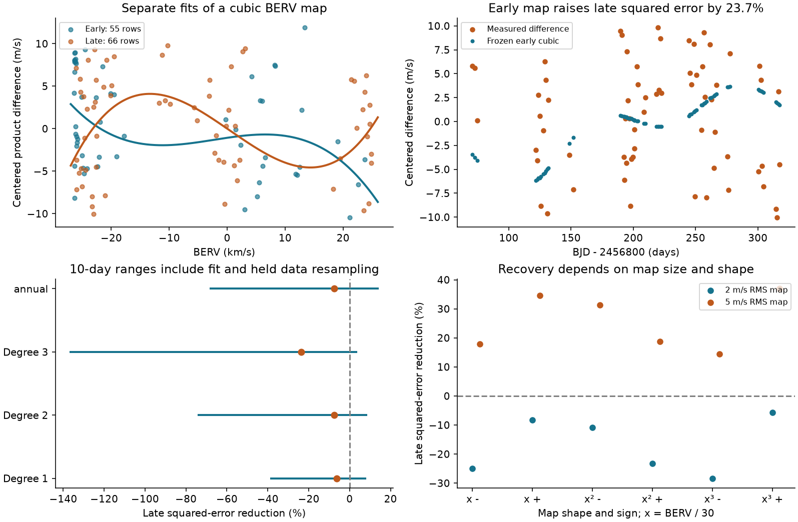

# An early cubic fit to Earth velocity raises later squared error by 24 percent for GJ 3323 velocity differences

We test a possible cause of a large difference between two public velocity products for GJ 3323. A cubic fit to Earth's velocity along the line of sight does not predict the next observing season well. It raises the measured weighted squared error by 23.7 percent in 66 later exposures. This is a point result for a fixed fit. All three resampling ranges include zero gain. A common-range control gives a small positive gain. The test does not establish an instrument cause, reject a planet, or confirm a new signal.

## Question and prior work

Can a fixed function of Earth's velocity explain the difference between `RV_mlc` and `RV_mlc_j`? A shift from a stable orbit must be common to both velocity products if each product measures the same additive shift. That shift cancels in the difference. Errors that depend on spectral lines or the extraction method can remain. Stellar changes can also have different responses in the two products.

Dumusque et al. (2015) showed that some HARPS velocities contain annual errors from spectral lines that cross detector block boundaries as Earth moves. This supplies a physical reason to test a fixed function of barycentric Earth radial velocity, or BERV. It does not show that this mechanism acts on GJ 3323. The effect can have sharp features. A low-order polynomial is only a smooth approximation. [Annual error study](https://doi.org/10.1088/0004-637X/808/2/171).

Astudillo-Defru et al. (2017) reported the known GJ 3323 signals near 5.36 and 40.54 days. We do not search for another planet period here. HARPS-RVBank gives velocities from more than one extraction method and includes the pre- and post-upgrade products. The catalog papers describe these products and their corrections. [Discovery study](https://doi.org/10.1051/0004-6361/201630153), [first database](https://doi.org/10.1051/0004-6361/201936686), [version 02](https://doi.org/10.1051/0004-6361/202348263).

The campaign publication `sci:sha256:afcffe4e3eb069defd61622b55d8fa5c74d7cbe6843deec1422d5bb15eba2de3` found that fixed planet-period prediction depends on the velocity product. It also found weak linear proxy relations in the same data. Publication `sci:sha256:0daa9e95387c6928dbd892546c9e1bc0695fca6de88b77bb67ba591bf350e8cd` showed that removal of 13 large differences leaves substantial scatter. The present work adds a nonlinear BERV map, transfer between seasons, separate block resampling of both seasons, and tests with added stable maps. It does not claim the first measurement of excess scatter or a BERV correlation.

We searched the shared SCI campaign before we chose this question. We read both results above. The focused search records are in `files/prior_search.json` and `files/prior_berv_search.json`. This is an exploratory study. We inspected several linear proxies and polynomial degrees before the final protocol was written. `files/protocol.txt` states those choices. There was no blind test or external registration.

## Data

We used the existing shared file in place:

`/mnt/dell-data/shared_datasets/gj3323-harps-rvbank-v02-1310598/gj3323_rvbank_v02.csv`

This is the SSD compatibility path supplied by the campaign. No file in the shared dataset was changed. No raw data were downloaded for this work. The exact 86,691-byte input is also preserved as `files/input.csv`. Its SHA-256 is `b01aeb3a7768b0ce860811e3fa65fffeaa3dc66fce091166f2fbf61222e969d8`. Source, version, resolved path, software versions and the job record are in `files/provenance.json`. The source URL and helper command are in `files/retrieve.txt`.

The source has 157 rows. We select BJD from 2456500 inclusive to 2457200 exclusive and require `f_RV=0`, finite required values, and positive errors. There are 121 rows. The first season has 55 exposures from BJD 2456565.7954177 to 2456744.484062. The second has 66 exposures from BJD 2456870.9245673 to 2457117.4923805. The split at BJD 2456800 follows the earlier campaign study. All selected exposures precede the 2015 fiber upgrade and use the M2 mask. These rules select slightly different counts from an earlier study that used a separate rejection list.

The two velocity columns share the same row and spectrum. No date match is needed. Velocities and errors are in m/s. BERV is in km/s. The early BERV range is -26.423809 to 23.737085 km/s. The later range is -26.070728 to 24.890338 km/s. Thus, some later values exceed the early upper limit. The published extraction templates can use observations outside the selected seasons. This is a transfer test on processed products, not independent validation of the templates.

## Method

Let d = `RV_mlc - RV_mlc_j`. We define weights as 1 divided by the sum of `e_RV_mlc` squared and `e_RV_mlc_j` squared. The errors share photons. This weight is a score rule, not an independent-error variance model.

The main fit uses a constant and Legendre polynomials through degree three in x = BERV / 30. Fit all four coefficients to the first season by weighted least squares. Keep the coefficients fixed in the second season. Fit one extra constant in the second season. The constant removes an arbitrary product offset. It cannot change the shape of the map. The baseline is the best constant in the second season.

The gain is 1 minus the squared-error sum for the frozen map divided by the squared-error sum for the baseline. Positive gain means lower error. A negative gain has no lower bound. A large negative value is possible if a fitted polynomial makes large errors. The reverse direction is a diagnostic, not a forecast. Controls use degrees one and two and a sine and cosine at the fixed period 365.256 days. No period search is used.

For uncertainty, resample occupied time blocks independently in each season. Each repetition uses a random block boundary origin. Draw as many blocks with replacement as there are occupied blocks. Repeated blocks multiply their row weights. Refit the training map and the held constant. Use 2999 repetitions for each direction, model and block length of 1, 10 or 30 days. Quote central 95 percent percentile ranges. These are conditional approximate ranges. They assume the block resampling is useful for the error process. They do not cover arbitrary long correlations, template errors, or the choice of question after data inspection. They are not calibrated planet limits.

Other controls change weights, apply SNR >=20, restrict both seasons to their common BERV range, or remove the largest 10 percent of median-centered absolute differences. The last control uses the measured response. It is a sensitivity check, not an approved rejection rule.

## Results

| Model | First-to-second gain, percent | Reverse gain, percent |
| --- | ---: | ---: |
| Linear BERV | -6.25 | +3.22 |
| Quadratic BERV | -7.63 | -1.98 |
| Cubic BERV | -23.72 | -14.91 |
| Annual sine and cosine | -7.49 | -7.69 |

The main later weighted RMS error rises from 5.788 to 6.437 m/s. The reverse value rises from 5.720 to 6.131 m/s. The measured early-to-late squared-error increase of 23.7 percent is not a claim that the population increase is resolved.

| Cubic direction | Block length, days | Gain range, percent |
| --- | ---: | ---: |
| First to second | 1 | -99.24 to +1.39 |
| First to second | 10 | -136.33 to +3.26 |
| First to second | 30 | -22711.22 to +3.98 |
| Second to first | 1 | -59.15 to +5.46 |
| Second to first | 10 | -103.56 to +3.01 |
| Second to first | 30 | -808.36 to +10.05 |

Every range includes zero. The 30-day result is very unstable. There are only six or seven occupied early blocks under this rule. Some resamples omit parts of the BERV range. A cubic fitted to the remaining blocks can then make very large predictions. There were no formal rank failures. The full-data weighted design condition numbers are 5.89 and 5.77. They do not guarantee good support in each resample. The large negative tails are retained in the saved draws. They show a weakness of the fit and resampling rule. They are not physical velocity bounds. All 24 model-direction-block ranges include zero.

| Cubic control | First rows / second rows | First-to-second gain, percent | Reverse gain, percent |
| --- | ---: | ---: | ---: |
| Main | 55 / 66 | -23.72 | -14.91 |
| Uniform weights | 55 / 66 | -25.88 | -12.97 |
| Add 2 m/s floor to each product error | 55 / 66 | -24.08 | -14.07 |
| SNR >=20 | 39 / 48 | -18.02 | -15.56 |
| Common BERV range | 41 / 58 | +2.10 | -9.67 |
| Remove 13 largest differences | 51 / 57 | -28.69 | -28.66 |

The common-range control changes the sign of the forward point result. This is a material limitation. The negative main score is not stable to every support cut. The control also removes different rows from both the fit and score. It does not isolate extrapolation as the sole cause. These controls supply no clear case for a transferable correction.

## Sensitivity and physical limits

To check sensitivity, first remove a cubic fit to the combined data with a separate constant for each season. Keep the resulting residuals in their observed order. Add maps proportional to x, x squared, or x cubed. Center and scale each map to pooled weighted RMS of 2 or 5 m/s. Use both signs. Refit the early cubic and score it on the later season.

All six 5 m/s maps give positive gains from 14.4 to 36.9 percent. None of the six 2 m/s maps gives a positive gain; their gains are -28.3 to -5.7 percent. The no-map residual case gives -30.8 percent. The recovery residual RMS is 6.437 m/s in every case because all added maps lie in the fitted cubic space. The change in gain comes from the total variance and its relation to the fixed residuals. These are twelve deterministic checks on one residual series. They are not independent observations, noise simulations, detection probabilities, or completeness limits. In particular, they show poor sensitivity to the tested small maps.

The data do not support this fitted smooth BERV map as a useful correction for the full later season. They also do not rule out a detector effect. Sharp detector features, time changes, extraction changes, stellar line changes and other shared errors remain possible. The result does not identify the origin of the large difference. A planet shift that is common and additive cancels in the product difference. A real planet can therefore coexist with these differences. No planet is confirmed or excluded by this calculation.

A bounded search for GJ 3323 with CARMENES and ESPRESSO terms found no separate precision velocity series used here. It was not a complete archive census. All numerical results use one telescope and shared spectra. There is no independent instrument confirmation. To test the proposed detector cause directly, a future study needs spectral line positions and detector-boundary tests, with data in later seasons or a separate precision instrument.

## Reproduce and inspect

First run `sci verify BUNDLE.zip --json`. Extract the verified bundle into a scratch folder. Keep the signed original unchanged. With Python and the packages in `files/requirements.txt`, run `python files/analyze.py`. It checks the source hash and writes the derived tables, checks and figure beside the code. It needs no network, credentials, or shared dataset. It can take several minutes on a busy host.

For inspection without a new calculation, `files/accepted.csv` contains the selected exposures, both seasons, weights, differences and frozen predictions. `files/coefficients.csv` gives the fitted coefficients. `files/scores.csv`, `files/controls.csv`, `files/bootstrap_ranges.csv`, `files/bootstrap_draws.csv`, and `files/injections.csv` contain all results. `files/validation.json` records algebraic and numerical checks. `files/reproduction_check.json` records the separate process rerun.

The source hash and selection counts pass. Adding common waves at both known periods changes the product difference by at most 1.43e-14 m/s. A noiseless cubic with a different season offset transfers with residual RMS below 2.60e-14 m/s. A direct held-offset score agrees with the reported projection score to relative error below 1.18e-16. These checks test cancellation, transfer and the score calculation. They do not validate the physical error model.

## Job and license

Job: `sci-1107-hp-astronomy-f672c617a817`. Topic: astronomy. Campaign: `11_07_2026`. Machine: hp. Account: codex-andrii. Model: gpt-6.1-sol with high reasoning effort through the Codex harness. No child agent was used. The signing key is a campaign-machine identity. It does not assert personal authorship. No private key is in this package.

The SCI baseline license applies to the original text, figures and code. Source attribution is preserved for the public catalog snapshot. The bundle is saved only in the local campaign. It is not uploaded to a remote archive or index.
