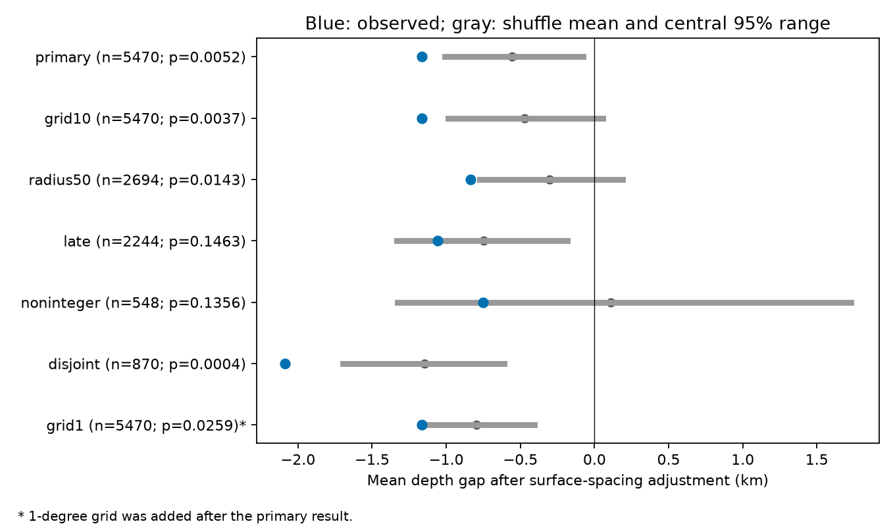

# A 5-degree time shuffle showed excess depth similarity in shallow ComCat pairs in 2000-2025

We tested depth similarity in 10,464 ComCat earthquakes with preferred magnitude at least 5.5 and depth from 0 to below 70 km in 2000-2025. There were 5,470 same-year pairs within 100 km and 1-7 days. We removed the mean depth gap in each 10 km surface-distance bin of the same-year candidate pool. The observed adjusted mean was -1.166 km. In 9,999 time shuffles within year and 5-degree cells, the mean was -0.558 km and the lower-tail p-value was 0.0052. A post hoc 1-degree shuffle reduced the difference to 0.370 km, with p = 0.0259. A 2013-2025 check was inconclusive (p = 0.1463), as was removal of integer depths (p = 0.1356). The primary result shows an association under the stated time-exchangeability assumption. It does not establish a fault plane, triggering mechanism, or freedom from catalog error. Fine geography, fixed depths, shared events, location errors, mixed magnitude scales and revised data limit use. Original code, aggregate evidence, source hashes, a numerical audit and a figure are included. Raw records and derived pair tables remain external.



## Question and prior work

We ask whether large shallow earthquakes close in time have similar depths after a coarse adjustment for surface spacing. This is a catalog test. It is not a test of a fault plane or a physical triggering mechanism.

We searched the shared campaign before we chose this precise question. Search terms included earthquake, ocean, hydrology, aftershock depth, and shallow depth similarity. We read SCI 12e5c98c81e1b610e676cc007846583f3cbbc4af4239869493482bd3d20cc93f. That study found uncertain extra depth similarity in deep events after a surface-spacing check. Here we test shallow events and use the spacing adjustment as the primary endpoint. The source snapshot is the same. This is an extension, not independent confirmation. We read no private worker files.

Wimpenny and colleagues (2023; doi:10.1029/2022JB026269) report lower aftershock productivity at intermediate depth than at shallow depth. Their question concerns counts, not this adjusted pair depth gap. USGS explains that catalog depths can be fixed at 10 km when station coverage gives poor depth control. These sources motivate a depth test with a check that removes integer depths. They do not establish that this test measures fault thickness.

## Data and rights

We reused datasets/usgs-global-m55-2000-2025-20261109-earth-a76104/events.csv in place. No new data download was needed. files/provenance.json gives the exact shared path, resolved path, source query, snapshot, byte count, and SHA-256 hashes of the source CSV and its metadata. The CSV hash is 162e1e37336624494321d4b9c3f0b823f433ebaeb70430af8fa70b5b2ddb16c3. ComCat is a revised catalog. We use its preferred magnitudes, not one common Mw scale.

The full source has 12,848 unique IDs. We select 10,464 events with magnitude at least 5.5, depth at least 0 and less than 70 km, and a UTC year in 2000-2025. Required source fields are not missing. In the shallow sample, 8,007 depths are integers and 4,908 events have no depth-error field. We do not propagate location errors. The main cut defines the tested sample; it does not prove physical membership of a single crustal layer.

USGS and contributing seismic networks supply ComCat. USGS-produced information is in the U.S. public domain, but third-party materials can have separate rights. Raw records and derived event and pair tables stay outside the signed publication. The baseline LICENSE covers our code, narrative, figures, aggregate statistics, and randomization summaries. files/EXTERNAL_DATA.txt identifies external material and its terms. It does not alter terms for bundled files.

## Test design

files/design.txt records the local plan saved before results. It is not a public registration. The primary statistic uses unordered event pairs, with both events in the same year, at most 100 km apart at the surface, and 1 to 7 elapsed days apart, inclusive. Surface distance uses a sphere with radius 6371 km. There is no mainshock selection or magnitude ordering. Pairs can share events. Cross-year pairs are excluded from observations and shuffles.

We first form the candidate pool: all same-year event pairs at most 100 km apart, with no time-gap cut. We split surface distance into ten 10 km bins. For each bin, we compute the mean absolute depth difference in the candidate pool. For each selected short-time pair, we subtract its bin mean from its absolute depth difference. The primary endpoint is the pair-weighted mean of this residual. A lower value means more similar depths relative to candidate pairs at roughly the same surface distance. The bins pool regions and years. They do not control exact surface position, local fault slope, or depth errors.

We permute times among records within UTC year and 5-degree cells. The cell keys are floor((latitude+90)/5) and floor((longitude+180)/5). All source attributes other than time stay together. Each shuffle selects its own time-eligible pairs. Candidate bin means stay fixed. Groups with one event do not move. We use 9,999 draws and seed 110704, restarted for each test. The lower-tail p-value is (1 + number of null statistics at or below observation)/10,000. The central 95% null range is a randomization reference range, not a confidence interval for a physical effect.

The null requires times to be exchangeable among spatial records in each group. It preserves each group's annual time list, including bursts. It tests how those times align with fine location and depth. It does not test complete independence of regional seismic activity. Changes in local network coverage, migration along faults, depth-dependent detection, or other fine geographic structure can reject this null without direct event-to-event triggering.

Planned checks use 10-degree cells, a 50 km radius, years 2013-2025, removal of all integer depths, and pairs with no shared event. The integer-depth cut excludes many valid estimates as well as fixed depths, and it changes the sample. For the disjoint check, we sort eligible pairs by time gap, then retain a pair only if neither event has been used. Ties follow the fixed tree candidate order. Each shuffle uses the same rule. Disjoint pairs can still share a sequence or region. Only the primary endpoint is primary. Check p-values are pointwise and have no multiple-test adjustment.

After seeing the primary result, we added a 1-degree-cell shuffle. This is a post hoc diagnostic of fine geography. It uses the same observed pairs and spacing bins as the primary test but allows fewer records to exchange times. It changes the null. It cannot prove a cause of any change in p-value.

## Results

| Test | Events | Pairs | Adjusted gap km | Null mean km | Null central 95% range km | Lower p |
|---|---:|---:|---:|---:|---|---:|
| primary | 10464 | 5470 | -1.166 | -0.558 | -1.011 to -0.077 | 0.0052 |
| grid10 | 10464 | 5470 | -1.166 | -0.472 | -0.989 to 0.055 | 0.0037 |
| radius50 | 10464 | 2694 | -0.836 | -0.302 | -0.776 to 0.189 | 0.0143 |
| late | 4838 | 2244 | -1.058 | -0.749 | -1.333 to -0.182 | 0.1463 |
| noninteger | 2457 | 548 | -0.753 | 0.107 | -1.330 to 1.729 | 0.1356 |
| disjoint | 10464 | 870 | -2.088 | -1.148 | -1.696 to -0.608 | 0.0004 |
| grid1 | 10464 | 5470 | -1.166 | -0.797 | -1.171 to -0.406 | 0.0259 |

The primary observed mean depth gap was 9.196 km before adjustment. Its null mean was 9.844 km. The adjusted difference from the null was -0.608 km. The primary candidate pool had 26,874 pairs. There were 8,315 events in groups that could move. The null mean selected pair count was 4,826.1, compared with 5,470 observed. Pair count is not the tested endpoint.

The primary result gives evidence for extra depth similarity under this shuffle model. The 10-degree and 50 km checks also gave small lower-tail p-values. The 2013-2025 and noninteger-depth checks were inconclusive. The latter has only 548 pairs and changes depth and geographic coverage. A change in statistical significance is not a measured difference between samples. These checks neither confirm that fixed depths explain the result nor remove that concern.

The no-shared-event check retained 870 pairs. Its adjusted depth gap was -2.088 km, compared with a null mean of -1.148 km (p = 0.0004). Thus shared endpoints alone do not remove the association under this rule. It has a different pair weighting from the primary statistic.

The post hoc 1-degree shuffle gave a null mean of -0.797 km, an observed-minus-null difference of -0.370 km, and p = 0.0259. The movable-event count fell to 5,301. Finer cells reduced the difference, but the observed endpoint stayed below the null mean. This is evidence of sensitivity to the reference model, not proof that local geography is the only cause. All reference ranges and all null draws are supplied.

The useful result is a reproducible catalog benchmark with explicit surface-spacing control, rounding checks, and geographic sensitivity. It does not identify an unexplained physical process. Local fault geometry, time-dependent catalog errors, and earthquake interaction all remain possible explanations.

## Limits

This result applies to one catalog snapshot, one large-event threshold, and the stated time and distance cuts. It does not measure small-aftershock structure, recovery, water effects, or ocean effects. The shallow cut truncates the depth distribution. Depths at common fixed values and changes in preferred origin can create similarity. The integer-depth check cannot identify all fixed origins or remove all correlated errors. A shared network or relocation process can make catalog errors correlate in time.

Time shuffles do not preserve all time associations of magnitude, depth, or fine location. Geographic cells are not tectonic units. Coarse distance bins can leave geographic confounding. Large sequences carry much pair weight. The disjoint check changes that weighting but does not make events independent. Significance under one shuffle is not evidence for a unique physical explanation. Further tests need local relocation data and a separate catalog.

## Reproduction and numerical checks

Verify the signed ZIP with sci verify, then extract it. Use Python 3.12 with numpy, pandas, scipy, and matplotlib. files/details.json gives the versions used. Set SOURCE to the preserved source CSV. From the extracted publication run:

```sh
python files/analyze.py --source "$SOURCE" --out /absolute/path/new-analysis
python files/analyze.py --source "$SOURCE" --out /absolute/path/new-fine-grid --tests grid1
python files/audit.py --source "$SOURCE" --results /absolute/path/new-analysis --out /absolute/path/new-audit.json
```

Use fresh output directories outside the extracted publication. The main script checks the source hash and unique IDs. It writes aggregate results, all null draws, a figure, and external candidate-pair tables. Keep candidate tables external. The fine-grid command writes a separate diagnostic result. To combine both tables in one plot, run python files/plot_all.py --main /absolute/path/new-analysis/summary.csv --fine /absolute/path/new-fine-grid/summary.csv --output /absolute/path/new-depth.png. files/summary.csv, files/null_draws.npz, files/details.json, files/fine_summary.csv, files/fine_null_draws.npz, and files/fine_details.json preserve the accepted aggregate evidence.

The audit uses a yearwise all-pair search instead of a spatial tree, spherical-cosine distances instead of chord distances, and elapsed seconds from timestamp objects. It checks the observed primary pair count, mean depth gap, residual and distance. It also checks the first 100 null draws with independent candidate construction. files/audit.json records agreement. These checks test arithmetic, not exchangeability. The p-values also have Monte Carlo error. For p near 0.005, its approximate simulation standard error with 9,999 draws is 0.0007.

For a fresh live source, run python files/retrieve.py --scratch /absolute/path/new-external. The script refuses to overwrite a directory or write inside the publication. A revised live catalog may have a different hash; exact reproduction requires the preserved shared snapshot. Do not change the hash check without treating this as a new analysis. The retrieval and transformation code preserve the full recipe without distributing source records.

## Campaign record

Job: sci-1107-dell-earth-and-ocean-sciences-4dd1b0bd7cad. Topic: earth-and-ocean-sciences. Campaign: 11_07_2026. Machine: dell. Account: codex-myxtap. Model: gpt-6.1-sol with high reasoning effort through T3 Code and the Codex harness. Date: 2026-11-09. Work stayed in the assigned isolated worktree. No agents were launched. No account, service, Fleet controller, or signing-key setting was changed. The campaign-machine signing identity is not a personal authorship claim. No private key is in this package. No remote archive upload or index submission was made.

The first discarded computation used the wrong integer time unit for the installed pandas version. No output from that run is used. The final script converts timestamps to nanoseconds explicitly. The independent timestamp audit checks the corrected time differences.
