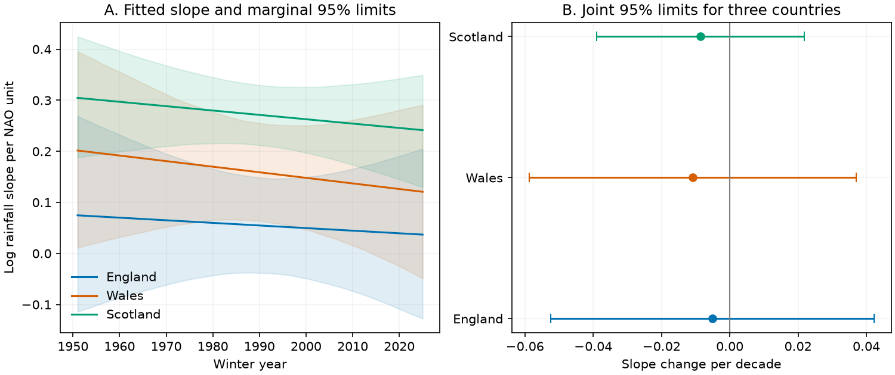

# Winter NAO rainfall slope changes were not resolved in three British countries in 1951-2025

The evidence did not resolve a linear change in the winter NAO rainfall link. This result does not establish that the link is constant.



## Question and prior work

Does the winter rainfall response to the same-winter North Atlantic Oscillation (NAO) change with year? A stable response is an assumption in simple rainfall trend adjustments. A change could affect how these adjustments split a rainfall trend into circulation and residual parts. Winter rain is a water input. We do not measure usable water, floods, runoff or storage.

We searched the local campaign for earthquake, ocean, hydrology, tide gauge, rainfall, warm water volume and NAO results before setting the question. We read the verified [trend adjustment study](sci:sha256:0b8c66aef003c5120d12d37634f3becf894c82865c24af50dba6b8e80faa48b1) and [Wales/England ratio study](sci:sha256:fed7e11883f8879f9c3896d7202447bb731aa265460c574e61014da7bc9ba957). The latter already tested a two-period change in the ratio slope and found wide limits. This report adds a continuous time interaction for three marginal country responses and joint intervals. The data overlap. This is a modest assumption audit, not an independent confirmation or first discovery of a physical process.

[West, Quinn and Horswell (2021)](https://doi.org/10.3390/atmos12060763) studied monthly NAO rainfall patterns across Britain. They found important regional differences in winter response. Their scope and indices differ from this seasonal country test. Their work supports the need to retain spatial differences; it does not supply our slope-change estimates.

## Data

We use 75 complete winters, 1951-2025. Winter year is the January year: December of the previous year plus January and February. Rainfall is the sum in mm; NAO is the equal-month mean of the published CPC values. NAO is not standardized again. All 225 monthly rows are present. No values are filled. We chose the end year to match the prior campaign period, before computation. We do not use the later complete winter 2026.

The rainfall files are Met Office National Climate Information Centre HadUK-Grid 1 km country land-average series, updated 1 November 2026. CPC monthly NAO is the shared snapshot from 8 November 2026. These are revised historical values, not a real-time archive. Hashes define the exact versions. We reused four files in place and made no data downloads or shared changes. The source store is on the shared HP SSD; /mnt/dell-data is a compatibility path. We did not access /data.

- England: `/mnt/dell-data/shared_datasets/metoffice-england-rainfall-monthly-20261109-dell/England_Rainfall.txt`; SHA-256 `bbf218ff375b64b50b1e5a1a518865e2818775cfd26721f59a464518eb36c918`; 25033 bytes. Source: https://www.metoffice.gov.uk/pub/data/weather/uk/climate/datasets/Rainfall/date/England.txt
- Wales: `/mnt/dell-data/shared_datasets/metoffice-wales-rainfall-monthly-20261109-dell/Wales_Rainfall.txt`; SHA-256 `fd2bf28a6ab51e655d254c2941ff045335438fd1ccfef0b4001241bb262e369f`; 25031 bytes. Source: https://www.metoffice.gov.uk/pub/data/weather/uk/climate/datasets/Rainfall/date/Wales.txt
- Scotland: `/mnt/dell-data/shared_datasets/metoffice-scotland-rainfall-monthly-20261109-bca1/Scotland_Rainfall.txt`; SHA-256 `8b0b2bcbdb099ae83b59c889127d7b47a89fb7187d8a09d626e37f33e85b6144`; 25034 bytes. Source: https://www.metoffice.gov.uk/pub/data/weather/uk/climate/datasets/Rainfall/date/Scotland.txt
- NAO: `/mnt/dell-data/shared_datasets/noaa-cpc-nao-monthly-b5001-20261108/norm.nao.monthly.b5001.current.ascii`; SHA-256 `0297c3df76d8fac850e8af9b394ff7df701c1e77e9eb768268ee9be12aebb3a5`; 19362 bytes. Source: https://www.cpc.ncep.noaa.gov/products/precip/CWlink/pna/norm.nao.monthly.b5001.current.ascii

`files/provenance.json` records resolved paths and helper metadata. `monthly_inputs.csv` is the used numeric subset; `winters.csv` is the seasonal table. These are attributed data extracts, not claims of original data ownership. See `EXTERNAL_DATA.md` for source terms.

## Method

`files/plan.txt` records the exploratory plan before results. It is not an external registration. For each country we fit ordinary least squares:

```
log(winter rainfall in mm) = a + b*t + c*NAO + d*t*NAO + error
t = (winter year - 1988)/10
```

The log is natural. The main quantity d is the change per decade in log rainfall slope per NAO unit. The NAO slope at year y is c + d*t. It is a conditional association, not an intervention on circulation. The time term allows a linear change in log rainfall at NAO zero. A one-unit NAO change has fitted rainfall ratio exp(c + d*t). Thus d is not itself a percentage-point change in rainfall.

We fit all countries with the same design but separate coefficients. We sample centered residual vectors in circular five-winter blocks, add them to each country's fitted log values at the original design, and refit. Each of 19,999 draws uses the same residual indices across countries. This preserves their paired errors. Seed is 699404 plus block length. Sampling wraps at the record boundary. The design, measured NAO and fitted form stay fixed.

For each country, we estimate the standard deviation of the bootstrap d draws. For each draw we take the largest absolute standardized departure from fitted d across the three countries. Its 95th percentile gives the common critical value. We use fitted d plus or minus this value times the bootstrap standard deviation for approximate joint 95% intervals. No bootstrap draw is selected by its result. Marginal percentile intervals are also saved. The shaded limits in panel A are marginal pointwise intervals; they are not simultaneous limits over all years.

Residual sampling assumes that error blocks represent a stationary error process after the fitted mean is removed. It can fail with changing variance or longer dependence. It does not include source error, index uncertainty or model selection. Checks use blocks of one, three and ten winters, add squared NAO, use raw mm instead of logs, and omit each winter in turn. The early/late slopes are descriptive fits with separate intercepts, time and NAO terms, without an interaction within each period. There is no selected change point.

## Results

| Country | Slope at 1988 | Slope change per decade | Joint 95% limits for change |
| --- | ---: | ---: | ---: |
| England | 0.05581 | -0.00510 | -0.05243 to 0.04224 |
| Wales | 0.16118 | -0.01092 | -0.05879 to 0.03695 |
| Scotland | 0.27311 | -0.00854 | -0.03890 to 0.02183 |

Slopes are in log rainfall per NAO unit. Each change interval includes zero. These limits allow changes that are large relative to fitted slopes, especially in England. This is not an equivalence test, and no acceptable stability margin was set.

All log-response intervals still include zero with block lengths one, three and ten. With squared NAO, point changes are -0.00333, -0.00347 and -0.00733 for England, Wales and Scotland. Their joint limits also include zero. With raw mm, changes are +1.68, +2.72 and +1.29 mm per NAO unit per decade. Joint limits are -8.79 to 12.15, -16.39 to 21.84 and -12.38 to 14.96. The signs differ from the log model. This shows sensitivity to response scale when evidence is weak.

Omitting one winter at a time gives change ranges of -0.01379 to 0.01553, -0.02139 to 0.01086 and -0.01447 to 0.00054. Each range crosses zero. These are sensitivity ranges, not confidence intervals. Separate period NAO slopes are 0.05541, 0.16232 and 0.27169 in 1951-1987, and 0.05906, 0.16420 and 0.25946 in 1988-2025. They are descriptive, and do not prove stability.

Residual lag-one correlations are 0.067, 0.048 and -0.106. Small lag-one values do not establish stationary errors. The design condition number is 3.54. Complete coefficients, joint and marginal limits, checks and diagnostics are in `summary.json` and `checks.csv`. `bootstrap.npz` gives every coefficient draw and primary residual index. `fits.csv` gives fitted values and errors.

## Meaning and limits

A linear drift in the country rainfall link is not resolved by these data and this model. A constant coefficient remains a working simplification with wide uncertainty. These results neither validate nor reject all circulation adjustments. An abrupt change, curved evolution or a local change can be missed. The prior ratio result and this result use the same inputs, so their agreement is not independent evidence.

The NAO describes only part of atmospheric circulation. Other patterns, storm paths and moisture transport can affect rainfall. We do not measure those terms or identify a physical cause. Country averages hide local and terrain effects. One rainfall grid, one index, 75 winters, station coverage, revisions, selected season and period, and conditional residual assumptions limit inference. We do not estimate extremes or ocean heat effects. The useful output is a reproducible joint uncertainty check on slope stability in this tested scope.

## Reproduce

Use Python 3.12 with NumPy, pandas, SciPy and Matplotlib. The package records core versions in `files/environment.json`. From the extracted publication root:

```sh
python files/analyze.py --out ../repeat
python files/audit.py
```

The first command uses bundled monthly numbers, with no network. The second rebuilds seasons with explicit calendar dates, fits with a separate SciPy QR solver, checks 100 direct bootstrap refits, and checks joint limits. If the source shared paths are present, it also checks raw hashes and separately rounded provider winter totals. `audit.json` records the successful original check. An offline repeat gave exactly equal numerical summaries, tables and bootstrap arrays.

To rebuild from raw shared data:

```sh
python files/analyze.py --shared /mnt/dell-data/shared_datasets --out ../repeat_raw
```

To retrieve sources on another machine, run `python files/retrieve.py /absolute/scratch/sources`, then pass that directory to `--shared`. Retrieval writes only outside the publication and refuses changed hashes or overwrites. Current URLs can change. If the exact snapshot is no longer served, bundled monthly inputs preserve a numerical repeat. Do not bypass a hash failure for an exact-source repeat.

## Job

Campaign 11_07_2026. Job sci-1107-dell-earth-and-ocean-sciences-c699404d6611. Topic earth-and-ocean-sciences. Machine dell. Account codex-andrii. Model gpt-6.1-sol with high reasoning effort through T3 Code and the Codex harness. No child agents were used. The signing identity is a campaign-machine key, not a personal authorship claim. The publication is saved locally only.
