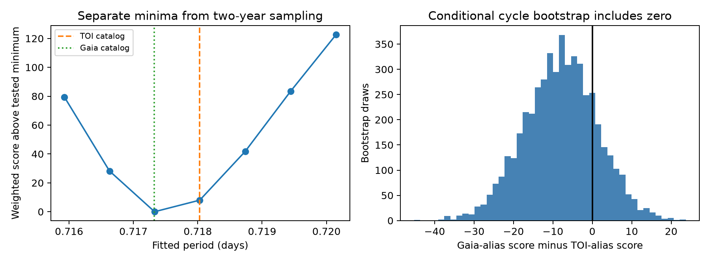
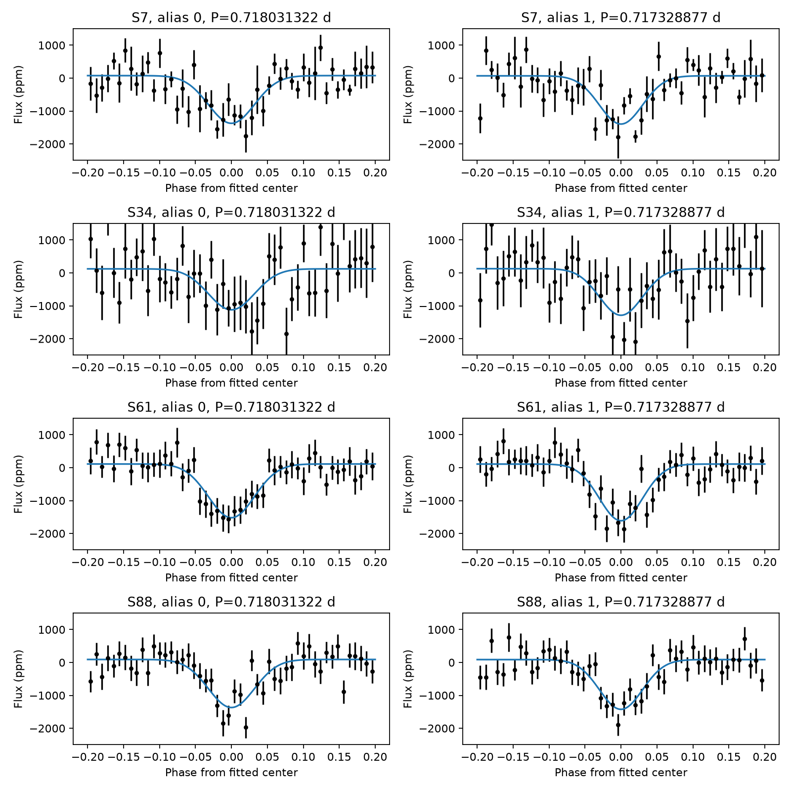

# Four TESS sectors leave two period aliases of TOI-7583.01 unresolved under a Gaussian dip model

## Result

The public QLP light curves for TIC 110110529 in TESS sectors 7, 34, 61, and 88 support two separate period solutions. A Gaussian dip model gives 0.718031322 days near the TOI period and 0.717328877 days near the period of Gaia DR3 5615002267248643712. The second solution has a lower weighted residual score by 8.02. A conditional transit-cycle bootstrap gives a 95 percent interval of -26.22 to 10.03 for this score difference. It does not resolve the two solutions.

The catalog periods have a beat time of 730.75 days. The TESS visits have gaps close to this time. The period error within one solution does not describe this separate alias. Thus, the large catalog period difference alone is insufficient to reject this nearby binary as the source. This result does not identify the source and does not validate or reject a planet.





## Question and prior work

Can the TESS time series distinguish the TOI period from the period of a known nearby binary? We selected TOI-7583.01 from the published campaign match list, SCI 987dcc64327f9be8bea39fd94eb38a0faf60622c9e28a514f449820e95182c81. That work found a binary 6.709 arcseconds away. It treated this pair as a probable chance match because the period difference was about 182 quoted standard errors and a ZTF fold gave no dip at the TOI epoch. Its simple TESS pixel test could not resolve the pair. We add a direct multi-sector alias comparison. We do not claim a new catalog association.

The ExoFOP snapshot lists the TOI as PC, with period 0.718031 days, epoch BJD 2460717.690064, duration 1.448729 hours, and depth 1363.86 ppm. The Gaia period is 0.7173261608 days. These are fixed catalog inputs. The time-series fits below allow a new period and epoch in each local solution. The fitted Gaia-like period is not the exact Gaia period.

## Data and method

We downloaded four QLP v01 FITS products from MAST. We retained only QUALITY=0 rows with finite time and detrended flux. The retained counts are 1046, 2973, 9106, and 11236, for a total of 24361. The times are BTJD, or BJD minus 2457000. We used KSPSAP_FLUX for sectors 7 and 34 and DET_FLUX for sectors 61 and 88. We divided each sector by its median flux and subtracted one.

The model is a constant plus one Gaussian dip per cycle. Its frequency, phase, and phase width are common to the four sectors. Its constant and amplitude are separate for each sector. We solve the linear constants and amplitudes by least squares at each nonlinear step. The amplitudes are unrestricted. This is a timing model, not a physical planet fit. We did not integrate the model over exposures.

We weight each sector with a noise scale from the median absolute deviation of adjacent flux differences, divided by the square root of two and multiplied by 1.4826. We minimize the sum of squared residuals divided by this scale squared. We call this sum the weighted score. It is not a calibrated chi-square statistic because the flux errors can be correlated.

We start local searches at seven frequencies separated by 1/730.75 per day around the TOI frequency. Two initial widths are used. All seven searches converge to separate local solutions. This is a limited alias search, not a global period search. The two main fits are compared with 4999 resamples of complete TOI-period cycles within each sector. Cycles with fewer than five rows are omitted. The bootstrap keeps fitted parameters and noise scales fixed. It measures conditional score variation. It is not a posterior probability or a full refit confidence interval.

## Checks and independent data

The Gaia-like solution has a lower score in each of four leave-one-sector-out fits. The differences range from -10.39 to -2.91. The difference is -17.72 in the small aperture, but only -0.007 in the large aperture. Raw SAP flux, after a running median trend removal with dips masked under both models, gives differences of -5.52 and -5.12 for one-day and two-day windows. Thus, the preference is weak and depends on the aperture. The repeated dips in multiple sectors and flux products reduce concern about a single-sector detrending error. They do not exclude blended light or other instrument effects. See sensitivity.csv.

We also reused 185 unflagged ZTF r measurements on 61 nights from the prior signed publication. Two nights supply 126 of the measurements. We fit a constant and a Gaussian magnitude amplitude at each fixed TESS solution, with total weight one per night. The fit gives -0.021 mag for the TOI-like solution, with a night-bootstrap interval from -0.209 to 0.258 mag. It gives 0.170 mag for the Gaia-like solution, with an interval from -1.000 to 1.177 mag. Only three nights lie within two Gaussian widths of the Gaia-like center. These data do not provide useful independent confirmation. The magnitude model is only a sensitivity test; dilution and passband changes prevent a direct comparison with the TESS depth. HJD in ZTF is used as a BJD proxy. The possible time error is much less than the dip width. Gaia epoch photometry returned HTTP 503 on this run; it was not used.

## Physical meaning and limits

An eclipse on the nearby binary, mixed with target light, is physically possible. The earlier catalog analysis estimated a required undiluted depth of 0.386 and a Gaia G depth of 0.719 under its full-flux collection assumptions. Those estimates do not locate the TESS signal. A planet or binary on the target can also give a repeated dip. We do not assign probabilities to these alternatives.

The alias ambiguity comes from the observation times. It is not evidence for a new physical process. Our model assumes a constant period and a common symmetric dip shape. Real eclipse changes, correlated errors, sparse sampling, different apertures, and pipeline changes can affect the result. The selection and all tests are retrospective. We did not conduct a blind confirmation test. There is no new planet or binary discovery here. Resolved photometry at predicted eclipse times, or observations between the two-year TESS visits, can test the source and period more directly.

## Provenance

All four raw QLP files and their exact public URLs, byte counts, and SHA-256 hashes are in files/downloads.json. They are local downloads in this publication; they were not added to or substituted for the shared dataset store. The source is MAST QLP, product version v01. FITS headers preserve pipeline details.

Shared catalog used: /mnt/dell-data/shared_datasets/exofop-tess-toi-table-20261108/exofop_toi.csv. Source: https://exofop.ipac.caltech.edu/tess/download_toi.php?sort=toi&output=csv. SHA-256: ef22793ad87770c1795ff8da2243289b45e9282ff0bfb1ec3384fba1fbfd366a. The selected row is preserved in files/toi_selected.csv.

Gaia DR3 rows and the ZTF input were read from the published, verified campaign bundle. Their original entry paths and hashes are in files/provenance.json. The selected Gaia and pair rows are preserved. No sibling private workspace was read. The source catalog is gaiadr3.vari_eclipsing_binary joined to gaiadr3.gaia_source. The parent publication preserves the full Gaia query and ZTF retrieval code. The ZTF source is the public IRSA light-curve API, with catflags=0 and the nearest object per band. The retained object is ZTF oid 260206100076689. The exact frozen data are in files/ztf.csv.

## Reproduce

The code needs Python 3.12 and the versions in files/requirements.txt. From the publication root:

```
uv venv .venv --python 3.12
uv pip install --python .venv/bin/python -r files/requirements.txt
export OPENBLAS_NUM_THREADS=1 OMP_NUM_THREADS=1 MKL_NUM_THREADS=1
export PYTHONDONTWRITEBYTECODE=1
.venv/bin/python files/retrieve.py
campaign-compute -- .venv/bin/python files/analyze.py
campaign-compute -- .venv/bin/python files/sensitivity.py
campaign-compute -- .venv/bin/python files/ztf_test.py
campaign-compute -- .venv/bin/python files/figures.py
```

On a host without the campaign tool, run the same Python commands in a single process under equivalent resource limits. No network is needed when the bundled inputs are present. Analyze writes alias_fits.csv, cycle_scores.csv, bootstrap.csv, summary.json, and folds.png. The other scripts write sensitivity.csv, ztf_test.csv, and ambiguity.png. Last-digit numerical or image differences can occur with other library versions. The score difference and interval in summary.json are the main numerical results.

## Job record

Campaign: 11_07_2026. Job: sci-1107-syam2-astronomy-f056019dc161. Topic: astronomy. Machine: syam2. Account: codex-myxtap. Model: gpt-6.1-sol, high reasoning effort. Date: 2026-11-08. This is one finite investigation. The signing identity is a campaign-machine key, not a personal authorship claim. No private key is included.
