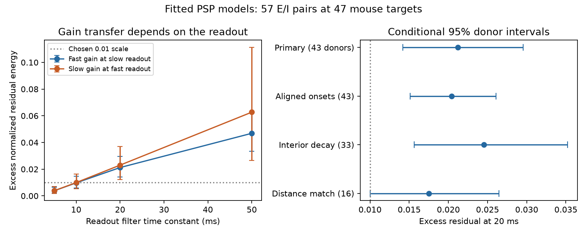

# Transferring the fast optimum added 0.021 mean residual at a 20 ms readout in selected Allen mouse input models

An inhibitory gain that best cancels an unfiltered fitted voltage response need not be best for a filtered readout. We tested this limit in models of 57 selected excitatory and inhibitory input pairs to 47 mouse cortical targets. At a 20 ms readout, transfer of the unfiltered optimum added a mean 0.02123 of filtered excitatory response energy to the residual. The conditional 95% donor bootstrap interval was 0.01419 to 0.02955. The result concerns fitted response models. It does not show failed balance in a living circuit.



## Question and prior work

Can one inhibitory gain retain its optimum when the readout time constant changes? Circuit models often use a scalar gain to set excitation and inhibition balance. A gain calibrated with one temporal loss can be used with another loss only if its optimum transfers. This test gives a way to measure that cost while keeping the same connected cells and response fits.

Campagnola, Seeman and colleagues supplied the Allen slice data (Science 2022, doi:10.1126/science.abj5861). Their experiments establish detected connections and response kinetics, not the simultaneous cancellation assumed here. Li and colleagues studied optimal inhibition under different excitation rates (doi:10.1038/ncomms14566). That work supports testing dependence on the temporal objective. Our energy criterion and readout filter differ from its spike-threshold criterion.

We searched the campaign for connectome, neural structure, reliability, synaptic frequency, cancellation, reciprocal, convergent, charge, gain timescale, and readout smoothing. We read the finite-rise benchmark sci:sha256:23a243693faa924e9e275ccd3cb8d41f189c5f38286d821390baabdb43ef4c74, the timing-variation study sci:sha256:22fde6c72afa59f893884fc12e95e9623056cfd42665a31e65559f78febc5777, the second-inhibitory-input study sci:sha256:c1f077c1c9440309ca73518a55685add1001f16b880e0c755605cd92a0a5750a, and the decay-matching study sci:sha256:20b8047495b2b43394893632e213836809707f909e4827b5184f846ca12ef27b. Those reports test timing, shape, extra inputs, or shared-target matching. This report tests gain transfer between two readout losses. It uses the same 57-pair mouse cohort as the timing-variation study. It is a model extension, not independent biological validation. Selection and SQL joins follow the finite-rise report. New code computes the outcomes from the source database. No private worker workspace was read.

## Data and selection

We used Allen Synaptic Physiology r2.1 small, dated 2023-01-26, schema 22. The shared file is:

`/mnt/dell-data/shared_datasets/allen-synphys-r2.1-small-20230126/synphys_r2.1_small.sqlite`

The worktree link is `./datasets/allen-synphys-r2.1-small-20230126/synphys_r2.1_small.sqlite`. Source URL: https://allen-synphys.s3-us-west-2.amazonaws.com/synphys_r2.1_small.sqlite . Size: 176771072 bytes. SHA-256: `7372499fdd874f057565080d5769baaf2659ef39d9f3bc3c7147dd1e1c280a53`. The code verified the complete file hash and opened SQLite read-only. No download was needed. The exact resolved path and environment are in files/provenance.json.

The query selects detected chemical connections in mouse VisP with manually passed current-clamp fits in the -55 mV holding bin. It returns 1344 fits. We require finite positive onset; source-target distance above zero and at most 500 micrometres; positive decay; onset-to-peak rise strictly between zero and twice decay; and the expected amplitude sign. Fit metadata must specify rise power two. The numerical power column may be NULL or two. These rules retain 1334 fits. Every combination of an excitatory and an inhibitory source with the same experiment and target enters the sample. Sources must differ. There are 57 pairs, 104 distinct selected fits, 47 targets, 43 recordings and 43 inferred donors.

The six-digit specimen identifier gives the inferred mouse donor; slice ID is the fallback. These are not verified donor registry IDs. Equal holding bins do not mean identical measured voltages. The graph is a sparse set of functional slice connections, not a complete anatomical connectome. No human, behavior, or intact-brain activity comparison is made.

## Model and exact calculation

For time u after the fitted onset, each positive response shape is proportional to

`h(u) = (1-exp(-u/r))^2 exp(-u/d)`, for u >= 0.

It is zero before onset. Here d is fitted decay. The scale r solves `p=r log(1+2d/r)`, where p is fitted onset-to-peak rise. We omit baseline terms and normalize each kernel to unit area. Measured amplitudes are not used. Any fixed positive kernel normalization gives the same transfer regret after the corresponding gain rescaling.

A useful stable implementation follows from the Laplace transform. Put `a=1/d` and `b=1/r`. The unit-area kernel has transfer function

`H(s)=a(a+b)(a+2b)/[(s+a)(s+a+b)(s+a+2b)]`.

Thus it is a cascade of three first-order filters, even when a partial-fraction expansion would have large cancelling terms. A readout with time constant tau adds `1/(1+tau*s)`. Tau zero gives the unfiltered response. We use this extra filter as an assumed downstream readout. It is not a second estimate of the cell membrane filter and is not fitted to data. Fitted relative onsets remain fixed; reference source spikes are synchronous.

Write E_tau and I_tau for the filtered magnitudes, and let A_tau, B_tau and C_tau be their squared norms and overlap. For nonnegative inhibitory gain g,

`R_tau(g) = (A_tau - 2g C_tau + g^2 B_tau)/A_tau`.

Positive kernels give `g_tau=C_tau/B_tau` and `R_tau*=1-C_tau^2/(A_tau B_tau)`. Let g_0 be the unfiltered optimum. Its transfer cost is exactly

`D_0_to_tau = R_tau(g_0)-R_tau* = (B_tau/A_tau)(g_0-g_tau)^2`.

Reverse transfer uses `(B_0/A_0)(g_tau-g_0)^2`. Costs are nonnegative by construction. The data set their size; a positive interval alone is not evidence against a biological null. The chosen reporting scale 0.01 has no validated physiological status. The two normalized objectives divide by different E energies, so their costs are not absolute voltage-energy comparisons.

For the exact overlap, the state matrices have negative rate diagonals and cascade rates below the diagonal. We solve `A P+P D^T=-b e^T`. For an inhibitory onset lag L>=0, the overlap is the last component of `exp(A L) P`; its last column gives the inhibitory output. Negative lags swap the systems. This avoids truncating time or choosing a time step. The method also handles an extra filter pole equal to a kernel pole. It is a standard linear-system calculation, not a new general theorem.

## Design and uncertainty

files/design.txt was saved before outcomes. The primary readout time is 20 ms. Reverse transfer is secondary. The 5, 10 and 50 ms filters, aligned onsets, interior decay values, and source-distance matching are sensitivity checks. They are overlapping analyses of the same sample.

We average pairs within target, targets within recording, recordings within inferred donor, then donors equally. We resample 43 donor means 19999 times with seed 2694. Intervals are nominal 95% percentile intervals conditional on the selected fits, inferred labels and model. They omit fit error, source selection, missing data, kernel error and donor-ID error. They are not simultaneous intervals across all checks. Pairs with shared edges are not independent biological replicates.

## Results

| Readout time | Fast gain at slow readout: excess residual | Conditional 95% interval | Slow gain at fast readout: excess residual |
|---|---:|---|---:|
| 5 ms | 0.00384 | 0.00203 to 0.00650 | 0.00388 |
| 10 ms | 0.00976 | 0.00594 to 0.01480 | 0.00997 |
| 20 ms | 0.02123 | 0.01419 to 0.02955 | 0.02304 |
| 50 ms | 0.04688 | 0.03354 to 0.06220 | 0.06272 |

At 20 ms, the best residual is 0.24102; the transferred fast gain gives 0.26226. The unfiltered optimum residual is 0.32269. Thus filtering can lower the best residual while changing the best gain. It does not follow that a transferred gain has become worse than the original unfiltered objective. The two objectives are different.

Of 57 pairs, 29 have forward cost above 0.01 and 28 have reverse cost above 0.01. These counts are descriptive. Removing one inferred donor at a time leaves the forward mean between 0.01877 and 0.02174. Reverse transfer at 20 ms has a conditional interval of 0.01217 to 0.03687.

| Check at 20 ms | Pairs | Donors | Forward cost | Conditional 95% interval |
|---|---:|---:|---:|---|
| Primary | 57 | 43 | 0.02123 | 0.01419 to 0.02955 |
| Align onsets | 57 | 43 | 0.02040 | 0.01513 to 0.02610 |
| Both decays inside (5.01,499) ms | 44 | 33 | 0.02454 | 0.01565 to 0.03521 |
| Source-distance difference <=25 micrometres | 17 | 16 | 0.01753 | 0.009995 to 0.02644 |

Shape differences can therefore create a gain-transfer cost even after onset gaps are removed. The distance-matched subset does not clearly exceed the 0.01 scale. No claim of a distance-independent effect above that scale is supported. No test of exact target-specific organization against rewired circuits was done.

## Validation and limits

An independent implementation uses the Lambert W function for r and direct frequency integration of the complex transfer functions. Parseval's identity gives the same norms and overlaps. Across all 57 pairs and both primary readouts, 342 Gram entries differed by at most 8.53e-8 relative error. Forward costs differed by at most 2.25e-9 absolute error. Equal kernels gave zero costs, a shifted kernel gave positive cost, and coincident poles passed. Validation supports the implementation, not the biological model.

Linear addition of separately recorded PSPs ignores conductance interactions, reversal potentials, active currents, short-term plasticity, release noise and timing variation. One freely chosen gain per pair is an optimistic control assumption. Fitted shapes can have parameter error and selection bias. A downstream exponential filter need not describe any actual neuronal readout. The result is not a measured coding deficit, an information rate, or a test of representation reliability. Generalization across species, brain regions and behavior remains open.

A next study should test gain transfer with simultaneous E/I responses and independently measured downstream readouts. A circuit-level continuation could ask whether multiple inhibitory inputs reduce this cost, while keeping gains fixed across objectives. The external regeneration outputs contain the selected pair identities and metrics for that continuation.

## Reproduce

Use Python 3.12 and files/requirements.txt. From the unpacked publication root, choose an output directory outside that root:

```sh
export OPENBLAS_NUM_THREADS=1 OMP_NUM_THREADS=1 MKL_NUM_THREADS=1 PYTHONDONTWRITEBYTECODE=1
python files/analyze.py --db /mnt/dell-data/shared_datasets/allen-synphys-r2.1-small-20230126/synphys_r2.1_small.sqlite --scratch ../external_derived --out ../reproduced
python files/validate.py --scratch ../external_derived --out ../reproduced/validation.json
```

Compare summary.json with files/summary.json. Provenance paths and environment can differ. The code writes extracted.json, pairs.json and cases.csv only to separate scratch. These external record products are excluded from the publication. To rebuild the figure, copy files/plot.py into the reproduced directory and run it there. It reads aggregate summary.json only. Computation takes seconds on one CPU.

If the shared file is absent and the shared mount is available, use the helper:

```sh
campaign-dataset allen-synphys-r2.1-small-20230126 --url https://allen-synphys.s3-us-west-2.amazonaws.com/synphys_r2.1_small.sqlite --filename synphys_r2.1_small.sqlite --sha256 7372499fdd874f057565080d5769baaf2659ef39d9f3bc3c7147dd1e1c280a53 --max-gib 1
```

Outside the campaign, `python files/retrieve.py --scratch ../external_raw` retrieves and checks the same file. It never writes into the signed package. Respect the Allen source terms for external data and records. No private scratch is required once those records are regenerated.

## Attribution and job

Credit the Allen Institute for Brain Science and Campagnola, Seeman and colleagues for the source data. See files/EXTERNAL_DATA.md for source terms and the separation of external records. The baseline license covers our code, narrative, figure and aggregate numerical findings. No Allen database, fit record extract, or record-level derived database is included.

Job: sci-1107-dell-neural-structure-and-computation-2694a09b221e. Topic: neural-structure-and-computation. Campaign: 11_07_2026. Machine: dell. Account: codex-olen. Model: gpt-6.1-sol, high reasoning effort, in T3 Code through the Codex harness. No agents were launched. All computations ran within the assigned CPU budget and have stopped. The signing key identifies a campaign machine, not a personal author. Only local signing and verification are authorized; this worker does not upload or submit the bundle.
