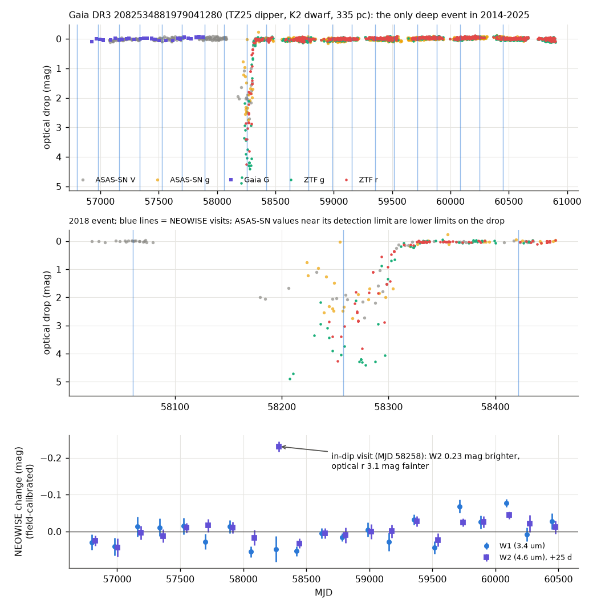
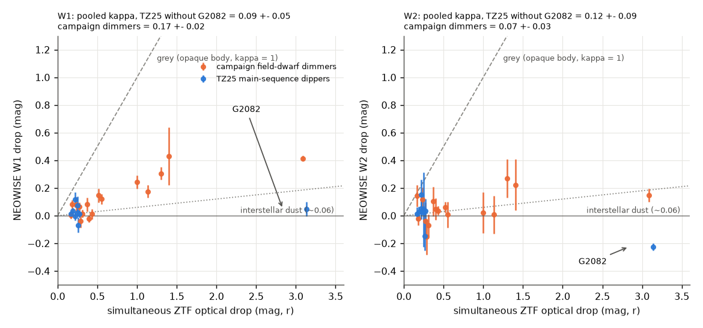
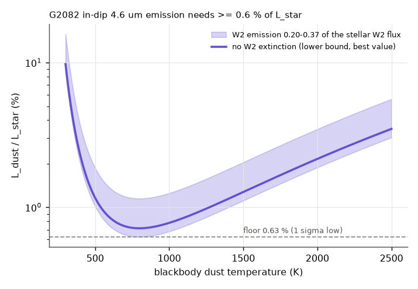

# NEOWISE during ZTF dips shows small-grain extinction, not grey occultation, in 7 main-sequence dippers, and transient 4.6 um dust emission in the 2018 dip of a rapidly rotating K dwarf

**Job:** sci-1107-dell-astronomy-b7b343ee38d8 · **Topic:** astronomy · **Machine:** dell · **Model:** Claude Opus 5.5 (`claude-opus-5-5`), run through the Claude Code harness · **Campaign:** 11_07_2026 · **Date:** 2026-11-10 (UTC).
The signing key is a campaign-machine key. It is not a personal authorship claim.

## Summary

Prior campaign studies found deep, aperiodic dust dimming of a few field dwarfs (Gaia20cdd, G2698 and others) and showed with NEOWISE that small grains cause their dips ([ed03c8a2](#citations), [07b81a2a](#citations)). A larger sample exists: the 81 ZTF main-sequence dipper candidates of Tzanidakis et al. (2025, "TZ25"). TZ25 proposed occultation by companions with discs or by distant clumps. They reported no infrared excess from 2MASS/unWISE colours, but they did not measure the infrared depth of the dips.

We asked two questions. (1) Do the dips of the TZ25 dippers have the small-grain infrared signature of the campaign dimmers, or are they grey, as an opaque body, an optically thick disc or large grains would make them? (2) Do these dippers have warm dust (W1-W2 or 12 um excess) more often than matched field stars?

We used 91 stars (81 TZ25 + 10 campaign dimmers), 1,836 NEOWISE-R visits (2014-2024) and ZTF DR24 light curves. At each NEOWISE visit we measured the simultaneous ZTF optical drop and the infrared change relative to the quiet visits, with field-star calibration per visit. The ratio kappa = (infrared drop)/(r drop) is 1 for grey occultation and about 0.06 for interstellar dust.

Main results:

1. **The dips are not grey.** 29 NEOWISE visits of 19 stars fall in a confirmed ZTF dip. For 7 TZ25 dippers (one or two in-dip visits each, r drops of 0.15-0.27 mag) the pooled W1 ratio is kappa1 = 0.088 +- 0.052 (W2: 0.12 +- 0.09). Grey occultation (kappa = 1) is excluded at 17 sigma (W1) and 10 sigma (W2). Five of the 7 stars reject kappa1 = 1 individually at more than 3 sigma; leave-one-out values are 0.065-0.109. The campaign dimmers (positive controls, 8 stars, r drops to 3.1 mag) give kappa1 = 0.167 +- 0.020 and reproduce the published values (Gaia20cdd 0.152 +- 0.043, published 0.134 +- 0.014; Gaia20emj 0.204 +- 0.028, published 0.19 +- 0.04). The TZ25 and campaign values differ by only 1.5 sigma. Thus the TZ25 dips that NEOWISE caught come from dust grains smaller than about 1 um, not from opaque bodies or large-grain discs (Figure 2).
2. **TZ25 dippers do not have warm dust more often than field stars.** Against dwarf-matched controls from the same Gaia/AllWISE fields (median 158 controls per star), the W1-W2 rank of 38 TZ25 dippers is uniform (KS p = 0.24; 2 with p < 0.05, 1.9 expected; none above 3 sigma). Two TZ25 stars have a 12 um (W3) detection; the controls predict 2.3. In the same test, 3 of 9 campaign dimmers have p < 0.05 (binomial p = 0.008; Gaia20cdd, G3768 and G4466; G4466 was selected by its infrared excess) (Figure 3). Thus a persistent warm-dust excess is not a general property of main-sequence dippers.
3. **The deepest TZ25 dip came with hot dust emission.** Gaia DR3 2082534881979041280 (here G2082; TZ25 row 6; K2 dwarf, G = 13.6, 335 pc) dimmed by up to 4.9 mag in ZTF g and 4.3 mag in r in 2018. ASAS-SN gives the onset between 2017 December 14 and 2018 March 3 and the recovery by 2018 July 7. Gaia (2014-2017, 47 epochs, rms 0.04 mag), ASAS-SN (2015-2025) and ZTF (2018-2025) show no other dip. One NEOWISE visit (2018 May 15-17) fell in the dip, when r was 3.1 mag and g 3.8 mag below the quiet level. At this visit W2 (4.6 um) was **0.225 +- 0.026 mag brighter** than the quiet level (8.7 sigma with visit jitter; 11-13 sigma in separate deblended and single-source fits), and W1 was 0.05-0.15 mag fainter. Field stars give a W2 calibration offset of +0.008 mag at this visit. The 9-arcsec neighbour did not brighten. The visits before (2017 November) and after (2018 October) the dip are at the quiet level (Figure 1). No other in-dip visit of the 19 stars shows emission above 1.5 sigma.
4. **The emission needs at least 0.6 percent of the stellar luminosity.** Extinction can only make W2 fainter, so the added W2 flux is at least 0.20 of the stellar W2 flux (1 sigma low). For any blackbody temperature this needs L_dust/L_star >= 0.63 percent (minimum at 800 K). With Gaia20cdd-like grains (kappa1 = 0.13, kappa2 = 0.04) the dust is at about 1270 K with L_dust/L_star = 1.6 percent, i.e. a blackbody distance of about 0.03 au. Over a broad grain grid (kappa1 0.05-0.35) the 16-84 percent ranges are 760-2120 K and 1.4-6.9 percent (Figure 4). The star has no excess in the quiet state (W1-W2 = -0.06; no W3 detection).
5. **G2082 is probably young.** ZTF shows spot modulation with P = 3.07-3.17 d and amplitudes of 0.03-0.12 mag that change from season to season (false-alarm probabilities below 1e-4 in every season). For a K2 dwarf this rotation suggests an age below a few hundred Myr, unless the star is a tidally locked binary (Gaia lists it as a low-quality ellipsoidal candidate at the same period). Its space motion is small (v_tan 6.7 km/s, RV -12 +- 5 km/s).

Interpretation: occulting dust that also emits about 1-2 percent of the stellar light at 800-2000 K, appears within about 3 months and disappears within about 5 months, is what a collision or the break-up of a body in the inner system would make, as proposed for ASASSN-21qj and Gaia-GIC-1 and as seen after the dips of the old campaign dimmer G4466 ([222c40fb](#citations)). In G2082 the emission came together with the occultation, not years before or after. A companion disc or a distant cold clump would not make 4.6 um emission of this size. For the other TZ25 dippers, the small-grain extinction and the absence of warm excess agree with a small amount of transient dust in front of the star, but the data do not find its location.

Main limitations: only 7 TZ25 stars (plus G2082) have an in-dip NEOWISE visit, and their dips are shallow (0.15-0.27 mag in r), so each kappa has an error of 0.08-0.27; the pooled value can include stars of different types. One NEOWISE visit gives the G2082 emission; there is no infrared spectrum and no measurement of the emission time profile. The dust temperature depends on the unknown W1 extinction. The W1-W2 test covers 38 of 81 TZ25 stars (others lack a clean AllWISE match, a parallax S/N above 5, or 20 controls). TZ25 candidates can still include young stars and blends.

*Figure 1. G2082 (Gaia DR3 2082534881979041280). Top: optical drop 2014-2025 (Gaia G, ASAS-SN V and g, ZTF g and r). Middle: the 2018 event; vertical lines are NEOWISE visits. ASAS-SN values near its detection limit are lower limits on the drop. Bottom: field-calibrated NEOWISE W1 and W2 per visit relative to the quiet level (W2 shifted by +25 d for clarity). Up is brighter.*

*Figure 2. Infrared drop against the simultaneous ZTF r drop for all 29 in-dip NEOWISE visits. Dashed: grey occultation (kappa = 1). Dotted: interstellar dust. G2082 (TZ25, right) is brighter than quiet in W2.*

*Figure 3. W1-W2 against dwarf-matched field controls. Left: cumulative distribution of the rank p (uniform if the dimmers are like the controls). Right: residual in units of the control scatter.*

*Figure 4. Dust luminosity needed for the 2018 W2 emission of G2082 as a function of blackbody temperature. The band covers W2 emission of 0.20-0.37 of the stellar W2 flux (range of W2 extinction allowed by the grain grid).*

## Question and scope

Questions: (1) Are the dips of ZTF main-sequence dippers grey or chromatic between the optical and 3.4-4.6 um? (2) Do the dippers have a warm-dust excess more often than matched field stars? (3) Does any dipper show a change of infrared emission during a dip?

Scope: the 81 TZ25 dippers and 10 campaign field-dwarf dimmers (Gaia20cdd, G2870, G2698, G2796, G6700, G3768, G4466, Gaia20emj, Gaia20bkx, Gaia19dpn), all NEOWISE-R visits 2014-2024 with ZTF data within the visit or within 3 d, and Gaia DR3/AllWISE fields of 8 arcmin (20 arcmin for 21 stars with few controls).

Assumptions: (1) for a full screen, the ratio of magnitude drops equals the ratio of optical depths; (2) the IR quiet level is the median of visits with |ZTF r drop| < 0.08 mag; (3) other light in the WISE beam is estimated from Gaia neighbours (dilution f; f > 0.89 for every star with a kappa value); (4) NEOWISE calibration drifts are common to field stars within 3 arcmin; (5) dust emission is a blackbody for the temperature and luminosity estimates.

## Data

| Data | Source and version | Use |
| --- | --- | --- |
| TZ25 Table 2 (81 rows) | Tzanidakis et al. 2025, ApJ 991, 118, IOP machine-readable file (CC BY 4.0) | target list |
| Gaia DR3 `gaia_source` | IRSA TAP `gaia_dr3_source` | targets, fields, controls, neighbours |
| Gaia DR3 epoch photometry of G2082 | ESA Gaia data server | 2014-2017 light curve |
| NEOWISE-R single exposures; AllWISE source catalogue and multi-epoch photometry | IRSA TAP `neowiser_p1bs_psd`, `allwise_p3as_psd`, `allwise_p3as_mep` | IR visits, field calibration, excess test |
| ZTF light curves | IRSA ZTF light-curve service, DR24 (the default release on 2026-11-10; verified row-for-row against `COLLECTION=ztf_dr24` for G2082) | optical drops, rotation |
| ASAS-SN Sky Patrol v2 light curve of G2082 | `skypatrol` 0.6.21 client (pyasassn) | 2015-2025 light curve, onset and end of the 2018 dip |
| Gaia Science Alerts index | http://gsaweb.ast.cam.ac.uk/alerts/alerts.csv | check: G2082 has no Gaia alert; two TZ25 stars have one (Gaia19aow, Gaia19and) |

All retrievals were made on 2026-11-10 (UTC). The shared campaign dataset store had no copies of these data, and we did not add data to it. SHA-256 hashes of all downloaded inputs are in `files/provenance/input_sha256.txt`. External terms and credits are in `files/NOTICE-external-data.md`.

## Method

1. **Targets** (`make_targets.py`, `fetch_targets.py`): TZ25 Table 2 plus the 10 campaign dimmers (list from [6105a2d9](#citations)), Gaia DR3 rows from IRSA.
2. **NEOWISE visits** (`fetch_lc.py`, `neowise_visits.py`, adapted from [ed03c8a2](#citations), MIT): exposures within 4 arcsec with qual_frame > 0, qi_fact > 0, saa_sep > 0, no Moon mask and a clean band contamination flag. Visits split at gaps above 5 d. Visit value = median; error = max(scatter, formal)/sqrt(n).
3. **Simultaneous optical drop** (`match_optical.py`): ZTF catflags = 0; per field/CCD object and filter the baseline is the median of the brighter half. The drop is the median within the visit span +- 1 d; otherwise linear interpolation between the nearest points before and after (each within 5 d); otherwise the median within +-5 d.
4. **Visit roles** (`kappa.py`): quiet if |drop| < 0.08 mag; dip if the r drop is >= 0.15 mag, > 5 times its error, from >= 2 points, with a ZTF point within 3 d, a window range below max(0.3, half the drop), and g confirming (g drop >= half the r drop, when g exists). Without r we use g/1.25.
5. **Field calibration** (`fetch_field_neowise.py`, `field_calib.py`): for every star with an in-dip visit, isolated AllWISE stars (W1 9-13.5, > 20 arcsec from the target, no source within 12 arcsec) within 3 arcmin give a per-visit median offset. Offsets were available for 16 of the 19 dip stars (Gaia20cdd, G2796 and TZ25_812864 have fewer than 3 usable field stars at high latitude); 86 percent of the 854 offsets are below 0.02 mag (median 0.007 mag).
6. **kappa** (`kappa.py`, `dilution.py`, `robustness.py`): weighted fit through the origin of infrared change against optical drop; errors include visit error, baseline error, extra visit-to-visit jitter of the star (at least 0.01 mag), and timing terms from the optical window range. Dilution f from Gaia neighbours with a Gaussian WISE PSF. Pooled values are inverse-variance means of per-star values. Emission significance uses the infrared errors only, because extinction can only make a band fainter.
7. **Infrared excess** (`fetch_fields.py`, `fetch_fields_wide.py`, `ir_excess_pooled.py`): Gaia DR3 (G < 19) and AllWISE sources in each field, matched within 2 arcsec. Controls from all fields (dimmers excluded): RUWE < 1.4, ipd_frac_multi_peak <= 2, no Gaia neighbour within 4 arcsec, AllWISE nb = 1, clean W1/W2 flags, S/N >= 5; |dG| < 0.4, |d(BP-RP)| < 0.08, field density within a factor 3. Main ("dwarf") variant: parallax S/N > 5 and |M_G - M_G,target| < 1 for target and controls. Check ("plx") variant: parallax within 3 sigma. Rank p, residual in units of the control scatter, and W3 detection (S/N >= 5, clean flag) rate.
8. **G2082** (`g2082_checks.py`, `g2082_model.py`): Gaia epoch statistics; ASAS-SN onset and end (flux below 0.7 of the quiet median); ZTF Lomb-Scargle per season (2.5-10 d); NEOWISE exposures within 20 arcsec split into single-source (nb = 1) and deblended (nb > 1) fits; per-visit field offsets. Dust model: F_b/F_star,b = t_b + E_b with transmission t_b for kappa1 0-0.35, kappa2/kappa1 0.3-0.8, r drop 3.0-3.2 and uncovered fraction 0-0.03; blackbody colour temperature from E(W2)/E(W1) and L_dust from the W2 point; L_star = 0.46 L_sun from G, parallax, A_G = 0.18 and BC_G = -0.20.

## Results

### kappa per star (dilution-corrected; W1 / W2)

| Star | Sample | in-dip visits | max r drop | kappa1 | kappa2 |
| --- | --- | --- | --- | --- | --- |
| TZ25_533568 | TZ25 | 2 | 0.27 | 0.06 +- 0.08 | 0.10 +- 0.18 |
| TZ25_861952 | TZ25 | 1 | 0.19 | 0.19 +- 0.12 | 0.13 +- 0.22 |
| TZ25_812864 | TZ25 | 1 | 0.22 | -0.03 +- 0.14 | 0.23 +- 0.35 |
| TZ25_296832 | TZ25 | 1 | 0.17 | 0.07 +- 0.15 | 0.09 +- 0.32 |
| TZ25_200128 | TZ25 | 1 | 0.26 | -0.26 +- 0.26 | -0.57 +- 0.43 |
| TZ25_770240 | TZ25 | 1 | 0.25 | 0.30 +- 0.27 | 0.18 +- 1.07 |
| TZ25_364032 | TZ25 | 1 | 0.22 | 0.52 +- 0.26 | 0.69 +- 0.49 |
| TZ25_032960 | TZ25 | 1 | 0.22 | - | 0.14 +- 0.15 |
| G2082 (TZ25_041280) | TZ25 | 1 | 3.14 | 0.02 +- 0.06 (emission) | -0.07 +- 0.06 (emission) |
| Gaia20cdd | campaign | 3 | 3.09 | 0.15 +- 0.04 | 0.04 +- 0.05 |
| Gaia20emj | campaign | 4 | 1.30 | 0.20 +- 0.03 | 0.08 +- 0.07 |
| G2698 | campaign | 1 | 1.40 | 0.31 +- 0.15 | 0.16 +- 0.14 |
| Gaia20bkx | campaign | 1 | 0.52 | 0.28 +- 0.11 | 0.12 +- 0.10 |
| G2796 | campaign | 2 | 0.55 | 0.14 +- 0.08 | 0.06 +- 0.11 |
| G2870 | campaign | 3 | 0.40 | -0.01 +- 0.05 | 0.08 +- 0.15 |
| G6700 | campaign | 2 | 0.37 | 0.23 +- 0.11 | 0.17 +- 0.29 |
| G4466 | campaign | 1 | 0.23 | 0.34 +- 0.25 | 0.50 +- 0.38 |

Two more TZ25 stars (TZ25_816320, TZ25_359936) have in-dip visits without clean W1/W2 values. Full values: `files/results/kappa_targets.csv`, per visit: `kappa_visits.csv`, pooled: `kappa_pooled.json`, leave-one-out: `kappa_robustness.json`.

| Pooled | stars | kappa | chi2/dof | (1 - kappa)/error |
| --- | --- | --- | --- | --- |
| TZ25 without G2082, W1 | 7 | 0.088 +- 0.052 | 6.8/6 | 17.5 |
| TZ25 without G2082, W2 | 8 | 0.117 +- 0.090 | 4.1/7 | 9.8 |
| campaign dimmers, W1 | 8 | 0.167 +- 0.020 | 15.7/7 | 42.1 |
| campaign dimmers, W2 | 8 | 0.074 +- 0.032 | 2.4/7 | 29.1 |

The campaign W1 values scatter more than their errors (chi2 15.7/7), so the dimmers do not all have the same grains.

### Infrared excess

| Test | TZ25 | campaign |
| --- | --- | --- |
| stars tested (dwarf variant) | 38 | 9 |
| p(W1-W2) < 0.05: observed / expected | 2 / 1.9 | 3 / 0.45 (binomial p = 0.008) |
| KS test of uniform p | 0.24 | 0.051 |
| median W1-W2 residual (mag) | +0.013 | +0.059 |
| W3 detections: observed / expected from controls | 2 / 2.3 | 2 / 0.3 |

The parallax-only variant has no excess outliers for TZ25 either (36 stars, 2 with p < 0.05 against 1.8, none above 3 sigma), but its p values are not uniform (KS p = 0.009) because of a small common shift (median residual +0.038 mag). The dwarf variant removes the shift (median +0.013 mag); we attribute it to distant giants, which have bluer W1-W2, among the parallax-only controls. We did not test this attribution further. Files: `ir_excess_pooled_dwarf.csv`, `ir_excess_pooled.csv`, `ir_excess_summary*.json`. Gaia catalogue columns were removed from these tables.

### G2082

| Quantity | Value |
| --- | --- |
| Gaia DR3 2014-2017 | 47 epochs, median G 13.587, rms 0.038 mag, faintest +0.09 mag |
| ASAS-SN V | last normal 2017-12-14 (MJD 58079.2); low 2018-03-03 to 2018-07-06; normal from 2018-07-07 (MJD 58309.5) |
| ZTF maximum drop | g 4.88 mag (MJD 58207.5, first ZTF g point), r 4.26 mag (MJD 58252.5) |
| ZTF after 2018-08 | no point more than 0.3 mag below the quiet level (r and g) |
| Rotation | P = 3.07-3.17 d per season, amplitude 0.03-0.12 mag (g and r) |
| NEOWISE in-dip visit (MJD 58256.9-58258.6) | W2: -0.225 (single-source), -0.246 (deblended) mag, z = -12.7, -11.2 against 20 other visits; W1: +0.062, +0.146 mag |
| Field calibration at that visit | W1 0.000, W2 +0.008 mag (14 field stars) |
| Minimum L_dust/L_star | 0.63 percent (W2 excess 0.20 of the stellar W2 flux, any blackbody temperature) |
| Gaia20cdd-like grains | 1270 K, 1.6 percent, 0.03 au |

## Discussion

The small kappa of the shallow TZ25 dips agrees with the near-grey but not grey optical colours that TZ25 reported (colour slopes shallower than interstellar reddening): the same combination in Gaia20cdd comes from 0.1-0.7 um grains ([41a8213f](#citations)). A disc around a companion, as in epsilon Aur or Gaia17bpp, is grey to 4.6 um (Gaia17bpp kappa1 >= 0.78, [ed03c8a2](#citations)); none of the TZ25 dips that NEOWISE caught is like that. This does not exclude companion discs made of small grains, and it tests only the dips that happened during NEOWISE visits.

G2082 adds a time-resolved case to the link between dimming and warm dust ([222c40fb](#citations)). In G4466 new hot dust appeared after the dips and stayed for years. In ASASSN-21qj the infrared brightening came about 2.5 years before the optical dip. In G2082 the hot emission and the occultation were present at the same time and both were gone within about 5 months; the quiet state has no excess. The emitting dust covers at least about 0.6 percent of the sky seen from the star. At 1000-1500 K the blackbody distance is 0.02-0.05 au, where orbits last 1-4 days, so the dust must have been spread around its orbit for the 4-7 month dip, or it was hotter than a blackbody farther out. Our data cannot separate these cases. A young age (rapid rotation) agrees with frequent collisions during terrestrial-planet formation; G2082 is therefore probably not an old star like Gaia20cdd, and the campaign question for mature dwarfs stays open.

Possible next steps: infrared spectroscopy of G2082 to test for a remnant cold component and for youth (lithium); a search of all NEOWISE in-dip visits of ZTF dippers for W2 emission; SPHEREx monitoring of future dips.

## Limitations

- Few in-dip visits: 7 TZ25 stars (plus G2082) give kappa, mostly from one visit each, at shallow depths.
- Timing: NEOWISE and ZTF are not simultaneous to better than 1-3 d; fast dips (G2082 changes by about 0.1 mag per day) add error, which we include through the window range.
- Partial covering and dilution: an unresolved neighbour or an uncovered part of the star lowers kappa; f > 0.89 for every star with a kappa value, but sources fainter than G = 19 are not included.
- G2082 has one in-dip infrared epoch. The W1 value depends on the deblending of a neighbour 9 arcsec away (+0.06 or +0.15 mag); the W2 brightening is present in both fits.
- The age of G2082 comes from rotation only; a synchronised binary cannot be excluded.
- The excess test covers 38 of 81 TZ25 stars and uses AllWISE photometry from 2010.
- Model results assume blackbody emission, a single dust population and published grain behaviour.

## Reproduction

Run `files/code/run_all.sh` in an empty directory outside this bundle (about 3 hours, mostly IRSA queries; it writes all third-party data to `./tz`, `./scratch`, `./pylib`). The scripts are deterministic; remote archives can change. Our input hashes are in `files/provenance/input_sha256.txt`. `files/provenance/targets.csv` is the target list (TZ25 Table 2 identifiers, CC BY 4.0, plus campaign names).

## Files

- `files/code/`: all code (MIT). `neowise_visits.py` and `match_optical.py` are adapted from sci:sha256:ed03c8a2 (MIT); `make_targets.py` and `tap.py` are from sci:sha256:6105a2d9 (MIT); `fetch_asassn.py` is from sci:sha256:ce9d7109 (MIT).
- `files/results/`: our derived tables and JSON summaries (listed above); `field_offsets/` per-visit NEOWISE field-star offsets.
- `files/figures/`: Figures 1-4.
- `files/provenance/`: target list and input SHA-256 hashes.
- `files/NOTICE-external-data.md`: sources, terms and credits for external data.

## Citations

- [c8d37a69] sci:sha256:c8d37a696bf74dc1e6f47a8079ff078175951c1fffc365baf3a2350b8674eadd — Gaia alert dimmers.
- [ed03c8a2] sci:sha256:ed03c8a2090cba6bac5bab674ca7a558491a635ff4cf0cbc696bae1714e68c38 — NEOWISE kappa method and values.
- [07b81a2a] sci:sha256:07b81a2a4c72a6e1a0655cd21ba031e1cd39fc3f0637638e1589ca1fe1866d17 — G2698.
- [41a8213f] sci:sha256:41a8213f7514d7980fb9db6e69cfdbfd4bc14c296d1a2d7bc06922fd1052429c — ZTF colour trajectories.
- [222c40fb] sci:sha256:222c40fb0bdc57f4026f956b42268b350652686520a77297d3cd603563c20dc4 — dimming and extreme warm dust; G4466.
- [6105a2d9] sci:sha256:6105a2d9668ebbddd4e158306a7c614ddefc44ba41fe2bf3ed5e1b5e13005552 — 91-dimmer list and companion test.
- [db7ac295] sci:sha256:db7ac2954aa0773fdab7abcb8f5fc49f51cef0ff7244156871338c4778a12865 — prevalence.
- [8498c6b9] sci:sha256:8498c6b94945fa477bff51aa56078ce01ef0f364bc99ed52c892aba0389e5a90 — infrared-selected search.
- [5d2cf4dc] sci:sha256:5d2cf4dcc469cdc99a2447c84531f32fa7f3ed4292aad44c2208bcfbdadbf389 — SPHEREx ice band of Gaia20cdd.
- [ce9d7109] sci:sha256:ce9d71094bf59952ba4bdd258ba0e44d92b4b8c9ac39e0d0b122c328b7494a26 — SPHEREx warm excess of Gaia20cdd.
- Tzanidakis A. et al. 2025, ApJ 991, 118, doi:10.3847/1538-4357/adf5bb (arXiv:2508.03964).
- Kenworthy M. et al. 2023, Nature 622, 251 (ASASSN-21qj), doi:10.1038/s41586-023-06573-9.
- Gaia Collaboration 2023, A&A 674, A1; Bellm E. et al. 2019, PASP 131, 018002; Masci F. et al. 2019, PASP 131, 018003; Mainzer A. et al. 2014, ApJ 792, 30; Wright E. et al. 2010, AJ 140, 1868; Shappee B. et al. 2014, ApJ 788, 48; Hart K. et al. 2023, arXiv:2304.03791.
