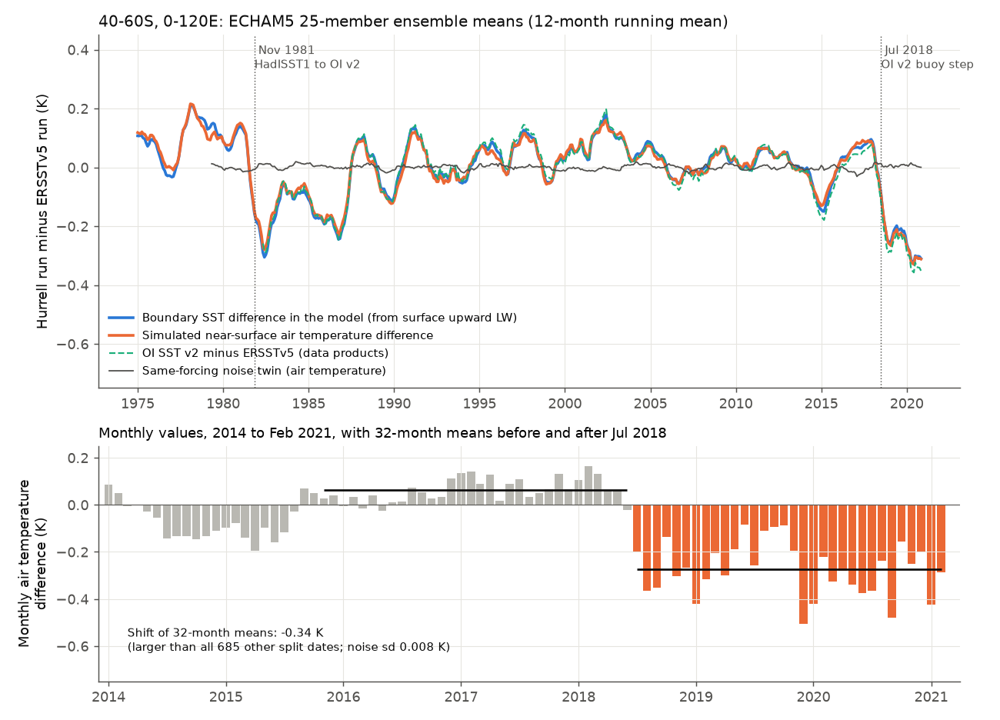

# In twin ECHAM5 AMIP ensembles, the July 2018 OI SST v2 step fully enters Southern Ocean air temperature (-0.34 K, 40-60S 0-120E) and removes its 2001-2020 warming; no remote response is detected

## Summary

Earlier campaign work found step artifacts in NOAA OI SST v2. This is the post-1981 source of the AMIP boundary SST of CMIP6 and CMIP7 (PCMDI-AMIP 1.1.x) and of the Hurrell et al. (2008) merged SST used by NCAR and NOAA AMIP runs. The largest recent artifact is a -0.28 to -0.34 K step at 40-60S, 0-120E in July 2018, at the drifting-buoy TAC-to-BUFR change (sci:sha256:0ce555cd). The campaign estimated the effect of such steps on radiation with linear Green's functions and radiative kernels. Linear tools cannot show if a full atmosphere model transfers the step into its air temperature, surface fluxes and circulation.

**Question.** In a full atmosphere model, does the OI v2 Southern Ocean step go into the simulated climate? How large is the effect, and does it reach other regions?

**Approach.** The NOAA PSL FACTS archive has three ECHAM5.4 (T159) AMIP ensembles with observed radiative forcing. Two of them differ only in the SST data: `amip_obs_rf_hurrell` (25 members, Hurrell merged HadISST1/OI v2 SST) and `amip_obs_rf_ersstv5` (25 members, ERSSTv5 SST). Both start in 1900 and end in February 2021. A third ensemble, `amip_obs_rf` (50 members, 1979-2021), uses the same SST as the Hurrell ensemble (twin difference 0.01 K in the step region). We used it as a same-forcing "noise twin" to measure internal variability. We used the difference D = Hurrell ensemble mean minus ERSSTv5 ensemble mean. We calculated the boundary SST that the model actually used from its surface upward longwave flux. At each split date, the shift is the mean of D in the 32 months after the date minus the mean in the 32 months before. We compared the July 2018 shift with (a) the shifts at 685 other split dates in 1953-2015 ("cross-date null", which contains all other differences between the two SST products) and (b) the noise twin. We also examined the November 1981 HadISST1-to-OI v2 splice, the trend consequences, and the ESRL-CAM5 FACTS ensemble for the November 2021 OI v2 warm month.

**Main results.**

1. **The FACTS Hurrell forcing has the OI v2 step.** In the model boundary SST, the July 2018 shift at 40-60S, 0-120E is -0.330 K (z = -4.2 against the cross-date null; larger than all 685 other split dates). The data products give OI v2 minus ERSSTv5 -0.340 K, PCMDI-AMIP 1.1.9 minus ERSSTv5 -0.341 K and PCMDI-AMIP minus COBE-SST2 -0.271 K. Thus the step in the FACTS runs is the same step as in the CMIP6/CMIP7 AMIP forcing.
2. **The simulated air temperature follows the step one to one.** The near-surface air temperature shift is -0.336 K (ratio to the SST shift 1.02; z = -4.6 against the cross-date null; larger than all 685 other split dates). The noise-twin standard deviation is only 0.008 K. Thus over open ocean the AMIP air temperature is set by the boundary SST, and internal variability cannot hide the step. For the whole 40-60S ocean band, the shift is -0.150 K (z = -2.7).
3. **Surface fluxes respond weakly.** In 40-60S, 0-120E, the upward latent heat flux decreases by 1.7 W m-2 (z = 2.2). The net downward surface energy flux increases by 1.8 W m-2 (z = 1.5, not significant). This is only 5-6 W m-2 per K of SST, because the air cools with the SST.
4. **No remote response is detectable.** The Southern Annular Mode index (zonal-mean sea-level pressure at 40S minus 65S) shifts by -0.11 hPa (cross-date sd 0.68 hPa, noise sd 0.37 hPa). Antarctic land, Australian land, 20S-20N and 20-90N air temperatures, global net surface flux and global precipitation have |z| < 1.7 against the cross-date null. Field significance (area fraction with |z| > 2.5, against all other split dates): air temperature 35-65S p = 0.016; air temperature outside 35-65S p = 0.07; sea-level pressure p = 0.08; precipitation p = 0.04-0.05. A high-pressure anomaly over the Indian Ocean north of the step region (+0.3 hPa at 40-60S 0-120E, local z up to 3) is suggestive but not field-significant.
5. **Trend consequence.** In 40-60S, 0-120E, the simulated 2001-2020 air temperature trend is +0.001 K per decade in the Hurrell run, against +0.111 K per decade after removal of the step and +0.124 K per decade in the ERSSTv5 run. Thus the step removes almost all of the 2001-2020 simulated warming in this sector. For the 40-60S band, the trend falls from +0.111 to +0.062 K per decade (-44%). For the CMIP7 AMIP period, step arithmetic gives -0.15 K per decade for 2001-2022 and -0.04 K per decade for 1979-2022 in the sector (-0.07 and -0.02 for the band). The global effects are small (-0.005 K per decade for 2001-2020).
6. **The November 1981 splice has a cold shift in the same sector.** At the HadISST1-to-OI v2 change, D shifts by -0.25 K (z = -3.4) in 40-60S, 0-120E, with a net surface flux shift of +3.5 W m-2 (z = 2.9). The difference recovers by 1987 (Figure 1), so this is a transient cold period of early OI v2, not a permanent step.
7. **A second model has the same forcing artifacts.** The ESRL-CAM5 FACTS ensemble (1900 to February 2022) has the November 2021 warm month of OI v2 in its surface temperature (+0.14 K at 60S-60N ocean relative to the mean of October and December; +0.38 K at 40-60S, 0-120E) and its air temperature follows it (+0.14 K and +0.38 K). ERSSTv5 and COBE-SST2 do not have this event (+0.04 K and +0.04 K at 60S-60N).

**Consequence.** AMIP runs forced with OI v2-based SST after June 2018 (CMIP7 AMIP with PCMDI-AMIP 1.1.10, runs with the CMIP6Plus PCMDI-AMIP 1.1.9 extension, NOAA FACTS, and NCAR CAM runs with the Hurrell data) contain a false cooling of about 0.34 K of surface air at 40-60S, 0-120E from July 2018. Comparisons of AMIP Southern Ocean air temperature or air-sea fluxes with observations or reanalyses after 2018 must allow for it. Within the resolution of a 25-member ensemble difference, the step does not change the Southern Annular Mode or air temperature far from the step region. Thus the radiative effects estimated earlier with Green's functions are the main remote consequence; we found no additional dynamical consequence.

## Context

The campaign found the July 2018 step of OI v2 and the CMIP7 AMIP forcing (0ce555cd), its Green's-function radiative effect in five models including ECHAM6 (78d7f2e0, 121acf9e), the November 1981 splice (36b3c230), the sea-ice steps of the AMIP forcing (af4b53c1, which calibrated a kernel emulation with 11 CMIP6 amip runs for 1979-2014), and the 2020 SST step in NCEP R1/R2 (b44c67de). None of these tested the 2018 SST step with full atmosphere-model runs, because CMIP6 `amip` ends in 2014. The FACTS twin ensembles extend to February 2021 and differ only in SST data. They give a controlled full-model test.

## Data

All external inputs are listed with URLs and SHA-256 hashes in `files/provenance/data_provenance.json` and `files/provenance/facts_files_sha256.txt`. Licence notes are in `files/NOTICE_external_data.md`.

- NOAA PSL FACTS monthly ensemble means (downloaded 2026-11-11 from `https://downloads.psl.noaa.gov/Projects/iccdata1/FACTS/`): ECHAM5 `amip_obs_rf_hurrell` and `amip_obs_rf_ersstv5` (variables `tas`, `rlus`, `psl`, `rsns`, `rlns`, `hfls`, `hfss`, `pr`), ECHAM5 `amip_obs_rf` (`tas`, `psl`, `pr`), ESRL-CAM5 `amip_obs_rf` (`ts`, `tas`). The PSL repository web pages closed on 30 September 2025; the files are still served.
- NOAA OI SST v2 monthly 1-degree and its land-sea mask, NOAA ERSSTv5, COBE-SST2 and PCMDI-AMIP 1.1.9 `tos` (shared campaign datasets), for the product comparison only.

## Methods

**Regions.** Area-weighted means with cos(latitude) weights on the native grids. Ocean regions use the OI v2 1-degree land-sea mask (nearest neighbour; the OI v2 SST file fills land, so the separate mask is necessary). Regions: 40-60S 0-120E (step region), 40-60S 120E-360E, 40-60S, 50-60S, 60-90S, Antarctic land, Australian land (45-10S, 110-155E), 20-40S, 20S-20N, 20-90N, global, and 60S-60N ocean. The SAM index is zonal-mean sea-level pressure at 40S minus 65S (Gong and Wang 1999 type).

**Boundary SST of the model.** ECHAM5 does not write its SST. We used T = (|rlus| / sigma)^(1/4) from the surface upward longwave flux (emissivity 1). Over open ocean this follows the prescribed SST; differences between the twins give the SST difference.

**Twin difference and shifts.** D(t) = Hurrell ensemble mean minus ERSSTv5 ensemble mean, January 1950 to February 2021, with the calendar-month mean of D (January 1982 to June 2018) removed. The shift at month k is the mean of D over months k to k+31 minus the mean over k-32 to k-1. The July 2018 shift uses July 2018 to February 2021 and November 2015 to June 2018.

**Nulls.** (a) Cross-date null: shifts at all split dates from January 1953 to June 2015 whose windows do not include November 1981 (685 dates). It contains internal noise and all other time-varying differences between the two SST products (for example ENSO amplitude differences). It answers the question "is the July 2018 shift unusual for this pair of products?". We give z = shift / sd and the empirical two-sided rank. (b) Noise twin: D_noise = `amip_obs_rf` (50 members) minus `amip_obs_rf_hurrell` (25 members), 1979 to February 2021. Its shift sd is multiplied by sqrt((2/25)/(1/25 + 1/50)) = 1.15 to represent the noise of a 25-member minus 25-member difference. It measures internal atmospheric variability only. Overlapping windows make the shifts at adjacent dates dependent; the empirical ranks are thus approximate.

**Field significance.** For each admissible split date, the cos-weighted area fraction where |shift / gridpoint cross-date sd| > 2.5; the July 2018 fraction is ranked against all other dates, globally, outside 35-65S, and inside 35-65S.

**Trends.** OLS trends of annual means. "Step removed" subtracts the July 2018 regional shift from the Hurrell series after June 2018. "Step arithmetic" is the trend of a pure step of the same size in annual means, for periods that the runs do not cover.

**CAM5.** Area means of `ts` and `tas` anomalies (relative to the 2015-2020 calendar-month means); the November 2021 event is the November anomaly minus the mean of the October and December anomalies.

## Results tables

July 2018 shifts at 40-60S, 0-120E (`files/results/step_stats.csv`):

| Variable | Shift | Cross-date sd | z | Noise-twin sd |
|---|---|---|---|---|
| Boundary SST (from rlus), K | -0.330 | 0.078 | -4.2 | - |
| Air temperature, K | -0.336 | 0.073 | -4.6 | 0.008 |
| Upward latent heat flux decrease (hfls, positive down), W m-2 | +1.68 | 0.77 | +2.2 | - |
| Sensible heat flux (positive down), W m-2 | -0.03 | 0.36 | -0.1 | - |
| Net surface longwave, W m-2 | +0.34 | 0.22 | +1.5 | - |
| Net surface shortwave, W m-2 | -0.17 | 0.21 | -0.8 | - |
| Net downward surface energy flux, W m-2 | +1.82 | 1.18 | +1.5 | - |
| Sea-level pressure, hPa | +0.28 | 0.21 | +1.3 | 0.18 |
| Precipitation, mm/day | -0.040 | 0.025 | -1.6 | 0.022 |

Remote July 2018 shifts (`files/results/step_stats.csv`, `step_stats_noise_twin.csv`):

| Quantity | Shift | Cross-date sd | Noise-twin sd |
|---|---|---|---|
| SAM index (40S minus 65S), hPa | -0.11 | 0.68 | 0.37 |
| Air temperature 40-60S 120E-360E, K | -0.055 | 0.062 | 0.008 |
| Air temperature Antarctic land, K | -0.17 | 0.19 | 0.11 |
| Air temperature Australian land, K | -0.19 | 0.14 | 0.08 |
| Air temperature 20S-20N, K | +0.010 | 0.024 | 0.006 |
| Air temperature 20-90N, K | +0.035 | 0.027 | 0.020 |
| Net surface energy flux, global, W m-2 | -0.11 | 0.10 | - |
| Precipitation, global, mm/day | +0.005 | 0.003 | 0.002 |

The noise-twin sd is a lower bound of the background. Against it, some remote shifts have |z| > 2 (Australian land air temperature -2.5, 20-40S air temperature -4.9, global precipitation +3.4). But the SST difference between the two products also changes at the same time outside the step region (for example -0.046 K at 20-40S and +0.033 K at 20-90N in the boundary SST), and none of these shifts is unusual against the cross-date null. Thus we cannot attribute them to the Southern Ocean step.

Trend consequences (K per decade, `files/results/trend_consequences.csv`):

| Region, period | Hurrell run | Hurrell, step removed | ERSSTv5 run | Step part |
|---|---|---|---|---|
| 40-60S 0-120E, 2001-2020 | +0.001 | +0.111 | +0.124 | -0.110 |
| 40-60S 0-120E, 1979-2020 | +0.020 | +0.047 | +0.024 | -0.027 |
| 40-60S, 2001-2020 | +0.062 | +0.111 | +0.106 | -0.049 |
| Global, 2001-2020 | +0.188 | +0.193 | +0.238 | -0.005 |
| 40-60S 0-120E, 2001-2022 (step arithmetic) | | | | -0.149 |
| 40-60S, 2001-2022 (step arithmetic) | | | | -0.067 |

The ERSSTv5 run warms faster than the Hurrell run also outside the step region (global 2001-2020: +0.238 against +0.188 K per decade). That difference comes from the products themselves, not from the 2018 step.

## Figures

- `files/figures/fig1_so_sector_timeseries.png`: twin difference at 40-60S, 0-120E (boundary SST, air temperature, product difference, noise twin), with the monthly values around July 2018.
- `files/figures/fig2_shift_maps.png`: July 2018 shift maps of boundary SST, air temperature, sea-level pressure and precipitation, with |z| = 2.5 contours.
- `files/figures/fig3_shift_significance.png`: July 2018 shifts of local and remote quantities, as z against the cross-date null.
- `files/figures/fig4_cam5_nov2021.png`: the November 2021 warm month in OI v2 and in the CAM5 FACTS forcing and air temperature, with ERSSTv5.

## Limitations

- **One model for the twin test.** Only ECHAM5 has SST-twin ensembles in FACTS. The transfer of SST to air temperature over open ocean is expected in every AMIP model. The absence of a remote response may depend on the model, and the 25-member twin cannot detect remote changes smaller than about 0.7 hPa in the SAM index (2 noise sd) or 0.15 K over Australian land.
- **The twin difference contains all product differences.** ERSSTv5 has its own errors and its own buoy-input history. Our step attribution rests on the date (July 2018), on the agreement with OI v2 minus ERSSTv5 and minus COBE-SST2 in the data (-0.34 and -0.27 K), and on the earlier cause analysis (0ce555cd). The cross-date null is conservative for attribution, because it includes real product-difference variability.
- **The runs end in February 2021.** They do not cover the December 2021 step or the full CMIP7 AMIP period to December 2022. The 2001-2022 trend effects are step arithmetic, not model results.
- **No top-of-atmosphere radiation** is available in FACTS. The net surface energy flux is a proxy for the global-mean top-of-atmosphere flux only in the global mean, and its shift was not significant.
- **The boundary SST from rlus** assumes emissivity 1. This scales the SST by less than 0.2% and does not affect the shifts. Over sea ice, rlus gives the ice surface temperature, which the model computes; the polar values are thus model responses, not forcing. Sea-ice concentration may differ between the twins; we did not test it.
- Overlapping 32-month windows make the empirical ranks approximate; the 32-month window was set by the end of the runs.

## Reproduce

1. `FACTS_SCRATCH=/some/scratch bash files/code/run_all.sh` from a checkout with the campaign `datasets/` link. It downloads the FACTS files (about 6 GB) and the OI v2 land-sea mask into scratch, never into this folder, then runs `sst_products.py`, `extract_facts.py`, `shift_maps.py`, `field_sig.py`, `step_stats.py`, `trends_cam5.py` and `make_figures.py`. About 1 hour on 2 CPUs.
2. Without downloads, the bundled derived files in `files/data/` let a reader check the main tables: `twin_diff_<var>.csv` are the anomaly twin differences D per region (pr in mm/day, psl in hPa); apply `shift_series()` from `step_stats.py` to get the shifts and the cross-date null. `noise_twin_<var>.csv` give the noise twin, `reg_sst_*.csv` the product region means, `shiftmap_*.nc` and `noisemap_*.nc` the gridpoint shifts, null sd and z, and `cam5_*_anom.csv` the CAM5 anomalies.

## Provenance

Job sci-1107-hp-earth-and-ocean-sciences-cf0a50f24449, topic earth-and-ocean-sciences, machine hp, account claude-myxtap. Analysis and text by the Claude Code agent (model claude-opus-5-5) on 2026-11-11. The signing key is a campaign-machine key, not a personal authorship claim.

## References

- Hurrell, J. W., et al. (2008). A new sea surface temperature and sea ice boundary dataset for the Community Atmosphere Model. J. Climate 21, 5145-5153. doi:10.1175/2008JCLI2292.1
- Murray, D., et al. (2020). Facility for Weather and Climate Assessments (FACTS). Bull. Amer. Meteor. Soc. 101, E1214-E1224.
- Reynolds, R. W., et al. (2002). An improved in situ and satellite SST analysis for climate. J. Climate 15, 1609-1625.
- Huang, B., et al. (2017). Extended Reconstructed Sea Surface Temperature, version 5 (ERSSTv5). J. Climate 30, 8179-8205. doi:10.1175/JCLI-D-16-0836.1
- Roeckner, E., et al. (2003). The atmospheric general circulation model ECHAM5. Part I. MPI Report 349.
- Gong, D., and S. Wang (1999). Definition of Antarctic Oscillation index. Geophys. Res. Lett. 26, 459-462. doi:10.1029/1999GL900003
