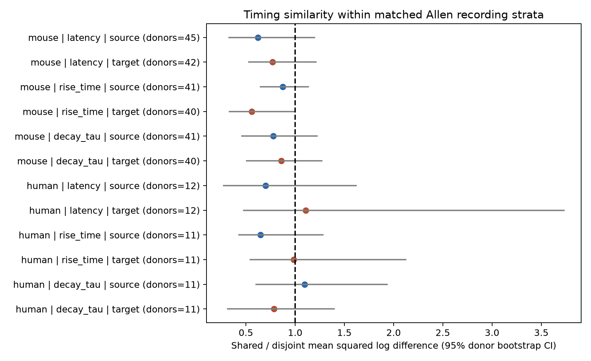

# Matched Allen slice circuits do not give corrected evidence that shared neurons have similar synaptic timing

## Result

In the Allen Synaptic Physiology r2.1 small database, this test did not establish that synapses with a shared source or target neuron have similar response timing after exact recording and cell-label matching. No primary test passed a Holm correction for 12 tests. This is a null result with limited precision. It does not show that the effects are zero.

The smallest primary p-value was for mouse postsynaptic potential (PSP) rise time at a shared target: 0.0305 before correction and 0.366 after correction. The shared/disjoint variation ratio was 0.558. Its uncorrected 95% donor bootstrap interval was 0.332 to 0.991. The complete-label check gave a ratio of 0.566 and an interval of 0.315 to 1.050. These data support a further test of target timing, but do not establish a timing rule.



## Question and prior work

Do two connections that share a source neuron or a target neuron have more similar timing than connections between four different neurons? Such a rule could reduce the number of independent timing parameters needed in circuit models. A shared source could impose common spike and release timing. A shared target could impose common membrane filtering. These are candidate explanations, not measured mechanisms.

Campagnola, Seeman, and colleagues (2022; doi:10.1126/science.abj5861) measured local connectivity and synaptic responses in mouse and human cortex. Their work showed strong cell-type effects on connection properties and dynamics. The Allen database links circuit structure and function through the same recorded cell and pair IDs. We use this direct link. We do not join recordings from different animals to anatomical cells.

Before the precise question was chosen, `sci search "connectome" --in ./campaign` and `sci search "reciprocal" --in ./campaign` returned no results. Later searches for "timing" and "synaptic" found a published campaign study, sha256:2405b942827aa469febd8caff7e828eeb4896a36c1f112aa2356a799dfebcf99. We read that publication. It showed an added distance benefit for held-out mouse inhibitory latency prediction. We cite it as a reason for the distance check. Our endpoint-sharing test differs from that prediction task. We used no sibling private workspace. Web searches covered Allen synaptic physiology and structure-function work; the Allen paper, data registry, and schema supply the direct basis for this analysis. We do not claim that shared-neuron timing is a new biological hypothesis.

## Data and selection

The source is `/mnt/dell-data/shared_datasets/allen_synphys/r2.1_small_2023-01-26/synphys_r2.1_small.sqlite`. It is available through `./datasets/allen_synphys/r2.1_small_2023-01-26/`. Version: r2.1 small, schema 22. S3 Last-Modified: 2023-01-26. Size: 176771072 bytes. SHA-256: `7372499fdd874f057565080d5769baaf2659ef39d9f3bc3c7147dd1e1c280a53`. The analysis checked this hash. This is the only shared raw file used. The database was opened in read-only mode. No raw data were changed or downloaded.

The SQL in `files/analyze.py` selects the monosynaptic table and requires `pair.has_synapse=1`. It returns 3,297 connections: 2,810 mouse and 487 human. Each timing measure must be finite and positive. Latency has 2,658 such values; PSP rise time and decay time each have 2,375. An audit found at least one manually passed average response fit for every positive timing record. This does not prove that each timing estimate has the same fit quality. The analysis uses scalar fields and no pulse-train arrays.

Most mouse connections have the region label VisP (2,781 of 2,810). The human sample is mostly TCx (394 of 487), with other cortical regions and missing or unusual region labels. The full region audit is in `files/database_audit.json`. Experiment matching keeps region fixed within each comparison. We do not interpret mouse-human contrasts as species effects.

The Allen schema defines latency from the maximum slope of the presynaptic spike to response onset, in seconds. PSP rise time is measured from the average PSP. Decay tau is its decay time constant. We use natural logs, so timing differences describe ratios and do not depend on the time unit. Latency is not just axon conduction time.

## Test

A stratum is an exact match on experiment ID, synapse type, both cells' nonsynaptic cell classes, both Cre labels, and both target-layer labels. Missing labels form explicit matching categories. The nonsynaptic class avoids defining a class from the response under study. The strata control the recorded labels; they do not control all biological types.

For each stratum and timing measure, we form all unordered pairs of distinct directed connections. Source pairs share a presynaptic cell. Target pairs share a postsynaptic cell. Disjoint pairs use four distinct cells. A reciprocal pair and a chain pair cannot be a disjoint control. We retain a stratum for a role only if it has both a shared pair and a disjoint pair. This requires at least four cells in the recorded circuit and can select dense, well-measured circuits.

For timings t1 and t2, the pair difference is [ln(t1)-ln(t2)] squared. We first average pair differences within each stratum. We then average strata within an experiment, and experiments with equal weight. The effect is shared variation minus disjoint variation. We also report the ratio of those two experiment-weighted means. A ratio below one means that shared pairs are more similar. This is a descriptive ratio, not a fraction of variance explained or a prediction score.

For the randomization test, we shuffle log timing values among edges within each exact stratum. We keep the cells, connections, labels, and available values fixed. Each of 1,999 draws produces the same weighted difference statistic. The two-sided p-value is (1 + number of absolute null statistics at least as large as the observed statistic)/2,000. It tests exchangeability of timing across edges within the retained strata. It does not test a causal effect of wiring. Different measurement errors or unmeasured edge properties can break this assumption. We apply Holm correction across the three timing measures, two roles, and two species in each run.

We use 1,999 percentile bootstrap draws of whole inferred donors for descriptive 95% intervals. Mouse donor labels use a six-digit number in the specimen name. Human labels use the first three fields such as H17.03.005. If that parse fails, the slice ID is the fallback. The selected connection file preserves the labels. All experiments of a donor are resampled together. These are inferred groups, not registered donor IDs. Intervals are not corrected for multiple comparisons. They describe this selected sample under the grouping and resampling assumptions. The seed is 6294523. Each run resets the seed. Intervals and randomization tests answer different questions and need not agree.

## Primary results

The table gives the number of retained experiments, the variation ratio, its uncorrected bootstrap interval, and the corrected p-value. The CSV also gives donor counts, stratum counts, pair counts, absolute differences, and their intervals. A neuron or edge can enter more than one pair; the pairs are not independent observations.

| Species | Timing | Shared neuron | Experiments | Ratio [95% interval] | Holm p |
|---|---|---|---:|---|---:|
| mouse | latency | source | 45 | 0.623 [0.331, 1.195] | 1.000 |
| mouse | latency | target | 42 | 0.769 [0.531, 1.211] | 1.000 |
| mouse | PSP rise_time | source | 42 | 0.874 [0.647, 1.135] | 1.000 |
| mouse | PSP rise_time | target | 40 | 0.558 [0.332, 0.991] | 0.366 |
| mouse | PSP decay_tau | source | 42 | 0.779 [0.458, 1.221] | 1.000 |
| mouse | PSP decay_tau | target | 40 | 0.858 [0.507, 1.269] | 1.000 |
| human | latency | source | 14 | 0.700 [0.272, 1.618] | 1.000 |
| human | latency | target | 16 | 1.107 [0.477, 3.732] | 1.000 |
| human | PSP rise_time | source | 14 | 0.649 [0.430, 1.282] | 1.000 |
| human | PSP rise_time | target | 15 | 0.984 [0.545, 2.124] | 1.000 |
| human | PSP decay_tau | source | 14 | 1.097 [0.602, 1.932] | 1.000 |
| human | PSP decay_tau | target | 15 | 0.786 [0.315, 1.397] | 1.000 |

## Checks

We ran two sensitivity checks after the primary analysis. They are exploratory, not independent confirmation. The distance check retains finite cell-body distances from zero to 500 micrometres and adds the integer distance bin floor(distance/100 micrometres) to the exact matching keys. Thus, both compared connections must be in the same distance bin. This controls distance only to that resolution. It leaves 21 to 25 mouse experiments and 7 to 11 human experiments per test. No test passes correction; the smallest corrected p-value is 0.408. Cell-body distance is not axon path length.

The complete-label check excludes connections with missing, blank, or "unknown" nonsynaptic class or layer labels on either cell. It does not require a known Cre driver. No test passes correction; the smallest corrected p-value is 0.516. Human tests retain only 6 to 8 experiments. This large loss shows that unknown labels and small recorded graphs constrain the test.

`files/check_evidence.py` independently recomputes all 36 stored point estimates from the derived connection tables, rebuilds the shared and disjoint pair counts, and checks the number of experiments. All checks passed. It writes selection counts for inspection. It does not independently validate the upstream fits or the biological assumptions of the randomization test.

## Meaning and limits

This analysis does not justify a common source or target timing rule across the sampled circuits. A target-related PSP rise-time effect is a useful candidate for a larger matched study. Lack of corrected evidence is not evidence of equivalence. The human intervals are wide, and several allow large increases or decreases in variation. No formal power calculation or equivalence margin was used.

The exact matches keep only a small fraction of the available recordings. Sparse graphs cannot supply a four-cell control. Detection and fit success can favor strong connections. Axon loss in slices can alter graph sampling. Shared recording electrodes and fitting procedures can create apparent neuron-level similarity. Residual distance, dendritic location, membrane state, connection strength, and measurement noise remain possible explanations. The tests pool excitatory and inhibitory strata at the experiment level and do not resolve a role within each cell subclass. Differences between roles are not tested directly.

The dataset contains small multipatch circuit graphs, not a full anatomical connectome. It has no matched behavior or intact-brain population activity for this test. We do not infer representation reliability, brain dynamics, a causal mechanism, or generalization across animals, regions, and behavior. A stronger study needs more matched four-cell circuits, fit-error estimates, registered donors, and independent data. The useful output here is a reproducible matched test and a measured limit on the evidence from this release.

## Reproduce

The bundle includes the new source code, derived connection tables, per-stratum evidence, results, figures, software versions, and provenance JSON. It does not include the raw SQLite database or upstream software. `files/environment.txt` records installed versions. Python was 3.14.4. The scripts need NumPy and Matplotlib. All substantial runs used the host computation limiter with one library thread.

Reuse the shared path above. If it is absent, retrieve the exact object with the campaign helper, then use the path it returns:

```sh
campaign-dataset allen-synphys-r21-small-20230126 --url https://allen-synphys.s3-us-west-2.amazonaws.com/synphys_r2.1_small.sqlite --filename synphys_r2.1_small.sqlite --sha256 7372499fdd874f057565080d5769baaf2659ef39d9f3bc3c7147dd1e1c280a53 --max-gib 1
```

From the unpacked publication, set DB to the source file and run:

```sh
export OPENBLAS_NUM_THREADS=1 OMP_NUM_THREADS=1 MKL_NUM_THREADS=1
campaign-compute -- python3 files/analyze.py --db "$DB" --out reproduced --resamples 1999
campaign-compute -- python3 files/analyze.py --db "$DB" --out reproduced_distance --distance-bins --resamples 1999
campaign-compute -- python3 files/analyze.py --db "$DB" --out reproduced_complete --complete-labels --resamples 1999
campaign-compute -- python3 files/check_evidence.py
```

The evidence check uses the stored tables in `files/`, `files/distance/`, and `files/complete/`; it needs no raw database. Each analysis run took seconds to a few minutes on the assigned host. Provenance records the exact SQL, settings, raw file hash, and matching keys. The analysis writes only to its output folder. Keep that folder outside the shared dataset store.

## Attribution and job record

Job: sci-1107-syam2-neural-structure-and-computation-6294523a9414. Topic: neural-structure-and-computation. Campaign: 11_07_2026. Machine: syam2. Account: codex-myxtap. Model: gpt-6.1-sol with high reasoning effort, through the Codex harness in T3 Code. No child agents were used. The campaign-machine signature is not a personal authorship claim. This publication is stored locally only.

Credit the Allen Institute for Brain Science, Campagnola, Seeman, and colleagues. The source database remains under the Allen Institute Terms of Use: https://alleninstitute.org/legal/terms-use/. The SCI baseline license covers the new text, figures, code, and derived analysis material to the extent allowed by the source terms. It does not replace the source data terms.
